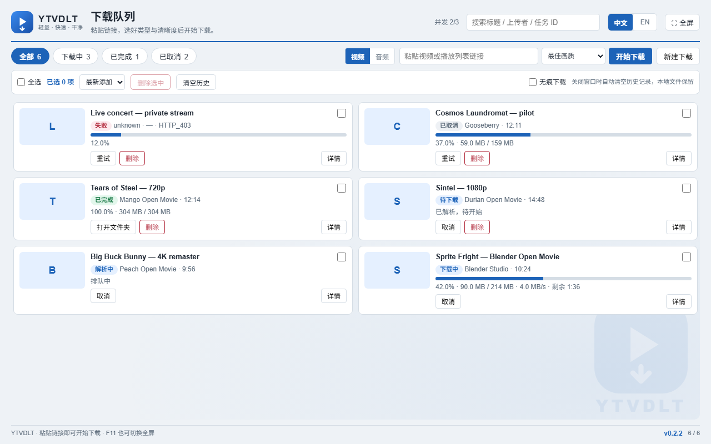
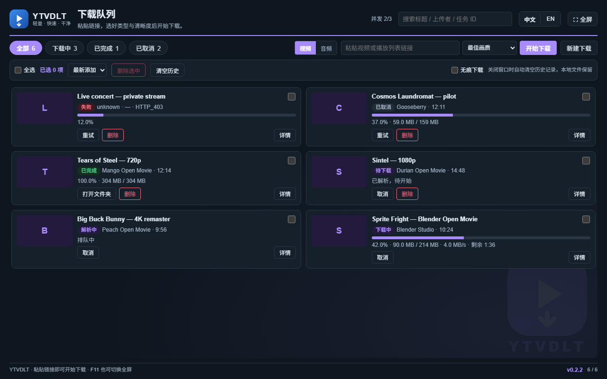
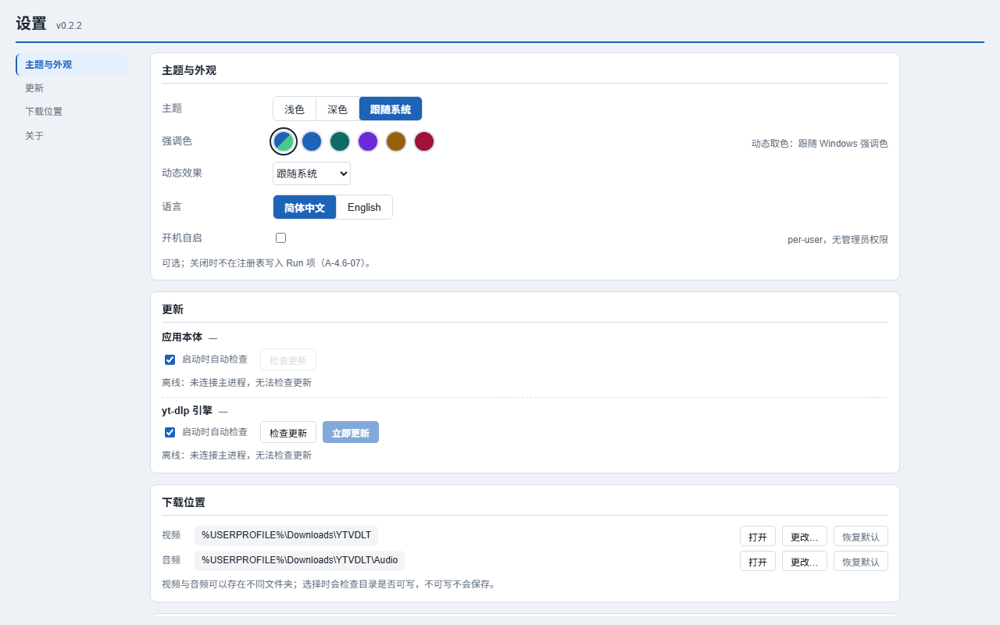
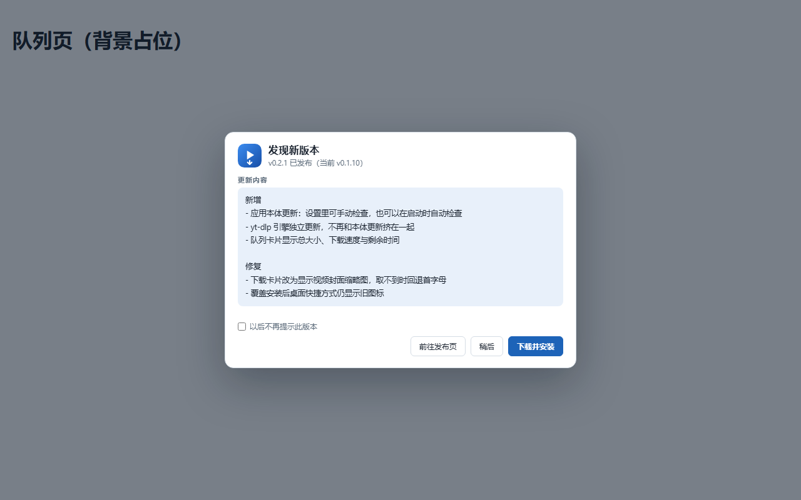

# YTVDLT

**English** · [简体中文](README.zh-CN.md)

[](https://github.com/yechenliao0820/YTVDLT/releases)


A focused Windows desktop downloader for video and audio. **Install it and it
works**: `yt-dlp`, FFmpeg and the Node.js runtime ship inside the installer, so
there is no Python / Node / FFmpeg setup, no PATH editing and no "engine not
found" dialog on first launch.

- Platform: Windows 10 (1809+) / Windows 11, x64
- Shell: Electron 45, TypeScript; the renderer is plain HTML/CSS/JS with **zero
  runtime dependencies**
- Download engine: bundled `yt-dlp`, verified and replaceable at runtime

## Screenshots

| Download queue | Dark theme |
|---|---|
|  |  |

| Settings — section list follows the scroll | Update dialog — release notes from GitHub |
|---|---|
|  |  |

## What it is

An Electron shell that does three things and nothing else: it orchestrates a
queue, it renders a static UI, and it supervises `yt-dlp` as a child process.
The interesting part is the boundary:

- `packages/core` is pure TypeScript — it may **not** import `node:fs`,
  `node:child_process` or `electron`; every external capability arrives through
  an injected port.
- `packages/engine-ytdlp` builds argv, parses progress lines and validates
  artifacts; network and disk still come from ports.
- `packages/ui` is a dependency-free static page set; it talks to the main
  process through one whitelisted `contextBridge` surface.

That is what makes the queue logic, the progress parser, the update decision
path and the error mapper testable offline, against an in-memory filesystem.

## Features

### Downloading

- Paste a link, choose **video** or **audio**, pick a resolution preset
  (best / 2160p / 1440p / 1080p / 720p / 480p / 360p / lowest) or an audio
  bitrate (192 / 128 / 64 / 32 kbps, with optional MP3 or M4A transcode).
- Live progress that actually says something: percentage, downloaded / total
  size, transfer speed and remaining time — each shown only when the engine can
  report it.
- Cancel, retry, open folder, multi-select, sort, bulk delete (files go to the
  **Recycle Bin**, never `rm -rf`) and clear history.
- Playlist import with per-entry selection — a 200-item playlist is a batch, not
  a surprise.

### Output you can trust

- Subtitle selection, embedding, language filters and container conversion.
- After every download the artifact is verified: byte-level checks, `ffprobe`,
  full decode, duration tolerance and stream integrity. A truncated file is
  reported as a **failure**, not as "completed".
- Per-task detail and log pages, plus a copyable error report with the media URL
  redacted.

### Comfort

- Cover thumbnails, cached locally (the renderer never receives a remote media
  URL).
- Light / dark / follow-system theme, accent colours, reduced-motion support.
- Chinese and English UI, switchable at runtime.
- Private mode: clears the task history when the window closes, and never
  touches your files.
- Download location picker: video and audio can live in different folders; the
  chosen folder is checked for write access **before** it is saved.
- Settings organised in panes, with a section list that follows the scroll and
  jumps on click.

### Staying current

Two independent update paths, on purpose — a stale engine breaks every download
while the app itself is fine.

| | App | yt-dlp engine |
|---|---|---|
| Source | GitHub Releases of this repository | official yt-dlp release feed |
| Check | on startup (toggle), 6 h throttle, or manually | on startup (toggle), 24 h throttle, or manually |
| Verify | size + SHA-256 (when published) + `MZ` header | `SHA2-256SUMS` |
| Apply | download the installer, then **you** confirm the NSIS wizard | atomic `.new` → rename, rollback to `.bak` on mismatch |
| Skip | "don't remind me about this version" | — |

The app never installs silently and never replaces a working binary before the
new bytes have been verified.

## Requirements

- Windows 10 1809+ or Windows 11, x64
- No Python, Node.js, FFmpeg or `PATH` setup — the runtime is bundled

## Install

1. Open [Releases](https://github.com/yechenliao0820/YTVDLT/releases) and download
   `YTVDLT Setup <version>.exe`.
2. The installer is **not code-signed**, so SmartScreen warns once:
   *More info → Run anyway*.
3. Launch, paste a link, press **Paste & parse**. Files land in
   `%USERPROFILE%\Downloads\YTVDLT` unless you change it in Settings.

## Where things go

| What | Path |
|---|---|
| Default downloads | `%USERPROFILE%\Downloads\YTVDLT` and `…\YTVDLT\Audio` |
| Config / logs (writable install dir) | `<exe folder>\config\config.json`, `<exe folder>\logs\app-YYYYMMDD.jsonl` |
| Config / logs (read-only install, e.g. `C:\Program Files`) | `%APPDATA%\YTVDLT\config\…` |
| Cover cache / downloaded updater | `%APPDATA%\YTVDLT\thumbs\…`, `%APPDATA%\YTVDLT\updates\…` |

## Build from source

Requires Node.js 22 and pnpm 9.

```bash
pnpm install
pnpm typecheck                 # 5 workspace packages
npm test                       # vitest + v8 coverage (gate 70%)
node scripts/run-e2e.mjs       # screenshot/DOM baselines + deliberate negative checks
node scripts/handoff-check.mjs # reconciles doc numbers with the repo

node scripts/build-desktop.mjs # bundle main + preload, copy the renderer
CSC_IDENTITY_AUTO_DISCOVERY=false ./node_modules/.bin/electron-builder \
  --config apps/desktop/electron-builder.yml \
  --config.directories.buildResources=apps/desktop/build \
  --config.directories.output=dist-<version> \
  -c.extraMetadata.main=apps/desktop/dist/main/main.cjs \
  -c.electronDist=node_modules/electron/dist \
  --win nsis
```

Four of those flags are not decoration:

| Flag | Why it is required |
|---|---|
| `--config apps/desktop/electron-builder.yml` | the config is not at the repo root |
| `--config.directories.buildResources=apps/desktop/build` | otherwise electron-builder falls back to the stock Electron icon |
| `-c.extraMetadata.main=apps/desktop/dist/main/main.cjs` | the root `package.json` has no `main` (it is also the workspace root) |
| `-c.electronDist=node_modules/electron/dist` | reuses the unpacked Electron, so a flaky CDN cannot break the build |

**Build order matters**: `build-desktop.mjs` must run before `electron-builder`,
otherwise the asar contains the previous frontend. `electron-builder` also
rewrites the root `package.json` in place — restore it afterwards.

## Project layout

```
apps/desktop/          Electron shell: main process, preload, packaging config
packages/shared/       pure types + IPC contract (no node:*, no electron)
packages/core/         pure logic: queue, verification, config, error mapping
packages/engine-ytdlp/ yt-dlp adapter: argv, progress parsing, artifacts
packages/ui/           zero-dependency static renderer (pages/styles/i18n)
scripts/               build, test, acceptance, smoke-test drivers
docs/                  decisions, maintenance manual, per-milestone reports
```

The dependency direction is one-way and enforced by `scripts/check-layering.mjs`:

```
ui  ←  preload  ←  apps/desktop
        ↑
   shared  ←  core  ←  engine-ytdlp
```

## Documentation

| Want to know | Read |
|---|---|
| How to change something, where, and how to verify it | [`docs/AI-MAINTENANCE.md`](docs/AI-MAINTENANCE.md) |
| What each release changed | [`docs/CHANGELOG.md`](docs/CHANGELOG.md) |
| Why a decision was made (numbered D-xx records) | [`docs/DECISIONS.md`](docs/DECISIONS.md) |
| Build environment and packaging pitfalls | [`docs/BUILD.md`](docs/BUILD.md) |
| Acceptance criteria and evidence | [`docs/ACCEPTANCE.md`](docs/ACCEPTANCE.md) |
| Artifact history and retired builds | [`docs/BUILD-HISTORY.md`](docs/BUILD-HISTORY.md) |

## Third-party components

| Component | License | How it is used |
|---|---|---|
| [yt-dlp](https://github.com/yt-dlp/yt-dlp) | Unlicense | separate process, replaceable |
| FFmpeg / ffprobe | LGPL-3.0 | dynamically linked shared build |
| aria2c | GPL-2.0-or-later | separate process, optional segment downloader |
| Electron / Node.js | MIT | application shell and runtime |

Full texts and compliance notes: [`docs/THIRD_PARTY_NOTICES.md`](docs/THIRD_PARTY_NOTICES.md).
This project's own license does not alter those terms.

## License

**YTVDLT Non-Commercial License 1.0** — see [`LICENSE`](LICENSE).

- Free for **non-commercial** use: personal study, research, teaching, charity.
- You may read, modify and redistribute the code, provided the license and
  attribution stay intact and modified versions are clearly marked.
- Commercial use requires prior written permission from the author.
- This is **source-available**, not OSI open source; it is **not** MIT.

## Disclaimer

YTVDLT is a front-end for `yt-dlp`. You are responsible for what you download,
for complying with the terms of service of the sites you use, and with applicable
copyright law. The project does not circumvent DRM and does not host or
distribute any media.

<details>
<summary>Repository history</summary>

The original `.git` (development history from 2026-11-05 to 11-07) was lost in a
directory-migration accident on 2026-11-07, with no remote copy to restore from.
This repository is a rebuild: the code and documentation are complete, but the
commit hashes do not match the original history. Recovered commit references are
documented in [`docs/GIT-HISTORY-RECOVERED.md`](docs/GIT-HISTORY-RECOVERED.md).

</details>
