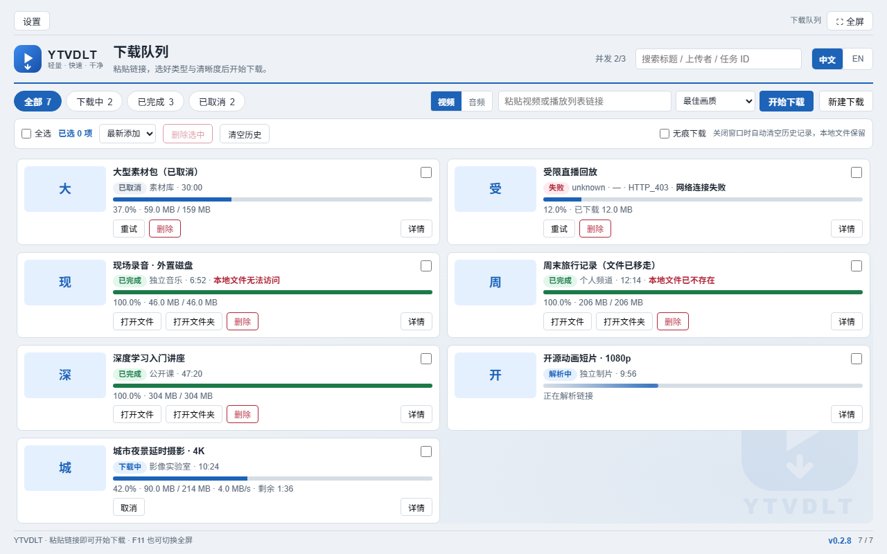
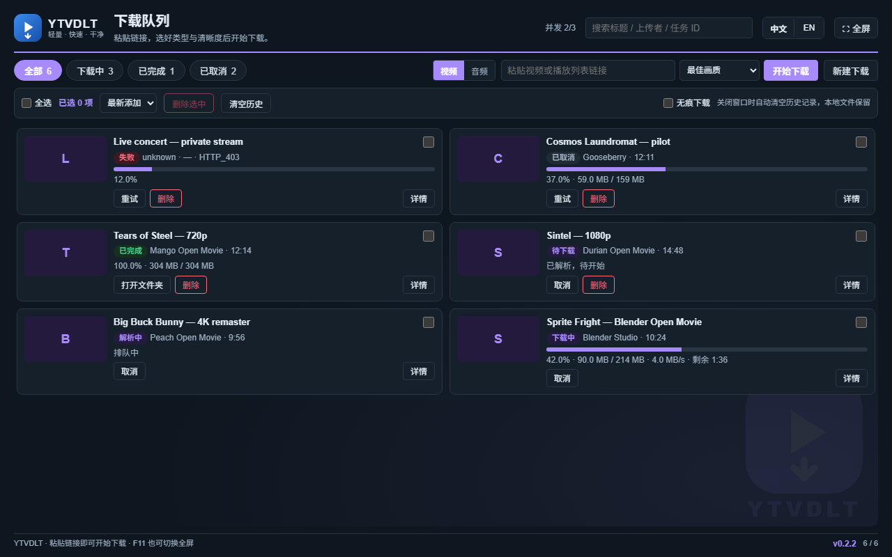
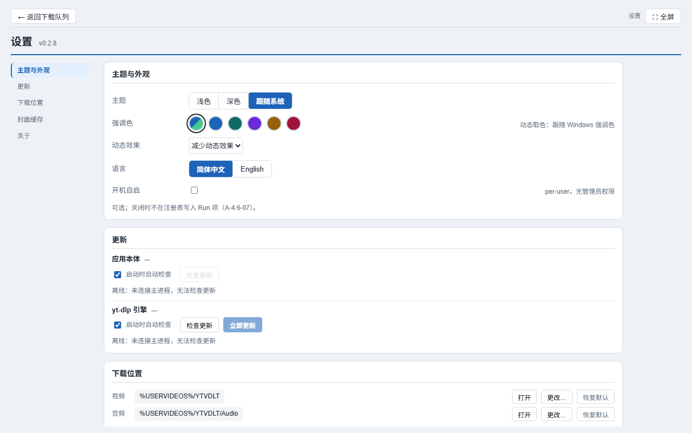
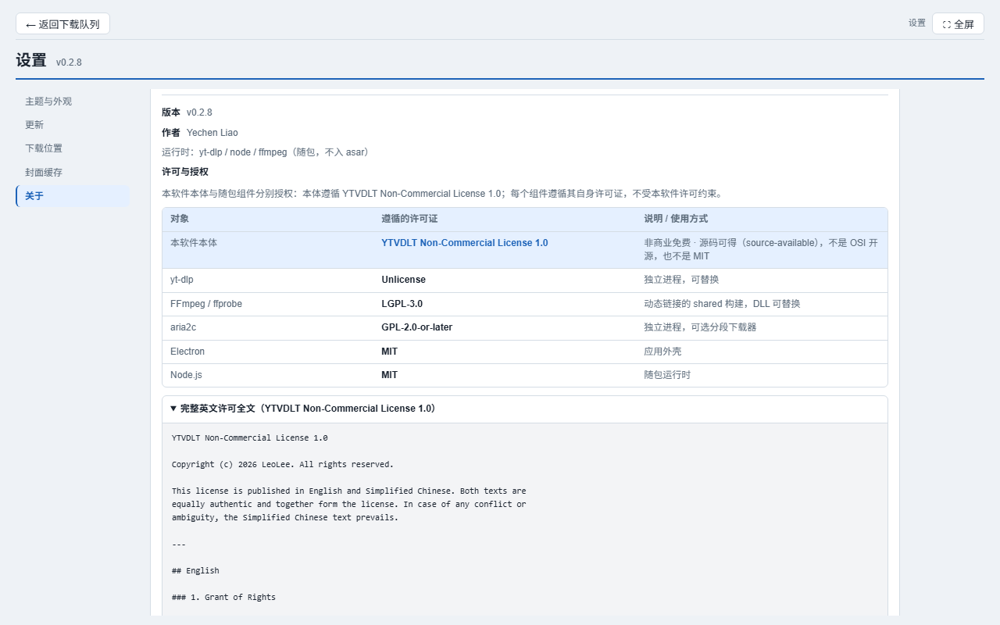
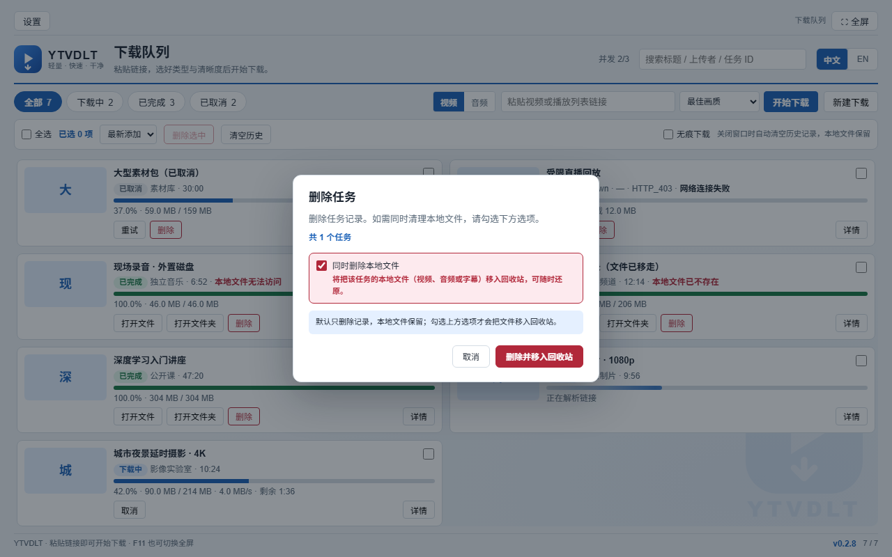
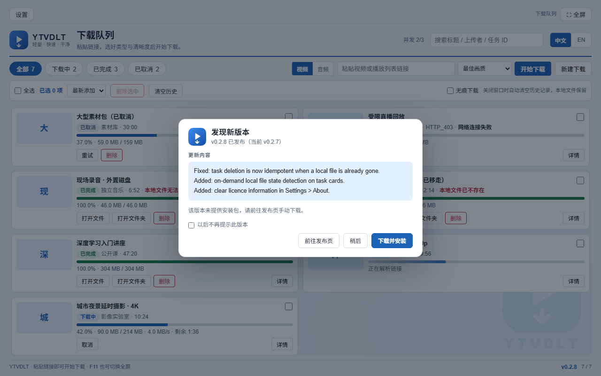
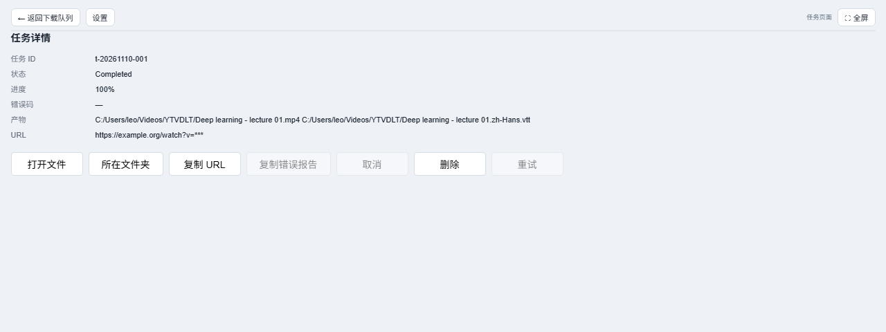

# YTVDLT

[English](README.md) · **简体中文**

[](https://github.com/yechenliao0820/YTVDLT/releases)


Windows 桌面视频 / 音频下载器。**装上就能用**：`yt-dlp`、FFmpeg、Node.js 与
aria2c 全部随包，不需要预装 Python / Node / FFmpeg，不用配 `PATH`，也不会在
首次启动时弹「找不到引擎」。

- 平台：Windows 10（1809+）/ Windows 11，x64
- 外壳：Electron 45 + TypeScript；渲染层是纯 HTML/CSS/JS，**零运行时依赖**
- 下载引擎：随包 `yt-dlp`，可校验、可在运行时替换
- 可维护性：单向分层约束让全部队列逻辑都能离线测试

## 最新版本 — 0.3.0

| | |
|---|---|
| 发布日期 | 2026-11-12 |
| 安装包 | `YTVDLT.Setup.0.3.0.exe` —— NSIS 安装版，Windows x64，226,282,986 B |
| SHA-256 | `5d93f92307e3b91ac72e5fa372332caa8766e265d0709254dd87d38287940af3` |
| 标签 / 发版基准 | `v0.3.0` |
| 下载 | [Release 0.3.0](https://github.com/yechenliao0820/YTVDLT/releases/tag/v0.3.0) · [全部版本](https://github.com/yechenliao0820/YTVDLT/releases) |

**0.3.0 改了什么** —— 第一个把 0.2.9 之后全部工作带上安装包的版本：字幕链路、
TXT 与播放列表批量导入、最低画质修复（`-S +res`）、有界子进程输出、动态「支持的
网站」与 URL 六态预检、HTTP / IPC / 子进程终止的边界加固，以及两条新的界面路径
——入队前可见并可确认的预检，与设置页的命令模板（D-124…D-139）。

安装包**未做代码签名**，首次运行 SmartScreen 会提示一次。

## 截图

以下图片全部由**真实 UI 页面**在无头 Chromium 中重新渲染生成，尺寸
1280×800（任务详情页为 1280×480）。任务行是注入真实渲染层的代表性示例数据
（与 E2E 用例同一机制），因此一张图里能同时看到下载中、解析中、已完成、
已取消、失败，以及两种本地文件状态提示。（后来新增的「支持的网站」面板只在
live 模式下注入，所以不会出现在这些静态截图里。）

| 下载队列 —— 浅色主题（中文），含文件状态提示 | 下载队列 —— 深色主题（英文） |
|---|---|
|  |  |

| 设置 —— 分区目录跟随滚动 | 设置 → 关于 —— 许可表格与英文许可全文 |
|---|---|
|  |  |

| 删除确认 —— 清理文件需显式勾选 | 更新弹窗 —— 说明来自 GitHub Release |
|---|---|
|  |  |

| 任务详情 —— 产物、状态与七项操作 |
|---|
|  |

仓库的社交预览图也同步更新为 1280×640（`docs/assets/social-preview.png`）。

重新生成：`node scripts/capture-readme-shots.mjs`（只写 `docs/assets/*.png`，
不碰 git 与 E2E 基线）。

## 它是什么

一个只做三件事的 Electron 外壳：编排队列、渲染静态界面、把 `yt-dlp` 当子进程
管起来。真正有意思的是分层边界：

- `packages/core` 是纯 TypeScript，**禁止** import `node:fs`、
  `node:child_process`、`electron`；所有外部能力都通过注入的 port 进来。
- `packages/engine-ytdlp` 负责拼 argv、解析进度行、校验产物；网络与磁盘仍然
  来自 port。
- `packages/ui` 是一组零依赖静态页面，只通过一个白名单 `contextBridge` 与主
  进程通信；渲染层**不碰文件系统**。
- `apps/desktop/src/main/adapters/` 才是真正接入 `node:*` 与 Electron 能力的地方。

也正因为这条边界，队列逻辑、进度解析、更新判定、错误映射与本地文件状态探测
都能用内存文件系统离线测试。`scripts/check-layering.mjs` 强制这条约束。

## 功能

### 下载

- 粘贴链接，选**视频**或**音频**，再选分辨率档位（best / 2160p / 1440p /
  1080p / 720p / 480p / 360p / lowest）或音频码率（192 / 128 / 64 / 32 kbps，
  可转 MP3 / M4A）。**最低画质重新变成一个真选项**：它按**相对排序**向引擎要
  最小的流，而不是把某个数字钉死——所以只有 480p 的源就取 480p，纯音频源也
  不会凭空长出一条视频流。（D-133）
- 批量导入：粘贴 TXT 清单（一行一个 URL）或播放列表链接。播放列表会实时解析、
  预览条目并默认全选，一次确认生成 N 个独立任务；每条都能单独取消 / 重试。
  （D-129、D-130）
- **「支持的网站」读的是你自己那个引擎。** 面板列出随包 `yt-dlp` 实际报告的
  内容（`--list-extractors`）——站点数、子提取器数、引擎版本——支持搜索、排序、
  刷新与分页。**刻意不做兜底名单**：读不到引擎就如实说明，绝不编造站点名。
  `GenericIE` 单独说明，因为它会认领任何 http(s) URL。（D-134）
- **URL 入队前的支持状态预检。** 提交时由同一个引擎判定
  `SUPPORTED` / `UNSUPPORTED` / `NO_MEDIA` / `INDETERMINATE` / `TIMEOUT` /
  `CANCELLED` 六种状态，**只有「明确不支持」才拦截**；其余一律放行，真失败时
  按引擎自己更准确的错误失败。一个「页面里没有视频」不会被报成「站点不支持」。
  单链接输入框会在**创建任务之前**先问引擎：明确拒绝用界面语言显示；预检
  未确认（无媒体 / 不确定 / 超时）会先问「是否仍要加入队列」，不再静默入队。
  **预检现在可以取消**：单链接输入框提供停止按钮，TXT / 播放列表批量导入显示
  「已检查 / 总数」并带取消操作。取消会终止引擎子进程，且**一个任务都不入队**，
  批量结果明确标记「已取消」。（D-134、D-139、D-156）
- 真实文件名：不再隐式启用 `--restrict-filenames`，中文标题、空格与标点得以
  保留；存量配置经 schema v1 → v2 自动迁移。重复下载会另存为独立的
  ` (1)` / ` (2)` 副本，不再误报 `ALREADY_DOWNLOADED`。（D-110、D-101）
- 进度不只是百分比：已下载 / 总大小、实时速度、剩余时间；引擎报不出来的字段
  单独隐藏，不拿 0 冒充。未知百分比保持不确定动画，真正的 `0` 仍显示
  `0.0%`。（D-107、D-111、D-112）
- 默认使用 yt-dlp 自带下载器。可选的外部 aria2c 会让 yt-dlp 完全不输出进度
  模板：A/B 实测同一条 17.6 MB 视频 aria2c **0 行**、原生 **6 行**；一段
  14 分 56 秒的 1080p HLS 分别为 89 秒与 24 秒（3.7 倍）。这是该视频与该
  测试环境下的结果，不代表所有站点都能获得同样提升。
- 有活动任务时队列每 400 ms 轮询，只就地更新数字，缩略图不闪烁；空闲时回到
  1.2 s。（D-112）
- **命令模板。** 在「设置 → 命令模板」保存一组命名的 yt-dlp 参数（每行一个），
  也可以删除。每个参数都由主进程按**正向白名单**校验——`--exec`、
  `--config-locations`、`--cookies-from-browser` 这类危险选项会被拒绝，而不是
  被信任。暂未提供就地编辑入口；底层 store 已支持。（D-139）
- 取消、重试、打开文件、打开文件夹、多选、排序、批量删除、清空历史。

### 产物可信

- 字幕语言过滤、自动字幕、嵌入与独立字幕文件，由下载计划落到 yt-dlp 参数。
- 每次下载后逐个校验产物：字节级检查、`ffprobe`、全解码、时长容差、流完整性。
  截断的文件会被判**失败**，而不是「已完成」。
- 到 100% 不代表结束：合并、后处理、校验都作为真实阶段显示（「合并视频中」/
  「整理中」），只有校验通过才出现绿色满条。（D-115）
- 任务详情页与日志页；错误报告可一键复制，其中的链接已脱敏。失败卡片还带一句
  普通用户能读懂的原因，例如「网络连接失败」。（D-109）

### 本地文件与任务生命周期

这是 0.2.8 的重点。任务历史记录与磁盘上的文件是两件事：

- **删除幂等**：`ENOENT` / `ENOTDIR` 表示本地清理已经完成，历史记录照常删除。
  文件占用、权限不足、磁盘不可用等错误**不会被吞掉**：记录保留，并回报真实
  的 OS 原因。（D-120）
- **不误伤其它任务**：若另一个在册任务仍引用同一物理文件，该文件跳过回收，
  不因删除一条记录而被删掉。删除范围绝不超出引擎为该任务登记的路径。
- **按需文件状态检测**：只检测已完成任务，只按记录里的产物路径 `stat`，
  **不扫描目录**。结果缓存 1.5 s，在加载、重新进入页面、点击打开操作时强制
  重查。状态分为 `present / missing / inaccessible / unavailable / invalid`。
- **反馈准确**：文件不存在不影响打开原文件夹；磁盘临时故障不会被误判成
  「用户删了文件」。卡片只加一句轻量提示，保留「已完成」徽章，不隐藏卡片、
  不自动删除历史。（D-120）
- 文件一律经 `shell.trashItem` 移入**回收站**，绝不 `rm -rf`。

### 使用体验

- 视频封面本地缓存：持久索引、可配置上限（128 MiB / 500 个文件 / 30 天）、
  自动清理、在用封面保护；被清理的封面同样进回收站。（D-103）
- 全局导航栏、全屏单一真相（菜单 F11 与界面按钮共用）、浅色 / 深色 / 跟随
  系统、强调色、减少动态效果、主窗口响应式布局。冻结截图页面仍保持固定的
  1280×800 画幅。（D-106）
- 中英文界面运行时切换，共用同一套键表。
- 无痕模式：关闭窗口时清空任务历史，**不动本地文件**。
- 下载位置可选：视频与音频可分别存放；选完先探测目录是否可写，不可写就不保存。
- 设置页按分区组织，左侧目录跟着滚动高亮，点一下就跳过去；设置 → 关于按
  层级列出许可信息。
- 版本号由主进程 `APP_INFO` 提供；页面跳转与语言切换不再丢版本，无法确认时
  显示 `v—` 而不是一个看似合理的旧号。（D-114）
- **首次启动跟随系统语言**：简体、繁体或任何中文系统默认中文界面，其余默认
  英文；识别结果立即持久化——之后每次启动都读保存的值，只有你在设置里手动
  切换才会变。（D-147）界面字典目前是简体中文 + 英文两套，繁体系统显示简体
  文案。
- **「觉得这个版本怎么样？」**：同一版本第 3 次启动、且没有进行中的任务时，
  会温和地问一次，喜欢就去 GitHub 点个 Star。每个版本最多出现 2 次，可以
  「以后再说」或「不再提醒」；升级到新版本才会重新问起。（D-148）

### 保持最新

更新刻意分成两条独立路径——引擎过旧会让所有下载失效，而软件本体可能完全正常。

| | 应用本体 | yt-dlp 引擎 |
|---|---|---|
| 来源 | 本仓库的 GitHub Releases | yt-dlp 官方发布源 |
| 检查 | 启动时（可关）、6 小时节流、或手动 | 启动时（可关）、24 小时节流、或手动 |
| 校验 | **复用缓存前**与**启动安装前**都重新计算 SHA-256；基准取发布 `digest` 或 `.sha256` sidecar，两者都没有就拒绝复用、重新下载 | `SHA2-256SUMS` |
| 应用 | 下载安装包，**由你**确认 NSIS 向导 | `.new` 原子替换，校验不过回滚 `.bak` |
| 忽略 | 「以后不再提示此版本」 | — |

可疑文件只改名隔离，绝不永久删除；软件本体从不静默安装。安装包就绪后按钮会
变成「立即安装」并真正发 `install`，不再回到 `download` 的循环。（D-104、D-119）

更新弹窗说明的是**你跳过的整段区间**：读发布列表，把「当前版本 → 待装版本」
之间的每个版本都留下，按版本号从旧到新一版一块。所以 0.2.8 升 0.3.0 时，
0.2.9 改了什么、0.3.0 又改了什么都能读到，而不是只看到一段引用着某个你从未
运行过的版本的正文。（D-140）

### 已知限制

如实列出，不粉饰：

- 播放列表批量入口已接通真实链路（实时预览 → 默认全选 → 一次确认 → N 个独立
  任务）；M3 遗留的「播放列表选择」对话框与逐格式选择器仍为 fixture 预览，
  不参与生产批量。
- 安装包未签名；错误报告里仍可能出现 `Engine: unknown`；后处理阶段没有速度 /
  剩余时间，因为引擎不报。
- 「支持的网站」面板与 URL 预检已在真实引擎上做过**离线与在线**验证：2026-11-12
  的两轮在线审计覆盖专用提取器、两种 GenericIE 页面、无媒体页、年龄限制视频与
  不可用视频，**误报 0 项**；「最低画质」在 144/240/360/480/720/1080 六档源上
  实际落到 **144p**（最低档）。**仍未**在真机 Electron 窗口点选验证、未做安装包
  验收。DNS 重绑定防护已闭合（D-143）：每条出站连接都钉在策略校验过的解析地址
  上，每次重定向重新解析、重新校验；残余局限（如解析器本身被控持）见 D-143
  「未覆盖」。边界加固沿革见 `DECISIONS.md` D-137 / D-138 / D-143。
- 应用更新每次下载整包（无差量），便携版不参与自更新。
- 不宣称覆盖所有真实设备与所有视频网站；下面的验证数字是自动化测试结论，
  不是真机全量试用。

完整清单见 [`docs/AI-MAINTENANCE.md`](docs/AI-MAINTENANCE.md) §10。

## 版本演进 — 0.2.2 → 0.3.0

四天九个版本。主线从界面打磨，走到下载核心的正确性，再走到「文件在应用之外
被移动或删除」这类边界情况。

| 版本 | 日期 | 重点 | 决策 | Release |
|---|---|---|---|---|
| 0.2.2 | 2026-11-08 | 设置页分区与滚动目录、等待动画、重复下载另存 `(1)` 副本、README 拆分中英 | D-99…D-102 | [v0.2.2](https://github.com/yechenliao0820/YTVDLT/releases/tag/v0.2.2) |
| 0.2.3 | 2026-11-09 | 缩略图缓存清理、更新器 SHA-256 复验、E2E 浏览器自动发现 | D-103…D-105 | [v0.2.3](https://github.com/yechenliao0820/YTVDLT/releases/tag/v0.2.3) |
| 0.2.4 | 2026-11-09 | 全局导航 / 全屏 / 主题 / 响应式、真实进度、失败简报、启动流程审计 | D-106…D-109 | [v0.2.4](https://github.com/yechenliao0820/YTVDLT/releases/tag/v0.2.4) |
| 0.2.5 | 2026-11-09 | 中文文件名恢复、去掉默认 aria2c 恢复进度、400 ms 轮询与局部更新 | D-110…D-112 | [v0.2.5](https://github.com/yechenliao0820/YTVDLT/releases/tag/v0.2.5) |
| 0.2.6 | 2026-11-09 | `APP_INFO` 版本真相、下载后处理阶段、更安全的删除确认、默认视频库、任务级临时文件隔离 | D-114…D-118 | [v0.2.6](https://github.com/yechenliao0820/YTVDLT/releases/tag/v0.2.6) |
| 0.2.7 | 2026-11-09 | 更新器安装状态机、卡片按钮高度随窗口适配 | D-119 | [v0.2.7](https://github.com/yechenliao0820/YTVDLT/releases/tag/v0.2.7) |
| 0.2.8 | 2026-11-10 | 幂等删除、按需本地文件状态检测、许可分层与完整英文许可全文 | D-120 / D-121 | [v0.2.8](https://github.com/yechenliao0820/YTVDLT/releases/tag/v0.2.8) |
| **0.2.9** | **2026-11-10** | 可编辑区域原生右键编辑菜单、设置页占位符显示 `—` 而非虚构路径 | D-122 / D-123 | [v0.2.9](https://github.com/yechenliao0820/YTVDLT/releases/tag/v0.2.9) |
| 0.3.0 | 2026-11-12 | 字幕链路、TXT / 播放列表批量导入、引擎输出硬上限、动态「支持的网站」与 URL 六态预检、HTTP / IPC / 子进程终止边界加固、命令模板 | D-124…D-139 | [v0.3.0](https://github.com/yechenliao0820/YTVDLT/releases/tag/v0.3.0) |

0.3.0 已发布。叠在它之上、**尚未发版**的工作——「跨版本更新说明」修复
（D-140，见上方「保持最新」）、live 模式假数据防线（D-141）、取消失败不再谎报
Error（D-142），以及外部审计四项修复：出站连接 DNS 钉扎（D-143）、下载输出
有界化（D-144）、配置「原子写入」真替换（D-145）、详情页取消按钮对齐（D-146）
——记在
[`docs/CHANGELOG.md`](docs/CHANGELOG.md) 与
[`docs/DECISIONS.md`](docs/DECISIONS.md)（已到 D-146）。

版本流水见 [`docs/CHANGELOG.md`](docs/CHANGELOG.md)，每条决策的现象 / 根因 /
取舍 / 验证见 [`docs/DECISIONS.md`](docs/DECISIONS.md)。

## 工程质量与验证

0.2.8 的发布门禁：

| 门禁 | 结果 |
|---|---|
| `pnpm typecheck` | 5/5 工作区包通过 |
| 单元 / 契约 / 集成测试 | 1152 项通过（新增 88 项，覆盖删除逻辑矩阵与文件状态场景） |
| `node scripts/run-e2e.mjs` | 31/31 截图 + DOM 用例，5/5 反例检查 |
| 截图像素偏差 | 0 px（许可区块改动后按 case 重建两个 DOM 基线，未覆盖任何 PNG 基线） |
| `check-layering` / `frozen-gate` | 0 违规 / 通过 |

0.3.0 那批工作（字幕、批量导入、播放列表批量、「支持的网站」、URL 预检、命令
模板，以及 D-137 / D-138 的安全边界加固）单独过了这些门禁：

| 门禁 | 结果 |
|---|---|
| `pnpm typecheck` | 5/5 工作区包通过 |
| 单元 / 契约 / 集成测试 | **138 个文件 1829 项通过 / 2 项跳过，0 失败** |
| 覆盖率 | 语句 88.7% / 分支 86.7% / 函数 92.0% / 行 88.7%（门槛 70，未上调） |
| 截图 E2E | 31/31 用例 + 5/5 反例；只按 case 重建了两个设置页基线（PNG + DOM），其余 58 个基线文件逐字节不变 |
| `check-layering` / `frozen-gate` / `request.ts` 冻结 | 0 违规 / 通过 / 逐字节一致 |
| 引擎自述取证 | 「有哪些解析器」与「失败怎么分类」都从随包 `yt-dlp` 读回，**不来自任何入库的清单** |

0.3.0 之后的审计与修复轮（D-140…D-146，尚未发版）同样过了这些门禁：

| 门禁 | 结果 |
|---|---|
| 类型检查 | 5/5 工区包通过（逐包 `tsc --noEmit`） |
| 单元 / 契约 / 集成测试 | **132 个文件 1871 项通过，0 失败** |
| 覆盖率 | 语句 88.3% / 分支 86.3% / 函数 91.4% / 行 88.3%（门槛 70，未上调） |
| 截图 E2E | 31/31 用例 + 5/5 反例；**0 px 像素偏差，未重建任何基线**（详情页取消按钮的修正只作用于 live 模式） |
| `check-layering` / `frozen-gate` / `request.ts` 冻结 | 0 违规 / 通过 / 逐字节一致 |

2026-11-13 的审计修复轮（D-150…D-158，尚未发版）补上了可取消的 URL 预检、
任务快照并发写与结构校验、IPv6 公网白名单、stdout 行拼装缓冲上限、组件更新器
网络策略，以及 GitHub Actions CI。同样过了这些门禁：

| 门禁 | 结果 |
|---|---|
| `pnpm typecheck` | 5/5 工作区包通过 |
| 单元 / 契约 / 集成测试 | **139 个文件 2000 项通过，0 失败** |
| 覆盖率 | 语句 89.44% / 分支 86.38% / 函数 92.22% / 行 89.44%（门槛 70，未上调） |
| 截图 E2E | 31/31 用例 + 5/5 反例；**0 px 像素偏差，未重建任何基线** |
| `check-layering` / `frozen-gate` / `request.ts` 冻结 | 0 违规 / 通过 / 逐字节一致 |
| M5 验收 | 10/10 门禁 PASS，allGreen=true |

仓库新增 `ci.yml`：每次推送 `main` 与每个 PR 都跑类型检查、全量测试与覆盖率、
分层守卫和冻结文件门；打包另由手动 workflow 负责。首次推送触发的 run #1 在
干净 runner 上失败，原因是三类资产缺失：两份 `.log` 进度 fixture 被 `*.log`
误伤未入库、随包 `node.exe` / `yt-dlp.exe` 按设计不入库、Windows 检出的 CRLF
与许可测试的 LF 逐字比对不一致。D-157 只补环境（补 fixture、测试前取回运行时、
输入统一 LF），**未放宽任何断言**。后续 D-158 用 `.gitattributes` 把 `.mjs` 钉为 LF——Windows
runner 会把带 shebang 的脚本检出成 CRLF，导致测试收集期语法错。两轮修复都未
改断言；上表数字来自本地实跑。

若要改动代码，这几条不变量值得先知道：

- 文件删除只有一个原语 `shell.trashItem`，适配层不做任何永久 unlink。
- `TASK_LIST` 不返回媒体 URL；渲染层也拿不到远端缩略图 URL，只拿本地缓存路径。
- `packages/core` 不 import 任何 `node:*`，`check-layering.mjs` 会拦。
- 每个 IPC payload 进入 handler 前都经过显式键白名单校验。
- 「支持的网站」名单与 URL 判定都来自**正在运行的那个引擎**，刻意没有写死的
  兜底名单；入队门禁是 **fail open**——只有明确「不支持」才拦截。

以上是该发版构建的自动化结论，不代表所有 Windows 设备、DPI 设置或视频站点
都已实测覆盖。

## 环境要求

- Windows 10 1809+ 或 Windows 11，x64
- 无需 Python / Node.js / FFmpeg，也不用配 `PATH`——运行时随包

## 安装

1. 打开 [Releases](https://github.com/yechenliao0820/YTVDLT/releases)，下载
   `YTVDLT.Setup.<版本>.exe`。
2. 安装包**未签名**，SmartScreen 会拦一次：点「更多信息 → 仍要运行」。
3. 启动后粘贴链接，点「粘贴并解析」。新安装默认保存到 Windows **「视频」库**
   下的 `YTVDLT`（由主进程 `app.getPath('videos')` 解析，跟随 OneDrive / 库
   重定向），音频在其 `Audio` 子目录；存量配置不强制迁移。（D-117）

## 数据落在哪

| 内容 | 路径 |
|---|---|
| 默认下载目录（新安装） | `%USERVIDEOS%/YTVDLT` 与 `…/YTVDLT/Audio`，由主进程运行时展开 |
| 配置 / 日志（安装目录可写） | `<exe 所在目录>\config\config.json`、`\logs\app-YYYYMMDD.jsonl` |
| 配置 / 日志（装到只读目录，如 `C:\Program Files`） | `%APPDATA%\YTVDLT\config\…` |
| 封面缓存 / 下载好的更新包 | `<dataDir>\thumbs\…`、`<dataDir>\updates\…` |
| 任务级工作文件 | `<dataDir>/work/<taskId>/`（与输出同卷）—— `.part`、`.ytdl`、分片索引、产物清单；残留是续传凭据，不是垃圾 |

## 从源码构建

需要 Node.js 22 与 pnpm 9。

```bash
pnpm install
pnpm typecheck                 # 5 个工作区包
npm test                       # vitest + v8 覆盖率（门限 70%）
node scripts/run-e2e.mjs       # 截图/DOM 基线 + 必须失败的反例
node scripts/handoff-check.mjs # 文档数字与仓库现状对账

node scripts/build-desktop.mjs # 打包主进程 + preload，拷贝渲染层
node scripts/capture-readme-shots.mjs  # 可选：重新生成 docs/assets/*.png

CSC_IDENTITY_AUTO_DISCOVERY=false ./node_modules/.bin/electron-builder \
  --config apps/desktop/electron-builder.yml \
  --config.directories.buildResources=apps/desktop/build \
  --config.directories.output=dist-<版本> \
  -c.extraMetadata.main=apps/desktop/dist/main/main.cjs \
  -c.electronDist=node_modules/electron/dist \
  --win nsis
```

其中四个参数不是装饰：

| 参数 | 为什么必须 |
|---|---|
| `--config apps/desktop/electron-builder.yml` | 配置文件不在仓库根 |
| `--config.directories.buildResources=apps/desktop/build` | 否则 electron-builder 会退回 Electron 默认图标 |
| `-c.extraMetadata.main=apps/desktop/dist/main/main.cjs` | 根 `package.json` 没有 `main`（它同时是工作区根） |
| `-c.electronDist=node_modules/electron/dist` | 复用已解压的 Electron，CDN 抖动不会弄坏构建 |

**顺序不能反**：`build-desktop.mjs` 必须先于 `electron-builder`，否则 asar 里
装的是上一版前端。`electron-builder` 也可能就地改写根 `package.json`，打包后
要检查并还原。

## 目录结构

```
apps/desktop/          Electron 外壳：主进程、preload、打包配置
packages/shared/       纯类型 + IPC 契约（禁 node:*、禁 electron）
packages/core/         纯逻辑：队列、校验、配置、错误映射
packages/engine-ytdlp/ yt-dlp 适配：argv、进度解析、产物清单
packages/ui/           零依赖静态渲染层（pages/styles/i18n）
scripts/               构建、测试、验收、截图与烟测驱动
docs/                  决策、维护手册、各里程碑报告
```

依赖方向单向，由 `scripts/check-layering.mjs` 强制：

```
ui  ←  preload  ←  apps/desktop
        ↑
   shared  ←  core  ←  engine-ytdlp
```

## 文档

| 想了解 | 看哪份 |
|---|---|
| 怎么改、改哪里、改完怎么验 | [`docs/AI-MAINTENANCE.md`](docs/AI-MAINTENANCE.md) |
| 每个版本改了什么 | [`docs/CHANGELOG.md`](docs/CHANGELOG.md) |
| 某个决定为什么这么定（编号 D-xx 的决策记录） | [`docs/DECISIONS.md`](docs/DECISIONS.md) |
| 各版本交付口径与已知边界 | [`docs/DELIVERY-REPORT.md`](docs/DELIVERY-REPORT.md) |
| 构建环境与打包的坑 | [`docs/BUILD.md`](docs/BUILD.md) |
| 验收口径与证据 | [`docs/ACCEPTANCE.md`](docs/ACCEPTANCE.md) |
| 产物考据与被淘汰的版本 | [`docs/BUILD-HISTORY.md`](docs/BUILD-HISTORY.md) |
| 随包二进制、版本与许可全文 | [`docs/THIRD_PARTY_NOTICES.md`](docs/THIRD_PARTY_NOTICES.md) |

## 第三方组件

每个组件**各自**遵循其原许可，本项目的许可不改变这些条款。

| 组件 | 许可 | 使用方式 |
|---|---|---|
| [yt-dlp](https://github.com/yt-dlp/yt-dlp) | Unlicense | 独立进程，可替换 |
| FFmpeg / ffprobe | LGPL-3.0 | 动态链接的 shared 构建，DLL 可替换 |
| aria2c | GPL-2.0-or-later | 独立进程，可选的分段下载器 |
| Electron | MIT | 应用外壳 |
| Node.js | MIT | 随包运行时 |

全文与合规说明见 [`docs/THIRD_PARTY_NOTICES.md`](docs/THIRD_PARTY_NOTICES.md)。

## 许可

**YTVDLT 非商业许可 1.0** —— 见 [`LICENSE`](LICENSE)。完整英文文本同时嵌入
在「设置 → 关于」中。

- **非商业**用途免费：个人学习、研究、教学、公益。
- 可阅读、修改、分发代码，但必须保留许可与署名，修改版要显著标注。
- 商业使用需事先取得作者书面授权。
- 属于 **source-available（源码可得）**，不是 OSI 意义的开源，**不是 MIT**。

## 免责声明

YTVDLT 只是 `yt-dlp` 的前端。下载什么、是否遵守所用网站的服务条款与著作权法，
由你负责。本项目不绕过 DRM，不分发也不托管任何媒体内容。

<details>
<summary>仓库历史</summary>

原始 `.git`（2026-11-05 至 11-07 的开发历史）在 2026-11-07 的一次目录迁移事故中
丢失，且无远端副本可恢复。当前仓库为事故后重建：代码与文档完整，但提交哈希与
原始历史不一致。找回的提交线索见
[`docs/GIT-HISTORY-RECOVERED.md`](docs/GIT-HISTORY-RECOVERED.md)。

</details>
