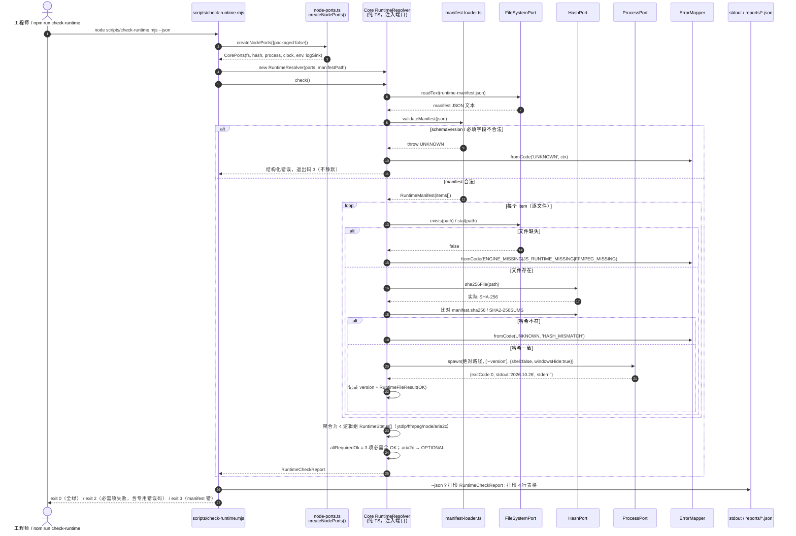
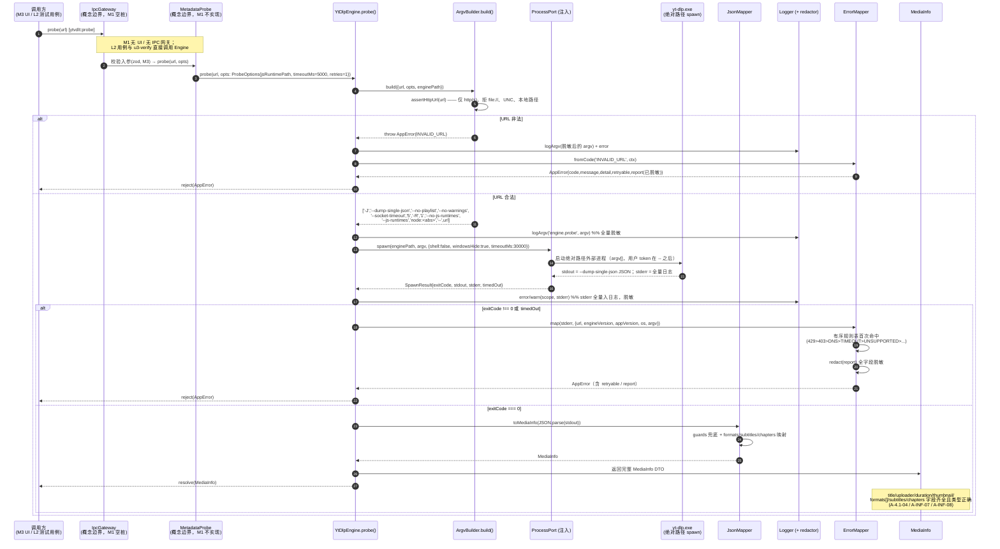
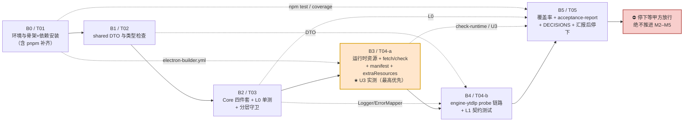

# YTVDLT · M1「骨架与引擎契约」系统设计与任务分解

> **文档类型**：架构设计 + 施工单（给工程师寇豆码直接照做）
> **作者**：高见远（Gao）· 架构师　|　**版本**：v1.0　|　**日期**：2026-11-05
> **权威输入（按优先级）**
> 1. `C:/Users/leolee/WorkBuddy/2026-11-05-07-24-49/YTVDLT_HANDOFF.md`（v1.1，933 行）—— 唯一权威
> 2. `C:/Users/leolee/WorkBuddy/2026-11-05-08-16-08/ytvdlt/docs/PRD-M1.md`（348 行）—— 直接上游输入
> **项目根**：`C:/Users/leolee/WorkBuddy/2026-11-05-08-16-08/ytvdlt`（下称 `ytvdlt/`，本文所有路径均为相对此根的**相对路径**）
> **本文不含业务代码与 UI 代码**；第 3 节的代码块是**接口契约（可直接复制的类型定义）**，第 9.7 节为依赖注入**示意**，均非业务实现。

---

## 0. 硬边界与阅读指引（先看这一节）

| 项 | 结论 |
|---|---|
| **M1 唯一目标** | 立稳「可验证的地基」：monorepo + 分层铁律 + 冻结 DTO/引擎契约 + Core 四件套 + `probe()` 解析链路 + 运行时资源前置 + U3 实测。**不追求任何可见功能** |
| **M1 不写 UI** | HANDOFF §9 禁止事项 7 / PRD §5 / §7-1：`packages/ui` **不建**，不产出页面、组件、线框、视觉稿、主题、托盘 UI、空错态 |
| **M1 汇报后停下** | HANDOFF §0/§8/§10 Step 5：出 M1 汇报（含 17 条断言对照表 + `acceptance-report.json`）后**停下等甲方放行**，绝不推进 M2–M5 |
| **§2 已拍板，不再讨论** | Electron 45.2.2 + React + TS + Vite；`core`/`engine-ytdlp` 纯 TS 零 electron；`DownloadEngine` 接口可替换；仅 Windows x64；全自包含分发；官方 `yt-dlp.exe` 外部子进程。**本文不重新做选型比较、不做竞品调研**（§6.1 已定） |
| **禁止事项** | 不复制 Seal 的 Kotlin/Java 源码或资源；不使用 "Seal" 作产品名/标识；**不输出任何绕过 DRM / 付费墙 / 登录限制 / 地区限制 / 年龄限制的设计，不生成或注入 PO Token，不自动抓取浏览器凭据（永久禁止）**；不字符串拼接命令、不 `shell:true` |
| **M1 必须绿断言（17 条，ID 稳定不改号）** | `A-4.1-03`、`A-4.1-04`、`A-4.4-19`、`A-4.4-30`、`A-4.5-03`、`A-4.5-05`、`A-4.5-09` + `A-INF-01`…`A-INF-10` |
| **M1 五条验收** | ① `npm run check-runtime` 4 项通过 ② fixture 驱动 `JsonMapper` 单测全绿 ③ `probe()` 对本地 fixture 返回完整 `MediaInfo` ④ `ArgvBuilder` 骨架单测覆盖 probe 分支（100%） ⑤ Core 覆盖率 ≥70% |

**文档结构**：Part A（§1–§6）为系统设计；Part B（§7–§10 + 附录）为任务分解与施工约定。工程师**按 §8 的 B0→B5 逐批执行，每批跑通验证命令再进下一批**（HANDOFF §0「不要一次性生成大量未经验证的代码」）。

---

# Part A · 系统设计

## 1. 实现方案与框架落点

### 1.1 一句话地基目标

> **M1 只交付一套「零网络可验证、零 UI、零 electron 依赖泄漏」的类型契约与 Core/引擎骨架，并把 §12.4 的运行时资源与 `extraResources` 提前落地，使后续 M2–M5 只需在此地基上叠加下载闭环、参数分支、UI 与打包，而不必返工。**

### 1.2 §2 已拍板项（本文直接采信，不再讨论）

| 决策项 | 结论 | M1 落地方式 |
|---|---|---|
| 技术栈 | Electron 45.2.2 + React + TypeScript + Vite | M1 只装 Electron/TS/Vitest/Turbo；React/Vite 登记不安装、无 UI |
| 分层铁律 | `packages/core`、`packages/engine-ytdlp` 纯 TS，**零 electron / 零 fs 副作用** | §9.7 端口注入 + §9.6 编译期 `types: []` 强制 + `scripts/check-layering.mjs` 静态守卫 |
| 引擎抽象 | 保留 `DownloadEngine` 接口（可替换） | §3.7 冻结 5 方法签名 + `FakeEngine` 实现同一接口（A-INF-10） |
| 运行时 | 官方 `yt-dlp.exe` + `ffmpeg/ffprobe` + `node.exe`，外部 `spawn(argv[])` | §2.7 资源布局、§4.3 spawn 铁律 |
| 分发 | 全自包含；运行时**不入 asar**，`extraResources` + `app.isPackaged` 双路径 | §2.5 `electron-builder.yml`、§9.1/§9.2 |
| 合规 | 仅下载用户有权保存的公开内容；禁用清单永久不实现 | §4.2 URL 白名单、§4.7 映射表、`CUSTOM_COMMAND_REJECTED` 预留 |

### 1.3 M1 的四个核心技术难点与对策

| # | 难点 | 对策（本文关键架构决策） |
|---|---|---|
| D1 | **Core 必须零 `electron`、零 `fs` 副作用，却要实现 ConfigStore/Logger/RuntimeResolver 这类天然要碰磁盘与进程的组件** | 定义纯类型端口（§3.9 `ports.ts`）→ Core 全部**构造函数注入**，内部绝不 `new` Node 适配 → Node 适配集中在 `apps/desktop/src/main/adapters/node-ports.ts` 唯一文件 → 测试用 `InMemoryPorts` 回放。并用 `packages/core/tsconfig.json` 的 `"types": []` 让 `process`/`Buffer`/`fs` 在**编译期**即不可用，比运行时检查更硬 |
| D2 | **`check-runtime.mjs`（Node 脚本）与 Electron 主进程要共用同一套自检逻辑，却不能各自实现导致口径漂移** | 自检逻辑唯一实现在 `packages/core/src/runtime-resolver/`（纯 TS，注入端口）；`check-runtime.mjs` 通过 `tsx` loader 直接加载该 TS 与 `node-ports.ts`；`apps/desktop/src/main/runtime-resolver.ts` 只负责读 `app.isPackaged` 后组装。二者共享同一份 `runtime-manifest.json` 与 `RuntimeCheckReport` DTO |
| D3 | **运行时二进制约 130 MB + Electron 45 安装，长耗时易单次超时；且 `latest` tag 滚动导致 manifest 不可复现** | `fetch-runtime.mjs` 支持 `--only=<key>` 分项下载/断点/逐项 SHA-256 复核，长任务一律后台执行（§10.6）；manifest 记录**实际解析到的 asset 名/release tag/来源 URL/文件 SHA-256**，并预留固定 autobuild asset 作可复现备选（附录 A、O-01） |
| D4 | **U3（generic extractor 能否解析本地直链）未实测，是 M1 最高优先风险** | 排在 B2 之后、B3 最早实测（§10）；不支持则切 `FakeEngine` 回放，**C1–C12 判据不变**（§10.5）；`YtDlpEngine`/`FakeEngine` 同一接口，工厂切换，生产固定 ytdlp |

### 1.4 框架与库落点（版本基线详见 §7）

| 组件 | 用途 | M1 是否安装 |
|---|---|---|
| pnpm 9 + turbo 2 | monorepo workspace 与任务管道 | ✅ 必需（pnpm 由 corepack 补齐） |
| TypeScript 5.8 | 全量类型；`tsconfig.base.json` 严格模式 + 路径别名 | ✅ 必需 |
| Vitest 3 + @vitest/coverage-v8 3 | L0/L1 测试与覆盖率（阈值四维最低 ≥70%） | ✅ 必需 |
| tsx 4 | 让 `.mjs` 脚本加载 Core 的 `.ts`（check-runtime 共用逻辑） | ✅ 必需 |
| Electron 45.2.2 | 主进程/打包基线；M1 仅安装并建空桩入口 | ✅ 必需（仅基线，不建窗口） |
| Vite 6 | UI/主进程构建（M3 起用）；M1 登记版本、预留配置 | ⚠️ 登记，不装 |
| zod 3 | IPC 入参 schema 校验（M3 `IpcGateway` 使用） | ⚠️ 登记，不装（M1 可选用其校验 fixture） |
| React 19 / MUI / Playwright / electron-updater / electron-builder CLI | M3–M5 UI、E2E、自更新、打包 | ❌ 登记不安装（`electron-builder.yml` 文件 M1 要建，CLI 不装） |

> **架构模式**：分层 + 端口-适配器（Hexagonal 的轻量版） + 纯函数核心。
> `ArgvBuilder` / `JsonMapper` / `redactor` / `ErrorMapper.rules` 全部为**无 I/O 纯函数**（覆盖率与可测性的主要来源）；有 I/O 的 `ConfigStore` / `Logger` / `RuntimeResolver` / `YtDlpEngine` 均为**注入端口的类**。Renderer 侧（M3 起）为 MVVM + 事件订阅，M1 不涉及。

### 1.5 M1 范围边界（做什么 / 不做什么 / 空桩）

| 类别 | 内容 |
|---|---|
| **做** | monorepo 骨架、shared DTO 全套、Core 四件套、engine-ytdlp 的 `probe()`/`ArgvBuilder(probe 分支)`/`JsonMapper`/`FakeEngine`、运行时四件 + manifest + `fetch/check-runtime` 脚本 + `extraResources`、U3 实测、L0/L1 测试与 fixtures、覆盖率报告、`DECISIONS.md`、M1 汇报 |
| **不做** | 任何 UI / 页面 / 组件 / 主题 / 托盘 UI；`download()` 下载闭环、`ProgressParser`、`CancelHandle` 业务实现、`ArtifactVerifier`、`HistoryStore`、`TaskQueue`、`PathResolver`、`probePlaylist()`、`selfUpdate()` 实现、格式/字幕/路径参数分支、L3 在线烟测、NSIS/便携版打包、代码签名 |
| **空桩/占位（建文件、不实现）** | `apps/desktop/src/main/index.ts`、`app-host.ts`、`ipc-gateway.ts`、`src/preload/bridge.ts`；`probePlaylist`/`download`/`selfUpdate` 在 `YtDlpEngine` 中抛 `UNKNOWN` 占位；`Logger.exportLogs()`/`writeCrashReport()` 占位返回；`ConfigStore.export()/import()` 占位（M4 实现） |
| **明确不建** | `packages/ui/**`（整包）、`apps/desktop/resources/**`（icon/licenses，M5）、`scripts/verify-artifact.mjs` / `check-network.mjs` / `gen-notice.mjs`、任何 `.tsx` / `.css` / 视觉稿 |

---

## 2. M1 完整文件清单

> **图例**：`状态` 列 —— `实现`=M1 写完整逻辑；`空桩`=建文件但仅注释/占位；`占位`=数据/配置骨架；`下载产物`=由 `fetch-runtime.mjs` 生成，不手写；`构建产物`=由测试/脚本生成；`只读`=上游已有，不修改。
> **P0 编号** 取自 PRD §2.1（P0-01…P0-18）；**断言 ID** 取自 PRD §3.9（17 条必须绿）。编号 `F###` 连续，便于回传核对条目数。

### 2.1 根配置与工作区（F001–F007）

| # | 相对路径 | 一句话职责 | P0 | 断言 ID | 状态 |
|---|---|---|---|---|---|
| F001 | `package.json` | 根脚本（`check-runtime`/`test`/`test:unit`/`test:contract`/`test:integration:offline`/`typecheck`/`fetch:runtime`）、`packageManager: pnpm@9.15.9`、workspaces 元信息 | P0-02/P0-13/P0-17 | A-INF-01/A-INF-06 | 实现 |
| F002 | `pnpm-workspace.yaml` | 声明 `packages/*`、`apps/*` 四个 workspace 包 | P0-02 | A-INF-01 | 实现 |
| F003 | `turbo.json` | `typecheck`/`test`/`build` 任务管道与依赖（`^typecheck`） | P0-02 | A-INF-01 | 实现 |
| F004 | `tsconfig.base.json` | `strict`/`noUncheckedIndexedAccess`/`exactOptionalPropertyTypes`/`verbatimModuleSyntax`/`ES2022`/`Bundler` + 路径别名 | P0-02 | A-INF-01 | 实现 |
| F005 | `.gitignore` | 忽略 `node_modules/ dist/ coverage/ reports/*.json` 与**运行时二进制**（`*.exe`/`*.dll`/`*.zip`/`ffmpeg/`），保留 manifest/LICENSE/SUMS | P0-02 | A-INF-02 | 实现 |
| F006 | `.npmrc` | pnpm 配置（`strict-peer-dependencies=false`、`auto-install-peers=true`），不启用 hoist 以守住分层 | P0-02 | A-INF-01 | 实现 |
| F007 | `vitest.config.ts` | `environment: node`、路径别名、`coverage: { provider:'v8', include:['packages/core/**','packages/engine-ytdlp/**'], thresholds:{lines:70,branches:70,functions:70,statements:70} }` | P0-17 | A-INF-06 | 实现 |

### 2.2 `packages/shared/src/**`（F008–F018）

| # | 相对路径 | 一句话职责 | P0 | 断言 ID | 状态 |
|---|---|---|---|---|---|
| F008 | `packages/shared/package.json` | 包名 `@ytvdlt/shared`、纯类型导出、`types: []` | P0-02/P0-04 | A-INF-01 | 实现 |
| F009 | `packages/shared/tsconfig.json` | 继承 base；`"types": []`（**禁止 node 类型**） | P0-03 | A-INF-01 | 实现 |
| F010 | `packages/shared/src/index.ts` | 统一 re-export 全部 DTO/接口/常量（A-INF-01 检查点） | P0-04 | A-INF-01 | 实现 |
| F011 | `packages/shared/src/errors.ts` | `ErrorCode` 17 个全枚举 + `AppError` + `RUNTIME_MISSING_CODES` | P0-04/P0-07 | A-4.5-03/A-4.5-05/A-4.5-09 | 实现 |
| F012 | `packages/shared/src/events.ts` | `EngineEvent` 联合、`Artifact`、`CancelHandle`、`UpdateResult`、`EngineStage` | P0-04 | A-INF-10 | 实现 |
| F013 | `packages/shared/src/media.ts` | `MediaInfo`/`PlaylistInfo`/`MediaFormat`/`SubtitleTrack`/`Chapter`/`PlaylistEntry` | P0-04/P0-10 | A-4.1-04/A-INF-08 | 实现 |
| F014 | `packages/shared/src/request.ts` | `DownloadRequest` 五域（`FormatDomain`/`SubtitleDomain`/`PathsDomain`/`NetworkDomain`/`AdvancedDomain`）、`ProbeOptions`、`ProbeRequest` | P0-04/P0-11 | A-INF-05 | 实现 |
| F015 | `packages/shared/src/runtime.ts` | `RuntimeManifest`/`RuntimeItem`/`RuntimeStatus`/`RuntimeFileResult`/`RuntimeCheckReport` schema 类型 | P0-08/P0-15 | A-INF-02/A-INF-04 | 实现 |
| F016 | `packages/shared/src/engine.ts` | `DownloadEngine` 5 方法接口（**可替换性硬要求**） | P0-04 | A-INF-10 | 实现 |
| F017 | `packages/shared/src/ipc.ts` | `IPC_CHANNELS` 常量（白名单 channel 名，M1 仅冻结常量不实现网关） | P0-04 | A-INF-01 | 实现 |
| F018 | `packages/shared/src/ports.ts` | **纯类型端口** `FileSystemPort`/`HashPort`/`ProcessPort`/`ClockPort`/`EnvPort`/`LogSinkPort`（Core 零 fs 副作用的地基） | P0-03/P0-05 | A-INF-01 | 实现 |

### 2.3 `packages/core/src/**`（F019–F035）

| # | 相对路径 | 一句话职责 | P0 | 断言 ID | 状态 |
|---|---|---|---|---|---|
| F019 | `packages/core/package.json` | 包名 `@ytvdlt/core`、仅依赖 `@ytvdlt/shared` | P0-02/P0-03 | A-INF-01 | 实现 |
| F020 | `packages/core/tsconfig.json` | 继承 base；`"types": []`；**不含** `@types/node`/`electron` | P0-03 | A-INF-01 | 实现 |
| F021 | `packages/core/src/index.ts` | 导出四件套 + 端口重导出 | P0-04 | A-INF-01 | 实现 |
| F022 | `packages/core/src/ports.ts` | 端口组合类型 `CorePorts` 与工厂签名 `checkRuntime(ports, manifest)` 声明 | P0-03 | A-INF-01 | 实现 |
| F023 | `packages/core/src/config-store/index.ts` | barrel | P0-05 | A-4.4-19 | 实现 |
| F024 | `packages/core/src/config-store/config-store.ts` | `ConfigStore` 类：分域 get/set、`schemaVersion`、迁移、原子写、损坏回退 WARNING、`export/import` 占位 | P0-05 | A-4.1-03/A-4.4-19 | 实现 |
| F025 | `packages/core/src/config-store/defaults.ts` | M1 域默认值表（`general`/`format`/`subtitle`/`paths`/`network`/`advanced`/`saved_links`），`CONFIG_SCHEMA_VERSION=1` | P0-05 | A-4.4-19 | 实现 |
| F026 | `packages/core/src/config-store/migrations.ts` | 纯函数迁移链 `Migration[]`（`from→to`，M1 仅 v1 基线 + 框架） | P0-05 | A-4.4-19 | 实现 |
| F027 | `packages/core/src/logger/index.ts` | barrel | P0-06 | A-4.4-30 | 实现 |
| F028 | `packages/core/src/logger/logger.ts` | `Logger` 类：JSONL 结构化行、级别、argv 脱敏后记录、`writeCrashReport()`/`exportLogs()` 占位 | P0-06 | A-4.4-30/A-4.5-09 | 实现 |
| F029 | `packages/core/src/logger/redactor.ts` | **纯函数** `redact(value)`/`redactArgv(argv[])`：键名/正则/URL userinfo/cookies.txt 行掩码 | P0-06 | A-4.4-30/A-4.5-09 | 实现 |
| F030 | `packages/core/src/error-mapper/index.ts` | barrel | P0-07 | A-4.5-03 | 实现 |
| F031 | `packages/core/src/error-mapper/error-mapper.ts` | `ErrorMapper.map(stderr, ctx)`：有序规则首次命中、生成 `AppError`（含已脱敏 `report`） | P0-07 | A-4.5-03/A-4.5-05/A-4.5-09 | 实现 |
| F032 | `packages/core/src/error-mapper/rules.ts` | 关键字→错误码**有序规则表**（纯数据，含优先级与 `retryable`/文案） | P0-07 | A-4.5-05 | 实现 |
| F033 | `packages/core/src/runtime-resolver/index.ts` | barrel + 导出 `checkRuntime()` | P0-08 | A-INF-04 | 实现 |
| F034 | `packages/core/src/runtime-resolver/runtime-resolver.ts` | `RuntimeResolver` 类 + `checkRuntime()`：读 manifest → 逐文件 SHA-256 → `--version` 探测 → 4 逻辑组状态 → 专用错误码 → `RuntimeCheckReport` | P0-08 | A-INF-02/A-INF-04 | 实现 |
| F035 | `packages/core/src/runtime-resolver/manifest-loader.ts` | 校验 `runtime-manifest.json` 结构/`schemaVersion`/必填字段，失败抛 `UNKNOWN`（不静默） | P0-15 | A-INF-02 | 实现 |

### 2.4 `packages/engine-ytdlp/src/**`（F036–F045）

| # | 相对路径 | 一句话职责 | P0 | 断言 ID | 状态 |
|---|---|---|---|---|---|
| F036 | `packages/engine-ytdlp/package.json` | 包名 `@ytvdlt/engine-ytdlp`、仅依赖 `@ytvdlt/shared`/`@ytvdlt/core` | P0-03 | A-INF-01 | 实现 |
| F037 | `packages/engine-ytdlp/tsconfig.json` | 继承 base；`"types": []`（**禁止 child_process**） | P0-03 | A-INF-01 | 实现 |
| F038 | `packages/engine-ytdlp/src/index.ts` | 导出 `YtDlpEngine`/`FakeEngine`/`createEngine()`/`ArgvBuilder`/`JsonMapper` | P0-09 | A-INF-10 | 实现 |
| F039 | `packages/engine-ytdlp/src/argv-builder.ts` | **纯函数** `ArgvBuilder.build(ProbeRequest): string[]`（M1 仅 probe 分支）+ URL 白名单 `assertHttpUrl()` | P0-11 | A-INF-05 | 实现 |
| F040 | `packages/engine-ytdlp/src/json-mapper.ts` | **纯函数** `JsonMapper.toMediaInfo(raw)` / `toPlaylistInfo(raw)`，字段完整映射与类型校验 | P0-10 | A-4.1-04/A-INF-08 | 实现 |
| F041 | `packages/engine-ytdlp/src/media-guards.ts` | 纯 guard：`isRecord`/`numOrNull`/`strOrNull`/`asArray`，供 JsonMapper 兜底 | P0-10 | A-INF-08 | 实现 |
| F042 | `packages/engine-ytdlp/src/yt-dlp-engine.ts` | `YtDlpEngine` 实现 `DownloadEngine`：`probe()` 走注入 `ProcessPort`；其余 4 方法 M1 占位抛 `UNKNOWN` | P0-09 | A-INF-07/A-INF-10 | 实现（含占位方法） |
| F043 | `packages/engine-ytdlp/src/fake-engine.ts` | `FakeEngine` 实现**同一** `DownloadEngine` 接口，从 fixture 回放 `MediaInfo`/事件/产物（U3 降级路径） | P0-14 | A-INF-10 | 实现 |
| F044 | `packages/engine-ytdlp/src/engine-factory.ts` | `createEngine(kind:'ytdlp'|'fake', ports, manifest)` 工厂；生产固定 `ytdlp` | P0-14 | A-INF-10 | 实现 |
| F045 | `packages/engine-ytdlp/src/probe-result.ts` | `ProbeOutcome` 内部类型（stdout/stderr/exitCode → `MediaInfo | AppError`），隔离 spawn 细节 | P0-09 | A-INF-07 | 实现 |

### 2.5 `apps/desktop/**`（F046–F056）

| # | 相对路径 | 一句话职责 | P0 | 断言 ID | 状态 |
|---|---|---|---|---|---|
| F046 | `apps/desktop/package.json` | 包名 `@ytvdlt/desktop`、`main` 指向 `dist/main/index.js`（M1 空桩） | P0-02 | A-INF-01 | 实现 |
| F047 | `apps/desktop/tsconfig.json` | 继承 base；**唯一**允许 `"types": ["node"]` + `electron` 类型的包 | P0-03 | A-INF-01 | 实现 |
| F048 | `apps/desktop/src/main/index.ts` | Electron 主进程入口 —— **M1 仅空桩**（注释说明 M3 才建 BrowserWindow，不 createWindow） | P0-02 | A-INF-01 | **空桩** |
| F049 | `apps/desktop/src/main/app-host.ts` | 单实例锁/托盘/菜单/快捷键 —— **M1 仅空桩**（M4） | P0-02 | A-INF-01 | **空桩** |
| F050 | `apps/desktop/src/main/ipc-gateway.ts` | IPC 白名单 + zod 校验 + 事件广播 —— **M1 仅空桩**（M4） | P0-02 | A-INF-01 | **空桩** |
| F051 | `apps/desktop/src/preload/bridge.ts` | `contextBridge` 白名单 —— **M1 仅空桩**（M3） | P0-02 | A-INF-01 | **空桩** |
| F052 | `apps/desktop/src/main/runtime-resolver.ts` | **实现**：唯一 `import { app } from 'electron'` 的组装层；`app.isPackaged` → 构造 `EnvPort` → 注入 Node 端口 → 调 Core `checkRuntime()` | P0-08/P0-16 | A-INF-02/A-INF-04 | 实现 |
| F053 | `apps/desktop/src/main/adapters/node-ports.ts` | **实现**：`createNodePorts()` —— 全仓库**唯一**允许 `import fs from 'node:fs/promises'`/`crypto`/`child_process` 的文件；实现全部端口 | P0-03/P0-05/P0-08 | A-INF-01/A-INF-04 | 实现 |
| F054 | `apps/desktop/electron-builder.yml` | **实现**：`extraResources from: resources/runtime/win-x64 → to: runtime, filter **/*`；`asar` 默认、`files` 排除 runtime；NSIS/portable target 预留 | P0-16 | A-INF-02 | 实现 |
| F055 | `apps/desktop/src/main/runtime-paths.ts` | **实现**：`resolveRuntimeDir(env)` 开发态/打包态双路径切换（纯函数，供 F052/F053 复用） | P0-16 | A-INF-02 | 实现 |
| F056 | `apps/desktop/src/main/README.md` | 说明 M1 空桩边界与「唯一 fs/electron import 点」约束，防止工程师误改 | P0-03 | A-INF-01 | 占位 |

> **路径差异说明（留痕）**：HANDOFF §6.6 示意图把 `runtime-manifest.json` 画在 `apps/desktop/resources/`，而 §12.4（v1.1 增补，明确「覆盖原方案」）与 §12.10 规定放 `resources/runtime/win-x64/`。**本文采用 §12.4 路径**，`apps/desktop/resources/**` M1 不建；该差异记入 `DECISIONS.md`（属目录示意 vs 增补铁律的细节对齐，非选型偏离）。

### 2.6 `scripts/**`（F057–F065）

| # | 相对路径 | 一句话职责 | P0 | 断言 ID | 状态 |
|---|---|---|---|---|---|
| F057 | `scripts/fetch-runtime.mjs` | 按 `--only=ytdlp\|node\|ffmpeg\|all` 分项下载 4 项运行时 + 官方 `SHA2-256SUMS` 校验 + 解压 + 原子放置 + 生成/更新 manifest；`--verify-only` 幂等复核 | P0-12/P0-15 | A-INF-02 | 实现 |
| F058 | `scripts/check-runtime.mjs` | `npm run check-runtime` 入口；`--json` 输出 `RuntimeCheckReport`；默认人类可读表格；退出码 0/2/3 | P0-13 | A-INF-04 | 实现 |
| F059 | `scripts/u3-verify.mjs` | U3 实测：生成/准备 fixture → 起本地 HTTP → 原始 `yt-dlp -J` probe + 一次真实下载（含 ffmpeg 合并）→ 输出结构化结论 JSON | P0-14 | A-INF-03 | 实现 |
| F060 | `scripts/check-layering.mjs` | **分层守卫**：扫描 `core`/`engine-ytdlp` 的 import 行，黑名单命中即退出 1；输出违规清单 | P0-03 | A-INF-01 | 实现 |
| F061 | `scripts/acceptance.mjs` | 汇总 Vitest/coverage/check-runtime/U3 结果 → `reports/acceptance-report.json`（17 条断言 PASS/FAIL/SKIPPED） | P0-18 | A-INF-09 | 实现 |
| F062 | `scripts/lib/download.mjs` | 带重试/断点 `.part` 的 HTTPS 下载工具（无第三方依赖，Node 内置 fetch/stream） | P0-12 | A-INF-02 | 实现 |
| F063 | `scripts/lib/hash.mjs` | SHA-256 文件/字节计算 + 官方 `SHA2-256SUMS` 解析比对 | P0-12/P0-15 | A-INF-02 | 实现 |
| F064 | `scripts/lib/manifest.mjs` | manifest 读写、逐文件校验、逐项追加条目（保持相对 runtime 根路径） | P0-15 | A-INF-02 | 实现 |
| F065 | `scripts/lib/mock-server.mjs` | Node 内置 `http` 的 127.0.0.1 静态服务（支持 Range、`Content-Type: video/mp4`），供 U3 与 L2 复用 | P0-14 | A-INF-03/A-INF-07 | 实现 |

### 2.7 `resources/runtime/win-x64/**` + manifest（F066–F075）

| # | 相对路径 | 一句话职责 | P0 | 断言 ID | 状态 |
|---|---|---|---|---|---|
| F066 | `resources/runtime/win-x64/runtime-manifest.json` | **全项** `path/sha256/sizeBytes/version/sourceUrl/releaseTag/license/required/kind`；`schemaVersion=1`、`platform=win-x64` | P0-15 | A-INF-02 | 实现（由 F057 生成/维护） |
| F067 | `resources/runtime/win-x64/runtime-manifest.schema.json` | JSON Schema（draft 2020-12），约束 manifest 结构（§4.8） | P0-15 | A-INF-02 | 实现 |
| F068 | `resources/runtime/win-x64/yt-dlp.exe` | 官方 stable `2026.10.26` 单文件（23,575,744 B） | P0-15 | A-INF-02/A-INF-04 | **下载产物** |
| F069 | `resources/runtime/win-x64/SHA2-256SUMS` | 官方 release 校验文件，交叉校验 F068 | P0-12/P0-15 | A-INF-02 | **下载产物** |
| F070 | `resources/runtime/win-x64/node.exe` | Node v24.22.2 win-x64 zip 内提取（MIT），供 `--js-runtimes node:<path>` | P0-15 | A-INF-02/A-INF-04 | **下载产物** |
| F071 | `resources/runtime/win-x64/ffmpeg/ffmpeg.exe` | BtbN LGPL shared `bin/` 原样放入 | P0-15 | A-INF-02/A-INF-04 | **下载产物** |
| F072 | `resources/runtime/win-x64/ffmpeg/ffprobe.exe` | 同上 | P0-15 | A-INF-02/A-INF-04 | **下载产物** |
| F073 | `resources/runtime/win-x64/ffmpeg/*.dll` | `avcodec-*.dll`/`avformat-*.dll` 等**全部** LGPL DLL（与 exe 同目录，原名不改） | P0-15 | A-INF-02 | **下载产物** |
| F074 | `resources/runtime/win-x64/FFMPEG-LICENSE.txt` | LGPL 许可证全文，与二进制同目录（§12.5 第 12 条） | P0-15 | A-INF-02 | 实现 |
| F075 | `resources/runtime/win-x64/README.md` | 记录 4 项来源 URL/精确 tag/重建命令（`node scripts/fetch-runtime.mjs --verify-only`） | P0-15 | A-INF-02 | 占位 |

> **二进制入库决策（架构师拍板，非待决问题）**：`.gitignore` 忽略 F068–F073 的大二进制，仅 F066/F067/F069/F074/F075 入库；`fetch-runtime.mjs --verify-only` 幂等重建并逐项校验 SHA-256。若甲方要求「离线可重建二进制」，在 `DECISIONS.md` 记录并改用 Git LFS（O-05，不阻塞）。

### 2.8 `tests/**` 与 fixtures（F076–F098）

| # | 相对路径 | 一句话职责 | P0 | 断言 ID | 状态 |
|---|---|---|---|---|---|
| F076 | `tests/unit/shared-contract.test.ts` | 断言 shared 导出齐全、`ErrorCode` 恰 17 个、`DownloadEngine` 5 方法、`IPC_CHANNELS` 常量 | P0-04/P0-17 | A-INF-01 | 实现 |
| F077 | `tests/unit/config-store.test.ts` | 分域读写/原子写/迁移/损坏回退 WARNING/`saved_links` 重启保持 | P0-05/P0-17 | A-4.1-03/A-4.4-19 | 实现 |
| F078 | `tests/unit/logger.test.ts` | JSONL 结构化、argv 与 report 全脱敏（含 12 类敏感键） | P0-06/P0-17 | A-4.4-30/A-4.5-09 | 实现 |
| F079 | `tests/unit/error-mapper.test.ts` | `example.invalid`→`UNSUPPORTED_SITE`；超时/DNS/403/429 四类**互斥**；报告字段齐全且脱敏 | P0-07/P0-17 | A-4.5-03/A-4.5-05/A-4.5-09 | 实现 |
| F080 | `tests/unit/runtime-resolver.test.ts` | 用内存端口 + 假 manifest 覆盖 4 项/哈希不符/缺失专用码/不崩溃 | P0-08/P0-17 | A-INF-04 | 实现 |
| F081 | `tests/unit/argv-builder.test.ts` | **probe 分支 100%**：argv 精确顺序、无 shell 拼接、URL 白名单拒绝 `file://`/UNC/本地路径 | P0-11/P0-17 | A-INF-05 | 实现 |
| F082 | `tests/unit/json-mapper.test.ts` | 字段映射、`formats/subtitles/chapters` 兜底、类型校验、缺字段不抛异常 | P0-10/P0-17 | A-INF-08 | 实现 |
| F083 | `tests/unit/layering.test.ts` | 断言 `core`/`engine-ytdlp` import 图无 `electron`/`node:fs`/`child_process` | P0-03/P0-17 | A-INF-01 | 实现 |
| F084 | `tests/unit/fake-engine.test.ts` | `FakeEngine` 实现同一 `DownloadEngine` 接口并可回放 fixture | P0-14/P0-17 | A-INF-10 | 实现 |
| F085 | `tests/unit/helpers/in-memory-ports.ts` | **内存端口实现**（Map 模拟 FS、可控时钟、FakeProcess 回放录制 stdout），Core 纯单测地基 | P0-05/P0-17 | A-4.4-19/A-INF-06 | 实现 |
| F086 | `tests/contract/json-mapper.contract.test.ts` | L1：录制的 `--dump-single-json` fixture → `MediaInfo` 字段契约全绿、不触网不 spawn | P0-10/P0-17 | A-INF-08/A-4.1-04 | 实现 |
| F087 | `tests/contract/download-engine.contract.test.ts` | L1：对 `YtDlpEngine` 与 `FakeEngine` 跑同一组接口契约断言 | P0-14/P0-17 | A-INF-10 | 实现 |
| F088 | `tests/integration/offline/probe-local.test.ts` | **M1 唯一 L2 用例**：`--case probe-local`，本地 HTTP fixture 上真实 `probe()` → 完整 `MediaInfo` | P0-09/P0-14/P0-17 | A-INF-07 | 实现 |
| F089 | `tests/integration/helpers/mock-server.ts` | TS 版本地 HTTP 服务（复用 F065 契约），Vitest 用例起停 | P0-14 | A-INF-07 | 实现 |
| F090 | `tests/fixtures/info-video.json` | 录制的单视频 `--dump-single-json`（含 formats/subtitles/chapters） | P0-17 | A-INF-08 | 占位 |
| F091 | `tests/fixtures/info-flat-playlist.json` | 录制的 `--flat-playlist --dump-single-json`（按 `_type` 分流） | P0-17 | A-INF-08 | 占位 |
| F092 | `tests/fixtures/info-minimal.json` | 缺字段样本，验证 JsonMapper 兜底不抛异常 | P0-17 | A-INF-08 | 占位 |
| F093 | `tests/fixtures/config-valid.json` / `config-corrupt.json` | 合法/损坏配置样本（迁移与回退） | P0-17 | A-4.4-19 | 占位 |
| F094 | `tests/fixtures/stderr-network.txt` / `stderr-unsupported.txt` | ErrorMapper 输入样本（4 类网络 + 站点不支持） | P0-17 | A-4.5-03/A-4.5-05 | 占位 |
| F095 | `tests/fixtures/progress-basic.log` | 录制进度日志（M2 `ProgressParser` 用，M1 占位） | P0-17 | A-INF-08 | 占位 |
| F096 | `tests/fixtures/media/fixture.mp4` | U3 生成的 10s 媒体样本（H.264+AAC，见 §10.1 的编码器约束） | P0-14 | A-INF-03/A-INF-07 | **构建产物** |
| F097 | `tests/fixtures/manifest.json` | fixture SHA-256 / 时长 / 流信息清单 | P0-14/P0-17 | A-INF-03 | 实现 |
| F098 | `tests/fixtures/README.md` | 说明每个 fixture 来源（录制/生成）、可离线、不含真实凭据 | P0-17 | A-INF-06 | 占位 |

### 2.9 `docs/**` 与报告（F099–F105）

| # | 相对路径 | 一句话职责 | P0 | 断言 ID | 状态 |
|---|---|---|---|---|---|
| F099 | `docs/PRD-M1.md` | PM 本轮产出（348 行），只读引用，不改 | — | A-INF-09 | **只读** |
| F100 | `docs/ARCHITECTURE-M1.md` | 本文 | — | A-INF-09 | 实现 |
| F101 | `docs/DECISIONS.md` | 偏离留痕：Q-01 覆盖率口径、Q-02/U3 结论、pnpm 补齐、断言 ID 稳定性、二进制入库、`latest` tag 选择、§6.6 路径差异 | P0-18 | A-INF-03/A-INF-09 | 实现 |
| F102 | `docs/M1-REPORT.md` | M1 汇报（按 PRD §8 模板：完成项/改动文件/运行命令/验收命令与输出摘要/17 条断言对照表/剩余与偏离/**停下声明**） | P0-18 | A-INF-09 | 实现 |
| F103 | `docs/sequence-diagram.mermaid` | §5.1/§5.2 时序图源文件（图示资产，非施工文件） | — | — | 实现 |
| F104 | `docs/class-diagram.mermaid` | §5.3 类图源文件（图示资产，非施工文件） | — | — | 实现 |
| F105 | `reports/acceptance-report.json` | 17 条断言 + 5 条验收的 `id/layer/status/expected/actual/durationMs/evidence` 汇总 | P0-18 | A-INF-09 | **构建产物** |
| F106 | `coverage/coverage-summary.json` | Vitest coverage-v8 汇总（四维最低 ≥70%），M1 汇报附件 | P0-17 | A-INF-06 | **构建产物** |

### 2.10 文件清单统计与「M1 不建清单」

| 分区 | 编号区间 | 条目数 |
|---|---|---|
| 根配置与工作区 | F001–F007 | 7 |
| `packages/shared/src/**` | F008–F018 | 11 |
| `packages/core/src/**` | F019–F035 | 17 |
| `packages/engine-ytdlp/src/**` | F036–F045 | 10 |
| `apps/desktop/**` | F046–F056 | 11 |
| `scripts/**` | F057–F065 | 9 |
| `resources/runtime/win-x64/**` | F066–F075 | 10 |
| `tests/**` 与 fixtures | F076–F098 | 23 |
| `docs/**` 与报告 | F099–F106 | 8 |
| **合计** | **F001–F106** | **106 个文件条目** |

**M1 明确不建**（避免工程师越界）：

```
packages/ui/**                              # 整包不建（M1 无 UI，§9 禁止事项 7）
apps/desktop/resources/**                   # icon.ico / licenses，M5
scripts/verify-artifact.mjs                 # M2
scripts/check-network.mjs                   # M3/L3
scripts/gen-notice.mjs                      # M5
tests/e2e/**                                # M3+ Playwright
docs/{README,BUILD,ARCHITECTURE,ACCEPTANCE,SHORTCUTS,LICENSE-COMPLIANCE}.md  # M5（P2-03）
THIRD_PARTY_NOTICES.md                      # M5
任何 *.tsx / *.css / 视觉稿 / 线框稿
```

---

## 3. 核心接口 TypeScript 签名（可直接复制）

> 全部位于 `packages/shared/src/**`，为**纯类型 + 常量**（无实现、无 I/O、无 node import）。`packages/shared/tsconfig.json` 与 `packages/core/tsconfig.json` 设 `"types": []`，使这些文件编译期即无法使用 `process`/`Buffer`/`fs`。

### 3.1 错误码与 `AppError`（`errors.ts`）

```ts
/** HANDOFF §6.7 错误码全枚举（17 个，稳定不改号；后续只追加，不重编号） */
export type ErrorCode =
  | 'INVALID_URL'
  | 'UNSUPPORTED_SITE'
  | 'FORMAT_UNAVAILABLE'
  | 'NETWORK_TIMEOUT'
  | 'DNS_FAILURE'
  | 'HTTP_403'
  | 'HTTP_429'
  | 'ALREADY_DOWNLOADED'
  | 'DISK_FULL'
  | 'PERMISSION_DENIED'
  | 'ENGINE_MISSING'
  | 'JS_RUNTIME_MISSING'
  | 'FFMPEG_MISSING'
  | 'EJS_FAILED'
  | 'ARTIFACT_INCOMPLETE'
  | 'CUSTOM_COMMAND_REJECTED'
  | 'UNKNOWN';

/** 运行时缺失类错误：用于「一键跳自检页」的前置分组（§6.7 / §12.4 铁律 3） */
export const RUNTIME_MISSING_CODES: readonly ErrorCode[] = [
  'ENGINE_MISSING', 'JS_RUNTIME_MISSING', 'FFMPEG_MISSING', 'EJS_FAILED',
] as const;

/**
 * 跨 IPC / 结构化克隆传输用普通对象，**不继承 Error**（Error 实例不可结构化克隆）。
 * report 含 OS / 应用版本 / 引擎版本 / URL / 完整 stderr，且已由 Logger.redactor 全量脱敏。
 */
export interface AppError {
  code: ErrorCode;
  message: string;      // 用户可读文案（zh-CN）
  detail: string;       // 原始 stderr / 上下文（已脱敏）
  retryable: boolean;
  report: string;       // 已脱敏的完整错误报告
}

/** 生成 report 所需的上下文，由注入的 EnvPort 提供，Core 不直接读 process/os */
export interface ErrorContext {
  url: string;
  stderr: string;
  engineVersion: string;
  appVersion: string;
  os: string;           // 形如 'Windows_NT 10.0.22631'
  argv?: readonly string[];
}
```

### 3.2 事件、产物与句柄（`events.ts`）

```ts
import type { AppError } from './errors.js';

export interface Artifact {
  taskId: string;
  path: string;          // 绝对路径，M2 起来自 --print after_move:filepath
  kind: 'video' | 'audio' | 'subtitle' | 'thumbnail' | 'infojson';
  sizeBytes: number | null;
}

export type EngineStage = 'fetching' | 'downloading' | 'postprocess';

/** HANDOFF §6.4：UI 只订阅事件、发送命令 */
export type EngineEvent =
  | { type: 'stage'; taskId: string; stage: EngineStage }
  | { type: 'progress'; taskId: string; percent: number | null;
      downloadedBytes: number | null; totalBytes: number | null;
      speedBps: number | null; etaSec: number | null; rawLine: string }
  | { type: 'artifact'; taskId: string; path: string }
  | { type: 'completed'; taskId: string; artifacts: Artifact[] }
  | { type: 'failed'; taskId: string; error: AppError }
  | { type: 'canceled'; taskId: string };

export interface CancelHandle {
  cancel(): Promise<boolean>;
  readonly pid: number | null;
}

export interface UpdateResult {
  fromVersion: string;
  toVersion: string;
  channel: 'stable' | 'nightly';
  changed: boolean;
  rolledBack?: boolean;
}
```

### 3.3 媒体 DTO（`media.ts`）

```ts
export interface MediaFormat {
  format_id: string;
  ext: string;
  width: number | null;
  height: number | null;
  vcodec: string;        // yt-dlp 用 'none' 表示无
  acodec: string;
  filesize: number | null;
  filesize_approx: number | null;
  tbr: number | null;
  fps: number | null;
  format_note: string | null;
  /** 注意：可能含签名/凭据，日志与 report 中一律脱敏，M1 不落盘 */
  url?: string;
}

export interface SubtitleTrack {
  lang: string;
  ext: string;           // 'vtt' | 'srt' | 'ass' | 'lrc' ...
  name: string | null;
  url?: string;
}

export interface Chapter {
  start_time: number;
  end_time: number;
  title: string;
}

export interface MediaInfo {
  id: string;
  title: string;
  uploader: string | null;
  uploader_id: string | null;
  duration: number | null;       // 秒
  thumbnail: string | null;
  webpage_url: string;
  extractor_key: string;
  description: string | null;
  upload_date: string | null;    // YYYYMMDD
  ext: string;
  formats: MediaFormat[];
  subtitles: Record<string, SubtitleTrack[]>;             // 键 = 语言码
  automatic_captions: Record<string, SubtitleTrack[]>;
  chapters: Chapter[] | null;
  _type: 'video' | 'url' | 'url_transparent';
}

export interface PlaylistEntry {
  id: string;
  title: string;
  url: string;
  duration: number | null;
  _type: string;
}

export interface PlaylistInfo {
  id: string;
  title: string;
  _type: 'playlist';
  extractor_key: string;
  webpage_url: string;
  entries: PlaylistEntry[];
}
```

### 3.4 请求分域（`request.ts`）

```ts
/** 解析选项（M1 只用于 probe） */
export interface ProbeOptions {
  timeoutMs?: number;          // 默认 5000 → --socket-timeout 5
  retries?: number;            // 默认 1 → -R 1
  proxy?: string;
  cookiesFile?: string;        // 仅用户手动导入的自有 cookies.txt（合规）
  userAgent?: string;
  jsRuntimePath: string;       // 必填：随包 node.exe 绝对路径
  noPlaylist?: boolean;        // 默认 true → --no-playlist
  flatPlaylist?: boolean;      // M3 播放列表，M1 仅占位
}

/** ArgvBuilder 的纯函数入参（M1 仅实现 probe 分支） */
export interface ProbeRequest {
  readonly url: string;
  readonly opts: ProbeOptions;
  /** yt-dlp.exe 绝对路径；仅用于 spawn 的 file 参数，不进入 argv */
  readonly enginePath: string;
}

/** 以下五域为 HANDOFF §6.4「不可变快照」，M1 冻结签名，M2/M3 才填充全部分支 */
export interface FormatDomain {
  quality: 'best' | '2160p' | '1440p' | '1080p' | '720p' | '480p' | '360p' | 'lowest';
  videoCodecPref: 'av01' | 'vp9.2' | 'h264' | 'auto';
  formatId: string | null;
  sortingFields: string | null;
  extractAudio: boolean;
  audioQuality: 'best' | '192' | '128' | '64' | '32' | 'lowest';
  audioCodecPref: 'opus' | 'aac' | 'auto';
  audioFormat: 'mp3' | 'm4a' | null;
  audioMultistreams: boolean;
}

export interface SubtitleDomain {
  enabled: boolean;
  languages: string;             // 默认 'en.*,.*-orig'
  autoCaptions: boolean;
  skipTranslated: boolean;
  convertTo: 'none' | 'ass' | 'srt' | 'vtt' | 'lrc';
  embed: boolean;
  keepSubtitleFile: boolean;
}

export interface PathsDomain {
  videoDir: string;
  audioDir: string;
  commandDir: string;
  privateMode: boolean;
  subdirByExtractor: boolean;
  subdirByPlaylist: boolean;
  outputTemplate: string;        // 默认 '%(title).200B [%(id)s].%(ext)s'
  tempDir: string;
}

export interface NetworkDomain {
  rateLimit: string | null;      // '500K'
  proxy: string | null;
  cookiesFile: string | null;
  userAgent: string | null;
  ipv4Only: boolean;
  concurrentFragments: number | null;
  aria2cPath: string | null;     // 可选外部下载器，不捆绑
}

export interface AdvancedDomain {
  sponsorblockRemove: string | null;
  downloadSections: string | null;
  splitChapters: boolean;
  customTitle: string | null;
  debug: boolean;
  downloadArchive: string | null;
  customCommand: readonly string[] | null;  // 须过白名单，M4
}

export interface DownloadRequest {
  readonly taskId: string;
  readonly url: string;
  readonly format: Readonly<FormatDomain>;
  readonly subtitle: Readonly<SubtitleDomain>;
  readonly paths: Readonly<PathsDomain>;
  readonly network: Readonly<NetworkDomain>;
  readonly advanced: Readonly<AdvancedDomain>;
}
```

### 3.5 运行时 schema（`runtime.ts`）

```ts
import type { ErrorCode } from './errors.js';

export type RuntimeKind = 'ytdlp' | 'node' | 'ffmpeg' | 'ffprobe' | 'aria2c';
export type RuntimeGroupKind = 'ytdlp' | 'ffmpeg' | 'node' | 'aria2c';   // 恰好 4 组
export type ItemStatus = 'OK' | 'MISSING' | 'HASH_MISMATCH' | 'NOT_EXECUTABLE' | 'OPTIONAL';

/** runtime-manifest.json 的逐文件条目 */
export interface RuntimeItem {
  /** 相对 runtime 根（开发态 = resources/runtime/win-x64，打包态 = process.resourcesPath/runtime）的 POSIX 路径 */
  path: string;
  sha256: string;        // 小写 64 hex
  sizeBytes: number;
  version: string;
  sourceUrl: string;
  releaseTag: string;    // 精确 tag（latest 也要落实际解析到的 tag/asset 名）
  license: string;       // 'Unlicense' | 'MIT' | 'LGPL-2.1+' | ...
  required: boolean;     // aria2c = false
  kind: RuntimeKind;
  group: RuntimeGroupKind;
}

export interface RuntimeManifest {
  schemaVersion: number;         // M1 = 1
  platform: 'win-x64';
  generatedAt: string;           // ISO 8601 UTC
  toolVersions: { node: string; npm: string; pnpm: string };
  items: RuntimeItem[];
}

export interface RuntimeFileResult {
  path: string;
  status: Exclude<ItemStatus, 'OPTIONAL'>;
  sha256Expected: string;
  sha256Actual: string | null;
  sizeBytesExpected: number;
  sizeBytesActual: number | null;
}

/** check-runtime 输出中恰好 4 条逻辑组 */
export interface RuntimeStatus {
  kind: RuntimeGroupKind;
  label: string;
  required: boolean;
  status: ItemStatus;
  errorCode: ErrorCode | null;   // ytdlp→ENGINE_MISSING / node→JS_RUNTIME_MISSING / ffmpeg→FFMPEG_MISSING
  absoluteDir: string;           // 绝对路径
  version: string;               // 探测所得，可为空串
  versionCommand: string | null;
  fileResults: RuntimeFileResult[];
  message: string;
}

/** `node scripts/check-runtime.mjs --json` 的输出（§4.9） */
export interface RuntimeCheckReport {
  schemaVersion: 1;
  platform: 'win-x64';
  checkedAt: string;             // ISO 8601 UTC
  packaged: boolean;
  runtimeDir: string;            // 绝对路径
  allRequiredOk: boolean;
  summary: { requiredOk: number; requiredTotal: 3; optionalMissing: number; failed: number };
  items: RuntimeStatus[];        // 长度恒为 4
}
```

### 3.6 ConfigStore / Logger / ErrorMapper / RuntimeResolver 接口 + 端口

```ts
// ---------- packages/shared/src/ports.ts（纯类型端口，无实现、无 node import） ----------

export interface FileSystemPort {
  readText(path: string): Promise<string>;
  /** 原子写：写同目录 <path>.tmp → fsync → rename(tmp, path)；绝不原地覆写 */
  writeTextAtomic(path: string, text: string): Promise<void>;
  writeBytesAtomic(path: string, data: Uint8Array): Promise<void>;
  exists(path: string): Promise<boolean>;
  stat(path: string): Promise<{ sizeBytes: number; isFile: boolean }>;
  mkdir(dir: string): Promise<void>;
  rename(from: string, to: string): Promise<void>;
  unlink(path: string): Promise<void>;
  readdir(dir: string): Promise<string[]>;
}

export interface HashPort {
  sha256File(path: string): Promise<string>;
  sha256Bytes(data: Uint8Array): Promise<string>;
}

export interface SpawnOptions {
  shell: false;                 // 恒为 false（类型层面锁死）
  windowsHide: true;            // 恒为 true
  cwd?: string;
  env?: Record<string, string | undefined>;
  timeoutMs?: number;
}
export interface SpawnResult {
  exitCode: number | null;
  stdout: string;
  stderr: string;
  timedOut: boolean;
}
export interface ProcessPort {
  /** 绝对路径 + argv[] + shell:false + windowsHide:true（§4.3 spawn 铁律） */
  spawn(file: string, argv: readonly string[], opts: SpawnOptions): Promise<SpawnResult>;
}

export interface ClockPort { nowIso(): string; nowEpochMs(): number }
export interface EnvPort {
  isPackaged(): boolean;
  resourcesPath(): string;
  appDataDir(): string;          // %APPDATA%/YTVDLT（便携版回退见 §9.5）
  configDir(): string;
  logsDir(): string;
  runtimeDir(): string;          // 已由 resolveRuntimeDir() 解析好的绝对路径
  platform(): string;            // 'win32'
  osRelease(): string;
  appVersion(): string;
  get(name: string): string | undefined;
}
export interface LogSinkPort { appendJsonl(line: string): Promise<void> }

/** 端口集合，供 Core 组件构造函数注入 */
export interface CorePorts {
  fs: FileSystemPort;
  hash: HashPort;
  process: ProcessPort;
  clock: ClockPort;
  env: EnvPort;
  logSink: LogSinkPort;
}

// ---------- packages/core 对外接口（实现类签名，见 F024/F028/F031/F034） ----------

export type ConfigDomainName =
  | 'general' | 'format' | 'subtitle' | 'paths' | 'network'
  | 'advanced' | 'saved_links';

export interface ConfigStore {
  schemaVersion: number;
  get<T>(domain: ConfigDomainName, key: string): T;
  set<T>(domain: ConfigDomainName, key: string, value: T): Promise<void>;
  getDomain(domain: ConfigDomainName): Readonly<Record<string, unknown>>;
  setDomain(domain: ConfigDomainName, patch: Record<string, unknown>): Promise<void>;
  /** M4 实现（A-4.4-24），M1 占位返回序列化快照 */
  export(): Promise<string>;
  import(json: string): Promise<void>;
}

export type LogLevel = 'DEBUG' | 'INFO' | 'WARNING' | 'ERROR' | 'FATAL';
export interface LogEvent {
  level: LogLevel;
  scope: string;
  event: string;
  payload?: Record<string, unknown>;
}
export interface Logger {
  log(e: LogEvent): Promise<void>;
  info(scope: string, event: string, payload?: Record<string, unknown>): Promise<void>;
  warn(scope: string, event: string, payload?: Record<string, unknown>): Promise<void>;
  error(scope: string, event: string, payload?: Record<string, unknown>): Promise<void>;
  /** argv 打印前强制脱敏；A-4.4-30 判定点 */
  logArgv(scope: string, argv: readonly string[]): Promise<void>;
  /** M1 占位：生成含版本信息的崩溃报告文件并返回路径（M5 完善 UI 提示） */
  writeCrashReport(err: unknown, context: Record<string, unknown>): Promise<string>;
  /** M1 占位 */
  exportLogs(): Promise<string>;
}

export interface ErrorMapper {
  /** 有序规则表首次命中即返回，保证分类互斥（A-4.5-05） */
  map(stderr: string, ctx: ErrorContext): AppError;
  /** 主动构造（如 INVALID_URL 前置校验） */
  fromCode(code: ErrorCode, ctx: ErrorContext): AppError;
}

export interface RuntimeResolver {
  /** 读 manifest → 逐文件 SHA-256 → --version 探测 → 4 组状态 → RuntimeCheckReport */
  check(): Promise<RuntimeCheckReport>;
}
```

### 3.7 `DownloadEngine` 接口与 IPC 常量

```ts
// packages/shared/src/engine.ts
import type { MediaInfo, PlaylistInfo } from './media.js';
import type { ProbeOptions, DownloadRequest } from './request.js';
import type { EngineEvent, CancelHandle, UpdateResult } from './events.js';

/** HANDOFF §6.4 —— 可替换性硬要求；YtDlpEngine 与 FakeEngine 均实现此接口 */
export interface DownloadEngine {
  version(): Promise<string>;
  probe(url: string, opts: ProbeOptions): Promise<MediaInfo>;
  probePlaylist(url: string, opts: ProbeOptions): Promise<PlaylistInfo>;
  download(req: DownloadRequest, onEvent: (e: EngineEvent) => void): CancelHandle;
  selfUpdate(channel: 'stable' | 'nightly'): Promise<UpdateResult>;
}

// packages/shared/src/ipc.ts —— M1 仅冻结 channel 名常量，不实现 IpcGateway
export const IPC_CHANNELS = {
  PROBE: 'ytvdlt:probe',
  PROBE_PLAYLIST: 'ytvdlt:probePlaylist',
  DOWNLOAD_START: 'ytvdlt:download:start',
  DOWNLOAD_CANCEL: 'ytvdlt:download:cancel',
  ENGINE_EVENT: 'ytvdlt:engine:event',
  RUNTIME_STATUS: 'ytvdlt:runtime:status',
  CONFIG_GET: 'ytvdlt:config:get',
  CONFIG_SET: 'ytvdlt:config:set',
  ERROR_REPORT: 'ytvdlt:error:report',
} as const;
export type IpcChannel = (typeof IPC_CHANNELS)[keyof typeof IPC_CHANNELS];
```

> **M1 冻结原则**：以上签名在 M1 一次性冻结。后续里程碑只**追加字段/追加方法**，不改已有签名与错误码编号（PRD §3.0「稳定不改号」）。任何偏离写入 `DECISIONS.md`。

---

## 4. 关键纯函数与模块契约

### 4.1 `ArgvBuilder.build(ProbeRequest)` —— 确切 argv 顺序（A-INF-05 / PRD §4 验收④）

**唯一权威顺序**（HANDOFF §6.5 第 3 步 + PRD §4 验收④，A-INF-05 逐元素断言）：

```
-J  --dump-single-json  --no-playlist  --no-warnings  --socket-timeout  5  -R  1
--no-js-runtimes  --js-runtimes  node:<随包 node.exe 绝对路径>  --  <url>
```

| 序号 | argv 元素 | 来源/说明 | 是否可选 |
|---|---|---|---|
| 1 | `-J` | `--dump-single-json` 短写；与下一项同时给出（HANDOFF §6.5 原文） | 必选 |
| 2 | `--dump-single-json` | 输出单条 JSON | 必选 |
| 3 | `--no-playlist` | `opts.noPlaylist !== false` 时加入（默认加） | 默认必选 |
| 4 | `--no-warnings` | 抑制 warning 混进 stdout JSON | 必选 |
| 5–6 | `--socket-timeout`, `String(opts.timeoutMs/1000)` | 默认 `5` | 必选 |
| 7–8 | `-R`, `String(opts.retries)` | 默认 `1` | 必选 |
| 9 | `--no-js-runtimes` | **必须先禁用默认 deno**（F4 优先级规则） | 必选 |
| 10–11 | `--js-runtimes`, `node:${opts.jsRuntimePath}` | 随包 `node.exe` 绝对路径 | 必选 |
| 12+ | 可选网络项（**在 `--` 之前**，均为固定 option + 独立 value） | `--proxy <v>` / `--cookies <v>` / `--add-header <v>` | 可选 |
| 倒数 2 | `--` | 分隔符；**用户可控 token 全部置于其后** | 必选 |
| 最后 1 | `<url>` | 已过 §4.2 白名单 | 必选 |

```ts
// 契约签名（实现见 F039；纯函数，无 I/O、无 Date.now、无随机）
export function build(req: ProbeRequest): string[] {
  // 1) assertHttpUrl(req.url)  ← 白名单失败抛 AppError(INVALID_URL)
  // 2) 按上表顺序 push，全部为独立数组元素（严禁模板字符串拼成一条命令）
  // 3) 返回 string[]；enginePath 不进入 argv
}
```

**铁律**：函数不得拼接出含空格的「命令字符串」；不得引入 shell 元字符作为**语法**（URL 查询串中的 `&`/`?` 属数据，由 argv 隔离）；`ProbeRequest` 只读；相同入参必须返回**逐元素相同**的数组（可测性）。`probe` 分支分支覆盖率 **100%**（A-INF-05）。

### 4.2 URL 白名单规则（A-INF-05 / HANDOFF §6.7）

`assertHttpUrl(raw: string): void`，失败抛 `AppError(INVALID_URL)`：

| 规则 | 判定 |
|---|---|
| 可解析 | `new URL(raw)` 必须成功（不成→拒绝） |
| 协议 | `protocol` 必须**精确**为 `http:` 或 `https:`；拒绝 `file:` / `ftp:` / `data:` / `javascript:` / 无 scheme |
| 本地文件系统 | 拒绝 UNC（`\\server\share`）、Windows 盘符路径（`C:\...`）、相对路径、纯文本 |
| 内嵌凭据 | authority 含 `user:pass@` → 拒绝（并在日志记 WARNING，不回显值） |
| 控制字符 | 拒绝含 `\0`、CR/LF、制表符等控制字符的 URL |
| 允许本地回环 | `127.0.0.1` / `localhost` **允许**（U3 实测需要）；不做 SSRF 站点黑名单——用户本就要下载任意公开 URL |
| 安全边界 | **不依赖字符黑名单**：安全性由 `argv[] + shell:false + --` 保证（§4.3）；白名单只做「协议 + 可解析性 + 拒绝本地文件系统协议」 |

> 合规：白名单**不放行** `--cookies-from-browser`、PO Token、`--geo-bypass*` 等任何绕过能力；`--cookies` 只接受用户手动导入的自有文件（HANDOFF §6.7）。

### 4.3 spawn 铁律（HANDOFF §6.7 / §12.4 铁律 4/5）

```ts
// 由注入的 ProcessPort 实现（Node 适配见 F053）；Core/engine-ytdlp 内不出现 child_process
const result = await ports.process.spawn(
  enginePath,                       // ① 绝对路径，绝不依赖系统 PATH
  argv,                             // ② string[]，每个参数独立元素
  {
    shell: false,                   // ③ 恒 false（SpawnOptions 类型层面锁死）
    windowsHide: true,              // ④ 恒 true，不弹控制台窗口
    cwd: <受控目录>,
    env: {
      ...process.env,
      // ⑤ §12.4 铁律 5 兜底：随包 ffmpeg 目录置于 PATH 之前（--ffmpeg-location 不支持时）
      PATH: `${runtimeDir}/ffmpeg${path.delimiter}${process.env.PATH ?? ''}`,
    },
    timeoutMs: 30_000,              // ⑥ 外层进程超时兜底（probe 内部另有 --socket-timeout 5）
  },
);
```

- **绝不** `shell:true`、**绝不**字符串拼接命令、**绝不**修改系统 PATH / 注册表 / 全局组件（§12.4 铁律 4/7）。
- **用户可控 token（URL、`--cookies` 路径、`--proxy`、`--add-header`）一律在 `--` 之后**；固定 option 的 value 作为独立 argv 元素，不拼接。
- stdout 全量收集 → `JsonMapper`；stderr 全量 → `Logger.logArgv()`（脱敏）→ 失败时 `ErrorMapper.map()`。
- 超时/`exitCode !== 0` → 不抛裸异常，统一转 `AppError`（`NETWORK_TIMEOUT` 或映射码）。
- DLL 与 `ffmpeg.exe`/`ffprobe.exe` **必须同目录**（Windows DLL 搜索顺序，§12.4 铁律 5）；优先 `--ffmpeg-location <随包 ffmpeg 目录>`，不支持则 PATH 前置兜底（U8 在 U3 实测记录，M2 复验）。

### 4.4 `JsonMapper` 字段映射表（A-4.1-04 / A-INF-08）

`JsonMapper.toMediaInfo(raw: unknown): MediaInfo` 与 `toPlaylistInfo(raw: unknown): PlaylistInfo` 均为**纯函数**；用 F041 guards 兜底，缺字段记 WARNING 并填空值，**不抛异常、不触网、不 spawn**。

| yt-dlp JSON 字段 | `MediaInfo` 字段 | 转换 / 兜底 |
|---|---|---|
| `id` | `id` | `String`；缺失 → `''` + WARNING |
| `title` | `title` | `String`；缺失回退 `${extractor_key}:${id}` |
| `uploader` → `channel` → `creator` | `uploader` | 依次回落；全缺 → `null` |
| `uploader_id` → `channel_id` | `uploader_id` | `null` |
| `duration` | `duration` | 有限数 → number；否则 `null` |
| `thumbnail` → `thumbnails[last].url` | `thumbnail` | `null` |
| `webpage_url` → `original_url` → `url` | `webpage_url` | 依次回落 |
| `extractor_key` → `extractor` | `extractor_key` | 小写化、去空格 |
| `description` | `description` | `null` |
| `upload_date` | `upload_date` | 校验 `YYYYMMDD`；否则 `null` |
| `ext` → `formats[0].ext` | `ext` | 兜底 `'mp4'` |
| `formats[]` | `formats: MediaFormat[]` | 逐项按下表映射；`null` → `[]` |
| `subtitles{lang:[...]}` | `subtitles` | 键=语言码，值按下表映射；缺 → `{}` |
| `automatic_captions{lang:[...]}` | `automatic_captions` | 同上 |
| `chapters[]` | `chapters: Chapter[] \| null` | `null`（无）/ `[]`（显式空） |
| `_type` | `_type` | `'video'` / `'url'` / `'url_transparent'`；其他 → `'video'` |

**`formats[]` 子映射**：

| yt-dlp | `MediaFormat` | 兜底 |
|---|---|---|
| `format_id` | `format_id` | `String` |
| `ext` | `ext` | `String` |
| `width` / `height` | `width` / `height` | 有限数 → number，否则 `null` |
| `vcodec` / `acodec` | `vcodec` / `acodec` | 保留 `'none'` 语义 |
| `filesize` / `filesize_approx` | `filesize` / `filesize_approx` | `null` |
| `tbr` / `fps` | `tbr` / `fps` | `null` |
| `format_note` | `format_note` | `null` |
| `url` | `url?` | **脱敏**：不写入日志/`report`，仅保留于内存 DTO |

**`subtitles[lang][]` 子映射**：`{ ext, url, name }` → `SubtitleTrack{ lang: <键>, ext, name, url? }`。
**`chapters[]` 子映射**：`{ start_time, end_time, title }` → `Chapter`，非法数值项跳过并记 WARNING。
**播放列表分流**：`raw._type === 'playlist'` → `toPlaylistInfo()`（`entries[]` 逐条取 `id/title/url/duration/_type`）；否则 `toMediaInfo()`。

> 类型校验：M1 用 F041 手写 guards（纯 TS，覆盖率计入 Core）；`zod` 仅登记（§7），M3 用于 IPC schema。若工程师选用 zod 校验 fixture，亦允许，但不得引入网络/进程副作用。

### 4.5 `ConfigStore` 原子写与迁移策略（A-4.1-03 / A-4.4-19）

**文件结构**（`%APPDATA%/YTVDLT/config.json`）：

```json
{
  "schemaVersion": 1,
  "updatedAt": "2026-11-05T...Z",
  "domains": {
    "general": {}, "format": {}, "subtitle": {}, "paths": {},
    "network": {}, "advanced": {}, "saved_links": { "items": [] }
  }
}
```

| 策略 | 落地 |
|---|---|
| 分域 | 7 个域独立 get/set；`saved_links` 域支撑 A-4.1-03（写 2 条 → 重载仍在） |
| `schemaVersion` | 常量 `CONFIG_SCHEMA_VERSION = 1`；文件内显式字段 |
| 迁移 | `migrations: Migration[]`，每步**纯函数** `(old) => new`；启动读文件时若 `schemaVersion < 1` 顺序执行并原子写回；若 `> 1`（降级）→ 回退默认 + WARNING，**不冒险迁移** |
| 原子写 | `writeTextAtomic()`：同目录写 `config.json.tmp` → fsync → `rename(tmp, config.json)`；**绝不原地覆写**；并发 set 串行化（内部队列） |
| 损坏回退 | `JSON.parse` 失败 / 结构校验失败 / 版本不识别 → `Logger.warn('config.corrupt')` → 备份原文件为 `config.corrupt-<epoch>.json`（**不删用户数据**）→ 返回该域默认值 → 下次 set 重写 |
| `export()/import()` | M1 占位（返回/接受序列化快照）；M4 实现去重与 schema 版本（A-4.4-24） |

### 4.6 `Logger` 脱敏规则（A-4.4-30 / A-4.5-09）

**JSONL 行格式**（每行为一个 JSON 对象，`ts` 为 ISO 8601 UTC）：

```json
{"ts":"2026-11-05T...Z","level":"INFO","scope":"engine.probe","event":"spawn","payload":{"argv":["-J","--dump-single-json","..."]}}
```

`redact()` 是**纯函数**，作用于任意嵌套对象/字符串；`redactArgv(argv)` 对「option + value」型参数替换 value。统一掩码串 **`***REDACTED***`**。

| 类别 | 必须掩码的键 / 模式 | 处理 |
|---|---|---|
| 键名（大小写不敏感、递归） | `cookie`、`cookies`、`set-cookie`、`authorization`、`auth`、`token`、`po_token`、`visitor_data`、`password`、`passwd`、`pwd`、`secret`、`api_key`、`apikey`、`access_token`、`refresh_token`、`session`、`credential`、`proxy`（含 userinfo 时） | 值整体替换 |
| argv option 的下一元素 | `--cookies`、`--add-header`、`--proxy`、`--password`、`--username`、`--twofactor`、`--video-password` | 替换为 `***REDACTED***`（option 名保留） |
| 正则（字符串内） | `(?i)(cookie\|set-cookie\|authorization\|bearer)\s*[:=]\s*\S+`、`(?i)(token\|po_token\|api[_-]?key\|secret\|password\|credential)\s*[:=]\s*\S+` | 只替换值 |
| URL userinfo | `https?://[^/\s:@]+:[^/\s@]+@` | → `https://***:***@` |
| Netscape cookies.txt 行 | 7 列 tab 分隔行 | 整行 → `# <redacted cookie line>` |
| 合规禁用项 | 出现 `--cookies-from-browser` / `--geo-bypass*` / PO Token 相关字样 | 整条记录标 `COMPLIANCE_BLOCKED` + WARNING（M1 不应出现） |
| `AppError.report` | 全部字段 | 生成前**强制**过 `redact()`，含 `stderr`、`url`、`argv` |

**出口强制**：`Logger.log()` / `logArgv()` / `ErrorMapper.fromCode()` 生成 report 三处**必须**调用 `redactor`，单测（F078/F079）用 12 类敏感输入断言输出中不含原值。

### 4.7 `ErrorMapper` 关键字 → 错误码映射表（A-4.5-03 / 05 / 09）

`rules.ts` 为**有序规则表**，`map()` 自上而下**首次命中即返回**，保证四类网络错误**分类互斥**（A-4.5-05）。

| 优先级 | stderr 关键字（大小写不敏感） | `ErrorCode` | `retryable` | 用户文案（zh-CN，摘要） |
|---|---|---|---|---|
| 1 | `HTTP Error 429` / `Too Many Requests` / `429` | `HTTP_429` | true | 请求过于频繁，稍后重试 |
| 2 | `HTTP Error 403` / `403: Forbidden` | `HTTP_403` | false | 该内容当前不可访问 |
| 3 | `getaddrinfo` / `Name or service not known` / `Temporary failure in name resolution` / `DNS` | `DNS_FAILURE` | true | 域名解析失败，检查网络 |
| 4 | `timed out` / `Read timed out` / `socket.timeout` / `timeout` | `NETWORK_TIMEOUT` | true | 网络超时，可重试 |
| 5 | `Unsupported URL` / `is not a valid URL` / `unsupported site` / `no suitable extractor` / `example.invalid` | `UNSUPPORTED_SITE` | false | 不支持的链接或站点 |
| 6 | `Requested format is not available` / `format not available` | `FORMAT_UNAVAILABLE` | false | 所选格式不可用 |
| 7 | `already been recorded in the archive` / `already downloaded` | `ALREADY_DOWNLOADED` | false | 已下载过（归档去重） |
| 8 | `No space left on device` / `disk full` | `DISK_FULL` | false | 磁盘空间不足 |
| 9 | `Permission denied` / `Access is denied` / `EACCES` / `EPERM` | `PERMISSION_DENIED` | false | 无写入权限 |
| 10 | `yt-dlp.exe` + `not found` / `ENOENT`(engine) | `ENGINE_MISSING` | false | 引擎缺失，前往自检 |
| 11 | `No JS runtime` / `JS runtime` / `node.exe` + missing | `JS_RUNTIME_MISSING` | false | JS 运行时缺失，前往自检 |
| 12 | `EJS` / `remote component` + failed | `EJS_FAILED` | true | EJS 组件失败，可重试/升级引擎 |
| 13 | `ffmpeg` / `ffprobe` + `not found` / `not installed` | `FFMPEG_MISSING` | false | FFmpeg 缺失，前往自检 |
| 14 | `CUSTOM_COMMAND_REJECTED`（白名单主动拒绝） | `CUSTOM_COMMAND_REJECTED` | false | 命令含禁用选项，已拒绝 |
| 15 | `ARTIFACT_INCOMPLETE`（校验主动判定） | `ARTIFACT_INCOMPLETE` | true | 产物不完整，可重试 |
| 16 | 空/非 URL 输入（前置校验主动构造） | `INVALID_URL` | false | 请输入合法的 http(s) 链接 |
| — | 兜底 | `UNKNOWN` | true | 未知错误，详见报告 |

`AppError.report` 必含：`timestamp` / `os` / `appVersion` / `engineVersion` / `code` / `url` / 完整 `stderr` / `argv`（全部已脱敏）。运行时缺失类（10/11/12/13）标记「一键跳自检页」（`RUNTIME_MISSING_CODES`）。

### 4.8 `runtime-manifest.json` 的 JSON Schema（§4.8 / A-INF-02）

`runtime-manifest.schema.json`（draft 2020-12）要点，**path 一律为相对 runtime 根的 POSIX 路径**（开发态/打包态共用）：

```json
{
  "$schema": "https://json-schema.org/draft/2020-12/schema",
  "$id": "https://ytvdlt.local/schemas/runtime-manifest-1.json",
  "title": "YTVDLT runtime manifest (M1)",
  "type": "object",
  "additionalProperties": false,
  "required": ["schemaVersion", "platform", "generatedAt", "toolVersions", "items"],
  "properties": {
    "schemaVersion": { "const": 1 },
    "platform": { "const": "win-x64" },
    "generatedAt": { "type": "string", "format": "date-time" },
    "toolVersions": {
      "type": "object", "additionalProperties": false,
      "required": ["node", "npm", "pnpm"],
      "properties": { "node": {"type":"string"}, "npm": {"type":"string"}, "pnpm": {"type":"string"} }
    },
    "items": {
      "type": "array", "minItems": 4,
      "items": {
        "type": "object", "additionalProperties": false,
        "required": ["path","sha256","sizeBytes","version","sourceUrl","releaseTag","license","required","kind","group"],
        "properties": {
          "path":  { "type": "string", "pattern": "^(?!.*\\\\\\\\|.*:)[A-Za-z0-9._/-]+$" },
          "sha256":{ "type": "string", "pattern": "^[0-9a-f]{64}$" },
          "sizeBytes": { "type": "integer", "minimum": 1 },
          "version": { "type": "string", "minLength": 1 },
          "sourceUrl": { "type": "string", "format": "uri" },
          "releaseTag": { "type": "string", "minLength": 1 },
          "license": { "type": "string", "minLength": 1 },
          "required": { "type": "boolean" },
          "kind":  { "enum": ["ytdlp","node","ffmpeg","ffprobe","aria2c"] },
          "group": { "enum": ["ytdlp","ffmpeg","node","aria2c"] }
        }
      }
    }
  }
}
```

**逐文件条目覆盖**：`yt-dlp.exe`、`node.exe`、`ffmpeg/ffmpeg.exe`、`ffmpeg/ffprobe.exe`、`ffmpeg/*.dll`（**全部** DLL 逐条记录 SHA-256）。`aria2c` 组 M1 **不含二进制**，仅登记 `required:false` 的检查组（O-04）。

### 4.9 `check-runtime.mjs` 输出 JSON 格式（A-INF-04）

`node scripts/check-runtime.mjs --json` → `RuntimeCheckReport`（§3.5）。示例（正常通过）：

```json
{
  "schemaVersion": 1,
  "platform": "win-x64",
  "checkedAt": "2026-11-05T02:10:00.000Z",
  "packaged": false,
  "runtimeDir": "C:\\Users\\leolee\\WorkBuddy\\2026-11-05-08-16-08\\ytvdlt\\resources\\runtime\\win-x64",
  "allRequiredOk": true,
  "summary": { "requiredOk": 3, "requiredTotal": 3, "optionalMissing": 1, "failed": 0 },
  "items": [
    { "kind": "ytdlp", "label": "yt-dlp.exe", "required": true, "status": "OK",
      "errorCode": null, "absoluteDir": "<abs>/win-x64", "version": "2026.10.26",
      "versionCommand": "--version",
      "fileResults": [ { "path": "yt-dlp.exe", "status": "OK",
        "sha256Expected": "<64hex>", "sha256Actual": "<64hex>",
        "sizeBytesExpected": 23575744, "sizeBytesActual": 23575744 } ],
      "message": "OK" },
    { "kind": "ffmpeg", "label": "ffmpeg.exe + ffprobe.exe + LGPL DLL", "required": true,
      "status": "OK", "errorCode": null, "absoluteDir": "<abs>/win-x64/ffmpeg",
      "version": "n9.0", "versionCommand": "-version", "fileResults": ["...逐文件..."],
      "message": "OK" },
    { "kind": "node", "label": "node.exe (EJS JS runtime)", "required": true,
      "status": "OK", "errorCode": null, "absoluteDir": "<abs>/win-x64",
      "version": "v24.22.2", "versionCommand": "--version", "fileResults": ["..."],
      "message": "OK" },
    { "kind": "aria2c", "label": "aria2c.exe (optional, user-supplied)", "required": false,
      "status": "OPTIONAL", "errorCode": null, "absoluteDir": "", "version": "",
      "versionCommand": null, "fileResults": [], "message": "OPTIONAL: 缺失不判 FAIL" }
  ]
}
```

**退出码约定**：`0` = 3 项必需全 OK（aria2c 缺失仅 `OPTIONAL`，不判 FAIL，PRD 验收①）；`2` = 存在必需项失败（报告含 `ENGINE_MISSING` / `JS_RUNTIME_MISSING` / `FFMPEG_MISSING`，**不崩溃、不静默降级**，负向测试判据）；`3` = manifest/脚本自身错误。默认（无 `--json`）输出人类可读 4 行表格。

---

## 5. 程序调用流程

### 5.1 `check-runtime` → `RuntimeResolver` → 哈希校验 → 版本探测 → 结构化结果



### 5.2 `probe()` 完整链路（含错误分支）



### 5.3 类图（接口与实现关系）

```mermaid
classDiagram
    direction TB

    class DownloadEngine {
        <<interface>>
        +version() Promise~string~
        +probe(url: string, opts: ProbeOptions) Promise~MediaInfo~
        +probePlaylist(url: string, opts: ProbeOptions) Promise~PlaylistInfo~
        +download(req: DownloadRequest, onEvent) CancelHandle
        +selfUpdate(channel) Promise~UpdateResult~
    }
    class YtDlpEngine {
        -ports: CorePorts
        -mapper: ErrorMapper
        -logger: Logger
        +probe(url, opts) Promise~MediaInfo~
        +probePlaylist() Promise~PlaylistInfo~ [M1 占位]
        +download() CancelHandle [M1 占位]
        +selfUpdate() Promise~UpdateResult~ [M1 占位]
    }
    class FakeEngine {
        -fixtures: string
        +probe(url, opts) Promise~MediaInfo~
        +download() CancelHandle
    }
    class EngineFactory {
        +createEngine(kind, ports, manifest) DownloadEngine
    }

    DownloadEngine <|.. YtDlpEngine : implements
    DownloadEngine <|.. FakeEngine : implements
    EngineFactory ..> DownloadEngine : creates
    EngineFactory ..> YtDlpEngine
    EngineFactory ..> FakeEngine

    class ArgvBuilder {
        <<pure function>>
        +build(req: ProbeRequest) string[]
        +assertHttpUrl(raw: string) void
    }
    class JsonMapper {
        <<pure function>>
        +toMediaInfo(raw: unknown) MediaInfo
        +toPlaylistInfo(raw: unknown) PlaylistInfo
    }
    class MediaGuards {
        <<pure function>>
        +numOrNull(v) number|null
        +strOrNull(v) string|null
    }
    YtDlpEngine ..> ArgvBuilder : uses
    YtDlpEngine ..> JsonMapper : uses
    JsonMapper ..> MediaGuards : uses

    class ConfigStore {
        <<interface>>
        +get(domain, key) T
        +set(domain, key, value) Promise~void~
        +export() Promise~string~
        +import(json) Promise~void~
    }
    class Logger {
        <<interface>>
        +log(e: LogEvent) Promise~void~
        +logArgv(scope, argv) Promise~void~
        +writeCrashReport(err, ctx) Promise~string~
    }
    class Redactor {
        <<pure function>>
        +redact(v: unknown) unknown
        +redactArgv(argv) string[]
    }
    class ErrorMapper {
        <<interface>>
        +map(stderr, ctx) AppError
        +fromCode(code, ctx) AppError
    }
    class ErrorRules {
        <<data>>
        +orderedRules: Rule[]
    }
    class RuntimeResolver {
        <<interface>>
        +check() Promise~RuntimeCheckReport~
    }
    class ManifestLoader {
        +validateManifest(json) RuntimeManifest
    }
    Logger ..> Redactor : uses
    ErrorMapper ..> Redactor : uses
    ErrorMapper ..> ErrorRules : uses
    RuntimeResolver ..> ManifestLoader : uses
    RuntimeResolver ..> ErrorMapper : uses

    class FileSystemPort { <<interface>> +writeTextAtomic(p, t) +readText(p) }
    class HashPort { <<interface>> +sha256File(p) }
    class ProcessPort { <<interface>> +spawn(file, argv, opts) }
    class EnvPort { <<interface>> +isPackaged() +runtimeDir() +configDir() }
    class ClockPort { <<interface>> +nowIso() }
    class LogSinkPort { <<interface>> +appendJsonl(line) }
    class CorePorts { <<interface>> +fs +hash +process +env +clock +logSink }

    CorePorts o-- FileSystemPort
    CorePorts o-- HashPort
    CorePorts o-- ProcessPort
    CorePorts o-- EnvPort
    CorePorts o-- ClockPort
    CorePorts o-- LogSinkPort
    ConfigStore ..> CorePorts : injected (constructor)
    Logger ..> CorePorts : injected
    RuntimeResolver ..> CorePorts : injected
    YtDlpEngine ..> CorePorts : injected

    class NodePortsAdapter {
        <<apps/desktop 唯一 fs/crypto/child_process import 点>>
        +createNodePorts(opts) CorePorts
    }
    class InMemoryPorts {
        <<tests/unit 内存实现>>
        +createInMemoryPorts() CorePorts
    }
    NodePortsAdapter ..|> CorePorts : implements
    InMemoryPorts ..|> CorePorts : implements

    class ElectronRuntimeResolver {
        <<apps/desktop/src/main/runtime-resolver.ts>>
        +checkRuntimeForApp() Promise~RuntimeCheckReport~
    }
    ElectronRuntimeResolver ..> NodePortsAdapter : assembles
    ElectronRuntimeResolver ..> RuntimeResolver : invokes

    class CheckRuntimeCli {
        <<scripts/check-runtime.mjs>>
        +main() void
    }
    CheckRuntimeCli ..> NodePortsAdapter : assembles
    CheckRuntimeCli ..> RuntimeResolver : invokes
```



---

## 6. 待明确事项（只列不阻塞开工的观察项）

> **禁止就选型、命名、平台范围、技术栈发问**（§2 已拍板 / HANDOFF §9 禁止事项 1）。下列均为「记录并继续」，不是待甲方决策的阻塞项；处理方式统一写入 `DECISIONS.md`。

| ID | 观察项 | 处理（不阻塞） |
|---|---|---|
| O-01 | BtbN `latest` tag 滚动，manifest 的 `releaseTag` 需可复现 | 以脚本运行时**实际解析到的 asset 名/tag + 文件 SHA-256** 写入 manifest；若需完全可复现，改用固定 autobuild asset（附录 A），选择理由记 `DECISIONS.md` |
| O-02 | 随包 LGPL FFmpeg 是否含 H.264 编码器（libx264 属 GPL，LGPL 构建不含） | U3 实测 `ffmpeg -encoders`；无 H.264 编码器时 fixture 改用 `mpeg4`/`libopenh264` 或 Python `imageio-ffmpeg` 备选（§10.1）。**U3 判据是 generic extractor 能解析本地直链，不强制 H.264** |
| O-03 | 所用 yt-dlp 是否支持 `--ffmpeg-location`（U8） | U3 顺带实测并记录；不支持则 PATH 前置兜底（§12.4 铁律 5），M2 复验 |
| O-04 | aria2c 是否在 manifest 登记 | M1 不含二进制，仅登记 `required:false` 的 `OPTIONAL` 检查组；缺失不判 FAIL |
| O-05 | 运行时二进制是否入 Git | 当前决策：不入库，`.gitignore` 忽略 exe/DLL/zip，`fetch-runtime.mjs --verify-only` 幂等重建；若甲方要求离线重建则改 Git LFS 并留痕 |
| O-06 | 覆盖率 70% → 80% 的收敛节奏（Q-01） | **M1 按 §8 取 ≥70% 判定**，M2–M5 逐模块补测收敛到 §7.1 的 ≥80%；写入 `DECISIONS.md` |
| O-07 | U1 / U4 / U5 / U7 等上游观察项 | 均为 M2/M5 实测项，M1 仅在 `DECISIONS.md` 登记，不处理 |
| O-08 | §6.6 示意把 `runtime-manifest.json` 画在 `apps/desktop/resources/` vs §12.4 规定 `resources/runtime/win-x64/` | 采用 §12.4（v1.1 覆盖原方案），`apps/desktop/resources/**` M1 不建；差异留痕 |

---

# Part B · 任务分解

## 7. 依赖包清单

### 7.1 版本基线与 M1 安装状态

> **本机开发环境**：Node **v22.22.2** / npm **10.9.7** / Python 3.13.14 / pnpm **未安装** / Windows x64 / Git Bash 可用。
> **注意区分**：开发与构建用本机 Node 22.22.2；**随包** `node.exe` 为 v24.22.2（仅为 yt-dlp EJS 的 JS runtime，不参与本项目构建）。`@types/node` 对齐**开发态 22.x**。

| 类别 | 包 | 版本基线 | 用途 | M1 状态 |
|---|---|---|---|---|
| **包管理** | `pnpm` | `9.15.9`（`packageManager` 锁定） | workspace + turbo | ✅ **必需**（corepack 补齐） |
| **dev** | `typescript` | `~5.8.3` | 全量类型、严格模式 | ✅ 必需 |
| **dev** | `vitest` | `^3.2.4` | L0/L1 测试 | ✅ 必需 |
| **dev** | `@vitest/coverage-v8` | `^3.2.4`（**必须与 vitest 同版本**） | coverage-v8 四维阈值 | ✅ 必需 |
| **dev** | `turbo` | `^2.5.4` | `typecheck`/`test` 任务管道 | ✅ 必需 |
| **dev** | `tsx` | `^4.20.3` | `.mjs` 脚本加载 Core `.ts`（共用自检逻辑） | ✅ 必需 |
| **dev** | `@types/node` | `^22.15.0` | 仅 `apps/desktop` 与 `scripts` 使用；`core`/`shared` **禁用** | ✅ 必需 |
| **dev** | `electron` | `45.2.2` | 主进程/打包基线（M1 仅安装 + 空桩） | ✅ 必需（不建窗口） |
| **dev** | `vite` | `^6.3.5` | UI/主进程构建，M3 起用 | ⚠️ **登记不安装**（版本已定：Vite 6 支持 Node ^18/^20/>=22） |
| **dev** | `zod` | `^3.24.2` | IPC 入参 schema 校验（M3 `IpcGateway`）；M1 可选用其校验 fixture | ⚠️ 登记不安装 |
| **dev** | `eslint` / `prettier` | `^9.x` / `^3.x` | 代码风格（可选） | ⚠️ 登记不安装 |
| **dev** | `react` / `react-dom` / `@types/react*` | `^19.x` | M3 UI | ❌ 登记不安装（M1 无 UI） |
| **dev** | `@mui/material` / `@emotion/*` | `^6.x` / `^11.x` | M3 组件库 | ❌ 登记不安装 |
| **dev** | `@playwright/test` | `^1.5x` | M3+ E2E 截图回归 | ❌ 登记不安装 |
| **dev** | `electron-builder` / `electron-updater` | `^26.x` / `^6.8.x` | M5 打包/自更新 | ❌ 登记不安装（但 `electron-builder.yml` 文件 M1 要建） |
| **runtime** | *（M1 无第三方 npm 运行时依赖）* | — | `core`/`shared`/`engine-ytdlp` 均为纯 TS；`apps/desktop` 仅 Electron | — |

### 7.2 Node 22.22.2 下 Vite / Vitest 兼容性（明确可选版本）

| 组合 | 最低 Node 要求 | 本机 22.22.2 | M1 选择 |
|---|---|---|---|
| **Vite 6.3.x + Vitest 3.2.x + coverage-v8 3.2.x** | Node ^18 \| ^20 \| >=22 | ✅ 满足 | ✅ **采用（保守组合）** |
| Vite 7.x + Vitest 4.x | Node ^20.19 \| >=22.12 | ✅ 亦满足 | ❌ 不采用（较新，M1 无收益） |
| Vitest 2.x + Vite 5.x | Node ^18 \| >=20 | ✅ 满足 | ❌ 不采用（覆盖率 v8 与 3.x 差异小，统一 3.x） |

> 若工程师选 Vite 7 / Vitest 4，需在 `DECISIONS.md` 记录；`@vitest/coverage-v8` **必须**与 `vitest` 主次版本一致，否则覆盖率统计会报错（A-INF-06 风险）。

### 7.3 pnpm 补齐策略（Q / HA-02，不更换包管理器）

```bash
# 方案 A（首选，Node 22 自带 corepack）
corepack enable
corepack prepare pnpm@9.15.9 --activate
pnpm -v            # 期望 9.15.9

# 方案 B（corepack 不可用时）
npm i -g pnpm@9.15.9
pnpm -v
```

- 根 `package.json` 写 `"packageManager": "pnpm@9.15.9"`，让 corepack 自动锁定版本。
- **绝不**改用 npm/yarn/bun 作为 workspace 包管理器（§6.6 已定 pnpm workspace + turbo）。
- `.npmrc` 不启用 `shamefully-hoist`，以守住「core 看不见 electron」的依赖边界。

---

## 8. 任务列表（有序、含依赖、按实现顺序分批）

### 8.1 双视图说明与 T ↔ B 映射

- **B0–B5 六批 = 工程师施工单**（team-lead 要求「4–6 批，每批独立跑通验证再进下一批」）。**每批必须跑完本批「验证命令」并达到「通过标准」才能进入下一批。**
- **T01–T05 五个任务 = 项目分组视图**（≤5 个任务、按层分组、第一个为项目基础设施、每个任务 ≥3 个文件）。

| 任务视图（≤5） | 任务名 | 对应批次 | 依赖 | 优先级 | 源文件（F 编号） |
|---|---|---|---|---|---|
| **T01** | 项目基础设施与环境补齐 | **B0** | — | **P0** | F001–F007、F008/F009/F019/F020/F036/F037/F046/F047 的骨架部分、F048–F051、F054、F056 |
| **T02** | 数据层：`shared` DTO 全套 | **B1** | T01 | **P0** | F008–F018 |
| **T03** | Core 四件套 + 端口适配 + L0 单测 | **B2** | T02 | **P0** | F019–F035、F052、F053、F055、F060、F076–F080、F083、F085、F093、F094 |
| **T04** | 运行时资源与引擎契约（U3 实测 + `probe()` 链路） | **B3 + B4** | T03、T01 | **P0** | F036–F045、F057–F059、F061–F075、F081/F082/F084、F086–F092、F095–F098 |
| **T05** | 覆盖率验收、汇报与停下 | **B5** | T01–T04 | **P0** | F007（阈值复核）、F061、F101、F102、F105、F106 |

> T04 内含 **B3 → B4 两个连续验证门槛**：**不可跳过 B3（运行时 + U3 实测）直接写 B4 的引擎代码**——U3 是 P0-14 最高优先验证项，且 `probe()` 的 L2 用例依赖真实运行时。

### 8.2 B0 · 环境与骨架 + 依赖安装（含 pnpm 补齐）

| 项 | 内容 |
|---|---|
| **批次目标** | 可重复构建的 monorepo 空骨架；pnpm 补齐；依赖装好；全量 typecheck 零错误；`electron-builder.yml` 的 `extraResources` 前置到位 |
| **要写的文件** | F001–F007（根配置）、各包 `package.json`/`tsconfig.json`/`src/index.ts`（F008/F009/F019/F020/F036/F037/F046/F047）、F048–F051（**仅空桩**）、F054 `electron-builder.yml`、F056、F099–F100 引用（不新建）、`docs/DECISIONS.md`（F101，初版含 Q-01/pnpm/断言稳定性留痕） |
| **关键动作** | `corepack enable && corepack prepare pnpm@9.15.9 --activate`；`pnpm install`（**Electron 45 体积大，后台执行**）；写 `tsconfig.base.json` 严格模式 + 别名；`packages/core`/`shared`/`engine-ytdlp` 的 tsconfig 设 `"types": []`；`apps/desktop` 唯一允许 node 类型 |
| **验证命令** | `node -v && npm -v && pnpm -v`<br>`pnpm -r list --depth -1`<br>`pnpm install`<br>`pnpm turbo run typecheck`<br>`node -e "const y=require('fs').readFileSync('pnpm-workspace.yaml','utf8'); console.log(y)"` |
| **通过标准** | Node `v22.22.2`、pnpm `9.15.9`；`pnpm -r list` 恰列出 4 个 workspace 包（shared/core/engine-ytdlp/desktop）；`pnpm install` 与 `pnpm turbo run typecheck` 均退出 0、零错误；`electron-builder.yml` 含 `extraResources from→runtime filter **/*`；`apps/desktop/src/main/index.ts` **不** `createWindow`；`packages/ui/` 不存在 |
| **依赖前序** | 无（第一批） |

### 8.3 B1 · `shared` DTO 与类型检查

| 项 | 内容 |
|---|---|
| **批次目标** | 冻结 §3 全部 DTO/接口/常量；`@ytvdlt/shared` 零实现零 I/O；A-INF-01 的「shared 导出 §6.4 全部类型」达成 |
| **要写的文件** | F010–F018（`index/errors/events/media/request/runtime/engine/ipc/ports`）、F076 `shared-contract.test.ts` |
| **验证命令** | `pnpm turbo run typecheck --filter=@ytvdlt/shared`<br>`pnpm exec vitest run tests/unit/shared-contract.test.ts`<br>`pnpm exec tsc --noEmit -p packages/shared/tsconfig.json` |
| **通过标准** | `tsc --noEmit` 零错误；`ErrorCode` 联合**恰好 17 个**成员；`DownloadEngine` **5 个**方法签名齐备；`IPC_CHANNELS` 常量导出；`RuntimeManifest`/`RuntimeCheckReport`/`ProbeRequest`/五域 `DownloadRequest`/`CorePorts` 类型全部可 import；`packages/shared/src/**` 无任何 `node:`/`electron` import（`"types": []` 已编译期锁死） |
| **依赖前序** | B0 |

### 8.4 B2 · Core 四件套 + L0 单测 + 分层守卫

| 项 | 内容 |
|---|---|
| **批次目标** | `ConfigStore`/`Logger`/`ErrorMapper`/`RuntimeResolver` 纯 TS 实现（**注入端口，零 fs/electron 副作用**）；Node 适配集中唯一文件；6 条矩阵断言全绿 |
| **要写的文件** | F021–F035、F052（`apps/desktop/src/main/runtime-resolver.ts` 组装层）、F053（`node-ports.ts` 唯一 I/O 适配）、F055（`runtime-paths.ts`）、F060（`check-layering.mjs`）、F077–F080/F083/F085、F093/F094、F007 的 coverage 配置复核 |
| **关键动作** | 先写 F018 端口接口（B1 已冻结）→ 写 `InMemoryPorts`（F085）→ 再写四个 Core 类（**构造函数注入，类内绝不 `new` Node 适配**）→ 写 `node-ports.ts` 与 `check-layering.mjs` |
| **验证命令** | `pnpm turbo run typecheck`<br>`pnpm exec vitest run tests/unit`<br>`pnpm exec vitest run tests/unit --coverage`<br>`node scripts/check-layering.mjs` |
| **通过标准** | `A-4.1-03`（saved_links 重启保持 + 损坏回退）、`A-4.4-19`（分域/schemaVersion/迁移/原子写）、`A-4.4-30`（JSONL + 12 类敏感键全掩码）、`A-4.5-03`（`example.invalid`→`UNSUPPORTED_SITE`）、`A-4.5-05`（超时/DNS/403/429 四类互斥）、`A-4.5-09`（`report` 全字段且脱敏）**全部 PASS**；`check-layering.mjs` 输出 **0 违规**（`packages/core` 与 `packages/engine-ytdlp` 的 import 图无 `electron`/`node:fs`/`fs`/`child_process`/`node:crypto`）；Core 覆盖率临时 ≥70%；`RuntimeResolver` 单测用内存端口 + 假 manifest（真实 4 项检测留 B3） |
| **依赖前序** | B1 |

### 8.5 B3 · 运行时资源下载 + `fetch/check` 脚本 + manifest + `extraResources` + **U3 实测【最高优先】**

> **排序理由**：U3（P0-14 / A-INF-03）是 M1 最高优先验证项；按 team-lead 要求「排在 B2 之后但尽早」——B2 提供 `RuntimeResolver`/manifest schema/Node 端口，B3 立即用真实运行时验证，结论直接决定 B4 是否需要 `FakeEngine` 降级。

| 项 | 内容 |
|---|---|
| **批次目标** | 4 项运行时真实就位、SHA-256 全项可校验、`check-runtime` 4 项通过、`extraResources` 生效、**U3 结论写入 `DECISIONS.md`** |
| **要写的文件** | F057/F058/F059（`fetch/check/u3-verify`）、F061（acceptance 骨架）、F062–F065（lib）、F066–F075（manifest/资源/许可证）、F054 复核、F096/F097（fixture 与清单）、F101（U3 结论 + Q-01/Q-02/pnpm 留痕） |
| **关键动作** | 长耗时下载/`pnpm install` **一律后台执行**（§10.6）；`fetch-runtime.mjs --only=<key>` 分项下载 → 官方 `SHA2-256SUMS` 交叉校验（yt-dlp）→ 解压 BtbN 整个 `bin/` → 原子放置 → 逐项追加 manifest（记录**实际 tag/URL/SHA-256**）；起 127.0.0.1 HTTP → 跑 U3 probe + 真实下载（含 ffmpeg 合并）→ 结论写 `DECISIONS.md` |
| **验证命令** | `node scripts/fetch-runtime.mjs --only=ytdlp --verify-only`<br>`node scripts/fetch-runtime.mjs --only=node --verify-only`<br>`node scripts/fetch-runtime.mjs --only=ffmpeg --verify-only`<br>`npm run check-runtime`<br>`node scripts/check-runtime.mjs --json > reports/check-runtime.json`<br>`node scripts/u3-verify.mjs --json > reports/u3.json`<br>`node -e "..."` 复核 `electron-builder.yml` 的 `extraResources` |
| **通过标准** | ① `npm run check-runtime` 3 项必需全 `status=OK`、路径为 `resources/runtime/win-x64` 下**绝对路径**、版本非空、退出码 **0**；aria2c 仅 `OPTIONAL` 不判 FAIL；**负向测试**：临时移走 `node.exe` → 输出 `JS_RUNTIME_MISSING`、退出码 **2**、不崩溃（移回后立即复验 0）；② manifest 全项 SHA-256 与磁盘一致（含 `yt-dlp.exe` 对官方 `SHA2-256SUMS` 交叉一致）；③ `electron-builder.yml` 含 `extraResources(from→runtime, filter **/*)` 且 `files` 不含 runtime；④ **U3 结论已写入 `DECISIONS.md`**（格式见 §10.4），并明确 `SUPPORTED`/`NOT_SUPPORTED` 与降级路径。达成 `A-INF-02` / `A-INF-03` / `A-INF-04` |
| **依赖前序** | B2（RuntimeResolver + 端口）、B0（electron-builder.yml） |

### 8.6 B4 · `engine-ytdlp`（probe / ArgvBuilder / JsonMapper / FakeEngine）+ L1 契约测试

| 项 | 内容 |
|---|---|
| **批次目标** | 打通 `probe()` → `ArgvBuilder` → spawn → stdout JSON → `JsonMapper` → `MediaInfo` 全链路；`ArgvBuilder` probe 分支 100%；`FakeEngine` 证明引擎可替换 |
| **要写的文件** | F038–F045、F081/F082/F084（单测）、F086/F087（L1 契约）、F088/F089（L2 `probe-local` 用例与 mock server）、F090–F092/F095/F098（fixtures） |
| **关键动作** | 严格按 §4.1 argv 顺序实现 `build()`；`YtDlpEngine.probe()` **只通过注入 `ProcessPort` spawn**（自身不 import `child_process`）；`FakeEngine` 与 `YtDlpEngine` 跑同一组契约测试；U3 若 `NOT_SUPPORTED` → `probe-local` 用例改走 `FakeEngine` 回放（A-INF-07 判据不变） |
| **验证命令** | `pnpm exec vitest run tests/unit tests/contract`<br>`pnpm exec vitest run tests/unit/argv-builder.test.ts --coverage`<br>`npm run test:integration:offline -- --case probe-local`<br>`node scripts/check-layering.mjs` |
| **通过标准** | `A-INF-05`（argv 逐元素顺序精确、无字符串拼接、`shell:false`、URL 白名单拒 `file://`/UNC/本地路径、**probe 分支覆盖率 100%**）；`A-INF-08` + `A-4.1-04`（fixture 映射全绿、0 FAIL、**不触网不 spawn**）；`A-INF-07`（本地直链 `probe()` 退出 0、完整 `MediaInfo`、spawn 绝对路径 + `argv[]`、已注入 `--no-js-runtimes --js-runtimes node:<path>`）；`A-INF-10`（`FakeEngine` 实现同一 `DownloadEngine` 接口）；`check-layering.mjs` 仍 0 违规 |
| **依赖前序** | B1（DTO）、B2（Logger/ErrorMapper 注入）、**B3（真实运行时 + U3 结论）** |

### 8.7 B5 · 覆盖率与 `acceptance-report` + `DECISIONS.md` + 汇报后停下

| 项 | 内容 |
|---|---|
| **批次目标** | 全量 `npm test` 零网络全绿；Core + engine 覆盖率四维最低 ≥70%；17 条断言全部 PASS 汇总；出 M1 汇报并**停下等甲方放行** |
| **要写的文件** | F007（阈值复核）、F061（acceptance 汇总定稿）、F101（DECISIONS 定稿）、F102（`M1-REPORT.md`）、F105（`reports/acceptance-report.json`）、F106（`coverage/coverage-summary.json`） |
| **验证命令** | `npm test`<br>`pnpm exec vitest run --coverage`<br>`npm run check-runtime`<br>`npm run test:contract`<br>`npm run test:integration:offline -- --case probe-local`<br>`npm run test:unit -- --run ArgvBuilder --coverage`<br>`node scripts/acceptance.mjs --milestone M1` |
| **通过标准** | `A-INF-06`（`lines`/`branches`/`functions`/`statements` **取最低值 ≥70%**，L0+L1 全绿、零网络、`npm test` 退出 0）；`A-INF-09`（汇报按 PRD §8 模板 + 17 条断言对照表 + `acceptance-report.json` + `DECISIONS.md` + **停下声明：未获放行不进入 M2**）；17 条「M1 必须绿」断言**全部 PASS**；`DECISIONS.md` 已记录 Q-01（70%→80% 收敛）、Q-02/U3 结论、pnpm 补齐方式、断言 ID 稳定性约定、二进制入库策略、`latest` tag 选择 |
| **依赖前序** | B0–B4 全部 |

### 8.8 任务依赖图



> **实线 = 硬依赖（必须等前批验证通过）**；**虚线 = 文件/契约级依赖**。B3 与 B4 虽同属 T04，但 B3 的验证门槛不可跳过。

---

## 9. 共享知识 / 跨文件约定

### 9.1 路径解析：开发态 vs 打包态（`app.isPackaged` 双路径）

```ts
// apps/desktop/src/main/runtime-paths.ts（F055，纯函数；node:path 只在适配层使用）
export function resolveRuntimeDir(env: EnvPort): string {
  return env.isPackaged()
    ? path.join(env.resourcesPath(), 'runtime')                 // 打包态：process.resourcesPath/runtime
    : path.resolve(process.cwd(), 'resources/runtime/win-x64'); // 开发态：项目内
}
```

| 态 | runtime 根 | 来源 |
|---|---|---|
| 开发态（`app.isPackaged === false`） | `<项目根>/resources/runtime/win-x64/` | `process.cwd()` |
| 打包态（`true`） | `path.join(process.resourcesPath, 'runtime')` | `extraResources from: resources/runtime/win-x64 → to: runtime` |

> **关键**：`runtime-manifest.json` 的 `items[].path` 一律为**相对 runtime 根**的 POSIX 路径（如 `yt-dlp.exe`、`ffmpeg/ffmpeg.exe`），**不含 `win-x64` 这一层**——因为打包后 `to: runtime` 会把 `win-x64/` 的**内容**平铺到 `resources/runtime/`。开发与打包两态因此共用同一份 manifest，路径零改写。这是最容易踩坑的一处，工程师务必按此实现。

### 9.2 运行时绝不入 asar

- 外部 exe/DLL 必须通过 `extraResources` 放到 `resources/`（asar **之外**）；**不要**用 `asarUnpack`（那只解包 app.asar 内文件，仍不可直接 spawn）。
- `electron-builder.yml` 的 `files` 列表**不得**包含 `resources/runtime/**`，避免重复打进 `app.asar`。
- 所有 `spawn` 使用**绝对路径**，不依赖系统 PATH；不修改系统 PATH、不写注册表、不注册全局组件（§12.4 铁律 1/4/7）。

```yaml
# apps/desktop/electron-builder.yml（F054）关键段
appId: com.ytvdlt.desktop
productName: YTVDLT
directories: { output: dist }
files:
  - apps/desktop/dist/**/*
  # 注意：不列 resources/runtime/** —— 运行时只走 extraResources
extraResources:
  - from: resources/runtime/win-x64
    to: runtime
    filter:
      - "**/*"
win:
  signingHashAlgorithms: [sha256]
  target:
    - { target: nsis, arch: [x64] }
    - { target: portable, arch: [x64] }
nsis: { oneClick: false, perMachine: false, allowToChangeInstallationDirectory: true,
        createDesktopShortcut: true, createStartMenuShortcut: true }
portable: { artifactName: "YTVDLT-Portable-${version}.exe" }
```

> M1 **只落配置、不执行打包**（`electron-builder` CLI 不安装）。NSIS/portable target 是 M5 的预置，不妨碍 M1。

### 9.3 错误码命名与分类

- 全大写下划线、`ErrorCode` 联合**恰好 17 个**，**稳定不改号**；后续只追加。
- `map()` 用**有序规则表首次命中即返回**，保证四类网络错误分类互斥（§4.7）。
- `RUNTIME_MISSING_CODES` 用于「跳自检页」；`AppError` 为普通对象（可结构化克隆），不继承 `Error`。
- 任何新增/改动错误码都要写 `DECISIONS.md` 并同步 PRD §3 的断言 ID 映射。

### 9.4 日志脱敏（跨文件强约束）

- **三处出口强制脱敏**：`Logger.log()` / `Logger.logArgv()` / `ErrorMapper` 生成 `report`。
- 键名/正则/URL userinfo/cookies.txt 行/argv option value 全部按 §4.6 掩码，统一 `***REDACTED***`。
- 日志目录 `<configDir>/logs/`，JSONL 按天轮转 `app-YYYYMMDD.jsonl`；`ts` 为 ISO 8601 UTC。
- `AppError.report` 含 OS/应用版本/引擎版本/URL/完整 stderr/argv，**全部**已脱敏。

### 9.5 配置目录（含便携版回退）

| 场景 | 目录 |
|---|---|
| 默认 | `%APPDATA%/YTVDLT/`（配置 `config.json`、日志 `logs/`） |
| 便携版且 exe 同目录可写 | `<exeDir>/YTVDLT/` |
| 便携版不可写 | 回退 `%APPDATA%/YTVDLT/` |

由 `EnvPort.configDir()` / `logsDir()` 注入，**Core 不直接读 `process.env.APPDATA`、不 `import node:os`**；卸载/删除目录即清理干净（§12.4 铁律 7）。

### 9.6 TS 严格模式与路径别名

```jsonc
// tsconfig.base.json（F004）要点
{
  "compilerOptions": {
    "target": "ES2022", "lib": ["ES2022"], "module": "ESNext",
    "moduleResolution": "Bundler", "verbatimModuleSyntax": true,
    "strict": true, "noUncheckedIndexedAccess": true,
    "exactOptionalPropertyTypes": true, "noImplicitOverride": true,
    "noFallthroughCasesInSwitch": true, "skipLibCheck": true,
    "baseUrl": ".",
    "paths": {
      "@ytvdlt/shared": ["packages/shared/src/index.ts"],
      "@ytvdlt/core": ["packages/core/src/index.ts"],
      "@ytvdlt/engine-ytdlp": ["packages/engine-ytdlp/src/index.ts"]
    }
  }
}
```

- `packages/shared` / `packages/core` / `packages/engine-ytdlp` 的 tsconfig **追加 `"types": []`** → `process`、`Buffer`、`fs`、`child_process` 在**编译期**不可用（零 fs 副作用的第一道锁）。
- 仅 `apps/desktop` 与 `scripts` 的 tsconfig 引入 `@types/node`（及 `electron` 类型）。
- `vitest.config.ts` 的 `resolve.alias` 必须与 `paths` 一致，避免测试期解析偏差。

### 9.7 ★ Core 零 `fs` 副作用的可落地依赖注入方式（本设计最关键决策）

**问题**：`ConfigStore`（写文件）、`Logger`（落日志）、`RuntimeResolver`（读哈希 + 跑 `--version`）、`YtDlpEngine`（spawn）天然要 I/O，但铁律要求 `packages/core` 与 `packages/engine-ytdlp` **零 electron / 零 fs 副作用**、100% 可离线单测。

**方案：端口-适配器 + 构造函数注入 + 编译期类型锁 + 静态守卫，四道锁叠加。**

```
┌─────────────────────────── packages/shared/src/ports.ts（F018，纯类型） ───────────────────────────┐
│  FileSystemPort / HashPort / ProcessPort / ClockPort / EnvPort / LogSinkPort / CorePorts        │
│  ▲ 只有 interface，无实现、无 import node:*                                                       │
└────────────────────────────────────────────────────────────────────────────────────────────────┘
        │ implements（三处实现，均在 core/engine-ytdlp 之外）
        ├── F053  apps/desktop/src/main/adapters/node-ports.ts   ← 全仓库唯一 fs/crypto/child_process import 点
        │         createNodePorts(opts): CorePorts（生产 / check-runtime.mjs 共用）
        ├── F085  tests/unit/helpers/in-memory-ports.ts          ← Map 模拟 FS、可控时钟、FakeProcess 回放录制 stdout
        └── F052  apps/desktop/src/main/runtime-resolver.ts      ← 唯一 import { app } from 'electron'，仅组装

┌─────────────────────────── packages/core/src/**（纯 TS） ───────────────────────────────────────┐
│  new ConfigStore({ ports, defaults, migrations })                                              │
│  new Logger({ ports, redactor, appVersion })                                                   │
│  new ErrorMapper({ redactor, rules })                     ← 纯函数，无 I/O                       │
│  new RuntimeResolver({ ports, manifestPath })                                                  │
│  ★ 类体内绝不 new Node 适配；绝不 import electron / node:fs / child_process / node:os          │
└────────────────────────────────────────────────────────────────────────────────────────────────┘
```

**可落地示意（契约，非业务代码）**：

```ts
// ① Core 组件（packages/core/src/config-store/config-store.ts）
export class ConfigStore {
  constructor(private readonly deps: {
    ports: CorePorts; defaults: Defaults; migrations: readonly Migration[];
  }) {}
  async set(domain: ConfigDomainName, key: string, value: unknown): Promise<void> {
    const path = this.deps.ports.env.configDir() + '/config.json';
    // 全部 I/O 走端口；本文件无 fs import、无 process 使用
    await this.deps.ports.fs.writeTextAtomic(path, /* serialized */ '');
  }
}

// ② 组装（apps/desktop/src/main/runtime-resolver.ts）—— 唯一读 app.isPackaged 的地方
import { app } from 'electron';
import { createNodePorts } from './adapters/node-ports.js';
import { resolveRuntimeDir } from './runtime-paths.js';
import { checkRuntime } from '@ytvdlt/core';
import manifest from '../../../../resources/runtime/win-x64/runtime-manifest.json';

export async function checkRuntimeForApp() {
  const ports = createNodePorts({
    packaged: app.isPackaged,
    resourcesPath: process.resourcesPath,
    runtimeDir: resolveRuntimeDir({ isPackaged: () => app.isPackaged,
                                   resourcesPath: () => process.resourcesPath } as EnvPort),
  });
  return checkRuntime(ports, manifest);
}

// ③ 脚本（scripts/check-runtime.mjs，通过 tsx 复用同一逻辑，绝不重复实现）
//    "check-runtime": "node --import tsx scripts/check-runtime.mjs"
const { createNodePorts } = await import('../apps/desktop/src/main/adapters/node-ports.ts');
const { checkRuntime } = await import('../packages/core/src/runtime-resolver/index.ts');
```

**四道锁**：

| 锁 | 机制 | 对应断言 |
|---|---|---|
| L1 编译期 | `packages/{shared,core,engine-ytdlp}/tsconfig.json` 的 `"types": []` → `process`/`Buffer`/`fs` 直接编译报错 | A-INF-01 |
| L2 结构 | 端口接口在 `shared`，实现只在 `apps/desktop` 与 `tests`；Core 构造函数注入，类内不 `new` 适配 | A-INF-01 |
| L3 静态守卫 | `scripts/check-layering.mjs`（F060）扫描 `core`/`engine-ytdlp` 的 `import` 行，黑名单：`electron`、`node:fs`、`fs`、`node:child_process`、`child_process`、`node:crypto`、`crypto`、`node:os`、`os`；命中即退出 1 | A-INF-01 / F083 |
| L4 测试 | `tests/unit/layering.test.ts`（F083）在 `npm test` 中复跑同一扫描，防止脚本被绕过 | A-INF-01 |

> `node:path` 是纯字符串函数（无 I/O），但为极简与统一，**Core 与 engine-ytdlp 也不使用**——路径拼接统一由 `EnvPort` / `resolveRuntimeDir()`（适配层）提供。这样 Core 的 import 图里连 `node:*` 都不存在，是最硬的可测性保证。
> `YtDlpEngine` 同理：spawn 能力来自注入的 `ProcessPort`，`engine-ytdlp` 内**没有** `child_process`；L1 契约测试用 `InMemoryPorts.FakeProcess` 回放录制的 stdout JSON，完全零网络零进程。

### 9.8 其他跨文件约定

| 约定 | 内容 |
|---|---|
| 日期/时间 | 全部 **ISO 8601 UTC**（`ClockPort.nowIso()`），禁止本地时间字符串入 DTO/日志 |
| 路径 | manifest/DTO 内路径用 POSIX 风格相对路径；对外输出（check-runtime）用**绝对路径** |
| 断言 ID | `A-4.x-xx` / `A-INF-xx` **稳定不改号**；M1 只判 17 条，其余在对应里程碑判绿（PRD §3.0/§3.9） |
| `acceptance-report.json` | 每项 `id / layer / status(PASS\|FAIL\|SKIPPED) / expected / actual / durationMs / evidence`；M1 无 L3、无 SKIPPED |
| 覆盖率口径 | **M1 取 §8 的 ≥70%**（四维最低值），M2–M5 收敛到 §7.1 的 ≥80%；写入 `DECISIONS.md`（Q-01） |
| M1 可绑断言说明 | 向甲方说明：M1 需绿 = **7 条矩阵项 + 10 条骨架 = 17 条**（PRD §3.9），并非 74 条全量 |
| `DECISIONS.md` 格式 | HANDOFF §10：`日期 / 偏离项 / 原因 / 等价性说明 / 影响范围`，每次里程碑汇报显式列出 |
| 停下声明 | B5 汇报末尾必须写「未获甲方放行，不进入 M2」；任何 M2–M5 代码不得出现在 M1 交付中 |

---

## 10. U3 实测方案（P0-14 / A-INF-03，M1 最高优先）

> **目的**：确认 yt-dlp generic extractor 能否处理 `http://127.0.0.1:<port>/fixture.mp4` 本地直链，从而决定 L2 是否可走真实引擎。结论**必须写入 `DECISIONS.md`**。

### 10.1 生成 10s `fixture.mp4`（H.264 + AAC；随包 FFmpeg 或 Python）

> ⚠️ **编码器约束（O-02）**：BtbN **LGPL** shared 构建**不含 libx264**（GPL）。先探测可用编码器，再决定命令：

```bash
# 步骤 0：探测随包 LGPL ffmpeg 是否有 H.264 编码器
resources/runtime/win-x64/ffmpeg/ffmpeg.exe -hide_banner -encoders | grep -iE "264|openh264"
```

**方案 A（首选，随包 FFmpeg）** —— 若输出含 `libopenh264` 或 `h264`：

```bash
resources/runtime/win-x64/ffmpeg/ffmpeg.exe -hide_banner -y \
  -f lavfi -i "testsrc=duration=10:size=320x240:rate=25" \
  -f lavfi -i "sine=frequency=1000:duration=10" \
  -c:v libopenh264 -b:v 400k -pix_fmt yuv420p \
  -c:a aac -b:a 64k -shortest -movflags +faststart \
  tests/fixtures/media/fixture.mp4
```

**方案 A′（无 H.264 编码器时的等价降级）** —— 改用 FFmpeg 原生 `mpeg4`（LGPL 兼容）：

```bash
resources/runtime/win-x64/ffmpeg/ffmpeg.exe -hide_banner -y \
  -f lavfi -i "testsrc=duration=10:size=320x240:rate=25" \
  -f lavfi -i "sine=frequency=1000:duration=10" \
  -c:v mpeg4 -q:v 3 -pix_fmt yuv420p \
  -c:a aac -b:a 64k -shortest -movflags +faststart \
  tests/fixtures/media/fixture.mp4
```

**方案 B（保真 H.264，Python 备选）** —— 本机 Python 3.13.14 可用：

```bash
python -m pip install imageio-ffmpeg     # 其自带 ffmpeg 含 libx264
python - <<'PY'
import imageio_ffmpeg, subprocess
exe = imageio_ffmpeg.get_ffmpeg_exe()
subprocess.run([exe,'-hide_banner','-y','-f','lavfi','-i','testsrc=duration=10:size=320x240:rate=25',
                '-f','lavfi','-i','sine=frequency=1000:duration=10',
                '-c:v','libx264','-preset','ultrafast','-pix_fmt','yuv420p',
                '-c:a','aac','-b:a','64k','-shortest','-movflags','+faststart',
                'tests/fixtures/media/fixture.mp4'], check=True)
PY
```

**成功判据**（写入 `tests/fixtures/manifest.json`）：

```bash
resources/runtime/win-x64/ffmpeg/ffprobe.exe -v error -show_format -show_streams -of json tests/fixtures/media/fixture.mp4
```

- 退出 0 且 **stderr 为空**、JSON 可解析；
- `streams[]` 含 **1 条 video + 1 条 audio**（C6）；`format.duration ≈ 10`（±1s，C5）；
- `size > 0`；记录文件 **SHA-256**、视频/音频 codec、时长；
- **备注**：U3 判据是「generic extractor 能解析本地直链并产出完整 `MediaInfo`」，**不强制 H.264**；若采用 A′ 或 B，把实际编码与原因写入 `DECISIONS.md`。

### 10.2 起本地 HTTP 服务（Node 内置 `http`，127.0.0.1）

`scripts/lib/mock-server.mjs`（F065）/ `tests/integration/helpers/mock-server.ts`（F089）契约：

| 要求 | 说明 |
|---|---|
| 绑定 | 仅 `127.0.0.1`，端口用 `0` 让 OS 分配，取 `server.address().port` 后拼 URL |
| 响应 | `GET /fixture.mp4` → `Content-Type: video/mp4`、`Content-Length`、`Accept-Ranges: bytes`、`fs.createReadStream` |
| **Range** | 必须支持 `Range: bytes=...` → `206 Partial Content` + `Content-Range`（yt-dlp 会发 Range 请求） |
| 生命周期 | `start(): Promise<{url, port, close()}>`；Vitest `afterAll` / 脚本 `finally` 必 `close()`，不留后台进程 |
| 其它资源 | `GET /fixture.vtt`、`GET /fixture.jpg` 可选（M2 字幕/缩略图用） |
| 零外网 | 全程仅回环地址；`npm test` 零网络（PRD US-3） |

### 10.3 probe 与「一次真实下载含 ffmpeg 合并」的具体命令与成功判据

> 下列 `<NODE_ABS>` = `resources/runtime/win-x64/node.exe` 的**绝对路径**；`<FFDIR_ABS>` = `resources/runtime/win-x64/ffmpeg/` 绝对路径；`<PORT>` = mock server 实际端口；`--` 之后的 URL 为用户可控 token。

**① 原始 U3 probe（先用裸 exe，不经过封装，隔离问题）**

```bash
resources/runtime/win-x64/yt-dlp.exe \
  -J --dump-single-json --no-playlist --no-warnings \
  --socket-timeout 5 -R 1 \
  --no-js-runtimes --js-runtimes node:<NODE_ABS> \
  -- http://127.0.0.1:<PORT>/fixture.mp4
```

- **成功判据**：退出码 0；stdout 为**单个合法 JSON**；含 `id`/`title`/`duration`/`formats[]`/`ext`/`webpage_url`/`extractor_key`；`stderr` 无 `ERROR:`；原始输出落 `reports/u3-probe-raw.json` 留证。

**② 一次真实下载（含 ffmpeg 合并 / 后处理路径）**

```bash
resources/runtime/win-x64/yt-dlp.exe \
  --no-playlist --no-warnings --socket-timeout 5 -R 1 \
  --no-js-runtimes --js-runtimes node:<NODE_ABS> \
  --ffmpeg-location <FFDIR_ABS> \
  -f "bestvideo+bestaudio/best" --merge-output-format mp4 --remux-video mp4 \
  -o "<TMP_ABS>/%(title)s.%(ext)s" \
  -- http://127.0.0.1:<PORT>/fixture.mp4
```

> **注意**：本地直链的 generic extractor 通常只给 1 个 format（不触发分离流合并）。为确证随包 FFmpeg 可被 yt-dlp 调用并走通后处理，追加一次显式 remux 兜底：
>
> ```bash
> ffmpeg.exe -hide_banner -y -i "<产物>" -c copy -movflags +faststart "<TMP_ABS>/merged.mp4"
> ```
>
> 若 `--ffmpeg-location` 不被该版本支持（U8），去掉该参数、改由 `PATH` 前置 `<FFDIR_ABS>` 兜底（§12.4 铁律 5 / §4.3），并把结论写入 `DECISIONS.md`，M2 复验。

- **成功判据**：
  - 下载退出码 0；产物存在且 `size > 0`（C1）；路径来自 `--print after_move:filepath`（M1 可用 `-o` 落地路径代替，M2 换精确路径）；
  - `ffprobe -v error -show_format -show_streams -of json <产物>` 退出 0 **且 stderr 为空**（C3）；
  - `ffmpeg -v error -i <产物> -f null -` **stderr 为空**（C4，不看退出码）；
  - `duration ≈ 10s`（C5）、含 video + audio 流（C6）；
  - 日志出现 FFmpeg 后处理调用（`[PostProcess]` / `ffmpeg` 命令行）或显式 remux 成功，证明**合并/后处理路径可用**；
  - 产物 SHA-256 记录到 `reports/u3.json`。

**③ 封装链路复验（B4 的 A-INF-07）**：`npm run test:integration:offline -- --case probe-local` 用 `YtDlpEngine.probe()` 对同一 URL 调用，断言返回 `MediaInfo` 字段与 ① 契约一致、spawn 为绝对路径 + `argv[]` + `shell:false`、已注入 JS runtime 参数。

### 10.4 结论写入 `DECISIONS.md` 的格式

```markdown
## U3 实测结论 · 2026-11-05 · M1 / B3 · P0-14 / A-INF-03

- 环境：Windows x64 / Node v22.22.2 / yt-dlp <version> / ffmpeg <version> / node.exe v24.22.2
- fixture：tests/fixtures/media/fixture.mp4
  - 生成命令：<方案 A|A′|B 的完整命令>（编码约束见 O-02）
  - sha256：<64hex> / duration：10.0s / streams：1 video + 1 audio
- 本地服务：http://127.0.0.1:<port>/fixture.mp4（Node http，支持 Range，测试后已关闭）
- probe（裸 exe）：命令 / exitCode=0 / JSON 字段摘要 / 完整 MediaInfo = YES|NO
- 下载（含 ffmpeg 合并）：命令 / exitCode=0 / 产物 sha256 / ffprobe(exit0+stderr空) /
  ffmpeg -f null -(stderr 空) / duration≈10s / 后处理调用 = YES|NO
- U8 观察：--ffmpeg-location 支持 = YES|NO（不支持时改用 PATH 前置兜底）
- **结论：SUPPORTED | NOT_SUPPORTED**
- 若 NOT_SUPPORTED：
  - 偏离项：L2 端到端引擎由 YtDlpEngine 改为 FakeEngine（同一 DownloadEngine 接口）
  - 原因：generic extractor 无法解析本地直链（附原始 stderr）
  - 等价性说明：C1–C12 完整性判据**不变**；FakeEngine 回放录制 fixture 产物，判据仍逐条判定
  - 影响范围：仅 L2 用例 A-INF-07 / M2 的 L2 基建；Core、shared、check-runtime、UI 契约均不变

## 通用偏离记录格式（HANDOFF §10）
| 日期 | 偏离项 | 原因 | 等价性说明 | 影响范围 |
```

### 10.5 不支持时的 `FakeEngine` 回放降级路径（Q-02 / §9 R5）

```
U3 = NOT_SUPPORTED
  → createEngine('fake', ports, manifest)  （F044 工厂；仅测试/验收注入，生产固定 'ytdlp'）
  → FakeEngine（F043）实现同一 DownloadEngine 接口：
      probe()      → 从 tests/fixtures/info-video.json 回放完整 MediaInfo
      probePlaylist() → 从 info-flat-playlist.json 回放
      download()   → 回放 progress-*.log 事件 + 把 fixture.mp4 复制为产物（走 --print 路径语义）
      version()/selfUpdate() → 返回录制值
  → L2 用例（A-INF-07）与 M2 的 C1–C12 判据**逐条不变**（判据是「产物完整性」，不是「必须真实引擎」）
  → 结论写入 DECISIONS.md，M1 汇报显式列出
```

> `YtDlpEngine` 与 `FakeEngine` 在 B4 跑**同一组** `download-engine.contract.test.ts`（F087），证明「引擎可替换性硬要求」成立（A-INF-10）；这也是把 U3 风险与架构解耦的关键。

### 10.6 长耗时下载 / 安装的后台执行与逐项校验（避免单次超时）

> 主理人已核实：外网可达（`api.github.com` / `registry.npmjs.org` / `nodejs.org` 均 200）；下载总量约 **130 MB**，另有 `pnpm install`（含 Electron 45）。**单次前台命令易超时**。

| 约束 | 落地 |
|---|---|
| 后台执行 | `fetch-runtime.mjs` 的下载、`pnpm install` 一律用后台任务运行（Bash `run_in_background: true`），完成后再取输出；**不要**用前台阻塞等待 130 MB 下载 |
| 分项 | `node scripts/fetch-runtime.mjs --only=ytdlp\|node\|ffmpeg\|all`，每项独立完成，失败只重跑该项 |
| 断点/原子 | 下载到 `<name>.part` → 校验 → `rename` 到最终路径；已存在且哈希正确则跳过（`--verify-only` 幂等） |
| 逐项校验 | 每项下载后立即 `node scripts/fetch-runtime.mjs --only=<key> --verify-only`，打印 `OK|FAIL`；最后 `npm run check-runtime` 统一复核 4 项 |
| 校验源 | `yt-dlp.exe` 必须对照官方 `SHA2-256SUMS`（交叉一致）；FFmpeg/Node 用实际文件 SHA-256 写入 manifest |
| 重试 | `scripts/lib/download.mjs` 内置有限重试（3 次）+ 超时，失败给出明确错误码，不静默 |
| 留证 | 4 项版本写入 `DECISIONS.md`（PRD 验收① 要求），`reports/check-runtime.json` / `reports/u3.json` 作为汇报附件 |

**真实下载源（主理人已核实，工程师直接采用，不要再摸索）** 见附录 A。

---

## 附录 A · 环境事实与真实下载源（权威，直接写进实现）

### A.1 环境与可达性

| 项 | 事实 |
|---|---|
| 平台 | Windows x64；Bash（Git Bash）可用 |
| 本机工具链 | Node **v22.22.2** / npm **10.9.7** / Python **3.13.14**；**pnpm 未安装** |
| 工作区 | 当前为空（仅 `docs/PRD-M1.md`），项目根与 `docs/` 由本次新建 |
| 外网 | `api.github.com` 200 / `registry.npmjs.org` 200 / `nodejs.org` 200 → `fetch-runtime.mjs` 可拉取 4 项运行时；**但 L0–L2 验收本身零网络** |

### A.2 四项运行时的精确来源

| # | 组件 | 来源 URL | 精确 tag / 版本 | 已知大小 | 校验 |
|---|---|---|---|---|---|
| 1 | `yt-dlp.exe` | `https://github.com/yt-dlp/yt-dlp/releases/download/2026.10.26/yt-dlp.exe` | stable `2026.10.26` | **23,575,744 B** | 官方 `https://github.com/yt-dlp/yt-dlp/releases/download/2026.10.26/SHA2-256SUMS` |
| 2 | FFmpeg LGPL shared | `https://github.com/BtbN/FFmpeg-Builds/releases/download/latest/ffmpeg-n9.0-latest-win64-lgpl-shared-9.0.zip` | **`latest` tag 的 n9.0 稳定线（优先）** | **76,568,576 B** | 下载后逐文件 SHA-256 写入 manifest |
| 2′ | FFmpeg 可复现备选 | `https://github.com/BtbN/FFmpeg-Builds/releases/download/autobuild-2026-11-04-12-51/ffmpeg-n9.0.2-47-gb204e94e90-win64-lgpl-shared-9.0.zip` | autobuild `autobuild-2026-11-04-12-51` | 76,577,144 B | 同上 |
| 3 | `node.exe` | `https://nodejs.org/dist/v24.22.2/node-v24.22.2-win-x64.zip` | **v24.22.2**（取其中 `node.exe`，MIT） | zip 约 30 MB | 实际文件 SHA-256 |
| 4 | aria2c | 用户自备，**不捆绑** | 1.37.x / GPL-2.0-or-later | — | manifest 仅登记 `required:false` 的 OPTIONAL 组 |

> **FFmpeg 选型铁律**：优先 `latest` tag 的 **n9.0 稳定线**；`latest` 是滚动 tag，**必须在 `runtime-manifest.json` 记录脚本运行时实际解析到的精确 release tag / asset 名 / 来源 URL / 每个文件 SHA-256**（§12.5 第 4 条「源码与二进制精确对应」）。若要求完全可复现，改用 2′ 的固定 autobuild asset，并在 `DECISIONS.md` 记录理由（O-01）。
> **解压要求**：BtbN zip 的**整个 `bin/` 原样**放入 `resources/runtime/win-x64/ffmpeg/`（`ffmpeg.exe`、`ffprobe.exe` 与全部 `*.dll` 同目录、DLL 原名不改）。

### A.3 17 条「M1 必须绿」断言 → 文件/批次速查

| 断言 ID | 主要承载文件（F 编号） | 判绿批次 |
|---|---|---|
| A-4.1-03 | F024/F025/F026/F077 | B2 |
| A-4.1-04 | F040/F041/F082/F086/F090 | B4 |
| A-4.4-19 | F024/F025/F026/F077/F093 | B2 |
| A-4.4-30 | F028/F029/F078 | B2 |
| A-4.5-03 | F031/F032/F079/F094 | B2 |
| A-4.5-05 | F031/F032/F079/F094 | B2 |
| A-4.5-09 | F011/F029/F031/F078/F079 | B2 |
| A-INF-01 | F001–F004/F018/F020/F037/F060/F076/F083 | B0→B1→B2 |
| A-INF-02 | F054/F057/F063/F064/F066–F075 | B0→B3 |
| A-INF-03 | F059/F065/F096/F097/F101 | **B3（最高优先）** |
| A-INF-04 | F034/F053/F058/F066/F080 | B2→B3 |
| A-INF-05 | F039/F081 | B4 |
| A-INF-06 | F007/F085/F106 | B2→B5 |
| A-INF-07 | F042/F088/F089/F096 | B4 |
| A-INF-08 | F040/F082/F086/F090–F092 | B4 |
| A-INF-09 | F061/F101/F102/F105 | B5 |
| A-INF-10 | F016/F038/F043/F044/F084/F087 | B1→B4 |

### A.4 M1 五条验收 → 命令 → 断言

| # | 命令 | 绑定断言 | 批次 |
|---|---|---|---|
| ① | `npm run check-runtime` / `node scripts/check-runtime.mjs --json` | A-INF-04（+ A-INF-02 / P0-08） | B3 |
| ② | `npm run test:unit -- --run JsonMapper` / `npm run test:contract` | A-INF-08（+ A-4.1-04） | B4 |
| ③ | `npm run test:integration:offline -- --case probe-local` | A-INF-07 / A-INF-03 | B4 |
| ④ | `npm run test:unit -- --run ArgvBuilder --coverage` | A-INF-05 | B4 |
| ⑤ | `npm test` / `npm run test:unit -- --coverage` | A-INF-06（+ 6 条矩阵断言） | B5 |

---

## 附录 B · 本文产出与边界声明

- **本文交付**：`docs/ARCHITECTURE-M1.md`（本文）、`docs/sequence-diagram.mermaid`（§5.1/§5.2）、`docs/class-diagram.mermaid`（§5.3）。后两个为**图示源文件**，供查阅，非施工文件。
- **本文未做**：选型比较、竞品调研、业务代码、UI 代码、任何绕过限制的设计、Seal 源码/资源复制。
- **下游须知**：工程师按 §8 的 B0→B5 施工；QA 按 §4/§8 的验证命令与 17 条断言判绿；PM 的 74 条断言 ID 全表在 `docs/PRD-M1.md` §3（**稳定不改号**），M1 只判其中 17 条。
- **停下**：B5 出 `docs/M1-REPORT.md` 与 `reports/acceptance-report.json` 后，**停下等甲方放行，绝不推进 M2–M5**。

---

*文档结束 · ARCHITECTURE-M1 v1.0 · 仅覆盖 M1 · 不含业务代码与 UI*
