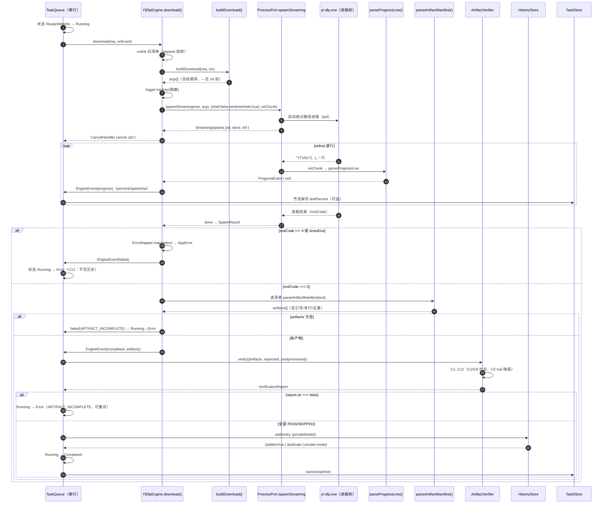
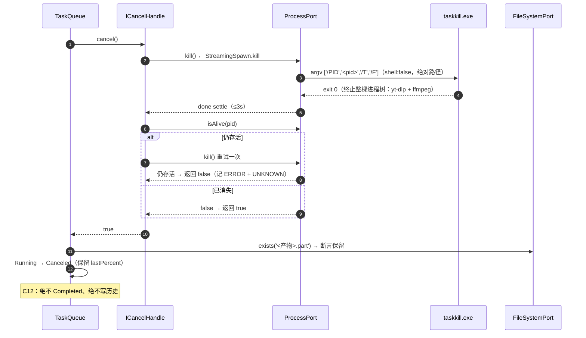
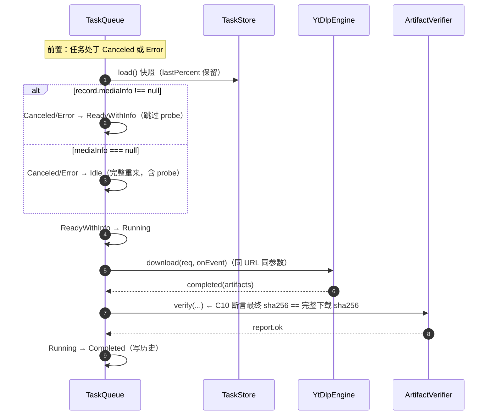
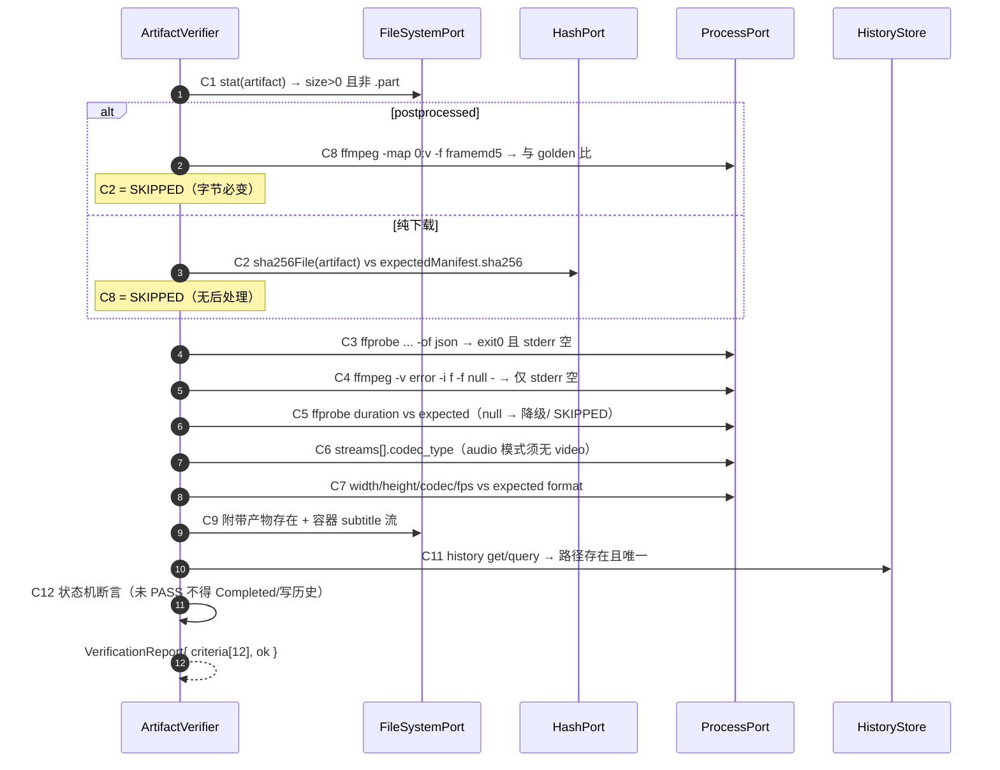
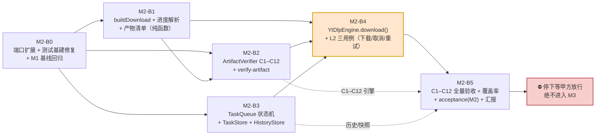

# YTVDLT · M2「单任务下载闭环 + 完整性」增量架构设计与任务分解

> **文档类型**：增量架构设计 + 施工单（给工程师寇豆码直接照做）
> **作者**：高见远（Gao）· 架构师　|　**版本**：v1.0　|　**日期**：2026-11-05
> **上游输入（按优先级）**
> 1. `YTVDLT_HANDOFF.md`（v1.1，933 行）—— §8 M2、§7.2 C1–C12、§11 CLI 速查、§3.5 五个坑、§6.4/§6.5、§6.7
> 2. `docs/ARCHITECTURE-M1.md`（1901 行）—— §3 已冻结 DTO、§4 契约风格、§9 端口注入与共享约定
> 3. `docs/M1-QA-VERIFICATION.md`（325 行）—— M1 基线质量与已知坑（P2-1～P2-4、P3-1～P3-3）
> 4. **实际代码**（已逐一核对：`packages/{shared,core,engine-ytdlp}/src/**`、`apps/desktop/src/main/adapters/node-ports.ts`、`tests/**`、`scripts/**`）
> **项目根**：`C:/Users/leolee/WorkBuddy/2026-11-05-08-16-08/ytvdlt`（下称 `ytvdlt/`，本文路径均相对此根）
> **本文不含业务代码与 UI 代码**；§3 的代码块是**接口契约（可直接复制的类型定义）**。

---

## 0. 硬边界与不做什么

| 项 | 结论 |
|---|---|
| **M2 唯一目标** | 打通「**单任务**下载闭环 + **C1–C12 完整性校验**」：`buildDownload` → spawn 流式 → 进度事件 → 精确产物 → 取消/重试 → 校验 → 历史入库 / 队列快照。**不做并发、不做 UI、不做全量参数组合** |
| **不写 UI** | 无页面/组件/`.tsx`/`.css`；`packages/ui` 仍**不建**；`apps/desktop` 仅保留 M1 空桩，不 `createWindow` |
| **不做并发调度** | `TaskQueue` 只实现**串行**单任务执行（`concurrency` 配置读取但不启用多路调度）——并发属 M4 |
| **不做全量格式/字幕/路径组合** | `buildDownload` 按「字段非空即映射」实现**必要参数子集**，不做互斥校验与组合矩阵；`FormatSelector` / `SubtitlePlanner` / `PathResolver` 属 M3 |
| **不做播放列表** | `probePlaylist` / 批量入队 / `--playlist-items` 属 M3/M4 |
| **不做自定义命令** | `runCustomCommand` + 白名单属 M4（`CUSTOM_COMMAND_REJECTED` 仅保留错误码） |
| **不做打包 / L3 在线烟测 / 自更新** | NSIS/portable/代码签名属 M5；`selfUpdate` 仍为 M1 占位 |
| **沿用 M1 铁律** | `core`/`engine-ytdlp` 零 `electron`、零 `node:*` 副作用，全部经 `CorePorts` 端口注入；`types: []` 编译期锁；`scripts/check-layering.mjs` 静态守卫；`argv[] + shell:false + windowsHide:true`，绝不字符串拼接；**不设计任何绕过 DRM/付费墙/登录/地区/年龄限制的能力**（`--cookies-from-browser` / `--geo-bypass*` / PO Token 永久禁用） |
| **已冻结签名不改** | `DownloadRequest` 五域、`DownloadEngine`（5 方法）、`EngineEvent`、`CancelHandle`、`AppError`、`ErrorCode` 17 码、`Ports` 已有方法 —— **只新增、不改**；新增成员一律标「向后兼容」 |
| **断言 ID 不改号** | 沿用 PRD §3 已分配的 12 条；新增 M2 骨架断言 `A-M2-01…A-M2-25`（只追加，不重编号） |

**M2 六条验收（HANDOFF §8）→ 断言绑定**

| # | 验收标准 | 绑定断言 |
|---|---|---|
| ① | 本地 HTTP fixture 走**真实 yt-dlp** 完成下载 | `A-4.4-07`（产物入库）、`A-M2-08`/`A-M2-09`（C1/C2）、`A-M2-25`（argv 冻结） |
| ② | 进度事件含 `%` / 速度 / ETA 且递增 | `A-4.4-11`、`A-4.4-12`、`A-M2-05`/`A-M2-06`/`A-M2-07` |
| ③ | 取消后无残留进程、`.part` 保留 | `A-4.4-13`、`A-4.4-14`、`A-M2-02`/`A-M2-03`/`A-M2-23` |
| ④ | 重试成功 | `A-4.4-14`、`A-M2-17`（C10）、`A-M2-22` |
| ⑤ | **C1–C12 全部通过** | `A-M2-08`…`A-M2-19` |
| ⑥ | 历史路径真实存在且唯一 | `A-4.4-07`、`A-4.4-08`、`A-4.4-22`、`A-M2-18`（C11）、`A-M2-20`/`A-M2-21` |

---

## 1. M2 实现方案与四个技术难点对策

### 1.1 一句话方案

> **在 M1 地基上补三层：① 端口层新增「流式 spawn + pid + kill + isAlive」；② engine-ytdlp 新增「下载 argv 纯函数 + 进度行解析 + 产物清单解析」，并让 `YtDlpEngine.download()` 真正跑起来；③ core 新增「TaskQueue 串行状态机 + ArtifactVerifier(C1–C12) + HistoryStore + TaskStore」。全程仍零 `electron`、零 `node:*`、100% 可离线单测；真实外部进程只经注入端口。**

### 1.2 四个技术难点（M2 成败所在）

| # | 难点 | 现状（实测） | 对策（本设计的关键决策） |
|---|---|---|---|
| **D1** | **Windows 取消必须杀「进程树」** | M1 `ProcessPort.spawn` 是**一次性 Promise**，**没有 pid / kill / 流式**；Node 适配只用 `child.kill()`（只杀父进程）。yt-dlp 会 spawn ffmpeg 子进程，**只杀父进程 → ffmpeg 孤儿残留**，直接违反验收③「无残留进程」 | 端口**新增** `spawnStreaming()`（返回 `{ pid, done, kill() }`，**保留** `spawn` 向后兼容）；Node 适配的 `kill()` 用 **`taskkill.exe /PID <pid> /T /F`（argv[]、shell:false、绝对路径 `%SystemRoot%\System32\taskkill.exe`）**；新增 `isAlive(pid)` 用 `process.kill(pid,0)` try/catch（适配层）；取消后**断言 pid 已消失**（§4.6） |
| **D2** | **进度解析容错** | 无 `ProgressParser`；Seal 源码把回调第二参数丢弃（§3.5 坑 2），桌面版必须**自行结构化** | 固定 `--progress-template "download:YTVDLT\|<7 fields>"` + `--newline` + `--progress-delta 0.5`（节流）；解析器**只认 `YTVDLT\|` 前缀**，忽略 `[download]`/`[info]` 等人类可读行；`percent` **自行计算**（`downloaded/total` → 回退 `total_estimate` → `null`）；`NA`/空串/`None`/`N/A` 一律 → `null`；**多流（video+audio 分离）进度会回退** → 用 `stage` 分段，只在**单流**上保证单调递增（本地 fixture 为单流，L2 判据稳定）（§4.2） |
| **D3** | **产物路径精确化** | Seal 用「扫目录 + 标题包含 + 正则排除」定位产物，脆弱（§3.5 坑 4） | `--print-to-file "after_move:%(filepath)q" <清单>` → 读清单得**最终路径**，**禁止目录扫描**。**两个致命细节**：① `--print-to-file` 是 **append 模式**，每次下载前**必须删除旧清单**（按 `taskId` 唯一命名）；② `%(filepath)q` 的 `q` 会加**外层引号**，解析必须**剥离一层同种引号**（§4.3） |
| **D4** | **完整性校验误判** | 无 `ArtifactVerifier`；C1–C12 有 3 条极易误判（见 §0 回传与 §4.4） | ① **C4 判据是 stderr 为空，绝不看 exit code**（`ffmpeg -v error -i f -f null -` 可能 exit 0 但有解码警告）；② **C5 时长容差在 `MediaInfo.duration===null` 时降级**（本地直链 generic extractor 固有，P3-3），改为与 fixture 期望时长比或 `SKIPPED`+WARNING，**不误报 FAIL**；③ **C2（字节哈希）与 C8（逐帧哈希）动态选择**——发生 remux/转码/合并后字节必变，必须改判 C8（§4.4） |

### 1.3 架构增量（分层不变，只在各层内新增）

```
┌──────────────────────────────── packages/shared/src/**（纯类型，零实现）────────────────────────────────┐
│  已有：errors / events / media / request / runtime / engine / ipc / ports                            │
│  M2 新增：progress.ts（ProgressEvent）· verification.ts（ArtifactVerification/VerificationReport）      │
│           task.ts（TaskState/TaskRecord/TaskSnapshot/TaskEvent）· history.ts（HistoryEntry/HistoryQuery）│
│  M2 修改：ports.ts（+spawnStreaming/StreamingSpawn/isAlive/IShellPort —— 只新增，向后兼容）            │
└───────────────────────────────────────────────────────────────────────────────────────────────────┘
┌──────────────────────────── packages/engine-ytdlp/src/**（纯 TS，无 child_process）─────────────────────┐
│  M2 新增：argv-builder-download.ts（buildDownload 纯函数）· progress-template.ts（模板常量）             │
│           progress-parser.ts（纯函数）· artifact-manifest.ts（清单解析纯函数）                          │
│  M2 修改：yt-dlp-engine.ts（download() 实现）· fake-engine.ts（回放增强）· index.ts                    │
└───────────────────────────────────────────────────────────────────────────────────────────────────┘
┌────────────────────────────────── packages/core/src/**（纯 TS，注入 CorePorts）─────────────────────────┐
│  M2 新增：task-queue/（state-machine 纯函数 + TaskQueue 串行执行）· artifact-verifier/（C1–C12）          │
│           history-store/（JSON 原子写 + 去重 + 查询）· task-store/（快照恢复）                          │
│  M2 修改：ports.ts（+ITaskQueue/IArtifactVerifier/IHistoryStore/ITaskStore/ICancelHandle/IShellPort）  │
│           index.ts · logger/redactor.ts（少量补充）                                                  │
└───────────────────────────────────────────────────────────────────────────────────────────────────┘
┌──────────────────────── apps/desktop/src/main/adapters/**（全仓库唯一 node:* 落点）──────────────────────┐
│  M2 修改：node-ports.ts（组装）· 新增 process-streaming.ts（spawnStreaming + taskkill /T /F + isAlive）  │
│           新增 shell-port.ts（explorer.exe argv[]：openPath / showItemInFolder）                       │
└───────────────────────────────────────────────────────────────────────────────────────────────────┘
┌──────────────────────────────── scripts/** 与 tests/**（测试基建）──────────────────────────────────────┐
│  M2 新增：scripts/verify-artifact.mjs · tests/{unit,contract,integration}/** 新用例与 fixtures          │
│  M2 修改：scripts/lib/mock-server.mjs（+节流，取消用例必需）· run-tests.mjs（+case 列表，修 P2-3）        │
│           scripts/acceptance.mjs（+M2 断言，修 P2-2 恒真兜底 / P3-1 durationMs）                        │
└───────────────────────────────────────────────────────────────────────────────────────────────────┘
```

### 1.4 端口扩展决策（最重要的一条）

`packages/shared/src/ports.ts` 的 `ProcessPort` **只新增成员，不改 `spawn`**（向后兼容）：

```ts
// M1 已有（保持不变，probe / --version 用它）
spawn(file: string, argv: readonly string[], opts: SpawnOptions): Promise<SpawnResult>;

// M2 新增（download 用它：流式 + pid + kill）
spawnStreaming(
  file: string,
  argv: readonly string[],
  opts: SpawnOptions,
  onChunk: (chunk: { stream: 'stdout' | 'stderr'; text: string }) => void,
): StreamingSpawn;

// M2 新增（取消后 pid 存活断言）
isAlive(pid: number): Promise<boolean>;
```

> **影响面（3 个实现必须同步补齐）**：`apps/desktop/src/main/adapters/process-streaming.ts`（生产）、`tests/unit/helpers/in-memory-ports.ts`（L0 可控行序列）、`tests/integration/helpers/real-process-port.ts`（L2 真实 spawn）。
> **为什么不做可选方法 `spawnStreaming?`**：`YtDlpEngine.download()` 需要无条件使用它；可选会逼出运行时判空分支并降低可测性。**必选新增 + 三实现同步**是更干净的契约。

---

## 2. 文件清单（M2-F001…M2-F060）

> **状态**：`新增` / `修改（向后兼容）` / `修改（缺陷修复）` / `构建产物`。**修改**一律指「在原文件上只增不改 M1 已冻结签名」。
> **实际基线**：`packages/shared/src/{errors,events,media,request,runtime,engine,ipc,ports,index}.ts`、`packages/core/src/**`（config-store/logger/error-mapper/runtime-resolver/ports）、`packages/engine-ytdlp/src/{argv-builder,json-mapper,media-guards,probe-result,runtime-check,yt-dlp-engine,fake-engine,engine-factory,index}.ts` 均已存在（M1 交付）。

### 2.1 `packages/shared/src/**`（M2-F001–F007）

| # | 相对路径 | 职责 | 新增/修改 | 绑定断言 |
|---|---|---|---|---|
| M2-F001 | `packages/shared/src/progress.ts` | `ProgressEvent`（结构化进度：percent/downloaded/total/speed/eta/elapsed/rawLine/stage）| 新增 | A-4.4-11/A-4.4-12/A-M2-06/A-M2-07 |
| M2-F002 | `packages/shared/src/verification.ts` | `ArtifactVerification`（单条判据结果）+ `VerificationReport`（C1–C12 汇总） | 新增 | A-M2-08…A-M2-19 |
| M2-F003 | `packages/shared/src/task.ts` | `TaskState`（7 态）、`TaskRecord`（可序列化快照）、`TaskSnapshot`、`TaskEvent` | 新增 | A-M2-01/A-M2-22 |
| M2-F004 | `packages/shared/src/history.ts` | `HistoryEntry` + `HistoryQuery` + `HistoryAddResult` | 新增 | A-4.4-07/A-4.4-08/A-M2-20 |
| M2-F005 | `packages/shared/src/ports.ts` | **只新增** `StreamingSpawn`、`ProcessPort.spawnStreaming`、`ProcessPort.isAlive`、`IShellPort` | 修改（向后兼容） | A-M2-02/A-4.6-02 |
| M2-F006 | `packages/shared/src/index.ts` | 追加导出 `progress/verification/task/history` | 修改（向后兼容） | A-M2-08 |
| M2-F007 | `packages/shared/src/ipc.ts` | 追加 channel 常量：`DOWNLOAD_EVENT`、`TASK_STATE`、`HISTORY_QUERY`、`ARTIFACT_VERIFY`（M2 只冻结常量，不实现网关） | 修改（向后兼容） | — |

### 2.2 `packages/engine-ytdlp/src/**`（M2-F008–F014）

| # | 相对路径 | 职责 | 新增/修改 | 绑定断言 |
|---|---|---|---|---|
| M2-F008 | `packages/engine-ytdlp/src/argv-builder-download.ts` | **纯函数** `buildDownload(req, ctx): string[]` + `DOWNLOAD_ARGV_FROZEN_ORDER` 常量表（§4.1） | 新增 | A-M2-25 |
| M2-F009 | `packages/engine-ytdlp/src/progress-template.ts` | 进度模板常量 `YTVDLT_PROGRESS_TEMPLATE`、行前缀 `YTVDLT\|`、`--progress-delta` 默认值 | 新增 | A-4.4-11 |
| M2-F010 | `packages/engine-ytdlp/src/progress-parser.ts` | **纯函数** `parseProgressLine(line, taskId): ProgressEvent \| null`（含 `NA`/空/异常值容错、percent 计算） | 新增 | A-4.4-11/A-4.4-12/A-M2-05/A-M2-06/A-M2-07 |
| M2-F011 | `packages/engine-ytdlp/src/artifact-manifest.ts` | **纯函数** `parseArtifactManifest(text): string[]`（去引号、去空行、多行、去重、绝对路径校验）；`artifactManifestPath(tempDir, taskId)` | 新增 | A-M2-04/A-M2-08 |
| M2-F012 | `packages/engine-ytdlp/src/yt-dlp-engine.ts` | **实现 `download()`**：spawnStreaming → 进度回调 → 取消句柄 → 读清单 → `EngineEvent(completed/failed/canceled)`；`probePlaylist/selfUpdate` 仍占位 | 修改（向后兼容） | A-M2-02/A-M2-03/A-M2-25 |
| M2-F013 | `packages/engine-ytdlp/src/fake-engine.ts` | 增强 `download()` 回放：从 `progress-*.log` 逐行回放 + 复制 fixture 产物（U3 降级路径仍可用） | 修改（向后兼容） | A-M2-25（契约） |
| M2-F014 | `packages/engine-ytdlp/src/index.ts` | 追加导出新模块 | 修改（向后兼容） | — |

### 2.3 `packages/core/src/**`（M2-F015–M2-F031）

| # | 相对路径 | 职责 | 新增/修改 | 绑定断言 |
|---|---|---|---|---|
| M2-F015 | `packages/core/src/ports.ts` | **只新增** `ICancelHandle`、`ITaskQueue`、`IArtifactVerifier`、`IHistoryStore`、`ITaskStore` | 修改（向后兼容） | A-M2-01 |
| M2-F016 | `packages/core/src/task-queue/state-machine.ts` | **纯函数** 7 态合法转移表 `canTransition` / `assertTransition`（13 合法，其余拒绝） | 新增 | A-M2-01 |
| M2-F017 | `packages/core/src/task-queue/task-queue.ts` | `TaskQueue implements ITaskQueue`：串行执行、`cancel`/`restart`、事件分发（**不并发**） | 新增 | A-M2-01/A-4.4-13/A-4.4-14 |
| M2-F018 | `packages/core/src/task-queue/index.ts` | barrel | 新增 | — |
| M2-F019 | `packages/core/src/artifact-verifier/criteria.ts` | C1–C12 **各判据纯逻辑**（输入 `CheckContext`，输出 `ArtifactVerification[]`），含 C2/C8 动态选择、C5 null 降级 | 新增 | A-M2-08…A-M2-19 |
| M2-F020 | `packages/core/src/artifact-verifier/artifact-verifier.ts` | `ArtifactVerifier implements IArtifactVerifier`：注入 ports，跑 ffprobe/ffmpeg（经 `ProcessPort`），产出 `VerificationReport` | 新增 | A-M2-08…A-M2-19 |
| M2-F021 | `packages/core/src/artifact-verifier/index.ts` | barrel | 新增 | — |
| M2-F022 | `packages/core/src/history-store/query.ts` | **纯函数** `matchEntry(entry, query)` / `dedupeKey(entry)`（路径规范化：盘符小写 + 统一斜杠） | 新增 | A-4.4-08/A-M2-20 |
| M2-F023 | `packages/core/src/history-store/history-store.ts` | `HistoryStore implements IHistoryStore`：JSON 原子写、按路径去重、搜索/过滤、隐私模式跳过、删除（可选删文件）、导入导出占位 | 新增 | A-4.4-07/A-4.4-08/A-4.4-22/A-M2-20/A-M2-21 |
| M2-F024 | `packages/core/src/history-store/index.ts` | barrel | 新增 | — |
| M2-F025 | `packages/core/src/task-store/task-store.ts` | `TaskStore implements ITaskStore`：`tasks.json` 快照读写；恢复时 `Running`/`FetchingInfo` → `Canceled`（保留 `lastProgress`） | 新增 | A-M2-22 |
| M2-F026 | `packages/core/src/task-store/index.ts` | barrel | 新增 | — |
| M2-F027 | `packages/core/src/index.ts` | 追加导出 `task-queue/artifact-verifier/history-store/task-store` | 修改（向后兼容） | — |
| M2-F028 | `packages/core/src/logger/redactor.ts` | 补充脱敏：stderr 中的 URL 签名参数（`?token=`/`&sig=` 已有内联规则覆盖）、新增 `--download-archive`/`--print-to-file` **不脱敏**（路径不敏感，但避免误掩码）；保持 19 类敏感键 | 修改（向后兼容） | A-4.4-30（回归） |

> **实现类命名**：沿用 D-10 约定——接口 `I` 前缀，实现类保留原名（`TaskQueue`、`ArtifactVerifier`、`HistoryStore`、`TaskStore`）。

### 2.4 `apps/desktop/src/main/adapters/**`（M2-F029–M2-F031）

| # | 相对路径 | 职责 | 新增/修改 | 绑定断言 |
|---|---|---|---|---|
| M2-F029 | `apps/desktop/src/main/adapters/process-streaming.ts` | **实现** `spawnStreaming`（`child.stdout/stderr.on('data')` 流式 + `pid`）+ `kill()`（`taskkill.exe /PID <pid> /T /F`，argv[]、shell:false）+ `isAlive(pid)`（`process.kill(pid,0)`） | 新增 | A-M2-02/A-M2-03 |
| M2-F030 | `apps/desktop/src/main/adapters/shell-port.ts` | **实现** `IShellPort`：`openPath` / `showItemInFolder` 用 `explorer.exe <path>` argv[]（M2 契约层可用；M3 由 Electron `shell` 接管） | 新增 | A-4.6-02 |
| M2-F031 | `apps/desktop/src/main/adapters/node-ports.ts` | 组装新增端口（`process.isAlive/spawnStreaming`、`shell`），保持唯一 `node:*` 落点 | 修改（向后兼容） | A-M2-02 |

### 2.5 `scripts/**`（M2-F032–M2-F037）

| # | 相对路径 | 职责 | 新增/修改 | 绑定断言 |
|---|---|---|---|---|
| M2-F032 | `scripts/verify-artifact.mjs` | `node scripts/verify-artifact.mjs --expect <manifest> --actual <path> [--json]` → tsx 加载 `ArtifactVerifier` 输出 `reports/artifact-verification.json` | 新增 | A-M2-24 |
| M2-F033 | `scripts/lib/mock-server.mjs` | **增加节流** `rateBytesPerSec`（分块 + `setTimeout`）与 `/fixture.vtt`、`/fixture.jpg` 路由；保留 127.0.0.1 + Range | 修改（向后兼容） | A-M2-23 |
| M2-F034 | `scripts/run-tests.mjs` | `--case` 扩展为 `probe-local\|download-local\|cancel-local\|retry-local\|artifact-local`；**修 P2-3**：`--run` 不再只用 `--testNamePattern`，改为「文件路径包含匹配 + `--testNamePattern`」双条件，避免漏跑 | 修改（缺陷修复） | A-M2-23 |
| M2-F035 | `scripts/acceptance.mjs` | **修 P2-2**：删 `\|\| exists('check-layering.mjs')` 恒真兜底；**修 P3-1**：`durationMs` 记实测；新增 M2 断言判定（`--milestone M2`） | 修改（缺陷修复） | A-M2-24 |
| M2-F036 | `tests/fixtures/manifest.json` | 复用 M1（`sha256=1db5d565…`/`size=308666`/`duration=10`）；追加 `expectedFormats`（best format 的 id/ext/vcodec/acodec，供 C7）与 `c8Golden?`（首次 L2 生成） | 修改（向后兼容） | A-M2-12/A-M2-14/A-M2-15 |
| M2-F037 | `scripts/lib/media-tools.mjs` | 抽公共 `ffprobeJson(path)` / `ffmpegDecodeCheck(path)` / `framemd5(path)`（u3-verify 与 verify-artifact 复用，避免重复） | 新增 | A-M2-10/A-M2-11/A-M2-15 |

### 2.6 `tests/**`（M2-F038–M2-F060）

| # | 相对路径 | 职责 | 新增/修改 | 绑定断言 |
|---|---|---|---|---|
| M2-F038 | `tests/unit/argv-builder-download.test.ts` | 下载 argv **逐元素**断言（含可选参数有/无、`--` 在 url 前、`--ffmpeg-location`/`--progress-template`/`--print-to-file` 存在） | 新增 | A-M2-25 |
| M2-F039 | `tests/unit/progress-parser.test.ts` | 正常行/NA/空/负值/非前缀行/多流回退/percent 三档回退 | 新增 | A-M2-05/A-M2-06/A-M2-07 |
| M2-F040 | `tests/unit/artifact-manifest.test.ts` | 带引号/无引号/多行/章节多行/空行/相对路径拒绝/去重 | 新增 | A-M2-04 |
| M2-F041 | `tests/unit/task-queue.test.ts` | 13 条合法转移通过 + 36 条非法组合全部拒绝 + cancel/restart 语义 | 新增 | A-M2-01/A-4.4-13/A-4.4-14 |
| M2-F042 | `tests/unit/artifact-verifier.test.ts` | 用 fake ports 覆盖 C1–C12 每条 PASS/FAIL/降级分支 | 新增 | A-M2-08…A-M2-19 |
| M2-F043 | `tests/unit/history-store.test.ts` | 去重（同 videoPath）、搜索/过滤、隐私模式不写、删除（含删文件） | 新增 | A-4.4-08/A-4.4-22/A-M2-20/A-M2-21 |
| M2-F044 | `tests/unit/task-store.test.ts` | 快照读写、Running/FetchingInfo→Canceled 恢复、lastProgress 保留 | 新增 | A-M2-22 |
| M2-F045 | `tests/contract/progress-parser.contract.test.ts` | 录制 `progress-*.log` → 事件序列契约（不触网、不 spawn） | 新增 | A-4.4-11/A-4.4-12 |
| M2-F046 | `tests/contract/download-engine.download.contract.test.ts` | `YtDlpEngine` 与 `FakeEngine` 跑**同一组** download 契约（返回值/事件顺序/取消） | 新增 | A-M2-25 |
| M2-F047 | `tests/integration/offline/download-local.test.ts` | L2：真实 yt-dlp 下载 → 进度递增 → 产物 → 历史 → ⑥ | 新增 | ① ② ⑥ |
| M2-F048 | `tests/integration/offline/cancel-local.test.ts` | L2：**节流服务**上取消 → pid 消失 → `.part` 保留 → `Canceled` | 新增 | ③ |
| M2-F049 | `tests/integration/offline/retry-local.test.ts` | L2：取消后 `restart` → 完成 → C10 哈希一致 | 新增 | ④ |
| M2-F050 | `tests/integration/offline/artifact-local.test.ts` | L2：C1–C12 全量逐条判绿（对 download-local 产物 + fixture） | 新增 | ⑤ |
| M2-F051 | `tests/integration/helpers/real-process-port.ts` | **新增** `spawnStreaming` + `isAlive`（真实 spawn，仍 argv[]+shell:false） | 修改（向后兼容） | A-M2-02 |
| M2-F052 | `tests/unit/helpers/in-memory-ports.ts` | **新增** `spawnStreaming`（可注入**行序列** + 可控 `kill` 结果）+ `isAlive` | 修改（向后兼容） | A-M2-02/A-M2-05 |
| M2-F053 | `tests/integration/helpers/mock-server.ts` | 对齐 `scripts/lib/mock-server.mjs` 的节流参数 | 修改（向后兼容） | A-M2-23 |
| M2-F054 | `tests/fixtures/progress-basic.log` | 单流正常进度（含 0%→100%、speed/eta 递增） | 新增 | A-4.4-11 |
| M2-F055 | `tests/fixtures/progress-edge.log` | `NA`/空/负值/非前缀行/多流回退 | 新增 | A-M2-05 |
| M2-F056 | `tests/fixtures/artifacts-quoted.txt` | `%(filepath)q` 带引号 + 多行 + 章节拆分样本 | 新增 | A-M2-04 |
| M2-F057 | `tests/fixtures/media/fixture.vtt` | C9 字幕附带产物 | 新增 | A-M2-16 |
| M2-F058 | `tests/fixtures/media/fixture.jpg` | C9 缩略图附带产物 | 新增 | A-M2-16 |
| M2-F059 | `tests/fixtures/history-valid.json` / `tasks-snapshot.json` | History/TaskStore 读写样本（含重复 videoPath、Running 残留） | 新增 | A-M2-20/A-M2-22 |
| M2-F060 | `tests/fixtures/README.md` | 追加 M2 fixtures 来源说明（录制 vs 生成、可离线、无真实凭据） | 修改（向后兼容） | — |

### 2.7 `docs/**`（M2-F061–M2-F063）

| # | 相对路径 | 职责 | 新增/修改 | 绑定断言 |
|---|---|---|---|---|
| M2-F061 | `docs/ARCHITECTURE-M2.md` | 本文 | 新增 | — |
| M2-F062 | `docs/DECISIONS.md` | 追加 M2 决策：`D-15` 端口扩展向后兼容、`D-16` taskkill /T /F、`D-17` 进度模板/节流、`D-18` C2/C8 动态选择、`D-19` C5 null 降级、`D-20` M2 断言清单 | 修改（追加） | — |
| M2-F063 | `docs/M2-REPORT.md` | M2 汇报（M2-B5，按 §8 模板 + 37 条断言对照表 + 停下声明） | 新增 | — |
| M2-F064 | `reports/artifact-verification.json` | `verify-artifact.mjs` / L2 产物（构建产物） | 构建产物 | A-M2-24 |

**合计 64 个文件条目**（M2-F001–M2-F064）：新增 44 / 修改 16 / 构建产物 4（含本文）。

---

## 3. 接口签名（可直接复制）

> 全部纯类型；`shared` 与 `core` 的 tsconfig 仍 `types: []`（禁止 `node:*`/`process`/`Buffer`）。

### 3.1 进度与事件（`packages/shared/src/progress.ts`）

```ts
/** 结构化进度（取代 Seal 被丢弃的回调第二参数；§3.5 坑 2）。 */
export type ProgressStage = 'downloading' | 'postprocess';

export interface ProgressEvent {
  taskId: string;
  stage: ProgressStage;
  /** 0–100；无法计算时为 null（total 与 total_estimate 都缺失） */
  percent: number | null;
  downloadedBytes: number | null;
  totalBytes: number | null;
  /** 缺失时为 null；UI 显示「—」 */
  speedBps: number | null;
  etaSec: number | null;
  elapsedSec: number | null;
  /** 原始行（已脱敏），用于日志与排障 */
  rawLine: string;
}
```

> `EngineEvent['progress']`（M1 已冻结）保持不变；`YtDlpEngine.download()` 把 `ProgressEvent` **投影**为 M1 的 `EngineEvent(progress)`（字段名一一对应：`percent/downloadedBytes/totalBytes/speedBps/etaSec/rawLine`），因此 **`EngineEvent` 零改动**。

### 3.2 校验结果（`packages/shared/src/verification.ts`）

```ts
export type CriterionId =
  | 'C1' | 'C2' | 'C3' | 'C4' | 'C5' | 'C6'
  | 'C7' | 'C8' | 'C9' | 'C10' | 'C11' | 'C12';

export type CriterionStatus = 'PASS' | 'FAIL' | 'SKIPPED';

/** 单条判据结果 */
export interface ArtifactVerification {
  id: CriterionId;
  status: CriterionStatus;
  /** 人类可读判定说明（已脱敏） */
  detail: string;
  /** 实测值（用于报告与复算） */
  actual?: Record<string, unknown>;
  /** SKIPPED 的原因（如 C5 在 duration=null 时降级） */
  skipReason?: string;
}

export interface VerificationReport {
  taskId: string;
  artifacts: string[];              // 参与校验的产物绝对路径
  /** 是否发生后处理（决定 C2 vs C8，§4.4） */
  postprocessed: boolean;
  criteria: ArtifactVerification[]; // 恰好 12 条，按 C1..C12
  /** 全部 PASS 或 SKIPPED（无 FAIL） */
  ok: boolean;
  /** 首个 FAIL 对应的错误码（通常 ARTIFACT_INCOMPLETE） */
  failureCode: 'ARTIFACT_INCOMPLETE' | 'ALREADY_DOWNLOADED' | 'UNKNOWN' | null;
  durationMs: number;
}
```

### 3.3 任务与快照（`packages/shared/src/task.ts`）

```ts
/** 7 态，对齐源码 Task.kt（§4.4 矩阵项 A-4.4-10，M2 只做基础） */
export type TaskState =
  | 'Idle' | 'FetchingInfo' | 'ReadyWithInfo'
  | 'Running' | 'Completed' | 'Error' | 'Canceled';

export type DownloadKind = 'video' | 'audio';

/** 可序列化任务快照（不含函数 / CancelHandle；后者只存在内存 Map） */
export interface TaskRecord {
  id: string;
  url: string;
  kind: DownloadKind;
  state: TaskState;
  createdAt: string;              // ISO 8601 UTC
  updatedAt: string;
  /** probe 成功后缓存，restart 可跳过重解析 */
  mediaInfo: MediaInfo | null;
  /** DownloadRequest 五域快照（不可变） */
  request: DownloadRequest | null;
  /** 产物绝对路径（清单解析后填充） */
  artifacts: string[];
  /** 最近一次进度（0–100），取消/失败/重启后保留 */
  lastPercent: number | null;
  /** 失败时的结构化错误 */
  error: AppError | null;
  /** 隐私模式：完成时不写历史 */
  privateMode: boolean;
  /** 是否已发生后处理（决定 C2/C8） */
  postprocessed: boolean;
}

export interface TaskSnapshot {
  schemaVersion: 1;
  savedAt: string;
  tasks: TaskRecord[];
}

/** TaskQueue 对外事件：状态变更 + 引擎事件（EngineEvent 已冻结，直接复用） */
export type TaskEvent =
  | { type: 'state-changed'; taskId: string; from: TaskState; to: TaskState }
  | EngineEvent;
```

### 3.4 历史（`packages/shared/src/history.ts`）

```ts
export interface HistoryEntry {
  id: string;                    // 稳定唯一 id（taskId 或 uuid）
  taskId: string;
  url: string;
  title: string;
  uploader: string | null;
  durationSec: number | null;
  /** 产物绝对路径（C11 校验对象） */
  videoPath: string;
  audioPath: string | null;
  thumbnailPath: string | null;
  subtitlePaths: string[];
  sizeBytes: number;
  extractorKey: string;
  downloadType: DownloadKind;
  formatId: string | null;
  createdAt: string;             // ISO 8601 UTC
  completedAt: string;
}

export interface HistoryQuery {
  /** 标题 / 上传者 / 路径 的包含匹配（大小写不敏感） */
  text?: string;
  downloadType?: DownloadKind;
  extractorKey?: string;
  limit?: number;
  offset?: number;
}

export type HistoryAddResult =
  | { added: true; entry: HistoryEntry }
  | { added: false; reason: 'duplicate'; existing: HistoryEntry }
  | { added: false; reason: 'private-mode' };
```

### 3.5 Core 对外接口（`packages/core/src/ports.ts` 追加）

```ts
// ---- 取消句柄（结构等价于 shared CancelHandle，供 TaskQueue 持有）----
export interface ICancelHandle {
  cancel(): Promise<boolean>;
  readonly pid: number | null;
}

// ---- 7 态状态机 + 串行执行 ----
export interface ITaskQueue {
  /** 入队并（在串行模式下）立即开始执行 */
  enqueue(record: TaskRecord): Promise<void>;
  /** 取消：销毁进程组 → Canceled；返回是否确实发生取消 */
  cancel(taskId: string): Promise<boolean>;
  /** 重试：Canceled/Error → ReadyWithInfo（有 mediaInfo）或 Idle（无） */
  restart(taskId: string): Promise<void>;
  get(taskId: string): TaskRecord | undefined;
  list(): readonly TaskRecord[];
  /** 订阅状态/引擎事件；返回取消订阅函数 */
  onEvent(listener: (e: TaskEvent) => void): () => void;
}

// ---- 完整性校验 C1–C12 ----
export interface IArtifactVerifier {
  verify(input: {
    taskId: string;
    artifacts: string[];
    /** 预期（来自 probe 的 MediaInfo，可为 null） */
    expected: MediaInfo | null;
    /** 是否发生后处理（决定 C2 vs C8） */
    postprocessed: boolean;
    /** L2 期望清单（fixture manifest，可选） */
    expectedManifest?: ExpectedArtifactManifest | null;
    /** C11 用的历史条目（可选） */
    historyEntry?: HistoryEntry | null;
  }): Promise<VerificationReport>;
}

export interface ExpectedArtifactManifest {
  sha256: string;
  sizeBytes: number;
  durationSec: number;
  videoCodec: string;
  audioCodec: string;
}

// ---- 历史 ----
export interface IHistoryStore {
  init(): Promise<void>;
  add(entry: HistoryEntry, opts?: { privateMode?: boolean }): Promise<HistoryAddResult>;
  query(q: HistoryQuery): Promise<HistoryEntry[]>;
  get(id: string): Promise<HistoryEntry | null>;
  remove(id: string, opts?: { deleteFile?: boolean }): Promise<boolean>;
  /** M4 完善去重；M2 返回/接受 JSON 快照 */
  exportJson(): Promise<string>;
  importJson(json: string): Promise<number>;
}

// ---- 队列快照 ----
export interface ITaskStore {
  load(): Promise<TaskSnapshot>;
  save(snapshot: TaskSnapshot): Promise<void>;
  /** 恢复：Running/FetchingInfo → Canceled（保留 lastPercent） */
  recover(raw: TaskSnapshot): TaskSnapshot;
}
```

### 3.6 端口扩展（`packages/shared/src/ports.ts` 追加，**向后兼容**）

```ts
export interface StreamingSpawn {
  /** OS 进程 id；spawn 失败时可能为 null */
  readonly pid: number | null;
  /** 进程结束时 resolve（与 spawn 的 SpawnResult 同构） */
  readonly done: Promise<SpawnResult>;
  /** 终止进程**树**（Windows: taskkill /T /F）；幂等，进程已退出时返回 true */
  kill(): Promise<boolean>;
}

export interface ProcessPort {
  /** M1 已有，保持不变 */
  spawn(file: string, argv: readonly string[], opts: SpawnOptions): Promise<SpawnResult>;
  /** M2 新增：流式 + pid + kill */
  spawnStreaming(
    file: string,
    argv: readonly string[],
    opts: SpawnOptions,
    onChunk: (chunk: { stream: 'stdout' | 'stderr'; text: string }) => void,
  ): StreamingSpawn;
  /** M2 新增：取消后 pid 存活断言 */
  isAlive(pid: number): Promise<boolean>;
}

/** 打开/定位产物（A-4.6-02）。M2 适配层用 explorer.exe argv[]，M3 由 Electron shell 接管。 */
export interface IShellPort {
  openPath(path: string): Promise<void>;
  showItemInFolder(path: string): Promise<void>;
}

// CorePorts 追加（可选成员，M1 组件不受影响）
export interface CorePorts {
  // ...M1 六个保持不变...
  shell?: IShellPort;
}
```

### 3.7 `DownloadRequest` 五域（**沿用 M1，不改**；M2 只读取子集）

> 已在 `packages/shared/src/request.ts` 冻结（`FormatDomain`/`SubtitleDomain`/`PathsDomain`/`NetworkDomain`/`AdvancedDomain`）。**M2 不新增字段**；`buildDownload` 仅按下表映射已存在字段，未使用字段在 M3 由 `FormatSelector`/`SubtitlePlanner`/`PathResolver` 填充。

---

## 4. 关键契约

### 4.1 下载 argv 完整顺序表（A-M2-25，逐元素可断言）

`buildDownload(req: DownloadRequest, ctx: DownloadContext): string[]`，`ctx = { jsRuntimePath, ffmpegDir, artifactManifestPath }`。**纯函数**：同入参 → 同数组。

| 段 | argv 元素（每个都是独立数组元素） | 条件 |
|---|---|---|
| 固定前置 | `--no-playlist` | 恒 |
| | `--no-warnings` | 恒 |
| | `--newline` | 恒（逐行输出，进度解析前提） |
| | `--socket-timeout` `5` | 恒 |
| | `-R` `1` | 恒 |
| | `--no-js-runtimes` | 恒（F4 优先级：先禁 deno） |
| | `--js-runtimes` `node:<jsRuntimePath abs>` | 恒 |
| | `--ffmpeg-location` `<ffmpegDir abs>` | 恒（U3 实测支持=YES；**仍保留 PATH 前置兜底**，§12.4 铁律 5） |
| 格式/音频 | `-f` `<format.formatId>` | `format.formatId !== null` |
| | `-S` `res:<N>` | `format.quality` ∈ {2160p,1440p,1080p,720p,480p,360p} |
| | `-S` `<format.sortingFields>` | `format.sortingFields !== null`（优先于上一行，二者互斥由 M3 校验） |
| | `-x` | `format.extractAudio` |
| | `--audio-format` `<format.audioFormat>` | `audioFormat !== null` |
| | `--audio-multistreams` | `format.audioMultistreams` |
| 字幕（M2 基础子集） | `--write-subs` | `subtitle.enabled` |
| | `--sub-langs` `<subtitle.languages>` | `subtitle.enabled` |
| | `--write-auto-subs` | `subtitle.autoCaptions` |
| | `--embed-subs` | `subtitle.embed` |
| | `--convert-subs` `<convertTo>` | `convertTo !== 'none'` |
| 路径 | `-P` `<videoDir \| audioDir>` | 恒（`extractAudio` ? `audioDir` : `videoDir`） |
| | `-o` `<paths.outputTemplate>` | 恒 |
| 网络 | `-r` `<network.rateLimit>` | `rateLimit !== null` |
| | `--proxy` `<network.proxy>` | `proxy !== null` |
| | `--cookies` `<network.cookiesFile>` | `cookiesFile !== null`（**仅用户手动导入的自有文件**） |
| | `--add-header` `User-Agent:<network.userAgent>` | `userAgent !== null` |
| | `--concurrent-fragments` `<n>` | `concurrentFragments !== null` |
| 其他 | `--no-mtime` | 恒 |
| | `--download-archive` `<advanced.downloadArchive>` | `downloadArchive !== null` |
| | `--progress-template` `download:<YTVDLT_PROGRESS_TEMPLATE>` | 恒 |
| | `--progress-delta` `0.5` | 恒（节流，避免行爆炸） |
| | `--print-to-file` `after_move:%(filepath)q` `<artifactManifestPath>` | 恒（D3 精确产物） |
| 分隔 | `--` | 恒 |
| 用户 token | `<req.url>`（**唯一用户可控 token，必须在 `--` 之后且为最后元素**） | 恒 |

**断言方式**：`EXPECTED_DOWNLOAD_ARGV` 为测试自带**字面量数组**（非引用实现常量），`expect(buildDownload(...)).toEqual(EXPECTED_DOWNLOAD_ARGV)`；另断言 `argv.filter(x => x === '--').length === 1`、`argv.at(-1) === url`、`enginePath` 不在 argv 内、无含空格拼接元素。

### 4.2 进度模板与解析规则（A-4.4-11 / 12 / A-M2-05 / 06 / 07）

**模板常量**（`progress-template.ts`）：

```ts
export const PROGRESS_LINE_PREFIX = 'YTVDLT|';
/** yt-dlp --progress-template 值（前缀 download: 表示下载阶段） */
export const YTVDLT_PROGRESS_TEMPLATE =
  'download:YTVDLT|%(progress.downloaded_bytes)s|%(progress.total_bytes)s|' +
  '%(progress.total_bytes_estimate)s|%(progress.speed)s|%(progress.eta)s|%(progress.elapsed)s';
export const PROGRESS_DELTA_SECONDS = '0.5';
```

**行格式**（7 段以 `|` 分隔）：`YTVDLT|<downloaded>|<total>|<total_estimate>|<speed>|<eta>|<elapsed>`

**解析规则**（`parseProgressLine`，纯函数）：

| 输入 | 处理 |
|---|---|
| 非 `YTVDLT\|` 前缀（`[download]`/`[info]`/`[youtube]` 等） | **返回 `null`**（忽略，不进事件流） |
| 段数 ≠ 7 | 返回 `null` + 计一次 malformed（DEBUG 日志） |
| 值为 `NA` / `N/A` / `None` / `''` / 非数 | 该字段 → `null` |
| 负数 / `NaN` / `Infinity` | → `null` |
| `downloaded` 存在且 `total` 存在且 `total > 0` | `percent = clamp(downloaded/total*100, 0, 100)`，保留 1 位小数 |
| 否则 `total_estimate > 0` | `percent = clamp(downloaded/total_estimate*100, 0, 100)` |
| 否则 | `percent = null`（UI 不确定态） |
| `speed === 0` | `speedBps = 0`（合法，不转 null） |
| `eta < 0` | `null` |
| 输出 `stage` | 行含 `YTVDLT|` 前缀属 `download:` → `'downloading'`（postprocess 行由 yt-dlp 另一前缀输出，M2 只映射 downloading） |

**多流回退**：video+audio 分离时 yt-dlp 会输出两段 0→100%，`percent` 会回退。M2 对策：事件里带 `stage`，**验收②「递增」只对单流场景断言**（本地 fixture = generic 单 format，稳定）；多流递增留给 M3（带 stage 分段）。**文档与 DECISIONS 明确写此限制**。

**速度/ETA**：`speedBps` 字节/秒（yt-dlp 输出即 B/s），UI 层再格式化（M3）；`etaSec` 秒。两者缺失 → `null`，UI 显「—」（`A-4.4-12`）。

### 4.3 产物清单文件格式（A-M2-04）

- **路径**：`<paths.tempDir>/ytvdlt-artifacts-<taskId>.txt`（`artifactManifestPath()` 生成，`taskId` 唯一）
- **下载前**：**必须 `unlink` 旧文件**（`--print-to-file` 是 **append**，不删会累积历史产物）★
- **写入内容**（每行一个，`%(filepath)q` 输出）：
  ```
  "C:\Users\x\Downloads\YTVDLT\Title [id].mp4"
  "C:\Users\x\Downloads\YTVDLT\Title [id].en.srt"
  ```
- **解析规则**（`parseArtifactManifest(text)`，纯函数）：
  1. 按 `\r?\n` 切行 → `trim()`
  2. 空行丢弃
  3. **剥离一层同种外层引号**：若首末字符同为 `"` 或同为 `'` → 去首末各一（httrack `q` 过滤器的 Windows 输出）
  4. 绝对路径校验（`[A-Za-z]:[\\/]` 或 `\\\\` 或 `/` 开头）；非绝对 → 丢弃 + WARNING（不猜）
  5. 排除 `.part` / `.ytdl` / `.temp` 后缀
  6. 去重（保持出现顺序）
  7. 空结果 + 进程 exit 0 → 上层报 `ARTIFACT_INCOMPLETE`（C1 需要路径）
- **多产物**：视频 + 字幕 + 缩略图 + `.info.json` 均逐行；**章节拆分**（M3）会多行，M2 解析器已支持多行。
- **顺序无关**：不假设第 1 行是视频；`ArtifactVerifier` 按扩展名/ffprobe 判定主产物。

### 4.4 C1–C12 实现细则表（A-M2-08…A-M2-19）

> **断言 ID 映射（逐条一一对应）**：C1→`A-M2-08`、C2→`A-M2-09`、C3→`A-M2-10`、C4→`A-M2-11`、C5→`A-M2-12`、C6→`A-M2-13`、C7→`A-M2-14`、C8→`A-M2-15`、C9→`A-M2-16`、C10→`A-M2-17`、C11→`A-M2-18`、C12→`A-M2-19`。

> 输入统一为 `CheckContext = { artifacts, expected(MediaInfo|null), postprocessed, expectedManifest?, historyEntry?, ports }`；每条独立产出 `ArtifactVerification`。**任一条 FAIL → `report.ok=false`，`failureCode` 默认 `ARTIFACT_INCOMPLETE`**（C11 去重冲突用 `ALREADY_DOWNLOADED`）。

| # | 判据 | 实现方法（经端口） | 判定 | 失败码 | 误判防护 |
|---|---|---|---|---|---|
| **C1** | 产物存在且非空 | `fs.stat(path)`；排除 `.part/.ytdl/.temp` | `sizeBytes > 0` 且 `isFile` 且路径来自清单（非目录扫描） | `ARTIFACT_INCOMPLETE` | 只认清单路径；空清单即 FAIL |
| **C2** | 精确字节一致（**仅纯下载**） | `hash.sha256File(actual) === expectedManifest.sha256` | 完全一致 | `ARTIFACT_INCOMPLETE` | **`postprocessed===true` 时直接 SKIPPED 并转 C8**（见下）★ |
| **C3** | 容器可解析 | `ffprobe -v error -show_format -show_streams -of json <f>` | **exit 0 且 stderr 为空** 且 JSON 可解析 | `ARTIFACT_INCOMPLETE` | exit 0 但有 stderr → FAIL（半坏容器） |
| **C4** | 全帧可解码 | `ffmpeg -v error -i <f> -f null -` | **仅看 stderr 为空**（**不看 exit code**）★ | `ARTIFACT_INCOMPLETE` | exit 0 但有解码警告 → 必须 FAIL；绝不能只判 exit code |
| **C5** | 时长一致 | `ffprobe.format.duration` vs 期望 | `\|actual - expected\| <= max(1s, 2%)` | `ARTIFACT_INCOMPLETE` | **`MediaInfo.duration===null`（本地直链）→ 改用 `expectedManifest.durationSec`；两者都无 → `SKIPPED`+`skipReason`**，不 FAIL ★ |
| **C6** | 音视频流完整 | `ffprobe.streams[].codec_type` | 视频任务须有 video；`-f v+a` 合并须 video+audio；仅音频（`-x`）须**无** video | `ARTIFACT_INCOMPLETE` | 仅音频模式判据相反，勿套用视频判据 |
| **C7** | 规格符合 | 比对 `width/height/codec_name/avg_frame_rate` 与 `expected.formats`（选中的 formatId） | 有明确 `formatId` → 严格一致；无（本地单 format）→ 记录实测并 PASS | `ARTIFACT_INCOMPLETE` | 「无选择」不算不符，避免 M2 误 FAIL |
| **C8** | 逐帧一致性（**remux/转码/章节场景**） | `ffmpeg -i <f> -map 0:v -f framemd5 -` 与 golden 比对 | 完全一致 | `ARTIFACT_INCOMPLETE` | **`postprocessed===true` 时用 C8 替代 C2**；golden 首次 L2 生成并缓存（`c8Golden`） |
| **C9** | 附带产物 | 字幕/缩略图/`.info.json` 存在性 + `ffprobe` 容器 `subtitle` 流 | 声明的附带产物齐全；`embed` 时容器内有 subtitle 流 | `ARTIFACT_INCOMPLETE` | `--embed-subs` 会自动 remux mkv，判据须看容器流而非同名 `.srt` |
| **C10** | 续传一致性 | 取消 → 重试 → 再校验 | 最终 `sha256 == 一次完整下载 sha256`（同 fixture） | `ARTIFACT_INCOMPLETE` | 必须**同 URL 同参数**；重试后重新读清单 |
| **C11** | 历史一致性 | `historyStore.get/query` | 路径存在、指向 C1 产物、`videoPath` 无重复 | `ALREADY_DOWNLOADED`（重复）/`ARTIFACT_INCOMPLETE`（缺失） | 路径规范化后再比（盘符小写 + 统一斜杠） |
| **C12** | 无「假完成」 | 状态机断言 | 取消/失败/校验未过 → **不得** `Completed`、不得写历史；`ARTIFACT_INCOMPLETE` 可重试 | `ARTIFACT_INCOMPLETE` | TaskQueue 的状态迁移与 HistoryStore.add **必须在 verify 通过之后** |

**C2/C8 动态选择（D4 核心）**：

```
postprocessed === false  → 判 C2（字节哈希）；C8 标 SKIPPED（无后处理）
postprocessed === true   → 判 C8（逐帧哈希）；C2 标 SKIPPED（字节必变）
```

`postprocessed` 由 `YtDlpEngine.download()` 依据「argv 是否含 `--remux-video`/`--merge-output-format`/`--audio-format`/`--split-chapters`」或「stderr 出现 `[PostProcess]`/`[Merger]`/`[ExtractAudio]`」置位，并写入 `TaskRecord.postprocessed`。

### 4.5 状态机转移表（A-M2-01）

**7 态**：`Idle` / `FetchingInfo` / `ReadyWithInfo` / `Running` / `Completed` / `Error` / `Canceled`

**13 条合法转移**：

| # | from → to | 触发 |
|---|---|---|
| 1 | `Idle → FetchingInfo` | `enqueue` 后开始 `probe()` |
| 2 | `FetchingInfo → ReadyWithInfo` | probe 成功，缓存 `mediaInfo` |
| 3 | `FetchingInfo → Error` | probe 失败（`AppError`） |
| 4 | `FetchingInfo → Canceled` | 解析阶段取消 |
| 5 | `ReadyWithInfo → Running` | 开始 `download()` |
| 6 | `ReadyWithInfo → Canceled` | 排队阶段取消 |
| 7 | `Running → Completed` | 进程 exit 0 **且** C1–C12 通过 |
| 8 | `Running → Error` | exit≠0 / 校验 FAIL / 无产物 |
| 9 | `Running → Canceled` | `cancel()` 成功（pid 消失） |
| 10 | `Error → ReadyWithInfo` | `restart`（有 `mediaInfo`，跳过重解析） |
| 11 | `Error → Idle` | `restart`（无 `mediaInfo`，完整重来） |
| 12 | `Canceled → ReadyWithInfo` | `restart`（有 `mediaInfo`） |
| 13 | `Canceled → Idle` | `restart`（无 `mediaInfo`） |

**非法转移**：其余 **36 条组合全部拒绝**（含自环；`Completed` 为终态，不接受任何入边）。`assertTransition(from,to)` 抛 `IllegalTaskTransitionError`（携带 `from/to`），`canTransition` 返回 `false`；单测遍历 `7×7=49` 组合逐条断言（13 通过 / 36 拒绝）。

**串行语义（M2）**：`enqueue` 在无运行任务时立即 `run()`；有运行任务时置 `ReadyWithInfo` 排队（**不做并发**）。`cancel` 在任意非终态可用；`restart` 仅对 `Error`/`Canceled` 有效（其他态抛非法转移）。

### 4.6 取消与重试时序契约

**取消**（A-4.4-13 / A-M2-02 / A-M2-03）：
1. `TaskQueue.cancel(taskId)` → 取内存 `ICancelHandle`（由 `YtDlpEngine.download()` 返回）
2. `handle.cancel()` → `StreamingSpawn.kill()` → 适配层 `taskkill.exe /PID <pid> /T /F`（argv[]、shell:false、`%SystemRoot%\System32\taskkill.exe` 绝对路径）
3. 等 `done` settle（超时 3s）；`isAlive(pid)` 断言 → 仍活则再 `kill()` 一次 → 仍活则记 `ERROR` + 返回 `false`
4. 状态 `Running → Canceled`；**`lastPercent` 保留**；`.part` 文件**必须仍在**（yt-dlp 默认不删）
5. **绝不**置 `Completed`、**绝不**写历史（C12）

**重试**（A-4.4-14 / A-M2-17）：`restart(taskId)` → 有 `mediaInfo` ? `ReadyWithInfo`（跳过 probe）: `Idle`；随后重新 `download()`。取消→重试后最终哈希须等于一次完整下载哈希（C10）。

### 4.7 `.part` 与临时目录命名

| 对象 | 命名 | 说明 |
|---|---|---|
| 最终产物 | `<videoDir 或 audioDir>/<outputTemplate 渲染>` | `%(title).200B [%(id)s].%(ext)s`（ConfigStore 默认） |
| 下载中的临时片 | `<产物路径>.part` / `.f<fmt>.<ext>.part` | **yt-dlp 自动生成，M2 不重命名、不清理**；取消后保留 |
| 产物清单 | `<paths.tempDir>/ytvdlt-artifacts-<taskId>.txt` | 每次下载前 `unlink` |
| 章节/后处理中间件 | yt-dlp 自管（`<产物>.temp.*`） | 不干预 |
| `paths.tempDir` 默认 | `<appDataDir>/temp`（便携版 `<exeDir>/YTVDLT/temp`，§9.5） | ConfigStore 提供 |

### 4.8 历史 schema 与去重规则

- 文件：`<configDir>/history.json`；结构 `{ schemaVersion:1, entries: HistoryEntry[] }`；`FileSystemPort.writeTextAtomic` 原子写
- **去重键**：`dedupeKey(entry) = normalizePath(entry.videoPath)`（盘符小写 + `\`→`/` + 合并重复分隔符 + 去尾部斜杠）
- `add()`：命中重复 → `{ added:false, reason:'duplicate', existing }`（**不新增、不覆盖**）；`privateMode` → `{ added:false, reason:'private-mode' }`（不写盘）
- `query()`：`text` 对 `title`/`uploader`/`videoPath` 做大小写不敏感包含匹配；`downloadType`/`extractorKey` 精确；`limit/offset` 分页
- `remove(id,{deleteFile})`：删条目；`deleteFile` → `fs.unlink(videoPath)`（并尝试删 `audioPath`/`subtitlePaths`）
- 错误映射：写入抛 `ENOSPC` → `DISK_FULL`；`EACCES/EPERM` → `PERMISSION_DENIED`（在组件内 try/catch 映射，不向上抛裸 Error）

---

## 5. 时序图

### 5.1 完整下载链路（验收 ① ② ⑥ + C1–C12）



### 5.2 取消链路（验收 ③）



### 5.3 重试链路（验收 ④ + C10）



### 5.4 C1–C12 校验链路



---

## 6. 任务批次 M2-B0…M2-B5

> 每批**独立跑通验证再进下一批**。**测试命令一律用文件/目录路径过滤，不用 `--run`**（P2-3 坑，见 §7.4）。

### M2-B0 · 端口扩展 + 测试基建修复 + M1 基线回归

| 项 | 内容 |
|---|---|
| 目标 | 端口层新增 `spawnStreaming`/`isAlive`/`IShellPort`；三实现同步；修复 M1 QA 的 P2-2/P2-3/P3-1；mock-server 支持节流；**M1 基线仍 17/17 绿** |
| 文件 | M2-F005/F006、M2-F029/F030/F031、M2-F033/F034/F035、M2-F051/F052/F053、M2-F001/F002/F003/F004（类型先落地）、M2-F062（D-15/D-16） |
| 验证命令 | `pnpm turbo run typecheck`<br>`node scripts/check-layering.mjs`<br>`npm test`（M1 87 例应仍全绿）<br>`node scripts/acceptance.mjs --milestone M1`（修复后仍 17/17、5/5）<br>`node scripts/check-runtime.mjs --json`（4 项回归） |
| 通过标准 | typecheck 零错误；layering 0 违规；`npm test` 退出 0；M1 acceptance 17/17 + 5/5 **仍绿**；`acceptance.mjs` 的 `layeringZero` 不再恒真（`reports/layering.json` violation=1 的注入测试能 FAIL）；`durationMs` 非 0；mock-server `rateBytesPerSec` 生效（308KB @20KB/s ≈ 15s） |
| 依赖 | 无 |

### M2-B1 · 下载 argv + 进度解析 + 产物清单（纯函数）

| 项 | 内容 |
|---|---|
| 目标 | 三个**纯函数**模块 + L0 全覆盖：`buildDownload`、`parseProgressLine`、`parseArtifactManifest` |
| 文件 | M2-F008/F009/F010/F011/F014、M2-F038/F039/F040、M2-F054/F055/F056 |
| 验证命令 | `pnpm exec vitest run tests/unit/argv-builder-download.test.ts tests/unit/progress-parser.test.ts tests/unit/artifact-manifest.test.ts`<br>`pnpm turbo run typecheck`<br>`node scripts/check-layering.mjs` |
| 通过标准 | `A-M2-25`（argv 逐元素 == 字面量期望、`--` 唯一且在 url 前、无拼接）、`A-M2-05/06/07`（NA/空/异常/非前缀/percent 三档回退）、`A-M2-04`（引号剥离/多行/章节/去重/相对路径拒绝）全 PASS；三模块分支覆盖率 ≥90% |
| 依赖 | M2-B0 |

### M2-B2 · ArtifactVerifier（C1–C12）+ verify-artifact.mjs

| 项 | 内容 |
|---|---|
| 目标 | C1–C12 逐条实现（含 C2/C8 动态、C5 null 降级）；`verify-artifact.mjs` 可对 fixture 自验 |
| 文件 | M2-F019/F020/F021、M2-F032/F037、M2-F042、M2-F036（expectedFormats）、M2-F057/F058、M2-F062（D-17/D-18/D-19） |
| 验证命令 | `pnpm exec vitest run tests/unit/artifact-verifier.test.ts`<br>`node scripts/verify-artifact.mjs --expect tests/fixtures/manifest.json --actual tests/fixtures/media/fixture.mp4 --json`<br>`pnpm turbo run typecheck` |
| 通过标准 | 单测覆盖 C1–C12 每条 PASS/FAIL/SKIPPED 分支；`verify-artifact` 对 fixture 输出 **C1/C3/C4 PASS、C5 PASS（与 manifest.durationSec=10 比）、C6 PASS**，`reports/artifact-verification.json` 生成；C2 对 fixture 自验（sha256 `1db5d565…`）PASS；C8 在 `--postprocessed` 下 SKIPPED→C8 生效 |
| 依赖 | M2-B0（端口）、M2-B1（清单解析） |

### M2-B3 · TaskQueue 状态机 + TaskStore + HistoryStore

| 项 | 内容 |
|---|---|
| 目标 | 7 态状态机 + 串行执行 + 快照恢复 + 历史去重/隐私/删除 |
| 文件 | M2-F015/F016/F017/F018、M2-F022/F023/F024、M2-F025/F026、M2-F027、M2-F041/F043/F044、M2-F059 |
| 验证命令 | `pnpm exec vitest run tests/unit/task-queue.test.ts tests/unit/task-store.test.ts tests/unit/history-store.test.ts`<br>`pnpm turbo run typecheck`<br>`node scripts/check-layering.mjs` |
| 通过标准 | `A-M2-01`（13 合法 + 36 非法全遍历）、`A-M2-22`（Running/FetchingInfo→Canceled + lastPercent 保留）、`A-M2-20`（同 videoPath 去重）、`A-M2-21`（隐私模式不写盘）、`A-4.4-08`（搜索/过滤）全 PASS；TaskQueue 保持**串行**（并发用例应表现为排队而非并行） |
| 依赖 | M2-B0 |

### M2-B4 · `YtDlpEngine.download()` 端到端 + L2 三用例

| 项 | 内容 |
|---|---|
| 目标 | 真实下载闭环：spawnStreaming → 进度 → 取消 → 清单 → 完成/失败；L2 `download-local`/`cancel-local`/`retry-local` 全绿 |
| 文件 | M2-F012/F013、M2-F045/F046/F047/F048/F049、M2-F051（补齐）、M2-F033（节流已就绪） |
| 验证命令 | `npm run test:integration:offline -- --case download-local`<br>`npm run test:integration:offline -- --case cancel-local`<br>`npm run test:integration:offline -- --case retry-local`<br>`pnpm exec vitest run tests/contract/download-engine.download.contract.test.ts`<br>`npm test` |
| 通过标准 | ① 真实下载 exit 0 + 产物来自清单（非扫描）；② 进度事件 `percent` 递增、`speedBps`/`etaSec` 非全 null；③ 取消后 `isAlive(pid)===false`、`.part` 存在、状态 `Canceled`、无 ffmpeg 残留（`tasklist` 无孤儿）；④ `restart` 后完成且哈希 == 完整下载（C10）；`FakeEngine` 与 `YtDlpEngine` 下载契约一致 |
| 依赖 | M2-B1（argv/进度/清单）、M2-B2（校验）、M2-B3（队列/历史） |

### M2-B5 · C1–C12 全量验收 + 覆盖率 + acceptance(M2) + 汇报

| 项 | 内容 |
|---|---|
| 目标 | `artifact-local` 逐条判绿 C1–C12；四维覆盖率 ≥70%；`acceptance.mjs --milestone M2` 汇总 37 条；出 M2 汇报并停下 |
| 文件 | M2-F050、M2-F035（M2 判定）、M2-F062（D-20）、M2-F063、M2-F064 |
| 验证命令 | `npm run test:integration:offline -- --case artifact-local`<br>`npm test`<br>`pnpm exec vitest run --coverage`<br>`node scripts/acceptance.mjs --milestone M2`<br>`node scripts/verify-artifact.mjs --expect tests/fixtures/manifest.json --actual <download-local 产物> --json` |
| 通过标准 | C1–C12 **12/12 PASS 或 SKIPPED（0 FAIL）**；37 条 M2 断言全 PASS；`npm test` 退出 0 零网络；四维最低 ≥70%；`reports/acceptance-report.json` 与 `docs/M2-REPORT.md` 生成；汇报末尾写「**未获甲方放行，不进入 M3**」 |
| 依赖 | M2-B0…B4 |

### 6.7 批次依赖图



---

## 7. 测试计划

### 7.1 L0 单测（零网络、零真实进程，全部走 InMemoryPorts）

| 文件 | 覆盖点 | 断言 |
|---|---|---|
| `tests/unit/argv-builder-download.test.ts` | argv 冻结顺序；可选参数有/无；`--` 位置；无拼接 | A-M2-25 |
| `tests/unit/progress-parser.test.ts` | 正常/NA/空/负/非前缀/段数错/percent 三档/多流回退 | A-M2-05/06/07 |
| `tests/unit/artifact-manifest.test.ts` | 引号剥离/多行/章节/空行/相对路径拒绝/去重 | A-M2-04 |
| `tests/unit/task-queue.test.ts` | 13 合法 + 36 非法；cancel/restart 语义；串行 | A-M2-01/A-4.4-13/A-4.4-14 |
| `tests/unit/artifact-verifier.test.ts` | C1–C12 每条 PASS/FAIL/SKIPPED；C2↔C8 切换；C5 降级 | A-M2-08…19 |
| `tests/unit/history-store.test.ts` | 去重/查询/隐私/删除/原子写 | A-4.4-08/A-4.4-22/A-M2-20/21 |
| `tests/unit/task-store.test.ts` | 快照读写/恢复/Running→Canceled | A-M2-22 |

### 7.2 L1 契约（录制 fixture 回放，不触网不 spawn）

| 文件 | 输入 | 断言 |
|---|---|---|
| `tests/contract/progress-parser.contract.test.ts` | `progress-basic.log` / `progress-edge.log` | 事件序列、单调性（单流）、字段类型 |
| `tests/contract/download-engine.download.contract.test.ts` | FakeEngine 回放 + YtDlpEngine(假进程端口) | 两实现同一接口/同一事件序 |

### 7.3 L2 离线端到端（mock server + 真实 yt-dlp）

| case | 场景 | 关键判据 | 预期耗时 |
|---|---|---|---|
| `download-local` | 真实下载 | ① 产物来自清单；② 进度递增；⑥ 历史路径存在唯一 | 3–10s |
| `cancel-local` | **节流 20KB/s**（308KB≈15s）中途取消 | ③ pid 消失、`.part` 保留、无 ffmpeg 孤儿 | 2–5s |
| `retry-local` | 取消后 restart 完成 | ④ C10 哈希一致 | 8–15s |
| `artifact-local` | 对产物逐条验 C1–C12 | ⑤ 12/12 PASS/SKIPPED | 3–8s |

**稳定性注意**：
- **取消必须用节流服务**：308KB 在 127.0.0.1 瞬间下完，不节流无法可靠触发取消（**这是最容易踩的坑**，§1.2 D1/D3）。
- **C5 本地直链 duration=null**（P3-3）：一律走「与 `expectedManifest.durationSec=10` 比」的降级路径，禁止直接 `|actual - null|`。
- **L2 串行跑**（`--case` 一次一个），避免同一端口/目录竞争；每个用例 `finally` 关 server、清 temp。
- **超时**：L2 用例 `testTimeout` 已 60s（vitest.config），单用例设 90s 足够。

### 7.4 已知坑与规避（来自 M1 QA）

| 坑 | 规避 |
|---|---|
| **P2-3** `--run` 按用例名匹配会漏跑 | **M2 测试命令一律用文件/目录路径**（`vitest run tests/unit/xxx.test.ts`）；`run-tests.mjs` 的 `--case` 用精确 case 名白名单；同时按 M2-F034 修 `--run` 为双条件匹配 |
| **P3-3** 定向运行跳过覆盖率门控 | 覆盖率判定只用**全量** `pnpm exec vitest run --coverage`；定向运行只看单测通过，不引用其覆盖率数字 |
| **P2-2** acceptance 恒真兜底 | M2-F035 删除 `\|\| exists(...)`；并加「注入 1 处违规应 FAIL」的自测 |
| **P3-1** `durationMs=0` | M2-F035 记实测 |
| L2 `duration/thumbnail=null` | C5 降级 + DECISIONS 留痕，不误判 |

---

## 8. 共享约定增量

| 约定 | 内容 |
|---|---|
| **进度模板常量** | `YTVDLT_PROGRESS_TEMPLATE`（§4.2）+ 前缀 `YTVDLT\|` + `--progress-delta 0.5`；解析只认前缀，忽略人类可读行 |
| **清单文件位置** | `<paths.tempDir>/ytvdlt-artifacts-<taskId>.txt`；**每次下载前 `unlink`**（append 陷阱）；解析去一层同种引号 |
| **错误码使用** | `ARTIFACT_INCOMPLETE`（C1–C12 失败/空清单/校验未过，`retryable=true`）；`ALREADY_DOWNLOADED`（归档/历史去重）；`DISK_FULL`（`ENOSPC`）；`PERMISSION_DENIED`（`EACCES/EPERM`）；`UNKNOWN`（kill 失败/未分类）。**不新增错误码**（17 码冻结） |
| **日志脱敏补充** | 产物路径**不脱敏**（排障必需，但不含凭据）；`--download-archive`/`--print-to-file` 值不掩码；stderr 中 URL 签名参数沿用内联规则掩码；`--cookies`/`--add-header`/`--proxy` 值仍掩码（19 类敏感键不变） |
| **端口扩展** | `ProcessPort` 新增 `spawnStreaming`/`isAlive`（**必选**，三实现同步）；新增 `IShellPort`（`CorePorts.shell?` 可选）；`spawn` 不变 |
| **进程终止** | 一律 `taskkill.exe /PID <pid> /T /F`（argv[]、shell:false、绝对路径）；**不用** `child.kill()` 单独杀父进程；kill 幂等 |
| **`postprocessed` 判定** | argv 含 `--remux-video`/`--merge-output-format`/`--audio-format`/`--split-chapters`，或 stderr 出现 `[PostProcess]`/`[Merger]`/`[ExtractAudio]` → 置位；决定 C2/C8 |
| **状态机** | 7 态、13 合法转移；`Completed` 终态；非法转移抛 `IllegalTaskTransitionError`；**M2 串行**（读取 `concurrency` 但不调度多路） |
| **`C12` 时序铁律** | `HistoryStore.add` 与 `Completed` **必须在 `verify().ok===true` 之后**；取消/失败/校验未过一律不写历史 |
| **隐私模式** | `HistoryEntry` 可生成用于 UI（M3），但 `privateMode` 时 `add` 不落盘；TaskRecord 不因隐私模式改变状态机 |
| **A-4.6-02 边界** | M2 只到 `IShellPort` 契约 + 适配层 `explorer.exe` argv[]；真实 Electron `shell` 集成留 M3（M2 断言"调用参数正确"而非"系统播放器已启动"） |
| **断言 ID** | 沿用 12 条 + 新增 `A-M2-01…A-M2-25`；**不改号**，写入 `DECISIONS D-20` |
| **测试命令规范** | 一律文件/目录路径过滤，不用 `--run`；L2 串行单 case |

---

## 9. 风险与偏离、待明确事项

### 9.1 风险与对策

| # | 风险 | 等级 | 对策 |
|---|---|---|---|
| R1 | **取消测不稳**：fixture 太小，本地瞬完，无法在下载中取消 | **高** | mock-server **节流**（20KB/s）+ 取消用例前置等待「已收到 ≥1 条进度且 percent<100%」再 `cancel()`；`A-M2-23` 专门验证节流生效 |
| R2 | **ffmpeg 孤儿残留**：只 kill 父进程 | **高** | `taskkill /T /F` 整树终止；取消后 `isAlive(pid)` + 可选的 `tasklist` 扫 `ffmpeg.exe` 残留断言 |
| R3 | **C2/C8 误判**：remux 后字节必变 | **高** | `postprocessed` 驱动动态选择（§4.4）；纯下载才判 C2 |
| R4 | **C4 误判**：用 exit code 代替 stderr | **高** | 判据**只认 stderr 空**；单测构造「exit 0 + 非空 stderr」样本断言 FAIL |
| R5 | **C5 误判**：`duration=null` 时 NaN | 中 | 降级到 `expectedManifest.durationSec`，再退 `SKIPPED`+WARNING |
| R6 | **`--print-to-file` append** 导致旧产物混入 | 中 | 下载前 `unlink`；`taskId` 唯一命名；空清单报 `ARTIFACT_INCOMPLETE` |
| R7 | `%(filepath)q` 引号未剥离 → 路径不可用 | 中 | `parseArtifactManifest` 剥离一层同种引号；单测覆盖带/不带引号 |
| R8 | 多流进度回退被误判"不递增" | 中 | 单流断言递增；多流按 `stage` 分段（M3 完善）；DECISIONS 留痕 |
| R9 | M2 改动破坏 M1 已冻结签名 | 中 | `ports.ts`/`index.ts` **只新增**；B0 跑 M1 acceptance 回归门控 |
| R10 | 覆盖率因新增大量代码跌破 70% | 中 | 每个新组件配 L0 单测；B5 全量 `--coverage` 门控；C1–C12 每条都有单测分支 |
| R11 | 定向运行绕过覆盖率门控（P3-3） | 低 | 覆盖率只认全量运行；文档明示 |
| R12 | 历史去重路径规范化不一致（`\` vs `/`、盘符大小写） | 中 | 统一 `normalizePath`（盘符小写 + 统一斜杠 + 去尾斜杠）；单测覆盖 4 种写法 |

### 9.2 待明确事项（只列不阻塞）

| ID | 观察项 | 处理（不阻塞） |
|---|---|---|
| O-M2-01 | `--progress-template` 在 yt-dlp 某些后处理阶段（`postprocess:`）输出独立前缀 | M2 只映射 `download:` 前缀；`postprocess` 阶段进度留 M3（以 `stage='postprocess'` 扩展），不影响验收② |
| O-M2-02 | `C8` golden（framemd5）首次生成需记录并入库（文本小文件） | 首次 L2 生成写 `tests/fixtures/golden-video.md5`（文本，入库）；后续比对 |
| O-M2-03 | `A-4.6-02` 的"默认播放器启动"需 Electron `shell`（M3） | M2 只验 `IShellPort` 调用参数与路径存在；M3 接 Electron shell 后 L2 复验 |
| O-M2-04 | `--download-archive` 的文件格式/位置由 yt-dlp 管理 | M2 只传路径与判 `ALREADY_DOWNLOADED`；格式细节 M4 归档管理再定 |
| O-M2-05 | 并发 `concurrency` 配置 M2 读取但不生效 | 明确 M4 启用；M2 单测断言"入队 3 个仍串行" |
| O-M2-06 | `TaskQueue` 与 `YtDlpEngine` 的事件桥接层位置（core 内 or apps 组装） | M2 在 `TaskQueue` 内注入 engine 实例（端口化），apps 层只组装；M3 IPC 网关再包一层 |
| O-M2-07 | 音频模式 `-x` 与 `-S abr~` 互斥（A-4.2-09 是 M3） | M2 只做"字段非空即映射"，互斥校验留 M3；M2 不误加 |

### 9.3 与 M1 的偏离登记（写入 `DECISIONS.md` M2-F062）

| ID | 内容 |
|---|---|
| D-15 | `ProcessPort` 新增 `spawnStreaming`/`isAlive`：**只新增不改 `spawn`**，向后兼容；三实现同步补齐 |
| D-16 | Windows 取消用 `taskkill /PID <pid> /T /F`（argv[]、绝对路径、shell:false），替代 `child.kill()` |
| D-17 | 进度用固定 `YTVDLT\|` 模板 + `--progress-delta 0.5` 节流；只解析前缀行 |
| D-18 | C2（字节哈希）与 C8（逐帧哈希）按 `postprocessed` **动态二选一** |
| D-19 | C5 在 `MediaInfo.duration===null` 时降级到 `expectedManifest.durationSec` / `SKIPPED`，不 FAIL |
| D-20 | 新增 M2 骨架断言 `A-M2-01…A-M2-25`（只追加，不改号）；M2 覆盖 37 条（12 沿用 + 25 新增） |

---

*文档结束 · ARCHITECTURE-M2 v1.0 · 仅覆盖 M2 · 不含业务代码与 UI · 未获甲方放行不进入 M3*
