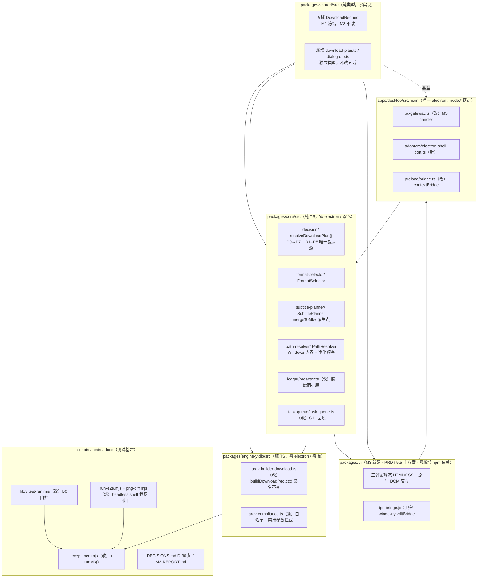
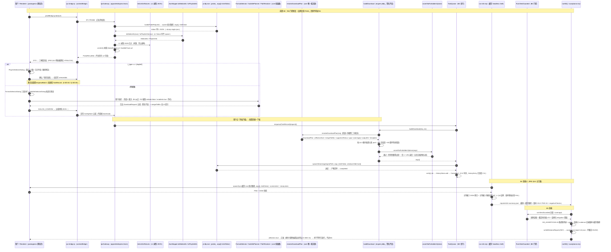
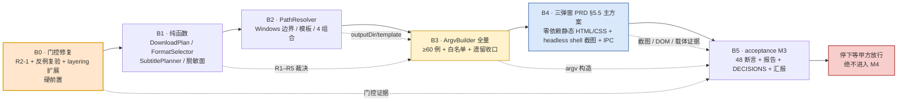

# YTVDLT · M3「格式 / 字幕 / 路径全量」增量系统架构设计与任务分解

> **文档类型**：增量架构设计 + 施工单（工程师寇豆码**唯一**设计依据，可直接照做）
> **作者**：高见远（Gao）· 架构师　|　**版本**：v1.1　|　**日期**：2026-11-05
> **v1.1 变更**：按产品经理修订版 `docs/PRD-M3.md`（473 行，新增 §5.5）与主理人两条补充调整 —— ① B4 载体由「离线降级方案」升为 **PRD §5.5 生效主方案**（零依赖静态 HTML/CSS + 缓存 headless shell），不再设计 React 主方案、不规划任何 npm 安装 / React 组件化；② DECISIONS 编号重排 **D-30 = R5、D-31 = B4 载体偏离、D-32 = B0 门控**；③ 补 `chrome-headless-shell.exe` 实测版本 / 缓存路径 / 软件渲染证据与 diff 判定口径；④ 补 Q-M3-15…18、验收④证据字段、M3 汇报显式列出、禁止虚报；⑤ 对齐 PRD Q-M3-05 的 `--ppa` 默认「显式 argv」并澄清无空格断言的适用边界。**其余章节、argv 冻结顺序表、B0–B5 批次、48 条断言口径全部不变**。
> **项目根**：`C:/Users/leolee/WorkBuddy/2026-11-05-08-16-08/ytvdlt`（下称 `ytvdlt/`，本文路径一律相对此根）
> **上游输入（按优先级）**：① 主理人任务书 + 两条补充（核心裁决，已复核采纳）→ ② `docs/PRD-M3.md` **v 修订版 473 行（含 §5.5）**（许清楚）→ ③ `docs/PRD-M1.md` §3 / `docs/ARCHITECTURE-M2.md` §4.1（冻结契约）→ ④ `docs/DECISIONS.md`（D-01…D-29）→ ⑤ **实际代码**（已逐一只读核对，见 §0.4）
> **本文边界**：只产出本文档；不改代码 / 测试 / 验收脚本 / `package.json` / `pnpm-lock.yaml` / `docs/PROJECT-HANDOFF.md` / `docs/PRD-M3.md`；不执行 `pnpm add` / `pnpm install`；**本轮不联网**。
> **停下声明（前置）**：**M3 汇报后停下，未获甲方放行不进 M4**（§10）。

---

## 0. 硬边界与裁决速查

### 0.1 七条核心裁决（主理人已复核，照此设计，不重新讨论）

| # | 裁决 | 落地约束 |
|---|---|---|
| **C1** | **断言口径**：M3 归属 **36 条**矩阵项（§4.1=3、§4.2=12、§4.3=8、§4.4=7、§4.5=4、§4.6=2）+ 新增 `A-M3-01…12` = **48 条**判定断言 | 依据 `docs/PRD-M1.md` §3.7 与 `scripts/acceptance.mjs:25,135`；`A-4.2-06`(M2) / `A-4.4-30`(M1) / `A-4.6-02`(M2，D-25) 是**回归复验项**，不计入 36、不改号、不重排。交接包 §7.3「§4.2 13 条全归 M3」是错的；PRD 修订版 36 条映射表一行未动 |
| **C2** | **冻结契约不可动**：`packages/shared/src/request.ts` 的 `DownloadRequest` 五域签名 M1 冻结 | M3 **不新增 / 不修改任何五域字段**；`mergeToMkv` 只能作为 `SubtitlePlanner` / `DownloadPlan` **内部派生值**，绝不写入 `PathsDomain`（`request.ts:45-54` 无该字段） |
| **C3** | **M2 已实现 ≠ 从零做** | `packages/engine-ytdlp/src/argv-builder-download.ts:63-88` 已生成 `-f / -S / -x / --audio-format / --audio-multistreams` 及 `--write-subs / --sub-langs / --write-auto-subs / --embed-subs / --convert-subs`；`sortingFields` 优先于 `quality` 已用 if/else。M3 = **补全未消费字段 + 加裁决**。**`A-M2-25` 冻结的 download argv 顺序必须逐元素不回归** |
| **C4** | **待补全字段清单**（PRD §9-④） | `videoCodecPref/audioQuality/audioCodecPref`、`subtitle.skipTranslated/keepSubtitleFile`、`paths.privateMode/subdirByExtractor/subdirByPlaylist/tempDir/commandDir`、`network.ipv4Only/aria2cPath`、`advanced.sponsorblockRemove/downloadSections/splitChapters/customTitle/debug/customCommand`（`customCommand` M3 **明确不消费**）；目前只有 `downloadArchive` 被用 |
| **C5** | **互斥裁决优先级链 P0→P7**（PRD §4.1）+ **R1–R5 五组必测冲突**（§4.2） | R5（裁剪 > 拆分 > 嵌入 mkv；split 抑制 remux/merge/embed；章节为空禁用 split；冲突记 WARNING）是 HANDOFF 未定义的**新增设计决定**，须固化并写入 `docs/DECISIONS.md` **D-30** |
| **C6** | **B0 是硬前置** | R2-1 门控修复 + 反例复验未通过，不得进 B1；否则 M3 的「全绿」不可信 |
| **C7** | **B4 载体以 PRD §5.5 为唯一主方案** | 弹窗 = 纯零依赖静态 HTML/CSS + 原生 DOM 交互（三独立页面）；截图 = 直调缓存 `chromium_headless_shell-1234`；**不引入任何 UI npm 依赖、不改 `package.json` 登记项、不动 `pnpm-lock.yaml`、不搭建 Electron renderer**。定性为「**实现载体 / 验收工具的临时等价替代，不是功能范围删减**」。偏离写入 **D-31**；联网后按 §5.5 表 5 项补齐（**本轮不规划 npm 安装 / React 组件化**）。§5.1–5.3 规格、三态、确认回写字段、`A-M3-01…06` 与四条验收判据**全部不变且仍为 P0**；**B1–B3 纯 TS 参数分支不受离线约束、仍是 P0 与 M3 主体交付** |

### 0.2 实测基线（主理人已实测，直接采用，不重复核验）

| 项 | 值 |
|---|---|
| `npm test` | 206/206 全绿，覆盖率四维最低 84.7%（v8） |
| M1 验收 | 17/17 断言 + 5/5 `allGreen=true` |
| M2 验收 | 37/37 断言 + 5/5 `allGreen=true` |
| `check-layering` / `check-runtime` | 0 违规 / 3 项必需 OK（aria2c OPTIONAL 缺失符合预期） |
| **R2-1 漏洞现场** | 跑 M1 验收真实触发 `[safe-delete][SAFE_DELETE_BULK_CONFIRM_REQUIRED] {"count":75,"threshold":50}`；`scripts/lib/vitest-run.mjs:45-55` 的 `artifactsProveSuccess()` **无 mtime / run-id / 新鲜度校验、无覆盖率四维 ≥70 复算**；第 94 行 `originalStatus` 只返回未落盘（`scripts/acceptance.mjs:104` 仅 push 字符串 `'M1:coverage-tmp'`） |
| `scripts/acceptance.mjs` | `M1_ASSERTIONS`(21–39)、`ACCEPTANCE_FIVE`(41–47)、`collectEvidence()`(86–125，:97 调 `runVitestGuarded`)、M2 分支 :129 起、milestone 分派 **:363 只有 M1/M2 两分支**；`writeMilestoneReports()` 已分文件写（D-27） |
| 根 `package.json` | `scripts` **无 `test:e2e`**；`react`/`react-dom`/`@mui/material`/`@playwright/test` 仅在 `ytvdltPlannedDependencies`(:31–41)，未安装、不在 `pnpm-lock.yaml` |
| 目录 | `packages/ui/`、`tests/e2e/`、`apps/desktop/src/renderer`、`playwright.config.*`、`*.spec.ts(x)`、renderer 目录**全部 0 结果**；`node_modules/electron/dist` **无二进制** |
| 离线资产 | Playwright 浏览器缓存 `chromium-1234` / `chromium_headless_shell-1234` / `ffmpeg-1011` / `winldd-1007` 已存在；pnpm store `C:/Users/leolee/AppData/Local/pnpm/store/v3`；**headless shell 实测版本见 §1.5.1 #6** |

### 0.3 本轮 M3 明确不做（PRD §8 / P2，含修订版 P2-11）

并发调度（M4）、托盘 / 系统通知（M4）、自定义命令模板 CRUD（M4）、播放列表**批量入队**（M4）、七态并发快照（M4）、NSIS / 便携 EXE 打包（M5）、L3 在线烟测（M5）、主题三态 / i18n / 全局快捷键（M5）、`probePlaylist()` **真实实现**（不做，留 M4，Q-M3-04）、真暂停 / 优先级 / arm64（延后）、竞品分析、**本轮联网安装 UI / 测试依赖与搭建正式 React + MUI + `@playwright/test` + Electron renderer 基建（PRD P2-11）**。

### 0.4 本文已只读核对的代码依据

`packages/shared/src/{request,media,ports,errors,engine,ipc,index}.ts`、`packages/core/src/{index,download-flags,logger/redactor,config-store/defaults,task-queue/task-queue}.ts`、`packages/engine-ytdlp/src/{argv-builder,argv-builder-download,json-mapper,yt-dlp-engine,index}.ts`、`scripts/{acceptance,run-tests,check-layering}.mjs`、`scripts/lib/vitest-run.mjs`、`tests/unit/argv-builder-download.test.ts`、`vitest.config.ts`、`apps/desktop/src/main/{ipc-gateway,index,app-host}.ts`、根 `package.json`、`pnpm-lock.yaml`、pnpm store v3 / v11、`ms-playwright` 缓存、**`docs/PRD-M3.md` 修订版 §5.5 / §6 验收④ / §9 差异登记 / §10 Q-M3-15…18**。

---

## 1. 实现方案与模块划分

### 1.1 一句话方案

> **在 M1/M2 冻结地基上补四层：① `packages/shared` 只新增「独立类型」（不改五域）；② `packages/core` 新增纯函数「双阶段裁决 + FormatSelector / SubtitlePlanner / PathResolver」；③ `packages/engine-ytdlp` 在**不改 `buildDownload` 签名、不重排冻结顺序**的前提下，以「条件性新增段」补全全量 argv 并加合规白名单拦截；④ `packages/ui` + `apps/desktop/src/main` 按 **PRD §5.5 生效主方案**以**零新增 npm 依赖**的静态 HTML/CSS 三弹窗 + IPC / Electron `shell` 落地。B0 先修验收门控，B5 新增 `--milestone M3` 产出 48 条断言报告后停下。**

### 1.2 分层图



> **依赖方向铁律**：`core` **不** import `engine-ytdlp`；`engine-ytdlp` → `core` 的运行时依赖**允许且已存在**（`packages/engine-ytdlp/package.json:16` 已声明 `"@ytvdlt/core": "workspace:*"`，M2 `yt-dlp-engine.ts:17` 已有 type-only import）。`check-layering.mjs` 只禁 `electron` / `node:*`，不禁 workspace 包（§2.2 扩展扫描范围）。
> **分层铁律（PRD §5.5）**：静态载体（`packages/ui/**`）**不接触子进程 / `node:fs` / `electron`**；`core` / `engine-ytdlp` 仍零 electron、零 fs。

### 1.3 四个技术难点与对策

| # | 难点 | 现状（实测） | 对策（本设计关键决策） |
|---|---|---|---|
| **D1** | **argv 冻结顺序 vs 全量参数扩展** | `A-M2-25` 用**手写字面量** `EXPECTED_MINIMAL`（`tests/unit/argv-builder-download.test.ts:51-68`）逐元素断言；同文件 :89-94 另有 `argv.every(e=>!/\s/.test(e))` 断言，**仅对 minimal 请求 `buildDownload(req(), CTX)` 生效**（§4.4 不变量 4 澄清） | ① M3 全部新增段**一律条件性 push**，默认 `DownloadRequest`（全字段默认 / 关闭）时**一个都不触发** → `EXPECTED_MINIMAL` 逐元素不变；② 用户文本（`customTitle` / `languages` / `newTitle`）进 argv 前经 `PathResolver.sanitizeToken()`（空白 / 控制字符 → `_`）；③ `--ppa` 按 PRD Q-M3-05 用**显式单一选项值**（不写临时 config），仅音频封面场景出现、minimal 不触发，版本不支持才降级（§4.6 / D-36）；④ `DOWNLOAD_ARGV_FROZEN_ORDER` 常量**保持 M2 原样不动**，新增段另立 `DOWNLOAD_ARGV_M3_SEGMENTS` 描述表 |
| **D2** | **冻结 DTO 无字段，却要生成 remux / 元数据 / 缩略图参数** | `PathsDomain` 无 `mergeToMkv`；`AdvancedDomain` 无 `embedMetadata` / `embedThumbnail` / `writeThumbnail` / `restrictFilenames`；PRD `A-4.2-10/11`、`A-4.4-04` 却要求这些参数出现 | 引入 **`DownloadPlan`（新增独立类型，非 DTO 字段）** 作为唯一派生层：`resolveDownloadPlan(req)` 由既有五域字段**确定性派生**全部开关（含 `mergeToMkv` / `restrictFilenames` / `embedMetadata` / `embedThumbnail` / `explicitTempDir` / `ppa`），`buildDownload` 读 plan 而非直接读 DTO（§3.6）。`mergeToMkv` 绝不写回 `PathsDomain` |
| **D3** | **B4 无 React / Playwright、无 Electron 二进制、不联网** | 见 §1.5.1 判定结论记录 | **PRD §5.5 生效主方案**：零新增 npm 依赖静态 HTML/CSS + 原生 DOM 交互，直调缓存 `chrome-headless-shell.exe --headless --screenshot --dump-dom` + Node 内置模块驱动；`npm run test:e2e` 指向 `node scripts/run-e2e.mjs`（**不是** `playwright test`）。Electron `shell` 真实 L2 复验降级为契约 + L0 单测 + `SKIPPED` 留痕（§9.2） |
| **D4** | **R2-1 验收门可被陈旧证据欺骗** | `artifactsProveSuccess()` 只看 `success===true && 0 failed` + `coverage-summary.json` 存在；无新鲜度、无覆盖率复算、无留痕 | B0 三合一修复：spawn 前 `unlink` 两份旧证据 + 记 `startedAt/runId` → spawn 后校验 **mtime ≥ startedAt** + **覆盖率四维 ≥70 复算** + `guardMitigated` **结构化落盘**；新增 `guard-negative-check.mjs` 做 4 反例 + 1 正例复验（§5.2 / §6.1） |

### 1.4 双阶段裁决模型（★ 最关键设计，工程师必须照此实现）

PRD §4 总原则要求「冲突在 `FormatSelector` / `SubtitlePlanner` / `PathResolver` 构造 `DownloadRequest` **之前**裁决完毕，`buildDownload()` 仍是纯函数」。工程落地为**双阶段、单一事实源**：

| 阶段 | 位置 | 职责 | 产出 |
|---|---|---|---|
| **阶段 1（UI 侧）** | `packages/core/src/{format-selector,subtitle-planner,path-resolver}/` | 把弹窗用户选择映射为**合法五域 DTO**：`FormatSelector` 纠正 `audioMultistreams`（R4）、`formatId` vs `sortingFields`（P3）；`SubtitlePlanner` 在音频模式强制 `embed=false`（R3 / P1）、按选中语言强制 `enabled=true`（A-4.3-08）、派生 `mergeToMkv` 供 UI 提示「将强制合并为 MKV」；`PathResolver` 净化模板 / 标题 / 路径 | 合法的 `DownloadRequest`（**五域签名不变**）+ UI 提示 / 禁用态 / WARNING |
| **阶段 2（构造侧，防御性二次裁决）** | `packages/core/src/decision/download-plan.ts` → `resolveDownloadPlan(req)` | **唯一裁决事实源**：按 P0→P7 优先级链 + R1–R5 把 req 归约为 `DownloadPlan`（含全部 argv 派生值 + `warnings[]`）。被阶段 1 三个纯函数与 `buildDownload` **共同复用** | `DownloadPlan`（纯数据，可单测） |
| **argv 生成** | `packages/engine-ytdlp/src/argv-builder-download.ts` | `const plan = resolveDownloadPlan(req)` → 按 §4 顺序表生成 argv（**所有条件判定改读 `plan.*`**）→ `assertNoForbiddenOptions(argv)` → 返回 | `string[]`（纯函数，签名不变） |

> **为什么允许阶段 2**：DTO 还可能来自 config 导入 / M4 批量入队 / 契约测试，必须在 argv 构造层再做一次确定性归约，保证「同入参 → 同数组」且任何路径下都不会产出互斥 argv。`FormatSelector` 等仍负责「UI 选择 → DTO」的首次裁决，PRD 语义不被削弱。
> **`buildDownload` 签名不变**：仍为 `buildDownload(req: DownloadRequest, ctx: DownloadContext): string[]`；`DownloadContext` 保持 `{jsRuntimePath, ffmpegDir, artifactManifestPath}` **不加字段**。

### 1.5 B4 载体 —— PRD §5.5 生效主方案（★ 判定结论记录）

> **按主理人简化要求**：原「先只读判定 pnpm store 能否离线提供 react」这一步**只记录判定结论**，不展开选型论证；**本轮不设计 React 主方案、不规划任何 npm 安装或 React 组件化**。若需备选零依赖方案，见 §1.5.5。

#### 1.5.1 判定结论记录（只读实测，非推测）

| # | 只读检查 | 结论 |
|---|---|---|
| 1 | `node_modules/@playwright/test` / `react` / `react-dom` / `@mui/material` / `playwright` / `electron/dist` | **全部 MISSING**（PM 复核） |
| 2 | `pnpm-lock.yaml` 中 `react` / `react-dom` / `@playwright/test` / `@mui/material` 条目 | **0 命中** |
| 3 | `node_modules/.pnpm` 中 UI 相关包 | 仅 `vite@7.3.7` / `vitest@3.2.4` / `electron@45.2.2` / `turbo` / `tsx` / `typescript` / `@vitest/*` 等；**无 react / playwright / mui / emotion** |
| 4 | **pnpm store v3**（本仓库 `pnpm@9.15.9` 实际使用，`files/**/*-index.json` 共 **130** 个）完整包名去重清单 | **不含** `react` / `react-dom` / `@playwright/test` / `@mui/material`；唯一含 "react" 字样命中经核实为 `turbo@2.11.10` 误命中；`vite@7.3.7` 是已装依赖 |
| 5 | pnpm store **v11**（另一大版本，`index.db` 18 MB SQLite + `projects/`） | 二进制字符串命中 `@playwright/test`(12) / `react-dom`(286) / `react@`(6)。**但**：① 与 v3 不互通（pnpm 9 读 v3）；② 字符串命中只是另一项目的**索引元数据**，不等于包文件齐全；③ 即便齐全，离线安装必须重写 `pnpm-lock.yaml` 与 `node_modules`，**违反硬边界**「禁止改 lock / 禁止 `pnpm add` / `pnpm install`」；④ 本轮**不联网**。**不构成「可离线安装」依据** |
| 6 | **缓存 headless shell 可执行性实测（主理人提供，D-31 证据字段）** | 绝对路径 `C:\Users\leolee\AppData\Local\ms-playwright\chromium_headless_shell-1234\chrome-headless-shell-win64\chrome-headless-shell.exe`；`<exe> --version` → **`Google Chrome for Testing 151.0.7922.34`**、退出码 **0**（可运行，非仅目录存在）；同目录含 `libEGL.dll` / `libGLESv2.dll` / `vk_swiftshader.dll` / `vulkan-1.dll`，**具备软件渲染能力**。另有 `chromium-1234/chrome-win64/chrome.exe` 备用 |
| 7 | 其它缓存 / 运行时 | `ffmpeg-1011` / `winldd-1007` 存在；`node_modules/electron/dist` **空**（无 `electron.exe`）→ 无法起真实 `BrowserWindow` |

> **判定结论（记录，不再论证）**：`react` / `react-dom` / `@mui/material` / `@playwright/test` **本轮不可用且不得安装**；缓存 `chrome-headless-shell.exe` **实测可运行**（版本 `151.0.7922.34`），因此 PRD §5.5 的零依赖截图方案**可执行、不是纸面假设**。
> **本轮 B4 唯一主方案 = PRD §5.5 的「零依赖静态 HTML/CSS 三弹窗 + 原生 DOM 交互 + 缓存 headless shell 直调截图 + `tests/e2e/` 基线 diff」**；定性「**实现载体 / 验收工具的临时等价替代，不是功能范围删减**」；任务书原「React + 组件库 + Playwright 截图回归」正式基建为**联网后补做项**（§1.5.3 / D-31），**不阻塞本轮判绿**、**不删除 / 不跳过验收④**、**不声称已建成**。

#### 1.5.2 本轮主方案落地矩阵（PRD §5.5 生效）

| 维度 | **本轮主方案（PRD §5.5，实施）** | 联网后正式基建（补做项，**不阻塞判绿**） |
|---|---|---|
| 弹窗载体 | **纯零依赖静态 HTML/CSS + 原生 DOM 交互**，三个独立弹窗页面；静态资源目录由架构定为 **`packages/ui/`**（PRD §5.5 允许 `packages/ui/` 或 `tests/e2e/`，此处二选一取前者） | React 组件 + MUI（可选），`apps/desktop/src/renderer` 真正接入 |
| npm 依赖 | **0 个新增**；`package.json` 的 `ytvdltPlannedDependencies` 登记项**原样保留**、`pnpm-lock.yaml` **零改动** | 装 4 包并转正登记项、更新 lock（PRD §5.5 表 #1） |
| 数据注入 | **L1 录制的 `MediaInfo` / `PlaylistInfo` fixture JSON**（与 `packages/shared/src/media.ts` 同源），**禁止虚构格式 / 字幕 / 条目**；`MediaFormat.url` / `SubtitleTrack.url` 经 `omitUrl()` 剥离，**禁止渲染 / 日志 / 报告** | 同源 DTO，经 IPC 实时下发 |
| 交互 / 回写 | 原生 DOM 事件实现多选 / 搜索 / 已选计数 / **禁用·空态·错误态三态门禁**；确认产出与 `DownloadRequest` 五域**同构**的 JSON 回写结果（写入 `<pre id="ytvdlt-output">`），供纯 TS 断言核验 | 同规格、同字段（§5.1–5.3 不变） |
| 截图回归 | 直调缓存 `chrome-headless-shell.exe`，固定 `--window-size=1280,800 --force-device-scale-factor=1` + 固定字体栈 / DPI；`tests/e2e/` 基线 diff；**不依赖** `@playwright/test` / `playwright.config.*` | 新建 `playwright.config.ts` + `tests/e2e/*.spec.ts`，正式 runner 承担 `npm run test:e2e` |
| 驱动 / npm script | `node scripts/run-e2e.mjs`（Node 内置模块）；**新增** `"test:e2e": "node scripts/run-e2e.mjs"` | `npx playwright test`（联网后替换） |
| 分层 | 静态载体**不碰子进程 / `node:fs` / `electron`**；`core` / `engine-ytdlp` 仍零 electron、零 fs | Renderer 只经 IPC 发命令（P0-17） |
| 断言映射 | `A-M3-01…06` / `A-4.2-04` / `A-4.3-08` / `A-4.1-07` / `A-4.1-05` **全部不变、仍判绿** | 正式 runner 重跑并**替换基线**，`A-M3-01…06` **ID 不改号** |

> **PRD §5.1–5.3 不变且仍为 P0**：触发入口、数据来源（probe 结果 DTO）、控件与状态、禁用 / 空态 / 错误态、确认后回写字段**全部不变**；四条验收判据与 `A-M3-01…06` 不变（**只换载体**）。**B1–B3 纯 TS 参数分支（FormatSelector / SubtitlePlanner / PathResolver / ArgvBuilder）不受离线约束、仍是 P0 与 M3 主体交付**，验收①②③不受影响。

#### 1.5.3 截图脚本与基线 diff 判定口径（QA 可反例复验）

**(a) 驱动铁律**（主理人实测要求）：`scripts/run-e2e.mjs` 用 Node 内置 `child_process.spawnSync(绝对路径, argv[], {shell:false, windowsHide:true})` 调用 §1.5.1 #6 的 exe，**禁止字符串拼接命令**；参数**至少**含：

```text
--headless --disable-gpu --hide-scrollbars --force-device-scale-factor=1
--window-size=1280,800 --screenshot=<abs.png> file://<abs.html>
```

补充 `--virtual-time-budget=2000` 保证状态机渲染完成、`--dump-dom` 取 DOM 快照；`--disable-lcd-text` / CSS 固定字体栈（不依赖系统字体回退）保证跨机器稳定。`tests/e2e/` **同时存放三个弹窗的基线截图（PNG）、DOM 快照基线（HTML）与 fixture 注入数据（JSON）**。

**(b) 基线 diff 判定口径**（★ 主判据 + 备选，避免 PNG 元数据非确定性）：

| 级别 | 判据 | 说明 |
|---|---|---|
| **主判据 ①（确定性）** | **DOM 快照断言**：`--dump-dom` 输出 → Node 解析，断言三组分栏 / 按语言多选 / 禁用·空态·错误态 / `aria-disabled` / 已选计数 / 合计体积（缺失显「—」不虚构）/ 五域同构回写 JSON / **DTO 无 `url`、无 `mergeToMkv`** | 不受渲染元数据影响，**最稳定**，作为首判据 |
| **主判据 ②（像素）** | **像素容差 diff**：`scripts/lib/png-diff.mjs` 用 `node:zlib` 解 PNG IDAT + filter 0–4 逆变换 → 逐像素 RGBA 比对；尺寸必须 1280×800；容差默认「单通道差 ≤2 且不同像素占比 ≤0.1%」，可在 `e2e-cases.mjs` 按用例配置 | 跨机器可比；`reports/e2e-summary.json` 记录 `differPixels` / `ratio` / `tolerance` |
| **备选 / 辅助（不作主判据）** | PNG **字节或 SHA-256 哈希**比对 | Chrome 输出可能含**非确定性元数据**（时间戳 / 可选块），哈希**不稳**；仅在同一渲染环境且已验证字节稳定时启用，并须在 `reports/e2e-summary.json` 记录 `hashStable:true` + `sha256`，否则不得用于判定 |

**(c) QA 反例复验（必须可复现、可被证伪）**：`run-e2e.mjs` 支持 `--negative-checks`，产出 `reports/e2e-summary.json` 的 `negativeChecks[]`；三类反例**改坏任一基线必须 FAIL**：

1. 改坏任一 PNG 基线（替换 1 像素或整张） → **主判据 ② 必须 FAIL**；
2. 改坏任一 DOM 基线（删一个控件 / 改 `aria-disabled`） → **主判据 ① 必须 FAIL**；
3. 改坏 fixture（虚构一个 `format_id` / 注入 `url` 字段） → **数据同源 / URL 红线校验必须 FAIL**。

**(d) 可复现元数据**：`reports/e2e-summary.json` 必须记录 exe 绝对路径 + `--version` 值 `151.0.7922.34` + 全部 argv + 窗口 / DPI / 字体参数 + fixture 文件 SHA-256 + 基线文件 SHA-256 + 每项 `pass/fail` + `negativeChecks[]`。

#### 1.5.4 联网后补做项（PRD §5.5 表 5 项 / D-31，**本轮不规划、不实施**）

| # | 补齐项 | 判据 |
|---|---|---|
| 1 | 联网安装 `react` / `react-dom` / `@mui/material` / `@playwright/test`，`ytvdltPlannedDependencies` 转正、更新 `pnpm-lock.yaml` | 四个包在 `node_modules` 与 lock 中可查；安装命令成功 |
| 2 | 补齐 `electron` dist 二进制，`apps/desktop/src/renderer` 真正接入 `packages/ui/` | Electron 窗口可启动，Renderer 只经 IPC 发命令（P0-17） |
| 3 | 新建 `playwright.config.ts` 与 `tests/e2e/*.spec.ts`，静态弹窗迁移为 React 组件（MUI 可选） | 三弹窗组件化且 §5.1–5.3 规格不变；`npm run test:e2e` 由正式 runner 承担 |
| 4 | 正式 `@playwright/test` 重跑三弹窗截图基线并 **替换** 本轮缓存 shell 基线，复验 `A-M3-06` | 新基线 diff 通过；`A-M3-01…06` **ID 不改号**（D-04） |
| 5 | `DECISIONS.md` 追加「补齐完成」登记并在汇报注明 | 偏离闭环、可审计 |

> **约束**：联网前**必须先告知用户**（`PROJECT-HANDOFF.md` §6.4）；**本轮不规划任何 npm 安装或 React 组件化**；`acceptance-report-m3.json` 验收④ `evidence` 须记录**载体与缓存路径**；M3 汇报「剩余 / 阻塞 / 偏离」显式列出；**禁止虚报**已建成 React / MUI / `@playwright/test` 正式基建或 Electron renderer 已接入，**不得把登记项写成已安装依赖**。

#### 1.5.5 备选零依赖方案（**不采用**，仅登记）

| 备选 | 说明 | 不采用原因 |
|---|---|---|
| 用 `chromium-1234/chrome-win64/chrome.exe`（完整 Chromium）代替 headless shell | 同缓存、同样 `--headless --screenshot --dump-dom` | 完整版二进制更大、启动更慢、依赖更多 DLL；headless shell 已实测可运行且轻量 |
| 完全放弃 PNG diff，只做 DOM 快照断言 | 零像素处理、`png-diff.mjs` 可省 | PRD §5.4 / 验收④明确要求「三弹窗各 ≥1 张基线截图 + 空态 / 禁用态截图」，不能删截图回归 |
| 用 `node:test` 驱动而非 `vitest` 做 DOM 断言 | 全 Node 内置 | 现有 `vitest` 已装且契约测试统一在 `tests/contract/`；混用会增加口径分裂 |

---

## 2. 文件清单（新增 / 修改严格分开）

> 状态：`新增` / `修改（仅追加）` / `修改（缺陷修复）` / `构建产物`。**「修改」一律只增不改 M1/M2 已冻结签名 / 已冻结断言**。
> `packages/ui/` 为 M3 **新建 workspace 包**；按 **PRD §5.5 生效主方案**，其内容为 `.html` / `.css` / `.js`，**不是 `.tsx`**（偏离见 §1.5 / **D-31**）。静态资源目录由架构定为 `packages/ui/`；`tests/e2e/` 从零存放基线截图、**DOM 快照基线**与 **fixture 注入数据**。

### 2.1 新增文件（N=46，含本文与 B5 汇报）

#### `packages/shared/src/`（2）— 纯类型，**不改五域**

| # | 相对路径 | 职责 | 批次 |
|---|---|---|---|
| M3-F001 | `packages/shared/src/download-plan.ts` | `DownloadPlan` / `PlanWarning` / `PlanWarningCode`（§3.2）—— **新增独立类型，不是 `DownloadRequest` 字段** | B1 |
| M3-F002 | `packages/shared/src/dialog-dto.ts` | `FormatSelection` / `SubtitleSelection` / `PlaylistSelection` / `DialogKind` / `DialogState` / `ProbeResultDto` / `DialogConfirmResult`（IPC 传输 DTO，**不含 `url` 字段**，§8.4） | B1 / B4 |

#### `packages/core/src/`（8）— 纯 TS，零 electron / 零 fs

| # | 相对路径 | 职责 | 批次 |
|---|---|---|---|
| M3-F003 | `packages/core/src/decision/download-plan.ts` | `resolveDownloadPlan(req): DownloadPlan` —— **P0→P7 + R1–R5 唯一裁决源**（§3.7） | B1 |
| M3-F004 | `packages/core/src/decision/index.ts` | barrel | B1 |
| M3-F005 | `packages/core/src/format-selector/format-selector.ts` | `FormatSelector`：`classifyFormats` / `recommendFormat` / `sumSelectedBytes` / `selectFormats`（§3.3） | B1 |
| M3-F006 | `packages/core/src/format-selector/index.ts` | barrel | B1 |
| M3-F007 | `packages/core/src/subtitle-planner/subtitle-planner.ts` | `SubtitlePlanner`：`groupLanguages` / `validateLanguageExpression` / `planSubtitles`；**`mergeToMkv` 派生点**（§3.3 / §3.6） | B1 |
| M3-F008 | `packages/core/src/subtitle-planner/index.ts` | barrel | B1 |
| M3-F009 | `packages/core/src/path-resolver/path-resolver.ts` | `PathResolver`：`sanitizeToken` / `sanitizeFileName` / `renderTemplate` / `buildOutputDir` / `resolveOutputPath` / `truncateWindowsPath`（§3.3） | B2 |
| M3-F010 | `packages/core/src/path-resolver/index.ts` | barrel | B2 |

#### `packages/engine-ytdlp/src/`（1）

| # | 相对路径 | 职责 | 批次 |
|---|---|---|---|
| M3-F011 | `packages/engine-ytdlp/src/argv-compliance.ts` | `ALLOWED_DOWNLOAD_OPTIONS` 白名单 + `M3_FORBIDDEN_OPTIONS` + `assertNoForbiddenOptions(argv)`（§4.5） | B3 |

#### `packages/ui/`（12，**新建包 · 零新增 npm 依赖**）

| # | 相对路径 | 职责 | 批次 |
|---|---|---|---|
| M3-F012 | `packages/ui/package.json` | workspace 包；**运行时依赖 0**；`scripts.typecheck = "tsc --noEmit -p tsconfig.json"` | B4 |
| M3-F013 | `packages/ui/tsconfig.json` | `allowJs:true, checkJs:false, noEmit:true, lib:["ES2022","DOM"], types:[]`（纯 JS 也能过 turbo typecheck） | B4 |
| M3-F014 | `packages/ui/src/styles/ytvdlt.css` | 固定 1280×800 布局、固定字体栈（不依赖系统字体回退）、三态样式、`aria-disabled` 视觉 | B4 |
| M3-F015 | `packages/ui/src/dialogs/dialog-state.js` | 原生 DOM 状态机（`ready / empty / error / disabled` 四态覆盖 PRD 禁用·空·错三态 / 确认门禁 / 搜索 / 多选 / 计数 / 五域同构 JSON 回写序列化 / 错误行内提示） | B4 |
| M3-F016 | `packages/ui/src/dialogs/format-selector.html` | 格式弹窗（三组分栏） | B4 |
| M3-F017 | `packages/ui/src/dialogs/format-selector.js` | 格式弹窗逻辑（默认建议格式、合计体积、MP3 时音质档位置灰、audio-only ≥2 → multistreams） | B4 |
| M3-F018 | `packages/ui/src/dialogs/subtitle-selector.html` | 字幕弹窗（建议 / 其它 / 自动三组） | B4 |
| M3-F019 | `packages/ui/src/dialogs/subtitle-selector.js` | 字幕弹窗逻辑（语言表达式校验、音频模式 / split 模式嵌入口置灰） | B4 |
| M3-F020 | `packages/ui/src/dialogs/playlist-selector.html` | 播放列表弹窗（按钮文案「保存选择」） | B4 |
| M3-F021 | `packages/ui/src/dialogs/playlist-selector.js` | 播放列表弹窗逻辑（**只回写选中 id，绝不入队**） | B4 |
| M3-F022 | `packages/ui/src/ipc-bridge.js` | 只经 `window.ytvdltBridge`（preload `contextBridge`）发命令；**不 import electron / node:fs / 子进程** | B4 |
| M3-F023 | `packages/ui/src/fixtures/probe-fixture.js` | **从 `tests/e2e/fixtures/*.json` 加载 L1 录制 DTO + `omitUrl()` 脱敏**；**不硬编码、不虚构**任何格式 / 字幕 / 条目；与 `packages/shared/src/media.ts` 同源（PRD §5.5 / Q-M3-15 / Q-M3-17） | B4 |

#### `apps/desktop/src/main/`（1）

| # | 相对路径 | 职责 | 批次 |
|---|---|---|---|
| M3-F024 | `apps/desktop/src/main/adapters/electron-shell-port.ts` | `IShellPort` 的 Electron `shell` 实现：`openPath` / `showItemInFolder`（A-4.6-02 / A-M3-12，§9.2） | B3 |

#### `scripts/`（4）

| # | 相对路径 | 职责 | 批次 |
|---|---|---|---|
| M3-F025 | `scripts/lib/guard-negative-check.mjs` | **B0 反例复验驱动**：4 反例 + 1 正例，产出 `reports/r2-1-negative-verification.json`（§5.2 / §6.1） | B0 |
| M3-F026 | `scripts/lib/png-diff.mjs` | 零依赖 PNG 解码（`node:zlib` 解 IDAT + filter 0–4 逆变换）+ **主判据 ② 逐像素 RGBA 容差 diff** + 尺寸 1280×800 校验 + 反例 CAPTURE（§1.5.3） | B4 |
| M3-F027 | `scripts/e2e-cases.mjs` | 三弹窗用例表：场景 → **fixture 注入数据** → 期望 DOM 快照基线 / 状态 / 截图基线 / 断言 ID 映射 / 反例用例 | B4 |
| M3-F028 | `scripts/run-e2e.mjs` | `npm run test:e2e` 入口：`spawnSync(绝对路径, argv[], {shell:false, windowsHide:true})` 调缓存 exe 做 `--screenshot` + `--dump-dom`；**主判据 ① DOM 快照 + 主判据 ② 像素容差**、备选用哈希；`--negative-checks` QA 反例；产出含可复现元数据的 `reports/e2e-summary.json` | B4 |

#### `tests/`（16）

| # | 相对路径 | 职责 | 批次 |
|---|---|---|---|
| M3-F029 | `tests/unit/download-plan.test.ts` | **R1–R5 五组正反例** + P0→P7 优先级链枚举（`A-M3-10` / `A-4.2-09` / `A-4.3-06` / `A-4.2-12`） | B1 |
| M3-F030 | `tests/unit/format-selector.test.ts` | 三组分栏分类、建议格式（最高 tbr）、合计体积（缺失 → `null`）、audio-only 计数 → R4 | B1 |
| M3-F031 | `tests/unit/subtitle-planner.test.ts` | 语言分组、表达式校验、音频模式强制 `embed=false`、选中语言强制 `enabled=true`、`mergeToMkv` 派生 | B1 |
| M3-F032 | `tests/unit/path-resolver.test.ts` | **Windows 边界**：9 类非法字符 + 控制字符、保留名大小写不敏感（含 `CON.txt` / `con`）、结尾点 / 空格、`%(title).200B` 截断、259/260/261、UNC + `\\?\` + `\\?\UNC\`、4 组合路径预览、净化顺序（Q-M3-09） | B2 |
| M3-F033 | `tests/unit/argv-builder-m3.test.ts` | **≥60 例组合**（清晰度 8 × 编码 2 × 音频 6 × 字幕 5 × 路径 4），`EXPECTED_DOWNLOAD_ARGV` 为**字面量数组**；`A-M2-25` 逐元素复验、`--` 恰 1、URL 最后、`enginePath` 不入 argv、**无含空格拼接元素**、禁用参数零出现 | B3 |
| M3-F034 | `tests/unit/argv-compliance.test.ts` | 逐项注入 PRD §7 禁用参数 → `assertNoForbiddenOptions` 抛错；白名单外选项不可出现 | B3 |
| M3-F035 | `tests/unit/vitest-run-guard.test.ts` | B0 门控单测（新鲜度 / 覆盖率四维 / 留痕 / 反例） | B0 |
| M3-F036 | `tests/unit/redactor-m3.test.ts` | **A-4.4-30 复验**：`--cookies` / `--proxy` / `--add-header` / `--replace-in-metadata` / `--ppa` 掩码、JSONL、report 全字段 | B1 |
| M3-F037 | `tests/unit/electron-shell-port.test.ts` | `IShellPort` Electron 实现契约（注入 fake `shell`）+ A-4.6-02 复验 | B3 |
| M3-F038 | `tests/contract/playlist-fixture.contract.test.ts` | **A-4.1-05 L1**：`toPlaylistInfo(info-flat-playlist.json)` 按 `_type` 分流、条目数 / 标题逐条一致、**不 spawn / 不触网** | B4 |
| M3-F039 | `tests/contract/dialog-dto.contract.test.ts` | 三弹窗确认回写**五域同构 JSON**契约（`format.*` / `subtitle.*` / 选中 id 列表），断言**无 `mergeToMkv`、无 `url`、未调用 `enqueueBatch`**；校验 fixture 与 `media.ts` 同源 | B4 |
| M3-F040 | `tests/e2e/README.md` | 基线生成 / 更新流程、固定渲染参数、**主判据 ① / ② 与备选口径**、跨机器 diff 容差、**QA 反例复验步骤**（改坏基线必须 FAIL） | B4 |
| M3-F041 | `tests/e2e/baselines/.gitkeep` | 基线目录占位：三弹窗 **PNG 截图基线** + 空态 / 禁用态截图 + **DOM 快照基线 `*.dom.html`**（首次 `npm run test:e2e -- --update-baselines` 生成后入库） | B4 |
| M3-F042 | `tests/e2e/fixtures/dialog-media.json` | **L1 录制** `MediaInfo`（格式 / 字幕 / 章节真实字段，与 `media.ts` 同源；**不含 `formats[].url` / `subtitles[].url` / `automatic_captions[].url`**） | B4 |
| M3-F068 | `tests/e2e/fixtures/dialog-playlist.json` | **L1 录制** `PlaylistInfo`（来自 `--flat-playlist --dump-single-json` fixture，条目真实、`_type:'playlist'`） | B4 |
| M3-F069 | `tests/e2e/fixtures/dialog-media-empty.json` | **L1 录制**空数据场景（`formats:[]` / `subtitles:{}` / `entries:[]` / probe 失败），供**空态 / 禁用态 / 错误态**截图与 DOM 断言；**不虚构数据** | B4 |

#### `docs/`（2）

| # | 相对路径 | 职责 | 批次 |
|---|---|---|---|
| M3-F043 | `docs/ARCHITECTURE-M3.md` | 本文 | 本次 |
| M3-F044 | `docs/M3-REPORT.md` | B5 汇报（PRD §11 模板 + 48 条对照表 + **剩余 / 阻塞 / 偏离显式列出 B4 载体偏离与 D-30 / D-31** + 停下声明） | B5 |

### 2.2 修改文件（M=23，**一律仅追加 / 缺陷修复**）

| # | 相对路径 | 修改内容 | 状态 | 批次 |
|---|---|---|---|---|
| M3-F045 | `packages/shared/src/index.ts` | 追加 `export * from './download-plan.js'` / `'./dialog-dto.js'` | 仅追加 | B1 |
| M3-F046 | `packages/shared/src/ipc.ts` | 追加 M3 channel 常量：`DIALOG_OPEN` / `DIALOG_CONFIRM` / `PATH_PREVIEW`（现有 `PROBE_PLAYLIST` 等**不动**） | 仅追加 | B1 |
| M3-F047 | `packages/core/src/index.ts` | 追加导出 `decision` / `format-selector` / `subtitle-planner` / `path-resolver` | 仅追加 | B1/B2 |
| M3-F048 | `packages/core/src/logger/redactor.ts` | `REDACT_VALUE_OPTIONS` 由数组改为 `Record<option, maskCount>`；新增 `--replace-in-metadata`(3) / `--ppa`(1)；`COMPLIANCE_BLOCKED_TOKENS` 追加 `--exec` / `--config-locations`；新增 `redactArgvN` 支持掩码后续 N 个值（**A-4.4-30 脱敏面复验**） | 向后兼容 | B1 |
| M3-F049 | `packages/core/src/download-flags.ts` | `detectPostprocessed()` 增补 `--embed-subs` / `--remux-video` / `--split-chapters` 触发（C2↔C8 动态二选一不回归，D-19） | 仅追加 | B3 |
| M3-F050 | `packages/core/src/task-queue/task-queue.ts` | `verify({...})` 的 `historyEntry: null` → **回填 `buildHistoryEntry(...)` 结果**激活 C11（D-28），保持 C12「verify 通过后才写历史」时序 | 缺陷修复 | B3 |
| M3-F051 | `packages/core/src/config-store/defaults.ts` | `paths` 域补 `videoDir` / `audioDir` / `commandDir` / `privateMode` / `tempDir` 默认键（A-4.4-01 重启保留）；`advanced` 补 `sponsorblockRemove` / `downloadSections` / `splitChapters` / `customTitle` | 仅追加 | B2 |
| M3-F052 | `packages/engine-ytdlp/src/argv-builder-download.ts` | **核心**：内部改读 `resolveDownloadPlan(req)`；按 §4.2 插入 M3 条件性新增段；末尾调 `assertNoForbiddenOptions(argv)`；**`buildDownload` 签名 / `DOWNLOAD_ARGV_FROZEN_ORDER` 常量 / M2 既有相对顺序全部不动** | 向后兼容 | B3 |
| M3-F053 | `packages/engine-ytdlp/src/index.ts` | 追加导出 `argv-compliance` / `DOWNLOAD_ARGV_M3_SEGMENTS` | 仅追加 | B3 |
| M3-F054 | `apps/desktop/src/main/ipc-gateway.ts` | 由 `export {}` 空桩实现 M3 handler：`PROBE` / `PROBE_PLAYLIST`（**L1 fixture 解析，不 spawn**）/ 三 `DIALOG_OPEN` / `DIALOG_CONFIRM` / `PATH_PREVIEW` / `CONFIG_GET\|SET`；入参白名单校验 | 从空桩实现 | B4 |
| M3-F055 | `apps/desktop/src/main/app-host.ts` | 组装 `IpcGateway` + `ElectronShellPort`（`CorePorts.shell`） | 仅追加 | B3/B4 |
| M3-F056 | `apps/desktop/src/main/index.ts` | 注册 gateway；**不 `createWindow`**（无 Electron 二进制，见 §9.2） | 仅追加 | B4 |
| M3-F057 | `apps/desktop/src/main/adapters/node-ports.ts` | 保持唯一 `node:*` 落点；`shell` 由 app-host 注入 Electron 版（**不改 `shell-port.ts`**，保留 explorer 版作非 Electron fallback） | 仅追加 | B3 |
| M3-F058 | `apps/desktop/src/preload/bridge.ts` | `contextBridge.exposeInMainWorld('ytvdltBridge', {...})` 暴露白名单方法 | 仅追加 | B4 |
| M3-F059 | `scripts/check-layering.mjs` | `SCAN_TARGETS` 追加 `packages/ui/src`；`collectTsFiles` → `collectSourceFiles`（同时收 `.ts` / `.js` / `.mjs`）；`FORBIDDEN_MODULES` 对 UI 追加 `node:fs` / `child_process` / `electron`（UI 只经 bridge） | 仅追加 | B0 |
| M3-F060 | `scripts/lib/vitest-run.mjs` | **B0 门控修复**：spawn 前 `unlink` 两份旧证据 + 记 `runId/startedAt`；`artifactsProveSuccess` 增 mtime 新鲜度 + 覆盖率四维 ≥70 复算；返回结构化 `mitigation`（含 `originalStatus`）并写 `reports/vitest-guard.json` | 缺陷修复 | B0 |
| M3-F061 | `scripts/run-tests.mjs` | 透传 `runVitestGuarded` 的结构化 `mitigation` 到 `reports/vitest-guard.json` | 仅追加 | B0 |
| M3-F062 | `scripts/acceptance.mjs` | ① `collectEvidence()` / `runM2()` 的 `GUARD_MITIGATIONS.push('M1:coverage-tmp')` 改为 push **完整 mitigation 对象**；② 新增 `runM3()` / `M3_ASSERTIONS`（48 条）/ **:363 附近新增 `if (milestone === 'M3')` 分支**；③ **验收④ `evidence` 记录 B4 载体与缓存 exe 绝对路径 + 版本 `151.0.7922.34`**；④ 统一走 `writeMilestoneReports('M3', report)`，**不得覆盖 M1/M2 报告** | 仅追加 | B5 |
| M3-F063 | `package.json` | `scripts` **新增** `"test:e2e": "node scripts/run-e2e.mjs"`；`ytvdltPlannedDependencies` **一字不动** | 仅追加 | B4 |
| M3-F064 | `tests/unit/argv-builder-download.test.ts` | **仅追加**新 `describe('M3 ...')` 块；`EXPECTED_MINIMAL`(51–68) 与既有 9 条断言**一字不改**（含 :89-94 的 minimal 无空格元素断言） | 仅追加 | B3 |
| M3-F065 | `tests/unit/logger.test.ts` | 仅追加 M3 脱敏面复验用例 | 仅追加 | B1 |
| M3-F066 | `tests/fixtures/README.md` | 追加 M3 fixture 来源说明（L1 录制 / 脱敏 / 无凭据 / **禁止虚构**） | 仅追加 | B4 |
| M3-F067 | `docs/DECISIONS.md` | 追加 **D-30 起**偏离清单（§9.3；**D-30 = R5、D-31 = B4 载体、D-32 = B0 门控**） | 仅追加 | B0…B5 |

> **统计**：新增 **46** 个文件 / 修改 **23** 个文件 / 构建产物 4 类（下表）。`packages/ui` 新建包占新增 12 个；`tests/e2e/fixtures/` 三份 L1 录制 JSON 为 F042 / F068 / F069。**`packages/ui` 与 `tests/e2e/` 基线目录均从零搭建，不引入 npm 依赖**（PRD §5.5 / 差异登记 ⑮）。

### 2.3 构建产物（不施工，由命令生成）

| 相对路径 | 生成者 | 批次 |
|---|---|---|
| `reports/r2-1-negative-verification.json` / `reports/vitest-guard.json` | `guard-negative-check.mjs` / `vitest-run.mjs` | B0 |
| `reports/e2e-summary.json`（含 `negativeChecks[]` + 可复现元数据）+ `tests/e2e/baselines/*.png` + `*.dom.html` | `run-e2e.mjs` | B4 |
| `reports/acceptance-report-m3.json` + `acceptance-report.json` + `acceptance-index.json` | `writeMilestoneReports('M3')` | B5 |

---

## 3. 数据结构与接口

### 3.1 冻结契约（**M1 冻结，M3 一字不改**）

`packages/shared/src/request.ts:23-84`：

| 域 | 字段（`readonly`） | M3 是否改 |
|---|---|---|
| `FormatDomain` | `quality`(8 档) / `videoCodecPref` / `formatId` / `sortingFields` / `extractAudio` / `audioQuality`(**6 档**: best/192/128/64/32/lowest) / `audioCodecPref` / `audioFormat` / `audioMultistreams` | **否** |
| `SubtitleDomain` | `enabled` / `languages` / `autoCaptions` / `skipTranslated` / `convertTo`(5) / `embed` / `keepSubtitleFile` | **否** |
| `PathsDomain` | `videoDir` / `audioDir` / `commandDir` / `privateMode` / `subdirByExtractor` / `subdirByPlaylist` / `outputTemplate` / `tempDir` | **否**（**无 `mergeToMkv`**） |
| `NetworkDomain` | `rateLimit` / `proxy` / `cookiesFile` / `userAgent` / `ipv4Only` / `concurrentFragments` / `aria2cPath` | **否** |
| `AdvancedDomain` | `sponsorblockRemove` / `downloadSections` / `splitChapters` / `customTitle` / `debug` / `downloadArchive` / `customCommand` | **否**（`customCommand` M3 不消费） |
| `DownloadRequest` | `taskId` / `url` / `format` / `subtitle` / `paths` / `network` / `advanced` | **否** |

> `ProbeRequest` / `ProbeOptions` / `DownloadContext`（`argv-builder-download.ts:12-19`）同样**不改签名**。
> `ErrorCode` **17 码冻结**（`errors.ts:7-24`），M3 **不新增错误码**；`IShellPort` / `ProcessPort` / `SpawnOptions`（`ports.ts:30-38`，`shell:false` / `windowsHide:true` 类型层锁死）不改。

### 3.2 新增类型（独立文件，**不是五域字段**）

```ts
// packages/shared/src/download-plan.ts  —— M3-F001
export type PlanWarningCode =
  | 'R1_AUDIO_TRANSCODE_SUPPRESSES_ABR'
  | 'R5_SPLIT_SUPPRESSED_BY_SECTIONS'
  | 'R5_SPLIT_SUPPRESSES_EMBED'
  | 'R5_SPLIT_DISABLED_NO_CHAPTERS'
  | 'P1_AUDIO_MODE_SUPPRESSES_EMBED'
  | 'ARIA2C_SUPPRESSES_FRAGMENTS'
  | 'PPA_UNSUPPORTED_DOWNGRADED'
  | 'CUSTOM_COMMAND_IGNORED';

export interface PlanWarning { readonly code: PlanWarningCode; readonly detail: string; }

/** 唯一派生层输出：由 resolveDownloadPlan(req) 从五域确定性归约，绝不回写 DTO。 */
export interface DownloadPlan {
  // ---- 格式 / 音频（对应 argv 第 13–20 位）----
  readonly effectiveFormatId: string | null;      // -f 值；null 表示不生成 -f
  readonly effectiveSort: string | null;          // -S 值（复合串）；null 表示不生成 -S
  readonly extractAudio: boolean;                 // -x
  readonly audioFormat: 'mp3' | 'm4a' | null;    // --audio-format
  readonly audioMultistreams: boolean;           // --audio-multistreams（R4 已纠正）
  // ---- 字幕（第 21–27 位 + 新增段）----
  readonly writeSubs: boolean;                   // --write-subs（含 embed&&keep 派生）
  readonly subLangs: string;                     // --sub-langs（已 sanitizeToken）
  readonly autoCaptions: boolean;                // --write-auto-subs
  readonly skipTranslatedSubs: boolean;          // --extractor-args youtube:skip=translated_subs
  readonly convertTo: 'none'|'ass'|'srt'|'vtt'|'lrc';
  readonly embedSubs: boolean;                   // --embed-subs（音频 / split 模式已强制 false）
  readonly keepSubtitleFile: boolean;
  readonly mergeToMkv: boolean;                  // 内部派生：--remux-video mkv + --merge-output-format mkv
  // ---- 高级 / R5（新增段）----
  readonly downloadSections: string | null;      // --download-sections（裁剪优先）
  readonly splitChapters: boolean;               // --split-chapters（被裁剪 / 空章节抑制）
  readonly suppressRemux: boolean;               // R5：split 时抑制 remux / merge / embed
  readonly chapterPrefix: string;                // 'chapter:' 仅 split 时有，拼进 -o 值
  readonly sponsorblockRemove: string | null;
  readonly replaceInMetadata: string | null;     // 已 sanitizeToken 的 customTitle
  readonly ppa: string | null;                   // PRD Q-M3-05：音频封面场景构造"显式 --ppa 单一选项值"；
                                                // 仅当工程实测 yt-dlp 2026.10.26 不支持时降级为 null（不裁剪）+ WARNING + D-36
  readonly debug: boolean;                       // --verbose
  // ---- 路径（第 28–31 位 + 新增段）----
  readonly outputDir: string;                    // -P 值（含 <extractor>/<playlist> 子目录）
  readonly outputTemplate: string;               // -o 值（chapter: 前缀 + 渲染 + 净化 + 截断）
  readonly restrictFilenames: boolean;           // 仅 sanitizationApplied 时为真 → 不破坏冻结 minimal
  readonly explicitTempDir: string | null;       // -P temp:<v>，仅 needsTempDir 时非 null
  readonly privateMode: boolean;                 // 历史不写（TaskQueue 消费，argv 不体现）
  // ---- 网络（第 32–41 位 + 新增段）----
  readonly rateLimit: string | null;
  readonly proxy: string | null;
  readonly cookiesFile: string | null;
  readonly userAgent: string | null;
  readonly ipv4Only: boolean;                    // -4
  readonly concurrentFragments: number | null;  // aria2c 时置 null
  readonly aria2cPath: string | null;            // --downloader aria2c
  // ---- 元数据 / 缩略图（无 DTO 字段，派生）----
  readonly embedMetadata: boolean;               // --embed-metadata（extractAudio 时）
  readonly embedThumbnail: boolean;              // --embed-thumbnail（extractAudio && audioFormat）
  readonly writeThumbnail: boolean;              // --write-thumbnail + --convert-thumbnails
  readonly embedChapters: boolean;               // --embed-chapters（非 split）
  readonly downloadArchive: string | null;
  readonly warnings: readonly PlanWarning[];     // 冲突 WARNING（R5 / R1 / P1 / aria2c / ppa / customCommand）
}
```

```ts
// packages/shared/src/dialog-dto.ts —— M3-F002（IPC 传输，绝不含 url）
export type DialogKind = 'format' | 'subtitle' | 'playlist';
export type DialogState = 'ready' | 'empty' | 'error' | 'disabled';
export interface FormatSelection {
  videoFormatId: string | null; audioFormatIds: readonly string[];
  quality: FormatDomain['quality']; videoCodecPref: FormatDomain['videoCodecPref'];
  audioQuality: FormatDomain['audioQuality']; audioCodecPref: FormatDomain['audioCodecPref'];
  audioFormat: FormatDomain['audioFormat']; sortingFields: string | null;
}
export interface SubtitleSelection {
  languages: readonly string[]; autoCaptions: boolean; skipTranslated: boolean;
  convertTo: SubtitleDomain['convertTo']; embed: boolean; keepSubtitleFile: boolean;
}
export interface PlaylistSelection { readonly selectedIds: readonly string[]; }
/** 三弹窗共用的确认结果：只回写五域字段或选中 id，不含命令 / 不含 url / 不含 mergeToMkv。 */
export interface DialogConfirmResult {
  kind: DialogKind; confirmed: boolean;
  requestPatch?: Partial<Pick<DownloadRequest,'format'|'subtitle'|'paths'|'network'|'advanced'>>;
  selectedPlaylistIds?: readonly string[];
  state: DialogState; reason?: string;
}
/**
 * PRD §5.5：确认后产出与 DownloadRequest 五域同构的 JSON 回写结果，
 * 序列化进 <pre id="ytvdlt-output">，供 tests/contract/dialog-dto.contract.test.ts 纯 TS 断言核验。
 * 结构 = { format, subtitle, paths, network, advanced }（各域为完整字段对象，不放 taskId / url / mergeToMkv）。
 */
export type FiveDomainWriteback = Pick<DownloadRequest, 'format'|'subtitle'|'paths'|'network'|'advanced'>;
/** probe 结果 DTO：url 字段已剥离（§8.4）。 */
export interface ProbeResultDto {
  media: (Omit<MediaInfo,'formats'|'subtitles'|'automatic_captions'> & {
    formats: ReadonlyArray<Omit<MediaFormat,'url'>>;
    subtitles: Readonly<Record<string, ReadonlyArray<Omit<SubtitleTrack,'url'>>>>;
    automatic_captions: Readonly<Record<string, ReadonlyArray<Omit<SubtitleTrack,'url'>>>>;
  }) | null;
  playlist: PlaylistInfo | null;
  error: { code: string; message: string; retryable: boolean } | null;
}
```

### 3.3 纯函数签名（可直接复制）

```ts
// packages/core/src/decision/download-plan.ts —— M3-F003 唯一裁决源
export function resolveDownloadPlan(req: DownloadRequest): DownloadPlan;
/** 纯函数：同 req → 同 plan；不抛异常；所有冲突以 warnings[] 留痕（不静默）。 */

// packages/core/src/format-selector/format-selector.ts —— M3-F005
export type FormatGroup = 'video-only' | 'audio-only' | 'merged';
export interface ClassifiedFormats {
  videoOnly: MediaFormat[];   // vcodec!=='none' && acodec==='none'
  audioOnly: MediaFormat[];   // vcodec==='none' && acodec!=='none'
  merged: MediaFormat[];      // 两者都 !=='none'
}
export function classifyFormats(formats: readonly MediaFormat[]): ClassifiedFormats;
export function recommendFormat(group: readonly MediaFormat[]): MediaFormat | null; // 最高 tbr；全缺失取 null
export function sumSelectedBytes(selected: readonly MediaFormat[]): number | null;  // filesize ?? filesize_approx；全缺失 → null（显「—」）
export function selectFormats(media: MediaInfo, current: FormatDomain, sel: FormatSelection): {
  format: FormatDomain;             // 回写五域（audioMultistreams 按 audio-only 条数纠正，R4）
  totalBytes: number | null; audioOnlyCount: number; warnings: string[];
};

// packages/core/src/subtitle-planner/subtitle-planner.ts —— M3-F007 mergeToMkv 派生点
export interface GroupedLanguages { suggested: string[]; other: string[]; automatic: string[]; }
export function groupLanguages(media: MediaInfo, suggested: readonly string[]): GroupedLanguages;
export function validateLanguageExpression(expr: string): { valid: boolean; reason: string | null };
export function planSubtitles(
  media: MediaInfo, current: SubtitleDomain, sel: SubtitleSelection, mode: 'video' | 'audio',
): {
  subtitle: SubtitleDomain;   // 回写五域：选中任一语言 → enabled=true（A-4.3-08）；audio 模式强制 embed=false（R3）
  mergeToMkv: boolean;        // 派生值，仅用于 UI 提示 + resolveDownloadPlan 复核，绝不写入 PathsDomain
  warnings: string[];
};

// packages/core/src/path-resolver/path-resolver.ts —— M3-F009
export interface TemplateVars {
  title: string; id: string; ext: string; playlist: string; extractor_key: string;
}
export interface OutputPathResolution {
  dir: string; template: string; preview: string;
  sanitizationApplied: boolean; truncated: boolean; usedLongPathPrefix: boolean; warnings: string[];
}
/** 用户文本 argv 安全：空白 / 控制字符 → '_'。作用域见 §8.5（不含 --ppa 的合法 ffmpeg 参数串）。 */
export function sanitizeToken(value: string): string;
/** Windows 文件名净化：9 类非法字符 + 控制字符 + 保留名（大小写不敏感、含后缀变体）+ 结尾点/空格。 */
export function sanitizeFileName(name: string): string;
/** 渲染 %(title)s / %(id)s / %(ext)s / %(playlist)s / %(extractor_key)s（3 内置 + 自定义模板）。 */
export function renderTemplate(template: string, vars: TemplateVars): string;
/** 4 组合（00/10/01/11）：<dir>[/<extractor>][/<playlist>]。 */
export function buildOutputDir(paths: PathsDomain, extractorKey: string, playlistTitle: string): string;
/** Q-M3-09 固定顺序：模板渲染 → 文件名净化 → 拼输出目录 → 长路径截断 / \\?\ 前缀。 */
export function resolveOutputPath(paths: PathsDomain, vars: TemplateVars): OutputPathResolution;
/** 259 / 260 / 261 边界 + UNC + \\?\ / \\?\UNC\ 前缀；超长路径不抛异常。 */
export function truncateWindowsPath(path: string, max?: number): string;

// packages/engine-ytdlp/src/argv-builder-download.ts —— M3-F052（签名不变）
export function buildDownload(req: DownloadRequest, ctx: DownloadContext): string[];
export const DOWNLOAD_ARGV_FROZEN_ORDER: readonly string[];  // M2 原样保留，一字不改
export const DOWNLOAD_ARGV_M3_SEGMENTS: readonly M3Segment[]; // 新增：描述 §4.2 插入段（文档化，不参与构造）

// packages/engine-ytdlp/src/argv-compliance.ts —— M3-F011
export const ALLOWED_DOWNLOAD_OPTIONS: readonly string[];   // 构造白名单
export const M3_FORBIDDEN_OPTIONS: readonly string[];       // PRD §7 禁用清单
export function assertNoForbiddenOptions(argv: readonly string[]): void; // 命中即 throw（不新增错误码，抛普通 Error）

// packages/core/src/logger/redactor.ts —— M3-F048（向后兼容扩展）
export function redactArgv(argv: readonly string[]): string[];        // 保留
export function redactArgvN(argv: readonly string[]): string[];       // 新增：支持 --replace-in-metadata 掩码 3 个值
export function detectComplianceBlocked(argv: readonly string[]): string[]; // 保留（常量扩展）
```

### 3.4 类图

```mermaid
classDiagram
    class DownloadRequest {
        <<frozen M1>>
        +taskId: string
        +url: string
        +format: Readonly~FormatDomain~
        +subtitle: Readonly~SubtitleDomain~
        +paths: Readonly~PathsDomain~
        +network: Readonly~NetworkDomain~
        +advanced: Readonly~AdvancedDomain~
    }
    class PathsDomain {
        <<frozen M1>>
        +videoDir: string
        +audioDir: string
        +commandDir: string
        +privateMode: boolean
        +subdirByExtractor: boolean
        +subdirByPlaylist: boolean
        +outputTemplate: string
        +tempDir: string
        note "无 mergeToMkv 字段"
    }
    class DownloadPlan {
        <<new shared 纯类型>>
        +effectiveFormatId: string|null
        +effectiveSort: string|null
        +mergeToMkv: boolean
        +suppressRemux: boolean
        +chapterPrefix: string
        +outputDir: string
        +outputTemplate: string
        +restrictFilenames: boolean
        +ppa: string|null
        +warnings: readonly PlanWarning[]
    }
    class MediaInfo {
        <<frozen M1>>
        +formats: MediaFormat[]
        +subtitles: Record~string,SubtitleTrack[]~
        +automatic_captions: Record~string,SubtitleTrack[]~
        +chapters: Chapter[]|null
    }
    class MediaFormat {
        <<frozen M1>>
        +url?: string
        note "NEVER log / render / report"
    }
    class SubtitleTrack {
        <<frozen M1>>
        +url?: string
        note "NEVER log / render / report"
    }
    class PlaylistInfo {
        <<frozen M1>>
        +entries: PlaylistEntry[]
        +_type: playlist
    }
    class ResolveDownloadPlan {
        <<new core 纯函数>>
        +resolveDownloadPlan(req) DownloadPlan
    }
    class FormatSelector {
        <<new core 纯函数>>
        +classifyFormats(formats) ClassifiedFormats
        +recommendFormat(group) MediaFormat|null
        +sumSelectedBytes(sel) number|null
        +selectFormats(media,current,sel) object
    }
    class SubtitlePlanner {
        <<new core 纯函数>>
        +groupLanguages(media,suggested) GroupedLanguages
        +validateLanguageExpression(expr) object
        +planSubtitles(media,current,sel,mode) object
        note "mergeToMkv 派生点"
    }
    class PathResolver {
        <<new core 纯函数>>
        +sanitizeToken(v) string
        +sanitizeFileName(name) string
        +renderTemplate(tpl,vars) string
        +buildOutputDir(paths,ext,pl) string
        +resolveOutputPath(paths,vars) OutputPathResolution
        +truncateWindowsPath(p,max) string
    }
    class BuildDownload {
        <<M2 签名不变>>
        +buildDownload(req,ctx) string[]
        +DOWNLOAD_ARGV_FROZEN_ORDER: readonly string[]
    }
    class ArgvCompliance {
        <<new engine-ytdlp>>
        +ALLOWED_DOWNLOAD_OPTIONS: readonly string[]
        +assertNoForbiddenOptions(argv) void
    }
    class Redactor {
        <<M1 core 脱敏面扩展>>
        +redactArgv(argv) string[]
        +redactArgvN(argv) string[]
        +detectComplianceBlocked(argv) string[]
    }
    class TaskQueue {
        <<M2 core C11 回填>>
        +verify(input) Promise~VerificationReport~
    }
    class DialogStateMachine {
        <<new ui 原生 DOM>>
        +state: DialogState
        +confirm() DialogConfirmResult
        +writeback() FiveDomainWriteback
    }
    class FormatSelectorDialog {
        <<new ui 静态HTML+JS>>
    }
    class SubtitleSelectorDialog {
        <<new ui 静态HTML+JS>>
    }
    class PlaylistSelectorDialog {
        <<new ui 静态HTML+JS>>
    }
    class L1Fixture {
        <<new tests/e2e/fixtures>>
        +dialog-media.json
        +dialog-playlist.json
        +dialog-media-empty.json
        note "L1 录制 · 与 media.ts 同源 · 禁止虚构"
    }
    class IpcGateway {
        <<M3 main 由空桩实现>>
        +register(channel,handler) void
    }
    class ElectronShellPort {
        <<new main IShellPort>>
        +openPath(p) Promise~void~
        +showItemInFolder(p) Promise~void~
    }
    class RunVitestGuarded {
        <<B0 scripts 缺陷修复>>
        +runVitestGuarded(argv,cwd) GuardResult
    }
    class RunE2E {
        <<B4 scripts 零依赖>>
        +spawnSync(exe,argv,opts) void
        +dumpDom() string
        +domAssert(dom) boolean
        +pixelDiff(a,b) result
    }
    class AcceptanceM3 {
        <<B5 scripts>>
        +runM3() Promise~void~
        +M3_ASSERTIONS: readonly AssertionDef[]
    }

    DownloadRequest *-- PathsDomain : 组合（五域冻结）
    DownloadRequest ..> DownloadPlan : 被归约（非字段）
    ResolveDownloadPlan ..> DownloadRequest : 读取
    ResolveDownloadPlan --> DownloadPlan : 产出
    FormatSelector ..> MediaInfo : 读取
    FormatSelector ..> ResolveDownloadPlan : 复用裁决
    SubtitlePlanner ..> MediaInfo : 读取
    SubtitlePlanner ..> DownloadPlan : 派生 mergeToMkv
    PathResolver ..> PathsDomain : 读取
    PathResolver ..> DownloadPlan : 提供 outputDir/template
    BuildDownload ..> ResolveDownloadPlan : 复用（engine→core）
    BuildDownload ..> ArgvCompliance : 返回前拦截
    BuildDownload ..> Redactor : logArgv 脱敏
    MediaInfo *-- MediaFormat : url 禁止渲染
    MediaInfo *-- SubtitleTrack : url 禁止渲染
    L1Fixture ..> MediaInfo : 同源录制
    L1Fixture ..> PlaylistInfo : 同源录制
    DialogStateMachine <|-- FormatSelectorDialog : 继承状态机
    DialogStateMachine <|-- SubtitleSelectorDialog : 继承状态机
    DialogStateMachine <|-- PlaylistSelectorDialog : 继承状态机
    L1Fixture ..> FormatSelectorDialog : 注入 DTO（脱敏）
    L1Fixture ..> SubtitleSelectorDialog : 注入 DTO（脱敏）
    L1Fixture ..> PlaylistSelectorDialog : 注入 DTO（脱敏）
    DialogStateMachine ..> DownloadRequest : 五域同构 JSON 回写
    FormatSelectorDialog ..> IpcGateway : 只经 bridge 发命令
    SubtitleSelectorDialog ..> IpcGateway : 只经 bridge 发命令
    PlaylistSelectorDialog ..> PlaylistInfo : 只读 DTO 不入队
    IpcGateway ..> ElectronShellPort : 组装
    IpcGateway ..> TaskQueue : 发命令（不直接 spawn）
    RunE2E ..> FormatSelectorDialog : --screenshot / --dump-dom
    RunE2E ..> SubtitleSelectorDialog : --screenshot / --dump-dom
    RunE2E ..> PlaylistSelectorDialog : --screenshot / --dump-dom
    RunVitestGuarded ..> AcceptanceM3 : 门控前置 B0
    AcceptanceM3 ..> BuildDownload : 验收①
    AcceptanceM3 ..> PathResolver : 验收③
    AcceptanceM3 ..> RunE2E : 验收④（记录载体与缓存路径）
```



### 3.5 五域「字段 → 消费模块 → argv 参数 → 断言」全量映射

| 域 · 字段 | 消费模块 | 生成 / 抑制的 argv | 断言 ID | 首次判绿 |
|---|---|---|---|---|
| `format.quality` (8 档) | `resolveDownloadPlan` → `-S` 值 | `-S res:N`（6 档）/ 无约束（best / lowest） | `A-4.2-01` | B1/B3 |
| `format.videoCodecPref` | 同上 | `-S` 复合串追加 `vcodec:av01` / `vcodec:vp9.2` / `vcodec:h264` | `A-4.2-02` | B1 |
| `format.sortingFields` | 同上（优先于 quality） | `-S <自定义值>`，**不含** `res:N` | `A-4.2-03` | B1 |
| `format.formatId` | 同上（P3） | `-f 137+251`；抑制清晰度 `res:N` | `A-4.2-04` / `A-M3-02` | B1/B4 |
| `format.audioMultistreams` | `FormatSelector` 按 audio-only 条数纠正（R4） | `--audio-multistreams`（≥2 才出现） | `A-4.2-05` / `A-M3-02` | B1 |
| `format.audioQuality` (**6 档**) | `resolveDownloadPlan` → `-S` 值 | `-S abr~192/128/64/32` + best / lowest；**R1：`audioFormat!==null` 时完全抑制** | `A-4.2-07` / `A-4.2-09` | B1/B3 |
| `format.audioCodecPref` | 同上 | `-S` 复合串追加 `acodec:opus` / `acodec:aac`（R1 下**保留**） | `A-4.2-08` | B1 |
| `format.audioFormat` | 同上（P2 / R1） | `--audio-format mp3\|m4a`；抑制全部 `-S abr~N` | `A-4.2-09` | B1/B3 |
| `format.extractAudio` | 同上（P1） | `-x` + `-P audioDir`；**强制 `embedSubs=false`** | `A-4.3-06` / `A-4.1-07` / `A-4.2-06`(复验) | B1 |
| `subtitle.enabled` | `SubtitlePlanner` / plan | `--write-subs`（关 → 不含任何字幕参数） | `A-4.3-01` | B1 |
| `subtitle.languages` | 同上 + `sanitizeToken` | `--sub-langs <v>`；默认 `en.*,.*-orig`；非法表达式 UI 禁用 | `A-4.3-02` / `A-4.3-08` | B1/B4 |
| `subtitle.autoCaptions` | 同上 | `--write-auto-subs` | `A-4.3-03` | B1 |
| `subtitle.skipTranslated` | 同上（仅 `autoCaptions && skipTranslated`） | `--extractor-args youtube:skip=translated_subs` | `A-4.3-03` / `A-4.3-04` | B1 |
| `subtitle.convertTo` (5) | 同上 | `--convert-subs ass\|srt\|vtt\|lrc`（冻结顺序在 `--embed-subs` **之后**，§4.6） | `A-4.3-05` | B1/B3 |
| `subtitle.embed` | 同上（R2/R3/R5） | `--embed-subs` + `--remux-video mkv` + `--merge-output-format mkv`；音频 / split 模式全抑制 | `A-4.3-06` / `A-4.2-11` | B3/B4 |
| `subtitle.keepSubtitleFile` | 同上 → `plan.writeSubs` 派生 | **不重复 push**，改为强制 `writeSubs=true`（`--write-subs` 只出现 1 次） | `A-4.3-07` | B3 |
| `paths.videoDir` / `audioDir` | `PathResolver.buildOutputDir` | `-P <dir>`（`extractAudio ? audioDir : videoDir`） | `A-4.4-01` | B2 |
| `paths.commandDir` | **M3 不消费**（自定义命令属 M4） | 无（配置持久化保留，重启不丢） | `A-4.4-01`(部分) / 待明确 | — |
| `paths.privateMode` | `TaskQueue` / plan | argv 无体现；历史不写 + 落 `%LOCALAPPDATA%\YTVDLT\private` | `A-4.4-02` | B2 |
| `paths.subdirByExtractor` × `subdirByPlaylist` | `buildOutputDir` **4 组合** | `-P <dir>/<extractor>/<playlist>/` | `A-4.4-03` / `A-M3-09` | B2 |
| `paths.outputTemplate` | `renderTemplate` + 净化 + 截断 | `-o <tpl>`（`chapter:` 前缀仅 split） | `A-4.4-04` / `A-4.2-13` / `A-M3-09` | B2 |
| `paths.tempDir` | plan `explicitTempDir` | `-P temp:<v>`（**仅 needsTempDir**）；清单路径沿用 `artifactManifestPath(tempDir, taskId)` | `A-4.4-01` / P0-04 | B2 |
| `network.rateLimit` | plan | `-r 500K` | `A-4.4-25` | B1/B3 |
| `network.proxy` | plan | `--proxy <v>`（脱敏） | `A-4.4-25` / `A-4.4-30`(复验) | B1/B3 |
| `network.cookiesFile` | plan | `--cookies <v>`（**仅用户手动导入自有文件**，空文件 UI 报错） | `A-4.4-26` / `A-4.6-04` | B1/B3 |
| `network.userAgent` | plan | `--add-header User-Agent:<v>`（脱敏） | `A-4.4-26` | B1/B3 |
| `network.ipv4Only` | plan | `-4`（仅 true 时出现） | `A-4.4-25` | B1/B3 |
| `network.concurrentFragments` | plan（aria2c 时置 null） | `--concurrent-fragments <n>`；与 `--downloader aria2c` 互斥 | `A-4.4-25` | B1/B3 |
| `network.aria2cPath` | plan | `--downloader aria2c` + `--downloader-args aria2c:<path>` | `A-4.4-25` | B1/B3 |
| `advanced.sponsorblockRemove` | plan | `--sponsorblock-remove <v>`；API 失败仅 WARNING 不 FAIL | `A-4.4-27` / `A-4.5-07` | B3 |
| `advanced.downloadSections` | plan（**R5 裁剪优先**） | `--download-sections "*00:30-01:00"`（`*` 字面量，`shell:false` 不展开） | `A-4.2-12` | B3 |
| `advanced.splitChapters` | plan（R5） | `--split-chapters` + `-o chapter:` 前缀；抑制 remux / merge / embed | `A-4.2-12` / `A-M3-10` | B3 |
| `advanced.customTitle` | plan + `sanitizeToken` | `--replace-in-metadata title .+ <v>`（3 个独立 argv 元素，全部无空格） | `A-4.2-13` / `A-M3-09` | B3 |
| `advanced.debug` | plan | `--verbose` | P0-04 | B3 |
| `advanced.downloadArchive` | plan（M2 已用） | `--download-archive <v>`（`ALREADY_DOWNLOADED` 回归） | `A-4.4-05`(M2 回归) | B3 |
| `advanced.customCommand` | **M3 明确不消费** | **不生成任何参数**；非 null 时 `plan.warnings` 记 `CUSTOM_COMMAND_IGNORED` | `A-4.6-04` / 合规 | B1 |
| （无 DTO 字段，派生） | `resolveDownloadPlan` | `--embed-metadata` / `--embed-thumbnail` / `--write-thumbnail` / `--convert-thumbnails jpg` / `--embed-chapters` / `--restrict-filenames` / **`--ppa <显式单一选项值>`（PRD Q-M3-05；版本不支持才降级为不生成）** | `A-4.2-10` / `A-4.2-11` / `A-4.4-04` | B3 |

### 3.6 `mergeToMkv` 派生位置（★ C2 硬约束）

```text
subtitle.embed === true
  && format.extractAudio === false                    // P1 / R3
  && advanced.splitChapters === false                 // R5 ②
  && advanced.downloadSections === null              // R5 ①（裁剪优先时不 remux）
  && chapters 列表非空（由 probe DTO 传入 plan，空则 split 禁用但不影响 embed）
        ↓
DownloadPlan.mergeToMkv = true  （仅内存派生）
        ↓
argv 新增段 C2′：--remux-video mkv --merge-output-format mkv（紧跟 --convert-subs 之后）
```

- **绝不**写入 `PathsDomain`（`request.ts:45-54` 无该字段，M3 不加字段）。
- **绝不**作为 `buildDownload` 的第 3 个参数 / `DownloadContext` 的新字段。
- `SubtitlePlanner.planSubtitles()` 返回值里的 `mergeToMkv` **只**供 UI 显示「将强制合并为 MKV」提示与嵌入控件禁用态；最终以 `resolveDownloadPlan(req)` 的归约为准（阶段 2 复核）。
- 附带影响：`detectPostprocessed()`（M3-F049）须把 `--embed-subs` / `--remux-video` / `--split-chapters` 计入 `postprocessed=true`，保证 C2↔C8 动态二选一不回归（D-19）。

### 3.7 P0→P7 优先级链 + R1–R5 实现表（`resolveDownloadPlan` 唯一裁决源）

| 级 | 规则 | 在 plan 中的归约动作 | WARNING code |
|---|---|---|---|
| **P0** | 合规白名单（不参与裁决，直接拒绝） | `advanced.customCommand !== null` → 忽略 + WARNING；`assertNoForbiddenOptions` 返回前拦截禁用参数 | `CUSTOM_COMMAND_IGNORED` |
| **P1** | `extractAudio===true` | `embedSubs=false`、`mergeToMkv=false`、`effectiveSort` 去 `res:N` / `vcodec:*`、保留 `acodec:*`；`outputDir=audioDir` | `P1_AUDIO_MODE_SUPPRESSES_EMBED` |
| **P2** | `audioFormat!==null`（R1） | `effectiveSort` **移除全部 `abr~N`**，`acodec:*` 保留；`audioFormat` 生效 | `R1_AUDIO_TRANSCODE_SUPPRESSES_ABR` |
| **P3** | `formatId!==null` | `effectiveFormatId=formatId`；清晰度 `res:N` 让位；`sortingFields` 仍优先于 `quality` 预设 | — |
| **P4** | `downloadSections!==null` > `splitChapters`（R5①） | 只保留 `downloadSections`；`splitChapters=false`；`chapterPrefix=''` | `R5_SPLIT_SUPPRESSED_BY_SECTIONS` |
| **P4′** | `splitChapters===true`（R5②） | `suppressRemux=true` → `embedSubs=false` / `mergeToMkv=false` / 不生成 remux / merge；`chapterPrefix='chapter:'` | `R5_SPLIT_SUPPRESSES_EMBED` |
| **P4″** | 章节列表为空 / null（R5③） | `splitChapters=false`（按钮禁用由 UI 承担） | `R5_SPLIT_DISABLED_NO_CHAPTERS` |
| **P5** | `embed===true`（R2） | `mergeToMkv=true` → remux + merge mkv；`keepSubtitleFile` → `writeSubs=true`（**不重复 push**） | — |
| **P6** | audio-only 选中 ≥2（R4） | `audioMultistreams=true`；=1 时强制 `false` | — |
| **P7** | 无显式选择 | 由 `quality` / `videoCodecPref` / `audioQuality` / `audioCodecPref` 拼 `-S` 复合串 | — |
| 补充 | `aria2cPath!==null` | `concurrentFragments=null`，生成 `--downloader aria2c` | `ARIA2C_SUPPRESSES_FRAGMENTS` |
| 补充 | `--ppa`（PRD Q-M3-05） | 音频封面场景构造**显式 `--ppa` 单一选项值**（不写临时 config）；**仅当工程实测 yt-dlp `2026.10.26` 不支持时** `ppa=null`（不裁剪） | `PPA_UNSUPPORTED_DOWNGRADED` |

**R1–R5 必测正反例**（`tests/unit/download-plan.test.ts` + `tests/unit/argv-builder-m3.test.ts`，`A-M3-10`）：

| # | 正向用例 | 反向用例 | 断言 argv 判据 |
|---|---|---|---|
| R1 | `audioFormat='mp3', audioQuality='128'` → `--audio-format mp3`，`-S` 不含 `abr~` | `audioFormat=null, audioQuality='128'` → `-S` 含 `abr~128`，无 `--audio-format` | 二者不同现 |
| R2 | `embed=true, extractAudio=false, split=false, sections=null` → `--embed-subs` + `--remux-video mkv` + `--merge-output-format mkv` **三者同现** | `embed=false` → 三者全不出现 | 三参数同现 / 全不现 |
| R3 | `extractAudio=true, embed=true` → 三参数全不出现，**可**含 `--write-subs` | `extractAudio=false, embed=true` → R2 成立 | 音频模式无 embed / remux / merge |
| R4 | audio-only 选中 2 条 → `--audio-multistreams` 出现 | 选中 1 条且手动置 `audioMultistreams=true` → 被纠正，参数不出现 | DTO 布尔与条数一致 |
| R5① | `sections='*00:30-01:00', split=true` → 只 `--download-sections`，无 `--split-chapters`，WARNING | 只 `split=true` → `--split-chapters` + `chapter:` 前缀 | 冲突组合无被抑制参数 |
| R5② | `split=true, embed=true` → 无 `--embed-subs` / remux / merge，有 `--split-chapters` | 三者皆无 + `embed=true` → R2 成立 | 4 种组合各 1 单测 |
| R5③ | 章节为空 → `splitChapters=false` | 章节非空 → 可用 | 按钮禁用 |

---

## 4. argv 扩展顺序表（★ 施工核心）

### 4.1 M2 冻结顺序（`A-M2-25`，逐元素，**一字不改**）

依据 `packages/engine-ytdlp/src/argv-builder-download.ts:52-120` 与 `tests/unit/argv-builder-download.test.ts:51-68`。以下为**默认 minimal 请求**（全字段默认 / 关闭）的 argv；M3 必须让该数组**逐元素不变**。

| # | argv 元素 | 条件 | 段 |
|---|---|---|---|
| 1 | `--no-playlist` | 恒 | A 固定前置 |
| 2 | `--no-warnings` | 恒 | A |
| 3 | `--newline` | 恒 | A |
| 4-5 | `--socket-timeout` `5` | 恒 | A |
| 6-7 | `-R` `1` | 恒 | A |
| 8 | `--no-js-runtimes` | 恒 | A |
| 9-10 | `--js-runtimes` `node:<abs>` | 恒 | A |
| 11-12 | `--ffmpeg-location` `<abs>` | 恒 | A |
| 13-14 | `-f` `<formatId>` | `formatId!==null` | B 格式/音频 |
| 15-16 | `-S` `<sortingFields \| res:N>` | 条件（M2 已 if/else） | B |
| 17 | `-x` | `extractAudio` | B |
| 18-19 | `--audio-format` `<v>` | `audioFormat!==null` | B |
| 20 | `--audio-multistreams` | `audioMultistreams` | B |
| 21 | `--write-subs` | `subtitle.enabled` | C 字幕 |
| 22-23 | `--sub-langs` `<v>` | `subtitle.enabled` | C |
| 24 | `--write-auto-subs` | `autoCaptions` | C |
| 25 | `--embed-subs` | `embed` | C |
| 26-27 | `--convert-subs` `<v>` | `convertTo!=='none'` | C |
| 28-29 | `-P` `<videoDir\|audioDir>` | 恒 | D 路径 |
| 30-31 | `-o` `<outputTemplate>` | 恒 | D |
| 32-33 | `-r` `<rateLimit>` | 条件 | E 网络 |
| 34-35 | `--proxy` `<v>` | 条件 | E |
| 36-37 | `--cookies` `<v>` | 条件 | E |
| 38-39 | `--add-header` `User-Agent:<v>` | 条件 | E |
| 40-41 | `--concurrent-fragments` `<n>` | 条件 | E |
| 42 | `--no-mtime` | 恒 | F 其他 |
| 43-44 | `--download-archive` `<v>` | 条件 | F |
| 45-46 | `--progress-template` `<tpl>` | 恒 | F |
| 47-48 | `--progress-delta` `0.5` | 恒 | F |
| 49-51 | `--print-to-file` `after_move:%(filepath)q` `<manifestPath>` | 恒 | F |
| 52 | `--` | 恒（**恰 1 个**） | G 分隔 |
| 53 | `<req.url>` | 恒（**最后元素**） | G |

> `DOWNLOAD_ARGV_FROZEN_ORDER`（:32-42）为上述**选项名**列表（31 项，不含 URL）。**M3 保持该常量原样**，不追加、不重排；新增段另用 `DOWNLOAD_ARGV_M3_SEGMENTS` 描述。
> `tests/unit/argv-builder-download.test.ts` 的 `EXPECTED_MINIMAL` 与 9 条既有断言**一字不改**（只在文件末尾追加新 describe）。

### 4.2 M3 新增段插入位置表（★ 精确到锚点）

> **总原则**：新增段**全部条件性 push**；默认 minimal 请求下**所有新增段一个都不触发** → `EXPECTED_MINIMAL` 逐元素不变 → `A-M2-25` 复验 PASS。
> **锚点**指「插在既有哪一行代码之后」（对应 `argv-builder-download.ts` 现有注释段）。

| 段 ID | 插入锚点（现有代码位置） | argv 元素 | 触发条件（plan 派生） | 断言 ID | 默认 minimal 是否触发 |
|---|---|---|---|---|---|
| **B0′** | **不新增元素**，改造第 15-16 位 `-S` 的值 | `-S` `<复合串>`（`res:N` + `vcodec:*` + `abr~N` + `acodec:*` 逗号拼接，仍是 1 个选项 + 1 个值） | `videoCodecPref` / `audioQuality` / `audioCodecPref` / `quality` / `sortingFields`；R1 移除 `abr~` | `A-4.2-01/02/03/07/08` | **否**（`-S` 本就不出现） |
| **B1′** | 第 74 行 `-x` 之后、第 76 行 `--audio-multistreams` **之后** | `--embed-metadata` / `--embed-thumbnail` | `plan.embedMetadata` / `plan.embedThumbnail`（仅音频模式） | `A-4.2-10` | 否 |
| **B2′** | B1′ 之后 | `--ppa` `<显式单一选项值>` | **按 PRD Q-M3-05 默认在音频封面场景生成显式 `--ppa` argv**（`plan.ppa!==null`），不写临时 config；**仅当工程实测 yt-dlp `2026.10.26` 不支持时**降级 `plan.ppa=null`（不裁剪）+ `PPA_UNSUPPORTED_DOWNGRADED` WARNING + **D-36 留痕**（§4.6 M-3） | `A-4.2-10`(P1-06) | 否（封面场景才触发；minimal `extractAudio=false`） |
| **C1′** | 第 82 行 `--write-auto-subs` **之后**、第 83 行 `--embed-subs` **之前** | `--extractor-args` `youtube:skip=translated_subs` | `plan.autoCaptions && plan.skipTranslatedSubs` | `A-4.3-03` / `A-4.3-04` | 否 |
| **C2′** | 第 84 行 `--convert-subs` **之后** | `--remux-video` `mkv`、`--merge-output-format` `mkv` | `plan.mergeToMkv===true`（R2） | `A-4.3-06` / `A-4.2-11` | 否 |
| **C3′** | **不新增元素**：把第 21 行 `--write-subs` 的条件由 `subtitle.enabled` 改为 `plan.writeSubs` | （无） | `plan.writeSubs = enabled \|\| (embed && keepSubtitleFile && !extractAudio)` → **`--write-subs` 只出现 1 次** | `A-4.3-07` | 否 |
| **C4′** | C2′ 之后（B/C 段末尾） | `--embed-chapters` / `--write-thumbnail` / `--convert-thumbnails` `jpg` | `plan.embedChapters` / `plan.writeThumbnail`（派生，无 DTO 字段） | `A-4.2-11` | 否 |
| **D0′** | 第 87 行 `-P` 值 / 第 88 行 `-o` 值：**只改值，不加元素** | （无） | `plan.outputDir`（含子目录 4 组合）/ `plan.outputTemplate`（`chapter:` 前缀 + 渲染 + 净化 + 截断） | `A-4.4-01/02/03/04` / `A-M3-07/08/09` | 否（值等于原值时） |
| **D1′** | 第 88 行 `-o` **之后** | `--restrict-filenames` | **`plan.restrictFilenames = plan.sanitizationApplied`**（仅净化场景；**绝不恒定**，否则破坏冻结 minimal） | `A-4.4-04` / `A-M3-07` | **否（强制）** |
| **D2′** | D1′ 之后 | `-P` `temp:<tempDir>` | `plan.explicitTempDir!==null`（仅 `needsTempDir`：裁剪 / 拆分 / remux 后处理场景） | A-4.4-01 / P0-04 | **否（强制）** |
| **E1′** | 第 104-106 行 `--concurrent-fragments` **之前** | `-4` | `plan.ipv4Only` | `A-4.4-25` | 否 |
| **E2′** | E1′ 之后 | `--downloader` `aria2c`、`--downloader-args` `aria2c:<path>` | `plan.aria2cPath!==null`；同时 `plan.concurrentFragments=null` → **抑制** `--concurrent-fragments` | `A-4.4-25` | 否 |
| **E3′** | **不新增**：第 104 行条件改读 `plan.concurrentFragments` | （无） | aria2c 共存时抑制（§4.3 补充约束） | `A-4.4-25` | 否 |
| **F1′** | 第 109-112 行 `--no-mtime` / `--download-archive` **之后**、第 113 行 `--progress-template` **之前** | `--sponsorblock-remove` `<v>` | `plan.sponsorblockRemove!==null` | `A-4.4-27` / `A-4.5-07` | 否 |
| **F2′** | F1′ 之后 | `--download-sections` `<"*start-end">` | `plan.downloadSections!==null`（R5 ①优先） | `A-4.2-12` | 否 |
| **F3′** | F2′ 之后 | `--split-chapters` | `plan.splitChapters===true`（R5 ②） | `A-4.2-12` | 否 |
| **F4′** | F3′ 之后 | `--replace-in-metadata` `title` `.+` `<newTitle>`（**3 个独立元素，经 `sanitizeToken` 无空白 / 控制字符**） | `plan.replaceInMetadata!==null`（`advanced.customTitle`） | `A-4.2-13` / `A-M3-09` | 否 |
| **F5′** | F4′ 之后 | `--verbose` | `plan.debug===true` | P0-04 | 否 |
| **G** | 第 120 行 | `--` + `<url>` | 恒，**位置不动** | `A-M2-25` | 恒 |

### 4.3 扩展后完整顺序表（逐项标注断言 ID）

> 图例：`【M2】`=冻结不动；`【M3】`=条件性新增；`【改值】`=元素数不变、值由 plan 派生。默认 minimal 请求下所有 `【M3】` 均不出现。

| 序 | 段 | argv 元素 | 类型 | 断言 ID |
|---|---|---|---|---|
| 1 | A | `--no-playlist` | 【M2】 | `A-M2-25` |
| 2 | A | `--no-warnings` | 【M2】 | `A-M2-25` |
| 3 | A | `--newline` | 【M2】 | `A-4.4-11` |
| 4-5 | A | `--socket-timeout 5` | 【M2】 | `A-M2-25` |
| 6-7 | A | `-R 1` | 【M2】 | `A-M2-25` |
| 8 | A | `--no-js-runtimes` | 【M2】 | `A-M2-25` |
| 9-10 | A | `--js-runtimes node:<abs>` | 【M2】 | `A-INF-05` |
| 11-12 | A | `--ffmpeg-location <abs>` | 【M2】 | `A-INF-02` |
| 13-14 | B | `-f <formatId>` | 【M2·条件】 | `A-4.2-04` / `A-M3-02` |
| 15-16 | B/B0′ | `-S <复合串>` | 【M2·改值】 | `A-4.2-01/02/03/07/08` / `A-4.2-09`(R1) |
| 17 | B | `-x` | 【M2·条件】 | `A-4.2-06`(复验) / `A-4.1-07` |
| 18-19 | B | `--audio-format <v>` | 【M2·条件】 | `A-4.2-09` (R1) |
| 20 | B | `--audio-multistreams` | 【M2·条件】 | `A-4.2-05` (R4) |
| 20a | B1′ | `--embed-metadata` | 【M3】 | `A-4.2-10` |
| 20b | B1′ | `--embed-thumbnail` | 【M3】 | `A-4.2-10` |
| 20c | B2′ | `--ppa <显式单一选项值>` | 【M3·PRD Q-M3-05 默认；版本不支持才降级】 | `A-4.2-10`(P1-06) |
| 21 | C/C3′ | `--write-subs` | 【M2·条件改读 plan】 | `A-4.3-01` / `A-4.3-07` |
| 22-23 | C | `--sub-langs <v>` | 【M2·改值(sanitize)】 | `A-4.3-02` / `A-4.3-08` |
| 24 | C | `--write-auto-subs` | 【M2·条件】 | `A-4.3-03` |
| 24a | C1′ | `--extractor-args youtube:skip=translated_subs` | 【M3】 | `A-4.3-03` / `A-4.3-04` |
| 25 | C | `--embed-subs` | 【M2·条件改读 plan】 | `A-4.3-06` (R2/R3) |
| 26-27 | C | `--convert-subs <v>` | 【M2·条件】 | `A-4.3-05` |
| 27a-27b | C2′ | `--remux-video mkv` | 【M3】 | `A-4.3-06` / `A-4.2-11` (R2) |
| 27c-27d | C2′ | `--merge-output-format mkv` | 【M3】 | `A-4.3-06` (R2) |
| 27e | C4′ | `--embed-chapters` | 【M3】 | `A-4.2-11` |
| 27f-27g | C4′ | `--write-thumbnail` / `--convert-thumbnails jpg` | 【M3】 | `A-4.2-11` |
| 28-29 | D/D0′ | `-P <outputDir>` | 【M2·改值】 | `A-4.4-01/02/03` / `A-M3-09` |
| 30-31 | D/D0′ | `-o <outputTemplate>` | 【M2·改值】 | `A-4.4-04` / `A-4.2-13` / `A-M3-09` |
| 31a | D1′ | `--restrict-filenames` | 【M3·条件】 | `A-4.4-04` / `A-M3-07` |
| 31b-31c | D2′ | `-P temp:<tempDir>` | 【M3·条件】 | `A-4.4-01` / P0-04 |
| 32-33 | E | `-r <rateLimit>` | 【M2·条件】 | `A-4.4-25` |
| 34-35 | E | `--proxy <v>` | 【M2·条件】 | `A-4.4-25` / `A-4.4-30`(复验) |
| 36-37 | E | `--cookies <v>` | 【M2·条件】 | `A-4.4-26` / `A-4.6-04` |
| 38-39 | E | `--add-header User-Agent:<v>` | 【M2·条件】 | `A-4.4-26` / `A-4.4-30`(复验) |
| 39a | E1′ | `-4` | 【M3】 | `A-4.4-25` |
| 39b-39c | E2′ | `--downloader aria2c` | 【M3】 | `A-4.4-25` |
| 39d-39e | E2′ | `--downloader-args aria2c:<path>` | 【M3】 | `A-4.4-25` |
| 40-41 | E/E3′ | `--concurrent-fragments <n>` | 【M2·条件改读 plan】 | `A-4.4-25` |
| 42 | F | `--no-mtime` | 【M2】 | `A-M2-25` |
| 43-44 | F | `--download-archive <v>` | 【M2·条件】 | `A-4.4-05`(M2 回归) |
| 44a-44b | F1′ | `--sponsorblock-remove <v>` | 【M3】 | `A-4.4-27` / `A-4.5-07` |
| 44c-44d | F2′ | `--download-sections <"*start-end">` | 【M3】 | `A-4.2-12` (R5) |
| 44e | F3′ | `--split-chapters` | 【M3】 | `A-4.2-12` (R5) |
| 44f-44i | F4′ | `--replace-in-metadata title .+ <newTitle>` | 【M3】 | `A-4.2-13` / `A-M3-09` |
| 44j | F5′ | `--verbose` | 【M3】 | P0-04 |
| 45-46 | F | `--progress-template <tpl>` | 【M2】 | `A-4.4-11` / `A-M2-25` |
| 47-48 | F | `--progress-delta 0.5` | 【M2】 | `A-M2-25` |
| 49-51 | F | `--print-to-file after_move:%(filepath)q <manifestPath>` | 【M2】 | `A-M2-04` / `A-M2-25` |
| **52** | **G** | `--` | 【M2·恒】 | **`A-M2-25`（恰 1 个）** |
| **53** | **G** | `<req.url>` | 【M2·恒】 | **`A-M2-25`（最后元素）** |

### 4.4 argv 不变量（B3 每个组合用例都必须断言）

| # | 不变量 | 判据 | 断言 |
|---|---|---|---|
| 1 | `--` 恰好 1 个 | `argv.filter(x=>x==='--').length===1` 且 `argv.indexOf('--')===argv.length-2` | `A-M2-25` |
| 2 | URL 是最后元素且 `--` 之后唯一 token | `argv.at(-1)===req.url`；`argv.slice(0,-1)` 不含 URL | `A-M2-25` |
| 3 | `enginePath` 不入 argv | `argv` 不含 `yt-dlp.exe` / 任何绝对路径 exe | `A-M2-25` |
| 4 | **无含空格「拼接」元素** | ① **M2 冻结断言 `argv.every(e=>!/\s/.test(e))`（`argv-builder-download.test.ts:89-94`）只对 minimal 请求 `buildDownload(req(), CTX)` 生效，必须保持 PASS**；② ≥60 例组合判据为 PRD §6 验收①「**无含空格拼接元素**」= **不得把多个独立 argv token 拼成 1 个字符串元素**（选项与值各自独立、无 shell 元字符）；③ `--ppa` 的 ffmpeg 参数串是 yt-dlp 规定的**单一合法选项值**，**不属拼接**、不经过 `sanitizeToken`；④ 用户文本（`customTitle` / `languages` / `newTitle`）经 `sanitizeToken()` 不含空白 / 控制字符 | `A-M2-25` / PRD §6 验收① |
| 5 | 每个元素独立字符串 | `argv.every(e=>typeof e==='string')` | `A-M2-25` |
| 6 | 冻结顺序逐元素不回归 | `EXPECTED_MINIMAL` 字面量 `toEqual`（不引用实现常量） | `A-M2-25` |
| 7 | 纯函数 | 同入参 → `toEqual` 且 `not.toBe` | `A-M2-25` |
| 8 | 禁用参数零出现 | `assertNoForbiddenOptions(argv)` 不抛 | `A-M3-11` / P0-16 |

> **★ 不变量 4 的实现要点**：不要把 M2 那条 `!/\s/` 断言**误推广**到全部 ≥60 例组合并据此删掉 PRD Q-M3-05 要求的显式 `--ppa`；组合用例改按「无 shell 拼接 / 每 token 独立」语义判定。`--download-sections "*..."` 的 `*` 是 yt-dlp 语法字面量，`shell:false` 下不展开。

### 4.5 PRD §7 禁用参数清单 —— 构造层拦截

| 层 | 位置 | 机制 |
|---|---|---|
| **① 白名单构造（根本）** | `argv-builder-download.ts` | `buildDownload` **只**从 `ALLOWED_DOWNLOAD_OPTIONS` 白名单内的选项 push；`advanced.customCommand` **永不读取**（非 null → `plan.warnings` 记 `CUSTOM_COMMAND_IGNORED`）；无任何「把用户输入拼成选项名」的路径 |
| **② 返回前二次校验** | `argv-compliance.ts` | `assertNoForbiddenOptions(argv)`：逐元素比对 `M3_FORBIDDEN_OPTIONS` = `--cookies-from-browser` / `--geo-bypass` / `--geo-bypass-country` / `--geo-bypass-ip-block` / `--no-check-certificates` / `--prefer-insecure` / `--exec` / `--config-locations` / **`--ppa` 中夹带脚本 / 命令注入的非法值** / PO Token 相关；命中即 `throw`（普通 `Error`，**不新增 17 错误码**）。**注意**：PRD Q-M3-05 的合法 `Thumbnails+ffmpeg_o:<裁剪参数>` 单一选项值**不在禁用之列**（禁的是注入，不是裁剪） |
| **③ 脱敏侧检测** | `logger/redactor.ts`（M3-F048） | `COMPLIANCE_BLOCKED_TOKENS` 追加 `--exec` / `--config-locations`；`detectComplianceBlocked()` 供 `A-4.4-30` 复验 |
| **④ 单测逐项注入** | `tests/unit/argv-compliance.test.ts` | 把每个禁用 token 塞进 mock argv → 断言抛错；`tests/unit/argv-builder-m3.test.ts` 断言 ≥60 例组合中禁用参数零出现 |
| **⑤ spawn 铁律** | `yt-dlp-engine.ts`（**不改**） | 一律 `spawnStreaming(enginePath, argv, {shell:false, windowsHide:true})`；`SpawnOptions.shell` 类型层锁死 `false`（`ports.ts:30-38`） |

> `--cookies` **只**接受用户手动导入的自有 `cookies.txt`；空文件由 UI 行内错误 + 确认禁用拦截（不进 argv），**不新增错误码**（复用 UI 错误态，不抛 `AppError`）。**不内置 WebView 登录路径**（`A-4.6-04`）。

### 4.6 三处「PRD 字面 vs M2 冻结表 / 断言适用边界」矛盾 —— 以冻结表与 PRD 修订版为准（★ 写入 D-33 / D-36）

| # | 矛盾 | 裁决（工程照此实现） | 依据 |
|---|---|---|---|
| **M-1** | PRD §4.3 补充约束写「`--convert-subs <v>` 在 `--embed-subs` **之前**」，但 M2 冻结表 / `argv-builder-download.ts:83-84` / `DOWNLOAD_ARGV_FROZEN_ORDER` 均为 **`--embed-subs` 在前、`--convert-subs` 在后** | **保持 M2 顺序**：`--write-auto-subs` → 【C1′ `--extractor-args`】→ `--embed-subs` → `--convert-subs` → 【C2′ remux/merge】。PRD 那行理解为「yt-dlp 内部执行时先完成格式转换再嵌入」的**语义顺序**，非 argv 顺序。**工程师若照字面改顺序，直接打破 `A-M2-25`** | C3 / `A-M2-25` / `tests/unit/argv-builder-download.test.ts:141-142` |
| **M-2** | PRD `A-4.4-04` 判据「`--restrict-filenames` 出现」、P0-04「`-P temp:` 自建临时目录」，易被实现成**恒定参数** | **`--restrict-filenames` 与 `-P temp:` 一律条件性**（D1′ / D2′），默认 minimal 不触发；恒定会破坏 `EXPECTED_MINIMAL`。净化场景 / 后处理场景才出现，判据在对应场景断言 | §4.2 D1′ / D2′ / C3 |
| **M-3** | 原设计默认不生成 `--ppa`（担心值含空格破坏无空格断言）；但 **PRD 修订版 Q-M3-05 明确「默认用显式 `--ppa` argv、不写临时 config，版本不支持则降级留痕」** | **按 PRD 修订版对齐**：音频封面场景默认生成**显式 `--ppa` 单一选项值**（B2′）；① M2 的 `!/\s/` 断言**仅对 minimal 请求**生效，minimal `extractAudio=false` 不触发 `--ppa` → 冻结 PASS；② 组合判据按 PRD §6「无含空格**拼接**元素」理解，`--ppa` 是单一合法选项值、不属拼接（§4.4 不变量 4）；③ **仅当工程实测 yt-dlp `2026.10.26` 不支持 `--ppa`** 时降级为「不裁剪」+ `PPA_UNSUPPORTED_DOWNGRADED` + **D-36 留痕**，`A-4.2-10` 其余元数据嵌入判据不变（P1-06）；④ **不写临时 config**、`--ppa` 值不经 `sanitizeToken` | PRD-M3 修订版 §10 Q-M3-05 / §4.2 行 203 / §6 验收① / D-36 / §4.4 |

---

## 5. 调用流程时序图

### 5.1 主链路：probe → 弹窗选择 → 回写 DTO → buildDownload → 验收



### 5.2 B0 门控修复时序（`runVitestGuarded`）

```mermaid
sequenceDiagram
    autonumber
    participant C as collectEvidence() / runM2() / runM3()
    participant G as runVitestGuarded()
    participant FS as node:fs（单文件操作）
    participant V as vitest（spawn argv[]）
    participant R as reports/

    C->>G: runVitestGuarded(argv, ROOT)
    G->>G: runId = randomUUID(); startedAt = Date.now()
    G->>FS: unlink reports/vitest-results.json（若存在）
    G->>FS: unlink coverage/coverage-summary.json（若存在）
    Note over G,FS: 单文件 unlink，不整目录删 → 不触发 SAFE_DELETE_BULK_CONFIRM_REQUIRED
    G->>V: spawnSync(process.execPath, argv, {shell:false, windowsHide:true})
    V-->>G: { status, stdout, stderr }
    alt status === 0
        G-->>C: { status:0, guardMitigated:false, originalStatus:0, mitigation:null }
    else status !== 0
        G->>G: guardTripped = combined.includes('SAFE_DELETE_BULK_CONFIRM_REQUIRED')
        G->>R: 读 vitest-results.json（mtimeMs ≥ startedAt ? 新鲜 : 陈旧）
        G->>R: 读 coverage-summary.json（mtimeMs ≥ startedAt ? 新鲜 : 陈旧）
        G->>G: gate = success===true && numFailedTests===0 && numTotalTests>0 && min(四维 pct) >= 70
        alt guardTripped && 两份证据都新鲜 && gate 通过
            G->>FS: batchedRemoveDir(coverage/.tmp)（20/批）
            G->>R: writeFile reports/vitest-guard.json（runId / startedAt / originalStatus / evidenceMtime / coverageMinimum / reasons）
            G-->>C: { status:0, guardMitigated:true, originalStatus, mitigation:{...} }
            C->>R: environmentMitigations.push(mitigation 完整对象)（不再只 push 字符串）
        else 任一不满足
            G-->>C: { status: originalStatus, guardMitigated:false, originalStatus, mitigation:null }
            Note over C: 反例：陈旧成功证据 / 覆盖率 69% / 真实测试失败 → 仍 exit 1
        end
    end
```

---

## 6. 任务列表 B0–B5（六批，每批一个 commit）

> **总规则**：每批**独立跑通验证再进下一批**；**B0 未过不得进 B1**；每批一个 commit；测试命令一律用**文件/目录路径过滤**，不用 `--run`（P2-3 坑）；覆盖率只认**全量** `npm test` / `vitest run --coverage`（P3-3 坑）；L2 串行（`fileParallelism:false` 已配）；验收命令连跑 **3 次**全绿才算稳。

### 6.0 总览

| 批次 | 主题 | 依赖 | 首次判绿断言（摘要） | commit |
|---|---|---|---|---|
| **B0** | R2-1 验收门控修复 + 分层守卫扩展 + M1/M2 回归 | 无 | 门控前置（P0-01，Q-M3-13 不算矩阵断言） | `M3-B0: 门控修复` |
| **B1** | 纯函数：DownloadPlan / FormatSelector / SubtitlePlanner + 脱敏面 | B0 | §4.2 中 8 条、§4.3 中 6 条、`A-M3-10`(R1–R5 裁决)、`A-4.6-04` | `M3-B1: 纯函数与裁决` |
| **B2** | PathResolver Windows 边界 + 路径 / 模板 / 配置持久化 | B1 | `A-4.4-01/02/03/04`、`A-4.6-01`、`A-4.2-13`、`A-M3-07/08/09` | `M3-B2: PathResolver` |
| **B3** | ArgvBuilder 全量（≥60 例）+ 合规白名单 + M2 遗留收口 | B2 | §4.2 剩余、§4.3 剩余、§4.4-25/26/27、§4.5-07、`A-M3-11/12`、`A-M2-25` 复验 | `M3-B3: argv 全量` |
| **B4** | 三弹窗（PRD §5.5 主方案）+ 截图回归 + IPC 网关 + `test:e2e` | B3 | `A-4.1-05/07`、`A-4.2-04`、`A-4.3-08`、`A-4.5-01/02/04`、`A-M3-01…06` | `M3-B4: 三弹窗与截图` |
| **B5** | acceptance(M3) 48 条 + 报告 + DECISIONS + 汇报 + 停下 | B0…B4 | 全 48 条 + gates + 3 条回归复验 | `M3-B5: 验收与汇报` |

### 6.1 B0 · 门控修复（硬前置）

| 项 | 内容 |
|---|---|
| **目标** | 修 `scripts/lib/vitest-run.mjs` R2-1：① spawn 前隔离 / 删除旧证据 + `runId/startedAt`；② 校验 mtime 新鲜度；③ **覆盖率四维 ≥70 复算**；④ `guardMitigated` 结构化落盘（含 `originalStatus`）；⑤ **反例复验**；扩展 `check-layering` 覆盖 `packages/ui`；M1/M2 验收不回归 |
| **文件** | F025 / F035 / F059 / F060 / F061 / F067(**D-30 / D-31 / D-32 / D-33 / D-34 / D-35 草稿**) / 产物 `reports/r2-1-negative-verification.json`、`reports/vitest-guard.json` |
| **验收命令** | `node scripts/lib/guard-negative-check.mjs --json`<br>`node scripts/check-layering.mjs --json`<br>`npm test`<br>`node scripts/acceptance.mjs --milestone M1`<br>`node scripts/acceptance.mjs --milestone M2`<br>`node scripts/check-runtime.mjs --json` |
| **完成判据** | ① 反例复验 **5/5 PASS**：(a) 改坏任一断言 + 手造陈旧成功结果 → `exit 1`；(b) 只留陈旧成功证据（mtime 早于 startedAt）→ `exit 1`；(c) `coverage-summary.json` 任一维 <70 → 不缓解、`exit 1`；(d) 真实测试失败 + guard 标记 → `exit 1`；(e) 正例（全绿 + guard 触发）→ 允许缓解且 `reports/vitest-guard.json` 含 `originalStatus / runId / startedAt / evidenceMtime / coverageMinimum`；② `acceptance.mjs:104` 不再只 push 字符串，`environmentMitigations` 为**对象数组**；③ `check-layering` 0 违规且 `SCAN_TARGETS` 含 `packages/ui/src`；④ M1 **17/17 + 5/5**、M2 **37/37 + 5/5** 仍 `allGreen=true`，`acceptance-report-m1.json` / `-m2.json` **并存**；⑤ `npm test` 206/206 全绿、四维最低 ≥70 |
| **依赖** | 无 |

### 6.2 B1 · 纯函数与裁决矩阵

| 项 | 内容 |
|---|---|
| **目标** | `DownloadPlan` 类型 + `resolveDownloadPlan` + `FormatSelector` + `SubtitlePlanner` + 脱敏面扩展；R1–R5 正反例单测；`mergeToMkv` 派生固化 |
| **文件** | F001–F008、F029–F031、F036、F045–F048、F065、F067(D-30/34/35/44/45) |
| **验收命令** | `pnpm exec vitest run tests/unit/download-plan.test.ts tests/unit/format-selector.test.ts tests/unit/subtitle-planner.test.ts tests/unit/redactor-m3.test.ts`<br>`pnpm turbo run typecheck`<br>`node scripts/check-layering.mjs`<br>`node scripts/acceptance.mjs --milestone M1` + `--milestone M2`（回归） |
| **完成判据** | ① R1–R5 五组各**正向 + 反向**单测全绿，`A-M3-10` 通过；② P0→P7 链可枚举断言；③ **不存在两互斥参数同时出现**的 plan；④ `mergeToMkv` 只在 `DownloadPlan` / `planSubtitles` 返回值中出现，`PathsDomain` 与 `request.ts` **零改动**（`git diff packages/shared/src/request.ts` 为空）；⑤ `A-4.4-30` 复验：`--cookies` / `--proxy` / `--add-header` / `--replace-in-metadata` / `--ppa` 值全掩码，JSONL 结构化行；⑥ `customCommand` 非 null 被忽略且记 WARNING；⑦ M1/M2 acceptance 仍全绿 |
| **依赖** | B0 |

### 6.3 B2 · PathResolver Windows 边界

| 项 | 内容 |
|---|---|
| **目标** | `PathResolver` 全量纯函数 + 4 组合路径预览 + 3 内置模板 / 自定义模板 + 净化顺序（Q-M3-09）+ 三目录 / 私有目录配置持久化 |
| **文件** | F009 / F010 / F032 / F047 / F051 / F067(D-43) |
| **验收命令** | `pnpm exec vitest run tests/unit/path-resolver.test.ts`<br>`pnpm turbo run typecheck`<br>`node scripts/check-layering.mjs` |
| **完成判据** | ① `tests/unit/path-resolver.test.ts` 全绿：9 类非法字符 `< > : " / \ \| ? *` + 控制字符 `\u0000-\u001f`、保留名 `CON/PRN/AUX/NUL/COM1-9/LPT1-9` **大小写不敏感**（含 `CON.txt` / `con` 变体）、结尾点 / 空格、`%(title).200B` 截断、**259 / 260 / 261** 边界、UNC 与 `\\?\` / `\\?\UNC\` 前缀；② 超长含非法字符标题 → 截断后**不抛异常**、文件名合法；③ `buildOutputDir` **4 组合**（00/10/01/11）逐条断言；④ 净化顺序固定「模板渲染 → 净化 → 拼路径 → 长路径截断 / `\\?\`」；⑤ `sanitizeToken` 保证用户文本输出 `!/\s/`；⑥ `A-4.4-01` 三目录重启保留 / `A-4.4-02` 私有目录不写历史 |
| **依赖** | B1 |

### 6.4 B3 · ArgvBuilder 全量（≥60 例）+ 遗留收口

| 项 | 内容 |
|---|---|
| **目标** | 按 §4 扩展 `buildDownload`（**冻结顺序逐元素不回归**）+ 合规白名单 + ≥60 例组合单测；**PRD Q-M3-05 显式 `--ppa` argv 落地**（版本不支持才降级 + D-36 留痕）；M2 遗留收口：D-18 多流进度按 stage 分段、D-28 双流合并 `taskkill /T /F` 无 ffmpeg 孤儿、C11 `historyEntry` 回填、Electron `shell` 契约 |
| **文件** | F011 / F024 / F033 / F034 / F037 / F049 / F050 / F052 / F053 / F057 / F064 / F067(D-33/36/39/42) |
| **验收命令** | `npm run test:unit -- --run ArgvBuilder --coverage`<br>`pnpm exec vitest run tests/unit/argv-builder-m3.test.ts tests/unit/argv-compliance.test.ts tests/unit/argv-builder-download.test.ts tests/unit/electron-shell-port.test.ts`<br>`pnpm exec vitest run --coverage`<br>`npm test`<br>`pnpm turbo run typecheck`<br>`node scripts/check-layering.mjs` |
| **完成判据** | ① **用例数 ≥60、0 FAIL**，覆盖清晰度 8 × 编码 2 × 音频 **6** × 字幕 5 × 路径 4；② `EXPECTED_DOWNLOAD_ARGV` 为**字面量数组**（非引用实现常量）；③ `EXPECTED_MINIMAL` 与 M2 既有 9 条断言**一字不改且仍 PASS**（`A-M2-25` 复验，含 :89-94 minimal 无空格元素断言）；④ §4.4 八条不变量全部断言，其中组合用例按「**无含空格拼接元素**」语义判定（**不把 `!/\s/` 一刀切推广到含 `--ppa` 的组合**）；⑤ 禁用参数逐项注入抛错；⑥ `DOWNLOAD_ARGV_FROZEN_ORDER` 常量 `git diff` 为空；⑦ `--ppa` 按 PRD Q-M3-05 用显式单一选项值、不写临时 config；若实测 yt-dlp 不支持则降级并留痕 D-36；⑧ C11 由 SKIP 转 PASS、D-18 / D-28 复验证据入 `reports/`；⑨ 四维覆盖率最低 ≥70；⑩ M1/M2 acceptance 仍全绿 |
| **依赖** | B2 |

### 6.5 B4 · 三弹窗 + 截图回归 + IPC 网关（PRD §5.5 生效主方案）

| 项 | 内容 |
|---|---|
| **目标** | 按 §1.5 / **PRD §5.5 本轮主方案**新建 `packages/ui`（零新增 npm 依赖静态 HTML/CSS + 原生 DOM），三弹窗**禁用 / 空态 / 错误态**齐全 + 确认门禁 + **五域同构 JSON 回写**；`npm run test:e2e` 用缓存 headless shell 做截图 + DOM 快照回归；`IpcGateway` / preload / `PROBE_PLAYLIST` L1 fixture 解析；播放列表**不入队** |
| **文件** | F002 / F012–F023 / F026–F028 / F038–F042 / F068 / F069 / F054 / F056 / F058 / F063 / F066 / F067(**D-31**/D-37/38/40) / 产物 `reports/e2e-summary.json` + `tests/e2e/baselines/*.png` + `*.dom.html` |
| **验收命令** | `npm run test:e2e`<br>`npm run test:e2e -- --negative-checks`（QA 反例复验）<br>`npm run test:e2e`（连跑 3 次）<br>`pnpm exec vitest run tests/contract/playlist-fixture.contract.test.ts tests/contract/dialog-dto.contract.test.ts`<br>`pnpm turbo run typecheck`<br>`node scripts/check-layering.mjs --json`<br>`npm test` |
| **完成判据** | ① `npm run test:e2e` 全绿且连跑 3 次稳定；`spawnSync(绝对路径, argv[], {shell:false, windowsHide:true})` 调 `chrome-headless-shell.exe`（**版本 `151.0.7922.34`**），参数含 `--headless --disable-gpu --hide-scrollbars --force-device-scale-factor=1 --window-size=1280,800 --screenshot=<out> file://<html>`，禁止字符串拼接命令；三弹窗各 ≥1 张 PNG 基线 + 空态 / 禁用态截图 + DOM 快照基线；② **主判据 ① DOM 快照断言**覆盖三组分栏 / 按语言多选 / 禁用·空·错三态 / `aria-disabled` / 确认按钮门禁 / 已选计数 / 合计体积（缺失显「—」不虚构）/ 五域同构回写 JSON；**主判据 ② 像素容差 diff**（尺寸 1280×800、单通道 ≤2 且不同像素 ≤0.1%）；PNG 字节 / 哈希**只作备选**且须记录 `hashStable`；③ **QA 反例复验**：改坏任一 PNG 基线、改坏任一 DOM 基线、改坏 fixture（虚构 `format_id` / 注入 `url`）**三者各必须 FAIL**，写入 `negativeChecks[]`；④ 数据来自 **L1 录制 fixture JSON**（F042 / F068 / F069，与 `media.ts` 同源，**禁止虚构**），`MediaFormat.url` / `SubtitleTrack.url` 在 fixture / DOM / 日志 / 报告中**零出现**；⑤ `DialogConfirmResult` / `FiveDomainWriteback` 回写 `format.formatId` / `format.audioMultistreams` / `subtitle.*` 六字段，且**无 `mergeToMkv`、无 `url`**；⑥ 播放列表确认**仅回写 selectedIds**，断言未调用 `enqueueBatch` / 未新增 `TaskRecord`（`A-M3-04`）；⑦ §5.1–5.3 触发入口 / 数据来源 / 控件状态 / 三态 / 确认回写字段**全部不变**，`A-M3-01…06` 判据不变；⑧ `packages/ui/**` 不 import `electron` / `node:fs` / `child_process`，`check-layering` 0 违规；⑨ **`pnpm-lock.yaml` 零改动**、`ytvdltPlannedDependencies` 一字不动、**不得把登记项写成已安装依赖**；⑩ `A-4.1-05` L1 fixture 解析（不 spawn / 不触网）PASS；⑪ `reports/e2e-summary.json` 记录**载体 + 缓存 exe 绝对路径 + 版本 + 全部 argv + 窗口 / DPI / 字体 + fixture / 基线 SHA-256**；⑫ **禁止虚报**已建成 React / MUI / `@playwright/test` 正式基建或 Electron renderer 已接入 |
| **依赖** | B3 |

### 6.6 B5 · acceptance(M3) + 报告 + 停下

| 项 | 内容 |
|---|---|
| **目标** | `scripts/acceptance.mjs` 新增 `runM3()` / `M3_ASSERTIONS`（**48 条**）/ `--milestone M3` 分支（**:363 附近**），产出 `reports/acceptance-report-m3.json` **不覆盖 M1/M2**；**验收④ `evidence` 记录 B4 载体与缓存 exe 绝对路径 / 版本**；`DECISIONS.md` **D-30 / D-31 / D-32 起**定稿；`docs/M3-REPORT.md` 汇报后**停下** |
| **文件** | F044 / F062 / F067(D-30…D-45 定稿) / 产物 `reports/acceptance-report-m3.json` |
| **验收命令** | `node scripts/acceptance.mjs --milestone M3`（连跑 3 次）<br>`node scripts/acceptance.mjs --milestone M1`<br>`node scripts/acceptance.mjs --milestone M2`<br>`npm test`<br>`npm run test:e2e`<br>`node scripts/verify-artifact.mjs --expect tests/fixtures/manifest.json --actual <download-local 产物> --json` |
| **完成判据** | ① **48 条断言全 PASS**（36 矩阵 ID 与 `PRD-M1.md` §3 完全一致、**不改号不重排** + `A-M3-01…12`），0 FAIL / 0 无证据项；② 每条含 `id / layer / status / expected / actual / durationMs / evidence`，`durationMs` **全为实测非零**（D-23）；③ **验收④ `evidence` 注明载体（零依赖静态 HTML/CSS）+ 缓存路径 `C:\Users\leolee\AppData\Local\ms-playwright\chromium_headless_shell-1234\chrome-headless-shell-win64\chrome-headless-shell.exe` + 版本 `Google Chrome for Testing 151.0.7922.34` + 窗口 / 字体 / DPI + 基线路径**；④ `acceptance-report-m3.json` / `-m1.json` / `-m2.json` **三份并存**，`acceptance-index.json` 记录三条 summary；⑤ 3 条回归复验项（`A-4.2-06` / `A-4.4-30` / `A-4.6-02`）单列且 PASS，**不计入 36**；⑥ 每个测试文件映射到 ≥1 条断言（P3-5）；⑦ 四维覆盖率最低 ≥70；⑧ `docs/DECISIONS.md` **D-30（R5）/ D-31（B4 载体）/ D-32（B0 门控）** 起逐条登记偏离，D-31 含 exe 版本与缓存绝对路径、定性「临时等价替代、非功能删减」、§5.5 表 5 项补齐条件（替换基线）、与正式 React / `@playwright/test` runner 无关；⑨ `docs/M3-REPORT.md` 按 PRD §11 模板，**「剩余 / 阻塞 / 偏离」显式列出 B4 载体偏离与 D-30 / D-31**、Q-M3-01…18 实际取舍；**禁止虚报**正式基建已建成；末尾写「**未获甲方放行，不进入 M4**」 |
| **依赖** | B0…B4 |

### 6.7 批次依赖图



### 6.8 断言首次判绿批次对照（48 条 + 3 回归复验）

| 批次 | 首次判绿断言 |
|---|---|
| **B1** | `A-4.2-02` `A-4.2-03` `A-4.2-05` `A-4.2-08` `A-4.3-01` `A-4.3-02` `A-4.3-03` `A-4.3-04` `A-4.3-05`(部分) `A-4.4-26` `A-4.6-04` `A-M3-10`(R1–R5 裁决层) |
| **B2** | `A-4.2-13` `A-4.4-01` `A-4.4-02` `A-4.4-03` `A-4.4-04` `A-4.6-01` `A-M3-07` `A-M3-08` `A-M3-09` |
| **B3** | `A-4.1-01` `A-4.2-01` `A-4.2-04`(argv) `A-4.2-07` `A-4.2-09` `A-4.2-10` `A-4.2-11` `A-4.2-12` `A-4.3-06` `A-4.3-07` `A-4.4-25` `A-4.4-27` `A-4.5-02` `A-4.5-07` `A-M3-11` `A-M3-12`(部分) `A-M2-25`(复验) |
| **B4** | `A-4.1-05` `A-4.1-07` `A-4.2-04`(弹窗) `A-4.3-08` `A-4.5-01` `A-4.5-04` `A-M3-01` `A-M3-02` `A-M3-03` `A-M3-04` `A-M3-05` `A-M3-06` `A-M3-12`(部分：Electron shell 契约) |
| **B5** | 全 48 条汇总判绿 + 3 条回归复验（`A-4.2-06` M2 / `A-4.4-30` M1 / `A-4.6-02` M2，D-25）——**不计入 36、不改号** |

---

## 7. 依赖包清单（离线约束结论）

### 7.1 已有可用（**零新增 npm 包**）

| 包 / 资产 | 版本 / 路径 | M3 用途 |
|---|---|---|
| `typescript` | `~5.8.3` | `tsc --noEmit` 全 workspace |
| `vitest` + `@vitest/coverage-v8` | `3.2.4` | L0/L1/L2 单测 + 四维覆盖率门控 |
| `vite` | `7.3.7`（已装，vitest 依赖） | 仅间接；**M3 不起 dev server** |
| `electron` | `45.2.2`（**仅类型 / API**，`dist` 无二进制） | `shell.openPath` / `showItemInFolder` 类型；真实窗口不启动（§9.2） |
| `tsx` / `turbo` / `@types/node` | 已装 | 脚本加载 / `turbo run typecheck` |
| Node 内置模块 | `node:child_process` / `node:fs` / `node:zlib` / `node:crypto` / `node:path` / `node:url` / `node:test` | B0 门控 / e2e 驱动 / PNG diff / 报告 |
| **`chrome-headless-shell.exe`** | `C:/Users/leolee/AppData/Local/ms-playwright/chromium_headless_shell-1234/chrome-headless-shell-win64/chrome-headless-shell.exe` · **`Google Chrome for Testing 151.0.7922.34`** · `--version` 退出 0 · 同目录 `libEGL.dll` / `libGLESv2.dll` / `vk_swiftshader.dll` / `vulkan-1.dll`（软件渲染） | **B4 验收④主方案载体**：截图 + `--dump-dom`（**非 npm 包、离线缓存、实测可运行**） |
| `chrome.exe` | `.../chromium-1234/chrome-win64/chrome.exe` | 备选（§1.5.5，不采用） |
| 运行时二进制 | `resources/runtime/win-x64/yt-dlp.exe` `2026.10.26` / `ffmpeg.exe` / `ffprobe.exe` / `node.exe` | L2 真实下载 / 校验；aria2c OPTIONAL 缺失不判 FAIL |

### 7.2 需新增

**0 个 npm 包。** 依据 §1.5.1 判定结论 + PRD §5.5 + 硬边界（不联网 / 不改 `pnpm-lock.yaml` / 不 `pnpm add` / `pnpm install` / 不改 `ytvdltPlannedDependencies`）。**本轮不规划任何 npm 安装或 React 组件化。**

### 7.3 联网后补做项（**本轮不装、不规划**，PRD §5.5 表 5 项 / D-31）

`react@^19.0.0` / `react-dom@^19.0.0` / `@mui/material@^6.0.0` / `@playwright/test@^1.50.0` / `vite@^6.3.5`（当前只是根 `package.json:31-41` 的 `ytvdltPlannedDependencies` **登记项**，本轮**一字不动**）。补齐条件、5 项判据与**替换基线**要求见 §1.5.4；正式 `@playwright/test` runner **不阻塞本轮验收④判绿**（PRD §6 验收④修订）。

---

## 8. 共享知识 / 跨文件约定

### 8.1 命名与导出

| 约定 | 内容 |
|---|---|
| 断言 ID | `A-4.x-xx` 沿用 `PRD-M1.md` §3，**稳定不改号、不重排**；M3 只追加 `A-M3-01…12`（D-04 / D-21）；需更多则续号追加 |
| 决策 ID | `docs/DECISIONS.md` 现到 **D-29**；M3 从 **D-30** 起（§9.3），**不占用 / 不改** D-01…D-29。**已分配：D-30 = §4.2 R5 组合约束、D-31 = B4 载体偏离、D-32 = B0 门控修复**，其余续 D-33 起 |
| 接口命名 | `I` 前缀 = 接口契约（D-10）；实现类保留原名（`TaskQueue` / `ArtifactVerifier` / `ElectronShellPort`） |
| 模块结构 | `packages/core/src/<module>/<module>.ts` + `index.ts` barrel；每个新模块经 `packages/{shared,core,engine-ytdlp}/src/index.ts` **追加** `export *`（只追加） |
| 纯函数 | 全部放 `packages/core`（零 `electron` / 零 `node:*` / 零 `fs`）；`packages/engine-ytdlp` 只做 argv 构造；`packages/ui` 只发 IPC 命令 |
| 文件命名 | 单测 `tests/unit/<module>.test.ts`；契约 `tests/contract/<name>.contract.test.ts`；L2 `tests/integration/offline/<case>.test.ts`；e2e 基线 / fixture 入 `tests/e2e/`（**不进 vitest include**） |

### 8.2 错误码（17 码冻结，不新增）

| 场景 | 处理 |
|---|---|
| 空链接 / 非 URL | `INVALID_URL`（`ErrorMapper` 已注册，`UrlExtractor` 返回空集、不创建任务）—— `A-4.5-01` / `A-4.5-02` |
| 手填不存在 format id | `FORMAT_UNAVAILABLE`（弹窗预校验 `MediaInfo.formats[].format_id`，保留重试）—— `A-4.5-04` |
| 空 `cookies.txt` | **UI 行内错误 + 确认禁用**拦截（不进 argv，不抛 `AppError`）—— `A-4.4-26` / `A-4.6-04` |
| 非法语言表达式 | UI 行内错误 + 确认禁用（`validateLanguageExpression`）—— `A-4.3-02` |
| SponsorBlock API 失败 | 降级：下载完成且**仅 WARNING**，不判 FAIL —— `A-4.4-27` / `A-4.5-07` |
| 禁用参数命中 | `assertNoForbiddenOptions` 抛普通 `Error`（**不新增错误码**） |
| `customCommand` 非 null | 忽略 + `plan.warnings`（`CUSTOM_COMMAND_IGNORED`），不抛错 |

### 8.3 日志脱敏面（**A-4.4-30 回归复验**）

| 项 | 约定 |
|---|---|
| 新增含用户数据的参数 | `--cookies` / `--proxy` / `--add-header` / `--replace-in-metadata` / **`--ppa`（PRD Q-M3-05 显式单一选项值）** / `--downloader-args`（aria2c 路径） |
| `redactArgvN` | `REDACT_VALUE_OPTIONS` 升级为 `Record<option, maskCount>`：`--cookies`:1 / `--proxy`:1 / `--add-header`:1 / `--ppa`:1 / **`--replace-in-metadata`:3**（3 个值全掩码）/ `--downloader-args`:1；`--opt=value` 形式同样掩码 |
| 保持 | `SENSITIVE_KEYS`（19 类）、`INLINE_SECRET_RE` / `USERINFO_RE` / `COOKIE_LINE_RE`、统一掩码 `***REDACTED***`、JSONL 结构化行、`AppError.report` 全字段脱敏 |
| 不脱敏 | 产物路径 / `--download-archive` / `--print-to-file` / `-P` / `-o` 模板（排障必需，不含凭据） |
| 复验 | `tests/unit/redactor-m3.test.ts` + `tests/unit/logger.test.ts`（追加）逐项断言 argv 中 Cookie / 凭据 / token / UA / newTitle 全掩码；`A-4.4-30`（M1 归属，**不计入 36**）在 B1 首次复验、B5 汇总 |

### 8.4 `MediaFormat.url` / `SubtitleTrack.url` 红线（★ `media.ts:15-16,23`）

| 规则 | 落地 |
|---|---|
| 绝不渲染 | 三弹窗数据源用 `ProbeResultDto`（`Omit<MediaFormat,'url'>` / `Omit<SubtitleTrack,'url'>`）；`packages/ui/src/fixtures/probe-fixture.js` 经 `omitUrl()` 从 **L1 录制 JSON** 加载；`tests/e2e/fixtures/*.json` **不含 `url` 键** |
| 绝不写日志 / 报告 | `IpcGateway` 序列化前 `omitUrl()`；`acceptance-report-m3.json` 的 `evidence` / `actual` 字段不含 URL 签名；截图 DOM / `reports/e2e-summary.json` 不含 |
| 绝不进 argv | URL 白名单只放行 `req.url`（`assertHttpUrl`，`argv-builder.ts:51`）；`format.url` / `subtitle.url` 从未被读取 |
| 检测 | `tests/contract/dialog-dto.contract.test.ts` 断言 DTO 中 `JSON.stringify` 不含 `formats[].url` / `subtitles[].url`；B4 `--dump-dom` 输出扫描；**QA 反例**：往 fixture 注入 `url` 字段必须 FAIL（§1.5.3） |

### 8.5 argv 铁律与 `sanitizeToken`

| # | 铁律 |
|---|---|
| 1 | 一律 `spawn(绝对路径, argv[], {shell:false, windowsHide:true})`；`SpawnOptions.shell` 类型层锁死 `false`（`ports.ts:30-38`），M3 不再运行时判空 |
| 2 | 用户可控 token **只在 `--` 之后**，且 `<url>` 是**最后元素**；`--` 恰 1 个 |
| 3 | `enginePath` **不入 argv**；不做任何字符串拼接命令 |
| 4 | **用户文本**（`customTitle` / `languages` / `newTitle`）进 argv 前经 `sanitizeToken()`（空白 / 控制字符 → `_`）；**`--ppa` 的合法 ffmpeg 参数串不经过 `sanitizeToken`**（否则破坏 yt-dlp 语法）。M2 的 `!/\s/` 断言**仅对 minimal 请求**生效，组合判据按「无含空格**拼接**元素」（§4.4 不变量 4） |
| 5 | `--download-sections "*start-end"` 的 `*` 是 yt-dlp **字面量**，`shell:false` 下不展开 |
| 6 | **`--ppa` 按 PRD Q-M3-05 用显式单一选项值、不写临时 config**；仅版本不支持才降级（D-36）；`--config` / 临时 config 文件**绝不写** |

### 8.6 净化顺序（Q-M3-09，固定不可换）

```text
① renderTemplate(template, vars)         // %(title)s/%(id)s/%(ext)s/%(playlist)s/%(extractor_key)s
② sanitizeFileName(渲染后的文件名)        // 非法字符 / 保留名 / 结尾点空格 / 控制字符
③ 拼输出目录 buildOutputDir(...)          // 4 组合 <dir>[/<extractor>][/<playlist>]
④ truncateWindowsPath(...)               // 259/260/261 边界 → 截断或 \\?\ / \\?\UNC\ 前缀
⑤ sanitizeToken(进入 argv 的用户文本)     // 最后一道 argv 安全兜底（不含 --ppa 合法值）
```

> `--restrict-filenames` 由 `sanitizationApplied` 派生（② 实际发生修改时才为真），**不恒定**（§4.2 D1′）。

### 8.7 报告 / 计时 / 稳定性口径

| 项 | 约定 |
|---|---|
| `durationMs` | 每断言证据步骤**实测非零**（`Math.max(1, round(performance.now()差))`，D-23）；M3 沿用 M2 的 `M3-GATE-duration` 自检 gate（collect 模式下出现 ≤1ms → FAIL） |
| `allGreen` | 48 条断言全 PASS 且 gates 全 PASS 才 `true` |
| **`test:e2e`** | **独立脚本**，不进 `npm test` 全量套件 / 不纳入 v8 `coverage.include`（UI 为 `.html/.css/.js`，`vitest.config.ts` **不改**）——避免覆盖率口径混乱（D-40）；**验收④ `evidence` 须记录 B4 载体 + 缓存 exe 绝对路径 + 版本 `151.0.7922.34`**（PRD §5.5 / Q-M3-18） |
| 覆盖率 | 只认**全量** `npm test` / `pnpm exec vitest run --coverage`；四维最低 ≥70（D-02 / Q-M3-14） |
| 稳定性 | 验收命令连跑 **3 次**全绿；L2 串行（`fileParallelism:false` 已配） |
| 报告分文件 | 统一 `writeMilestoneReports('M3', report)`（D-27）；**M1/M2/M3 三份并存**，`acceptance-index.json` 记录三条 summary |

---

## 9. 风险与待明确事项

### 9.1 风险表

| # | 风险 | 等级 | 对策 |
|---|---|---|---|
| **R1** | **argv 冻结顺序被破坏**（恒定新增参数 / 重排 / 含空格拼接） | **高** | §4.2 全条件性 + 默认不触发 + `EXPECTED_MINIMAL` 一字不改 + `DOWNLOAD_ARGV_FROZEN_ORDER` 不动 + 组合按「无含空格**拼接**元素」判定（§4.4）；D-33 / D-34 留痕；B3 完成判据 `git diff` 为空 |
| **R2** | **B4 载体偏离被误做成功能删减 / 验收④被误删 / 虚报已建成正式基建** | **高** | §1.5 / PRD §5.5 **生效主方案**（非降级）；`npm run test:e2e` **必须新增**；`A-M3-01…06` 全判绿；**D-31** 留痕 + §1.5.4 补做项；**不得删 / 不得 SKIP 验收④**；`acceptance-report-m3.json` ④ 记录载体与缓存路径；M3 汇报「剩余 / 阻塞 / 偏离」显式列出；**禁止虚报 React / MUI / `@playwright/test` / Electron renderer 已建成，不得把登记项写成已安装** |
| **R3** | **R5 组合约束 HANDOFF 未定义** | **高** | §3.7 固化 P4/P4′/P4″ + `A-M3-10` 四组合正反例 + **D-30** 登记；要求工程写入 `docs/DECISIONS.md` |
| **R4** | `--ppa` 版本支持（**Q-M3-05**） | 中 | 按 PRD 修订版默认**显式 `--ppa` argv**；**仅实测 yt-dlp `2026.10.26` 不支持时**降级「不裁剪」+ `PPA_UNSUPPORTED_DOWNGRADED` + **D-36 留痕**；`A-4.2-10` 其余元数据嵌入判据不变（P1-06）；不写临时 config |
| **R5** | `probePlaylist()` 只做 L1 fixture（**Q-M3-04**） | 中 | **不改** `YtDlpEngine.probePlaylist()`（保持 `UNKNOWN` 占位）；L1 用 `toPlaylistInfo` 契约测试 + `IpcGateway` 读 `info-flat-playlist.json`；D-37 留痕 |
| **R6** | **播放列表确认误入队**（**Q-M3-06**） | **高** | `DialogConfirmResult` 只回写 `selectedIds`；契约测试断言未调用 `enqueueBatch` / 未新增 `TaskRecord`；按钮文案「保存选择」；D-38 |
| **R7** | **净化顺序**（**Q-M3-09**） | 中 | §8.6 固定 5 步 + `tests/unit/path-resolver.test.ts` 断言；D-43 |
| **R8** | Electron 二进制缺失 → `A-4.6-02` 真实 L2 复验无法执行 | 中 | 降级为 `IShellPort` 注入契约 + L0 单测 + `SKIPPED` 留痕（**不判 FAIL**，类比 P2-07 L3 在线烟测）；D-39 |
| **R9** | `MediaFormat.url` / `SubtitleTrack.url` 泄露 | **高** | §8.4 三层红线 + `omitUrl()` + 契约断言 + `--dump-dom` 扫描 + **QA 反例**（注入 url 必须 FAIL） |
| **R10** | M3 新增大量 core 代码导致覆盖率跌破 70% | 中 | 每个新模块配 L0 单测；B3/B5 全量 `--coverage` 门控；`vitest.config.ts` 的 `coverage.include` 含 `packages/core/src/**/*.ts`（**UI 为静态资源不纳入**） |
| **R11** | `mergeToMkv` 被误写进 `PathsDomain` | **高** | §3.6 显式派生位置；B1 完成判据 `git diff packages/shared/src/request.ts` 为空；契约测试断言 |
| **R12** | B0 门控形同虚设（陈旧证据 / 覆盖率未复算） | **高** | §5.2 三合一 + 反例复验 5/5 + `reports/vitest-guard.json` 结构化留痕；**D-32** |
| **R13** | PRD §4.3「convert 在 embed 之前」误导工程重排 | **高** | §4.6 M-1 裁决 + D-33 |
| **R14** | pnpm store v11 `index.db` 字符串命中被误读为「可离线安装」 | 低 | §1.5.1 #5 只记录结论：版本不互通 / 索引 ≠ 包文件 / 必改 lock 违反边界；**D-31** |
| **R15** | `advanced.customCommand` 被误消费 | **高** | plan 忽略 + WARNING + 白名单构造 + 合规单测（P0 直接拒绝） |
| **R16** | 跨机器截图 diff 不稳定（字体 / DPI / PNG 非确定性元数据） | 中 | **主判据 ① DOM 快照断言（确定性）+ 主判据 ② 像素容差 diff**；PNG 字节 / 哈希**只作备选**且须 `hashStable:true`；固定 1280×800 + `deviceScaleFactor=1` + CSS 固定字体栈 + `--disable-lcd-text`；**QA 反例改坏基线必须 FAIL**（§1.5.3） |

### 9.2 待明确事项（默认假设直接生效，不阻塞开工，全部「记录并继续」；PRD 修订版 Q-M3-01…18）

| ID | 待明确点 | **默认假设（直接生效）** | 登记 |
|---|---|---|---|
| **Q-M3-01** | 36 条口径冲突 | 以 `PRD-M1.md` §3.7 + `acceptance.mjs` 为准，`A-4.2-06` / `A-4.4-30` **不计入 36**；两条 + `A-4.6-02` 列回归复验，ID 不改号 | C1 |
| **Q-M3-02** | 音频档位 5 vs 6 | 以 `request.ts:29` 实际 **6 个枚举值**全量覆盖（≥5 满足验收①，6 档更严格） | §3.5 |
| **Q-M3-03** | R5 组合约束 HANDOFF 未定义 | **裁剪 > 拆分 > 嵌入 mkv**；split 抑制 remux / merge / embed；章节为空禁用拆分；冲突记 WARNING | **D-30** |
| **Q-M3-04** | `probePlaylist()` 真实实现 | **不做**；M3 只做录制 flat-playlist fixture 的 **L1 解析**（`A-4.1-05`）+ 播放列表选择弹窗；接口维持 `UNKNOWN` 占位；批量入队留 M4 | **D-37** |
| **Q-M3-05** | `--ppa` 在 yt-dlp `2026.10.26` 的支持性 | **按 PRD 修订版：默认用显式 `--ppa` argv、不写临时 config**（§4.2 行 203）；**仅当工程实测版本不支持时**降级「不裁剪」+ `PPA_UNSUPPORTED_DOWNGRADED` + **D-36 留痕**；`A-4.2-10` 其余元数据嵌入判据不变（P1-06）。M2 的 `!/\s/` 断言仅对 minimal 请求生效，`--ppa` 为单一合法选项值不属「含空格拼接」（§4.4 / §4.6 M-3） | **D-36** |
| **Q-M3-06** | 播放列表弹窗确认后的数据去向（M3 不入队） | 默认写入配置 / 预览状态（**仅选中 id 列表**），供 M4 消费；按钮文案「保存选择」；断言未创建 `TaskRecord` | **D-38** |
| **Q-M3-07** | 三弹窗是否引入 React / 第三方组件库（React 本身也未安装） | **本轮完全不引入 UI npm 依赖**，用零依赖静态 HTML/CSS（PRD §5.5 / Q-M3-15）；联网后再按 §2 拍板技术栈接入 React（MUI 可选用），届时才谈组件库选型；不改 §2 拍板项，载体偏离写 **D-31** | **D-31** |
| **Q-M3-08** | Playwright 基线窗口 / 字体参数 | **1280×800**、`--force-device-scale-factor=1`、CSS 固定字体栈（不依赖系统字体回退）、`--disable-lcd-text`；截图与 DOM 快照基线入 `tests/e2e/` | §1.5.3 |
| **Q-M3-09** | `--restrict-filenames` 与自定义模板 / 标题同开的净化顺序 | **模板渲染 → 文件名净化 → 拼输出目录 → 长路径截断 / `\\?\` 前缀**；`PathResolver` 纯函数单测覆盖 | §8.6 / **D-43** |
| **Q-M3-10** | R1 音质档位抑制范围 | **完全抑制 `-S abr~N`**，保留 `acodec:opus/aac` 编码偏好 | §3.7 |
| **Q-M3-11** | `mergeToMkv` 是否入 `PathsDomain` | **不新增**，作为 `DownloadPlan` / `SubtitlePlanner` 内部派生决策 | §3.6 / **D-35** |
| **Q-M3-12** | `A-M3-xx` 编号上限 | `01…12`；需更多**续号追加、不重编号**（D-04） | §8.1 |
| **Q-M3-13** | B0 的 R2-1 修复是否算 M3 断言 | **不算矩阵断言**，门控前置单独留证；`guardMitigated` 记录 `originalStatus`，反例证据写 `reports/` | §6.1 / **D-32** |
| **Q-M3-14** | M3 覆盖率目标 | 沿用 D-02：四维最低 **≥70%**，向 §7.1 ≥80% 收敛；M2 实测 85.42%，M3 不得跌破 70% | §8.7 |
| **Q-M3-15** | B4 在「不联网、依赖未装」前提下如何实现三个弹窗 | **纯零依赖静态 HTML/CSS + 原生 DOM 交互**（静态资源落 `packages/ui/`），不引入 `react` / `react-dom` / `@mui/material`；数据由 **L1 录制 `MediaInfo` / `PlaylistInfo` fixture JSON** 注入（与 `media.ts` 同源、**禁止虚构**）；确认产出与 `DownloadRequest` 五域**同构** JSON 回写结果供断言核验。属**载体偏离、非功能删减**（PRD §5.5），§5.1–5.3 规格与 `A-M3-01…06` 判据不变；**B1–B3 纯 TS 参数分支仍是 P0** | §1.5 / **D-31** |
| **Q-M3-16** | 无 `@playwright/test` / `playwright.config.*` 时如何做截图回归 | 直调缓存 `C:/Users/leolee/AppData/Local/ms-playwright/chromium_headless_shell-1234/.../chrome-headless-shell.exe`（**`151.0.7922.34`、退出码 0**），固定 1280×800 + 字体 / DPI，截图 + DOM 快照与 `tests/e2e/` 基线 diff；`npm run test:e2e` 本轮由本地截图脚本承担；正式 runner 为**联网后补做项、不阻塞 M3 判绿**；`A-M3-06` 届时复验、ID 不改号 | §1.5.3 / **D-31** |
| **Q-M3-17** | 弹窗数据来源与 Electron renderer 缺失 | 用 **L1 录制 fixture**（与 Core DTO 同源），**禁止虚构数据**；**不声称 Electron renderer 已接入**；`MediaFormat.url` / `SubtitleTrack.url` 含凭据仍禁止渲染 / 日志 / 报告（§5.0 / §8.4） | §2.1 / §8.4 / **D-31** |
| **Q-M3-18** | 载体偏离如何留痕、后续补什么 | 写入 `DECISIONS.md` **D-31**（**D-30 记 §4.2 R5**）、`acceptance-report-m3.json` ④ 注明**载体与缓存路径**（含 exe 版本）、M3 汇报「剩余 / 阻塞 / 偏离」显式列出；联网后（须先告知用户）按 §5.5「后续补齐清单」**5 项**补依赖 / renderer / playwright 配置 / 正式基线（**替换**本轮基线）/ 闭环登记，`A-M3-01…06` ID 不改号 | §1.5.4 / §6.6 / **D-31** |
| **O-M3-01** | `commandDir` M3 是否消费 | **不消费**（自定义命令属 M4）；配置持久化保留，`A-4.4-01` 只验 video / audio 两路 + 重启保留 | §3.5 |
| **O-M3-02** | `A-4.2-10/11` 元数据 / 缩略图参数**无 DTO 字段** | 由 `DownloadPlan` 依据 `extractAudio` / `embed` / `split` 确定性派生（§3.5 末行） | **D-45** |
| **O-M3-03** | `--restrict-filenames` / `-P temp:` 恒定 vs 条件 | **条件性**（否则破坏冻结 minimal），仅净化 / 后处理场景出现 | **D-33** |
| **O-M3-04** | PRD §4.3「convert 在 embed 之前」 | 以 **M2 冻结表**为准（`--embed-subs` 在前），PRD 那行属语义顺序非 argv 顺序 | **D-33** |
| **O-M3-05** | Electron `shell` 真实 L2 复验（`A-4.6-02`） | 因 `node_modules/electron/dist` 无二进制，降级为 `IShellPort` 契约 + L0 单测 + **`SKIPPED` 留痕，不判 FAIL**；M5 打包后补真实启动复验 | **D-39** |
| **O-M3-06** | `test:e2e` 是否进 `npm test` | **不进**（独立脚本；UI 为静态资源不纳入 v8 `coverage.include`；`vitest.config.ts` **不改**） | **D-40** |
| **O-M3-07** | pnpm store v11 `index.db` 字符串命中 | 不构成「可离线安装」依据（版本不互通 / 索引 ≠ 包文件 / 必改 lock 违反边界）；**只记录判定结论** | **D-31** |
| **O-M3-08** | `A-4.6-01` UNC 路径原生目录对话框 | M3 无 Electron 窗口 → 以 `PathResolver` UNC / `\\?\UNC\` 纯函数单测 + 配置持久化绝对路径承担；原生对话框留 M5 | §9.2 |
| **O-M3-09** | `--merge-output-format mkv` 与 `--remux-video mkv` 是否都需 | **都需**（R2 判据「三参数同现」） | §4.3 C2′ |

### 9.3 必须写入 `docs/DECISIONS.md` 的偏离清单（**D-30 起**，工程落地）

| ID | 内容 | 影响 / 验证 |
|---|---|---|
| **D-30** | **§4.2 R5 组合约束**（PRD Q-M3-03）：裁剪 > 拆分 > 嵌入 mkv；split 抑制 remux/merge/embed；章节为空禁用拆分；冲突 WARNING | M3 新增设计决定（HANDOFF 未定义）；`A-M3-10` 四组合正反例 |
| **D-31** | **B4 离线载体偏离**（PRD §5.5 / Q-M3-07 / 15…18）：任务书「React + 组件库 + Playwright 截图回归」→ 本轮「**纯零依赖静态 HTML/CSS + 原生 DOM 交互三弹窗 + 缓存 `chrome-headless-shell.exe` 直调截图 / `--dump-dom` + `tests/e2e/` 基线 diff + Node 内置 PNG 像素 diff**」。**定性：实现载体 / 验收工具的临时等价替代，不是功能范围删减**（§5.1–5.3 规格 / 三态 / 确认回写字段 / `A-M3-01…06` / 四条验收判据全部不变且仍为 P0；B1–B3 纯 TS 不受约束、仍是 M3 主体交付）。**证据字段**：exe 绝对路径 `C:\Users\leolee\AppData\Local\ms-playwright\chromium_headless_shell-1234\chrome-headless-shell-win64\chrome-headless-shell.exe`、`--version` = **`Google Chrome for Testing 151.0.7922.34`**、退出码 **0**、同目录 `libEGL.dll` / `libGLESv2.dll` / `vk_swiftshader.dll` / `vulkan-1.dll` 软件渲染；固定 1280×800 + `deviceScaleFactor=1` + 固定字体栈；主判据 ① DOM 快照 + ② 像素容差，PNG 哈希只作备选；QA 反例改坏基线必须 FAIL。v11 store 字符串命中不构成可离线安装依据。**与正式 React 组件 / `@playwright/test` runner 无关**；联网后（须先告知用户）按 **PRD §5.5 表 5 项**补齐并**替换基线**，`A-M3-01…06` ID 不改号 | `npm run test:e2e` 全绿；`pnpm-lock.yaml` 零改动；`ytvdltPlannedDependencies` 一字不动；`acceptance-report-m3.json` ④ `evidence` 记录载体与缓存路径；M3 汇报「剩余 / 阻塞 / 偏离」显式列出；**禁止虚报**已建成 React / MUI / `@playwright/test` 正式基建或 Electron renderer 已接入，不得把登记项写成已安装 |
| **D-32** | **B0 R2-1 门控修复**：spawn 前 unlink 旧证据 + runId/startedAt + mtime 新鲜度 + 覆盖率四维 ≥70 复算 + 结构化留痕（含 `originalStatus`）+ 4 反例 1 正例复验 | 门控前置，不算断言（Q-M3-13）；`reports/r2-1-negative-verification.json` / `vitest-guard.json` |
| **D-33** | **冻结表优先于 PRD 字面**：① `--embed-subs` 先于 `--convert-subs`（PRD §4.3 那行属语义顺序）；② `--restrict-filenames` / `-P temp:` **条件性不恒定** | `A-M2-25` 逐元素不回归；`EXPECTED_MINIMAL` 不变 |
| **D-34** | **`sanitizeToken` 规则**：用户文本（`customTitle` / `languages` / `newTitle`）进 argv 前空白 / 控制字符 → `_`；M2 `!/\s/` 断言**仅对 minimal 请求**生效，组合判据按「无含空格**拼接**元素」 | 保证冻结断言 PASS 且不误删 PRD Q-M3-05 的显式 `--ppa` |
| **D-35** | **`mergeToMkv` 派生位置**：`DownloadPlan` / `SubtitlePlanner` 内部值，五域 DTO 与 `DownloadContext` 零改动；双阶段裁决模型 | `git diff request.ts` 为空 |
| **D-36** | **`--ppa` 显式 argv 与版本降级留痕**（PRD Q-M3-05 / P1-06）：默认用显式 `--ppa` 单一选项值、不写临时 config；**仅实测 yt-dlp `2026.10.26` 不支持时**降级「不裁剪」+ `PPA_UNSUPPORTED_DOWNGRADED` | `A-4.2-10` 其余元数据嵌入判据不变；降级须有实测证据 |
| **D-37** | **`probePlaylist()` 真实实现不做**（Q-M3-04） | L1 fixture 解析承担 `A-4.1-05`；接口维持 `UNKNOWN` 占位 |
| **D-38** | **播放列表确认不入队**（Q-M3-06） | 只回写 selectedIds；契约断言无 `enqueueBatch` / 无 `TaskRecord` |
| **D-39** | **Electron `shell` 真实 L2 复验降级**（无 `electron/dist` 二进制） | 契约 + L0 单测 + `SKIPPED` 留痕，不判 FAIL；M5 补 |
| **D-40** | **`test:e2e` 独立脚本**，不进 `npm test` / 不纳入 v8 include；`vitest.config.ts` 不改 | 覆盖率口径不混乱；UI 为静态资源 |
| **D-41** | **M3 断言集合 48 条**（36 + 12）+ 3 回归复验，ID 不改号 | `acceptance-report-m3.json` 与 `PRD-M1 §3` 一致 |
| **D-42** | **`A-M3-12` M2 遗留收口实际取舍**：C11 回填 / D-18 多流 stage 分段 / D-28 ffmpeg 孤儿 / Electron shell | 逐条证据入 `reports/` |
| **D-43** | **净化顺序**（Q-M3-09）：模板渲染 → 净化 → 拼路径 → 截断 / `\\?\` | `path-resolver.test.ts` 覆盖 |
| **D-44** | **`customCommand` M3 不消费且构造层拒绝**（合规 P0） | `CUSTOM_COMMAND_IGNORED` WARNING + 白名单 |
| **D-45** | **`A-4.2-10/11` 无 DTO 字段的元数据 / 缩略图 / 章节参数由 `DownloadPlan` 派生** | 不改五域；`plan.embedMetadata` 等确定性归约 |

---

## 10. 停下声明

> **M3 汇报后停下，未获甲方放行不进 M4。**

三处显式固化：

1. 本文档头（前置声明）与 §6.6 B5 完成判据；
2. `docs/M3-REPORT.md` 末尾（按 PRD §11 模板），且**「剩余 / 阻塞 / 偏离」必须显式列出 B4 载体偏离（PRD §5.5 / D-31）与 D-30 起的全部偏离**、Q-M3-01…18 实际取舍、M2 遗留收口结果；**禁止虚报**已建成 React / MUI / `@playwright/test` 正式基建或 Electron renderer 已接入；
3. `reports/acceptance-report-m3.json` 的 `stopDeclaration: '未获甲方放行，不进入 M4'`（沿用 M1/M2 报告字段），且**验收④ `evidence` 注明 B4 载体与缓存 exe 绝对路径 / 版本**。

**M3 交付后不自动推进 M4–M5**：并发调度、托盘通知、自定义命令模板、播放列表批量入队、打包、L3 在线烟测、主题 / i18n、正式 React + MUI + `@playwright/test` + Electron renderer 基建全部留待甲方书面放行并联网（联网前必须先告知用户）。

---

*文档结束 · ARCHITECTURE-M3 v1.1 · 仅覆盖 M3 · 不含业务代码 · 断言 ID 稳定不改号 · PRD §5.5 零新增 npm 依赖生效主方案 · D-30=R5 / D-31=B4 载体 / D-32=B0 门控 · 未获甲方放行不进入 M4。*
