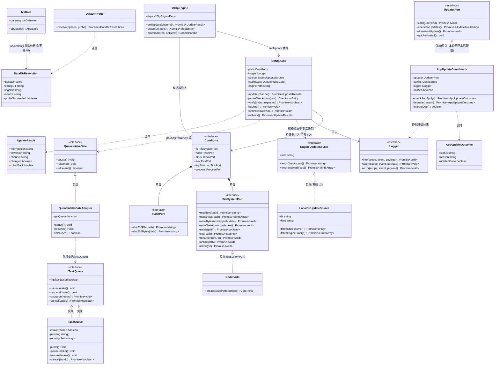
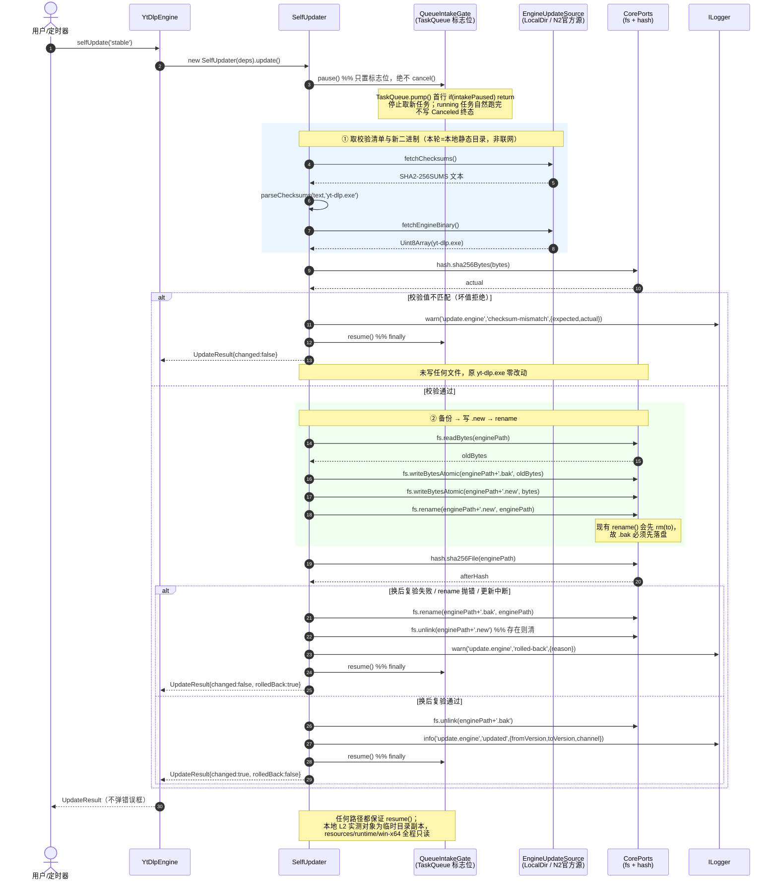
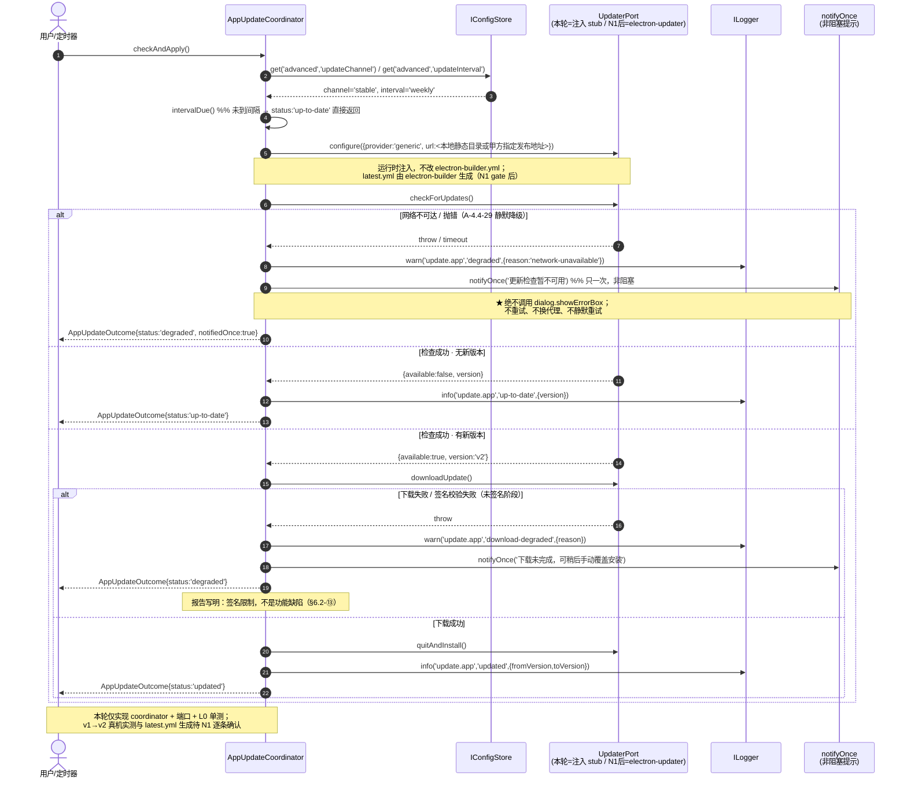
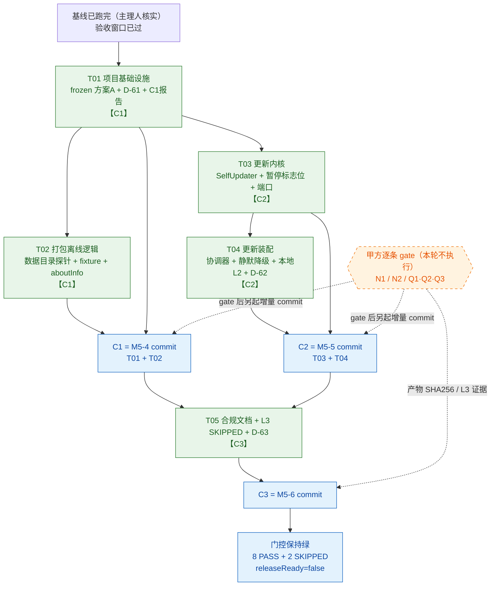

# YTVDLT · M5 剩余三块增量架构设计与任务分解

> 版本 **v1.4**（v1.3 + 门控等价性口径订正）／ 2026-11-06 ／ 作者：高见远（Gao，架构师）／ 简体中文 ／ 结构化表格 + Mermaid
> **v1.4 订正（QA 源码复核，仅措辞与口径）**：`acceptance.mjs:1239` 的 `decisionsOk = m5Decisions.length >= 6 && every(n === 54+i)` **只要求「D-54 起 ≥6 条连续」，不禁止 D-64+ 连续编号，也不要求恰好 10 条**；脚本正则还要求编号后带 ` ·`，与 `grep '^## D-'` 匹配口径不同。故 **§7.8 #7 的「四条组合」⊃ 脚本门控，是更严的 QA 判据，非等价**。已订正三处：§7.8 #7（改「等价」为「非等价 + 不得只凭 gate 判 PASS」）、T05 文档门控体检（补「脚本门控只是必要条件」）、§6.1 关键说明（删「恰好」、写明本轮是主动收紧）。**任务列表、三个 commit 清单、D-61/62/63、gate 表、十七条雷映射、四条组合判据本身一律不变。**
> **v1.3 订正（QA 复核 + 主理人锁定，仅判据与数字）**：① **§7.8 #7 / T05 文档门控体检 / §6.3 复核清单** 三处的 `grep '^## D-' … | tail -12` 全部改为**四条组合判据**（`grep -c '^## D-'`=63；`tail -10`=D-54…D-63 共 10 条连续；无 D-64；D-01…D-63 全序列无缺号）——`tail -12` 在 63 条时返回 D-52…D-63，与「10 条」期望不自洽会制造假 FAIL；② **§0 事实表与 §7.9(a)** 的 `ffmpeg/` 体积由「约 163 MB」订正为 **10 文件合计 174,731,264 B ≈ 175 MB / 166.6 MiB（仅 7 个 DLL 154,699,776 B ≈ 155 MB / 147.5 MiB）**，与 PRD v1.2 / gate 表一致；③ §7.9 小节标题标注订正版本。**任务列表、三个 commit 清单、D-61/62/63、gate 表、十七条雷映射一律不变。**
> **v1.2 订正（只改数字，不重写）**：QA 用 `git ls-files` + 实物目录核查，`resources/runtime/win-x64/ffmpeg/` 是 **7 个 LGPL DLL**（`avcodec` / `avdevice` / `avfilter` / `avformat` / `avutil` / `swresample` / `swscale`）+ **3 个 exe**（`ffmpeg.exe` / `ffprobe.exe` / `ffplay.exe`），**共 10 个文件**；v1.1 的 DLL 数量误计，本版在 §0 事实表与 §7.9(a) 统一订正为 **7 个 DLL**。PRD 与 gate 表已同步为 7。**其余内容（任务列表 / 三个 commit 清单 / D-61…63 / gate 表 / 十七雷映射）一律不变**；主理人已确认「关于框无需改文件」与「deferred 文案本轮不订正」两项裁决，Q1/Q2/Q3 已交甲方拍板。
> **v1.1 修订摘要**：① 全文档补齐「本地运行时二进制被 `.gitignore` 第 16–20 行忽略、未入库、仅本机工作区存在，clone 后 / 干净 VM 无此文件」的**环境边界**；② 任务分解按 **离线 L2 / 须 N1 / 须 N2** 三层拆分，新增「PRD 需求池 → 任务三层映射表」（§5.0）；③ 新增 **§7.8 审计约定**（L2 本地实测 ≠ L3 真机/在线实测 ≠ 断言转 PASS）；④ 裁决「关于框措辞**无需订正**」（已核实为 LGPL-3.0），**不新增决策编号**，保持 D-61/62/63 连续；⑤ **`docs/M5-SUMMARY.md` 改为「核对不改」**，从三个 commit 的 `git add` 清单移除，新状态一律写进三份 `M5-x-REPORT.md`；⑥ 补**网络分类口径**（以施工单 §0.1 + 甲方原话为准，不让 `acceptance.mjs` 的 deferred 文案反向定义分类）。
> 文档类型：**增量架构设计 + 施工级任务分解**（只读设计产出，不含代码、不含测试实现、不含报告正文）
> 权威输入（冲突时以靠前者为准，并在 `docs/DECISIONS.md` 留痕）：
> ① 原始任务书 `C:/Users/leolee/WorkBuddy/2026-11-05-07-24-49/YTVDLT_HANDOFF.md`（§6.7 / §12.4 七条铁律 / §12.5 LGPL 12 条；其中「LGPL-2.1+」文案已过时，以 D-08 实测 `LGPL-3.0` 为准）
> ② `docs/M5-HANDOFF-V2.md` v2.1（唯一权威施工单，§5 / §6.2 十七条雷 / §7 / §10）
> ③ 增量 PRD `m5-staging/M5-DELTA-PRD.md` v1.1（§3 需求池 / §4 三块边界 / §5 联网清单 / §6 诚实性硬约束 / §7 待确认）
> ④ `docs/DECISIONS.md`（D-01…D-60，D-08 为 LGPLv3 实测事实）＞ `docs/M5-SUMMARY.md`、`docs/M5-3-REPORT.md`（报告模板）
> **只读约束（本设计阶段）**：未修改项目内任何文件；未执行任何联网命令；未运行任何会写 `reports/` / `coverage/` 的命令。产出仅落项目外 `m5-staging/M5-DELTA-DESIGN.md`。

---

## 0. 结论先行 · 事实基线（直接采信主理人核实结果）

| 标签 | 内容 |
|---|---|
| 【事实】 | 基线验收**已跑完**（离线 12m15s）：`npm test` 53 files / 670 passed；覆盖率 95.36 / 86.70 / 95.97 / 95.36；typecheck 5/5；`layering violationsCount=0`；e2e 30/30 + 反例 5/5；**串行** M1–M5 五套 `allGreen=true`，M5 = 8 PASS + 2 SKIPPED、10/10 门控、`releaseReady=false`。§6.2-③「验收期间禁改源码」的窗口**已过**，现在可以改源码。 |
| 【事实】 | `docs/PROJECT-HANDOFF.md` 是甲方本地改动（`M` 状态），**绝不提交 / 覆盖**；commit 必须精确 `git add <文件>`，**禁止 `git add -A`**。 |
| 【事实·v1.1 环境边界 / v1.2 数量订正】 | `reports/`、`coverage/`、`dist/` 均在 `.gitignore` 内。`resources/runtime/win-x64/` 的 `yt-dlp.exe`（23,575,744 B ≈ 23.5 MB）、`node.exe`（93,922,624 B ≈ 93.9 MB）、`ffmpeg/`（**3 个 exe：`ffmpeg.exe` / `ffprobe.exe` / `ffplay.exe` + 7 个 LGPL DLL，共 10 个文件**；10 文件合计 **174,731,264 B ≈ 175 MB / 166.6 MiB**，仅 7 个 DLL 合计 154,699,776 B ≈ **155 MB / 147.5 MiB**）是**本机工作区磁盘已就位**，但被 **`.gitignore` 第 16–20 行忽略、未入库**；`SHA2-256SUMS`（1595 B）/ `FFMPEG-LICENSE.txt`（7651 B）/ `runtime-manifest.json`（6518 B，ffmpeg 项 `license:"LGPL-3.0"`）**已入库**。⇒ 结论仅为「**本机可离线 L2 实测**」，**不是**「随仓库自带 / clone 后或干净 VM 可复现」；凡引用这些文件都要写明此边界。 |
| 【事实】 | `scripts/acceptance.mjs:569-578` `frozenFilesUntouched()` 现要求 `git diff HEAD -- packages/shared/src/request.ts pnpm-lock.yaml package.json` 为空，另校验 `test:e2e` 只出现 1 次且含 `ytvdltPlannedDependencies`；**实际调用点仅 M3(693) / M4(972) 两处，M5 不调用**。 |
| 【事实】 | `scripts/acceptance.mjs:1239-1247`：`M5-GATE-docs` 要求 D-54 起**连续** ≥6 条 + 5 份**固定**报告（`M5-0/1/2/3-REPORT.md` + `M5-SUMMARY.md`）齐全，且 `M5-SUMMARY.md` 必须含字面串「未获甲方放行」与「N1」。新增 `M5-4/5/6-REPORT.md` **不在该门控的检查数组内**，不影响通过。 |
| 【事实·本设计核实】 | `M5_ASSERTIONS`（`acceptance.mjs:1126-1137`）**固定 10 条**（8 PASS + 2 SKIPPED）；`A-4.4-28` / `A-4.4-29` 带 `deferred` 字段且 `layer:'L3'`。**任何新增 / 删除 / 改 `deferred` 都会破坏 8+2 与 10/10 口径**。 |
| 【事实·本设计核实 / 架构裁决】 | `packages/ui/src/i18n/messages.js:153`（中）`/ :304`（英）的 `about.license` **已经是「LGPL-3.0」**。PRD **R-5.3-3 的可验收条件是「如 `messages.js` 现有文案含 LGPLv2.1 措辞，须一并订正」——该条件不触发**，故「关于框措辞订正」**无需改动文件**；`settings/index.html` 含 about 文本且被 e2e `settings-*` 截图，改文案必然触发 §6.2-④ DOM 基线重建 + `i18n.test.ts` 两语言键集校验。落地方式：把「关于框 LGPL-3.0 声明」作为**已满足项**写入 `M5-6-REPORT.md` 栏①（附证据路径 `messages.js:153/:304`），并在 NOTICE 12 条 / D-63 记「已合规、无需订正及理由」。**不为此新增决策编号**（PM 建议，保持 D-61/62/63 连续）。 |
| 【事实·本设计核实】 | `YtDlpEngine.selfUpdate()`（`yt-dlp-engine.ts:332-334`）当前是 `throw unknownPlaceholder('selfUpdate')`；`TaskQueue.pump()`（`task-queue.ts:165-174`）是取新任务的**唯一入口**。二者正是 M5-5 的落点。 |
| 【事实·本设计核实】 | `check-layering.mjs` 的 `SCAN_TARGETS` **只扫** `packages/{shared,core,engine-ytdlp,ui}/src`，**不扫 `apps/desktop/src/main`**；纯 TS 包禁 `electron` / `node:fs|fs|crypto|os|path|child_process`，UI 另禁 `electron` / `node:fs` / `child_process`。 |
| 【判断】 | 本轮确定性可达：frozen 门控方案 A、便携版数据目录探针、`process.cwd()` fixture 修正、更新模块（引擎更新 / 应用更新协调器 / 暂停队列标志位 / 静默降级）+ 单测 + **本地真实文件 L2 实测**、6 份合规文档、3 份块报告、D-61…D-63 连续、门控保持绿。 |
| 【判断】 | 本轮**不可达 / 不执行**：任何 `pnpm install` / `pnpm add` / `electron-builder` / 下载命令（N1/N2/N3 逐条 gate 未开）；N3 国际网 L3；C13–C16 干净 VM；`A-4.4-28/29` 改 PASS。 |
| 【红线·v1.1】 | **代码写完 ≠ 实测通过**；**本地 L2 实测 ≠ L3 真机/在线实测 ≠ 断言转 PASS**；**SKIPPED ≠ PASS**；`releaseReady=false` 不改写；L3 原样落「国际网未放行，L3 先记 SKIPPED，等我另行通知。」即便离线 L2 全绿，`A-4.4-28`（`acceptance.mjs:1132` 定义为 L3 且带 `deferred`）与 `A-4.4-29` **仍维持 SKIPPED**。 |
| 【事实·v1.1 门控】 | `M5-GATE-docs`（`acceptance.mjs:1246`）要求 `M5-SUMMARY.md` 含「未获甲方放行」+「N1」；`M5-GATE-blockers`（`acceptance.mjs:1335`）读该文件阻塞登记，而 `M5_BLOCKERS`(1147–1151) **硬编码 N1/N2/N3 三项**。⇒ **本轮决定干脆不改 `docs/M5-SUMMARY.md`**，新状态一律写进三份新增 `M5-x-REPORT.md`，从三个 commit 的 `git add` 清单移除（§2.1 #11 / §6.2）。 |
| 【判断·v1.1 三层】 | 任务分解按 PRD §3 重构后的三层拆：**① 离线 L2**（本地真实文件 + 本地静态目录，本轮 P0 可达，不联网）／**② 须 N1**（装依赖、出安装包、`latest.yml`、真机开窗、应用更新 v1→v2，本轮待 gate）／**③ 须 N2**（**仅**从官方 GitHub Releases 拉新版本，本轮待 gate，不阻塞 ①）。N3 国际网 / L3 本轮不做。映射见 §5.0。 |
| 【口径·v1.1 网络分类】 | 分类一律以**施工单 §0.1 + 甲方原话**为准：**N1** = 包管理器网络（`pnpm install` / 打包工具链）；**N2** = 代码托管/发布网络（GitHub Releases 取 `yt-dlp.exe`、`SHA2-256SUMS`、Electron 预编译包）；**N3** = 国际站点网络（YouTube / L3）。`acceptance.mjs:1132` 的 `deferred` 文案把取 `yt-dlp.exe` 写成「N3」属**遗留笔误**，**不让脚本反向定义分类**；本轮不改该文案（见 §7.9 / T04 可选项）。 |

---

## 1. 实现方案与框架选型

### 1.1 核心技术难点

| # | 难点 | 结论 |
|---|---|---|
| 1 | 装打包依赖必然改 `package.json` / `pnpm-lock.yaml`，而 M3/M4 frozen 门控要求对 HEAD 零改动 | 采用 §6.2-① **方案 A**：只硬锁 `packages/shared/src/request.ts`（D-50 真正冻结对象）；`package.json` / lock 改为「**只允许新增依赖声明**」的显式白名单检查（详见 §3.5）。本轮**不装依赖**，门控改造是给 gate 后预置的。 |
| 2 | `electron-updater` / `electron-builder` **未安装**，任何静态 `import` 都会让 `pnpm turbo run typecheck` 报 `TS2307`，打破 5/5 | 本轮**不创建任何引用该包名的源码文件**。应用更新做成「`UpdaterPort` 接口 + `AppUpdateCoordinator` 纯协调器」，由依赖注入装配；`electron-updater` 适配器文件明确列为 **N1 gate 后**新增（§1.4 / §2.2）。 |
| 3 | 分层铁律要求 `engine-ytdlp` / `core` 零 `node:*`，但引擎更新需要读二进制、算 SHA-256、原子 rename、回滚 | 全部 I/O 走**既有 `CorePorts` 注入**（`fs` / `hash` / `clock` / `env` / `logSink`），`packages/shared/src/ports.ts` 仅 append-only 补一个 `FileSystemPort.readBytes()`。`apps/desktop/src/main` 不被 layering 扫描，是唯一允许 `node:fs` / `electron` 的层。 |
| 4 | 「暂停队列」不能调用 `TaskQueue.cancel()`（会写 `Canceled` 终态，不可恢复） | 在 `TaskQueue.pump()` 入口加**标志位**（`intakePaused`）：停止从 FIFO 取新任务、当前 running 任务自然跑完；`resumeIntake()` 清标志并 `pump()`。详见 §3.4。 |
| 5 | 引擎更新 L2 实测要用本地真实 23.5 MB `yt-dlp.exe`，但该文件被 `.gitignore` 忽略、损坏后无法从仓库恢复 | 实测对象必须是 **临时目录中该文件的副本**；`resources/runtime/win-x64/**` 全程**只读**，绝不写入 / rename / unlink。详见 §4.1。 |
| 6 | 新增 `<link>` / `<script>` / 改 UI 文案会触发 §6.2-④ DOM 基线重建（14 张 M3 中文零差异证据作废） | 本轮**不新增任何 `<link>`/`<script>`、不改任何 HTML / CSS / UI JS / `messages.js` 既有键值**。「关于」框的数据目录展示改为**纯数据 DTO**（`M5Host.aboutInfo()`），UI 接入留 N1 gate 后。 |
| 7 | `M5_ASSERTIONS` 固定 10 条，但新增测试文件必须登记 `M3_TEST_FILE_MAP`（否则三套 file-coverage 门控全挂） | **不新增任何断言 ID / gate ID**；新测试文件一律映射到**既有且三处 `knownIds` 都保证合法**的白名单 ID（§7.4）。 |

### 1.2 框架选型（沿用现状，不引入新框架）

| 层 | 现状 | 本轮决策 |
|---|---|---|
| Core | TypeScript 纯函数包，`@ytvdlt/shared` DTO，构造器注入 `CorePorts` | 沿用；仅 append-only 扩展 `ITaskQueue` 与 `FileSystemPort` |
| Engine | `packages/engine-ytdlp`（`DownloadEngine` 唯一实现，`selfUpdate()` 占位） | 沿用；实现 `selfUpdate()`，新增 `SelfUpdater` 纯编排 |
| Renderer | 静态 HTML + CSS + 原生 JS（D-31 偏离），无 React/MUI/Vite | **沿用且本轮零改动**；不引入任何前端框架 |
| Electron Main | `apps/desktop/src/main`，`electron-entry.ts` 是唯一 import `electron` 的装配点，`bootstrap(ElectronLike)` 注入可测（D-59） | 沿用注入模式；新增 `data-dir.ts` / `app-updater.ts` / 两个 adapter |
| 依赖 | `electron-builder@^26` / `electron-updater@^6.8` / `electron@45.2.2` 已登记在 `package.json → ytvdltPlannedDependencies`，**未安装** | **本轮不装、不改 `package.json` / `pnpm-lock.yaml`** |
| 测试 | vitest 3.2.4（`tests/unit` + `tests/contract` 口径），`layering.test.ts` 复用 `scanForViolations()` | 沿用；新增 `scripts/frozen-gate.mjs` 导出纯函数供单测（复刻 `check-layering.mjs` 的「脚本导出 + 测试复用」既有模式） |

**架构模式**：端口与适配器（Ports & Adapters）+ 构造器依赖注入 + 纯函数编排。没有新增 MVC/MVVM，不引入状态管理库。

### 1.3 分层落地核对表

| 新增/修改文件 | 所在层 | 允许 import | 依据 |
|---|---|---|---|
| `packages/shared/src/update.ts`、`ports.ts`、`index.ts` | shared（纯类型） | 仅 `@ytvdlt/shared` 内部类型 | `SCAN_TARGETS` 含 shared，禁 `node:*` / `electron` |
| `packages/engine-ytdlp/src/self-updater.ts`、`yt-dlp-engine.ts`、`engine-factory.ts`、`index.ts` | engine | 仅 `@ytvdlt/shared` / `@ytvdlt/core` 类型 + 本包纯函数 | 禁 `node:*` / `electron`；I/O 全走注入端口 |
| `packages/core/src/ports.ts`、`task-queue/task-queue.ts` | core | 仅类型 + 本包纯函数 | 同上 |
| `apps/desktop/src/main/**` | Electron Main | 允许 `node:fs/promises` / `node:path` / `electron` | **不在 SCAN_TARGETS**；`node-ports.ts` / `electron-entry.ts` 已是此模式 |
| `packages/ui/src/**` | Renderer | 仅浏览器 API + `window.ytvdltBridge` | 本轮**零改动** |

### 1.4 三个 commit 的技术边界

| Commit | 块 | 技术边界（做什么 / 不做什么） |
|---|---|---|
| **C1** | M5-4 打包 | **做**：frozen 门控方案 A（纯脚本 + 单测）、便携版数据目录「可写探针 + 回退」、`process.cwd()` fixture 路径改为注入解析、`M5Host.aboutInfo()` 纯数据 DTO、D-61、报告。**不做**：不装依赖、不打包、不产出 exe / `latest.yml`、不改 `electron-builder.yml`、不改 `package.json` / lock、不改 UI。 |
| **C2** | M5-5 更新 | **做**：`SelfUpdater`（校验 → `.new` → rename → `.bak` 回滚）、`AppUpdateCoordinator`（generic provider 运行时配置 / 通道 / 间隔 / 静默降级）、`TaskQueue` 暂停标志位、`ports` append-only、本地 L2 实测（副本）、D-62、报告。**不做**：不静态 import `electron-updater`、不建适配器文件、不执行 v1→v2 真机实测、不拉官方 release、不改 `M5_ASSERTIONS`。 |
| **C3** | M5-6 合规 + L3 | **做**：6 份合规文档（LGPL-3.0 12 条逐条证据 + 旧文案差异）、产物 SHA256 归档段（待 gate）、L3 段 SKIPPED、D-63、报告。**不做**：不改 `messages.js`（已是 LGPL-3.0）、不改 DOM、不做 L3 在线烟测、不做 C13–C16。 |

### 1.5 关键架构判断（须工程师照做，勿自行"优化"）

| # | 判断 | 理由 |
|---|---|---|
| A1 | `electron-updater` 适配器**本轮不建文件**，`publish` 不写进 `electron-builder.yml`，改由 `UpdaterPort.configure({provider:'generic', url})` 运行时注入 | 静态 import 打破 typecheck 5/5；施工单 §5.1-4 / PRD §4 明确「`electron-builder.yml` 配置已就位，勿改」，且 §6.2-⑥ 禁止顺手加 glob |
| A2 | `electron-builder.yml` 仅 `files` / `extraResources` **核对**，核对结果写入 `M5-4-REPORT.md`，**不进 `git add`** | 配置已就位；无改动可提交 |
| A3 | `M5_HOST.aboutInfo()` 只返回纯数据；「关于」框 UI 渲染列为「待 N1 gate」 | 避开 §6.2-④ DOM 基线重建 + §6.2-⑯ i18n 动态串 |
| A4 | L2 实测在 `os.tmpdir()` **副本**上做，`resources/runtime/win-x64/` **全程只读**；报告须写明「本机工作区磁盘已就位、二进制被 `.gitignore` 第 16–20 行忽略未入库、clone 后 / 干净 VM 无此文件、结论只对本机成立」 | 二进制未入库，损坏后无法从仓库恢复；不得写成「随仓库自带 / 任意环境可离线复现」（PRD §1.2 提醒 / §6.2-⑩ 诚实性约束 10） |
| A5 | 不新增断言 ID / gate ID；新测试文件映射到既有白名单 ID | `M5_ASSERTIONS` 固定 10 条；三处 `knownIds` 共享 `M3_TEST_FILE_MAP` |
| A6 | 「关于框措辞订正」**裁决为无需改文件**：`messages.js:153/:304` 已是 LGPL-3.0，R-5.3-3 的条件「如含 LGPLv2.1 措辞」不触发；把它作为**已满足项**写进 `M5-6-REPORT.md` 栏①并附证据路径，在 NOTICE 12 条 / D-63 记「已合规、无需订正及理由」。**不新增决策编号** | 改文案会挂 `settings-*` e2e 基线 + `i18n.test.ts` + 触发 §6.2-④ DOM 基线重建；PM v1.1 建议不另立编号（保 D-61/62/63 连续） |
| **A7·v1.1** | **`docs/M5-SUMMARY.md` 本轮「核对不改」**，不进任何 commit 的 `git add`；所有新状态（本地运行时资源、L2 结论、三块进展）一律写进新增的三份 `M5-x-REPORT.md` | `M5-GATE-docs` 需保留「未获甲方放行」+「N1」两字面串，`M5-GATE-blockers` 读该文件阻塞登记且 `M5_BLOCKERS` 硬编码 N1/N2/N3；改它有双重变红风险，PM 建议「最省事是干脆不改」 |
| **A8·v1.1** | **网络分类以施工单 §0.1 + 甲方原话为准**（N1 包管理器 / N2 发布包 / N3 国际站点）；`acceptance.mjs:1132` deferred 把取 `yt-dlp.exe` 写成「N3」属遗留笔误，**不让脚本反向定义分类**；本轮**不改该脚本文案**，只在 `M5-5-REPORT.md` 与 D-62 留痕 | 改验收脚本属高敏感改动，可能触发门控回归；分类是甲方口径，不由脚本文案决定（主理人提醒） |
| **A9·v1.1** | 任务分解按 **离线 L2 / 须 N1 / 须 N2** 三层标注；「离线 L2 实测」是 P0 本轮必达，**不因 N2 未放行而标 SKIPPED** | PRD v1.1 §3.2 已把需求池重构为三层；`N2 收窄为仅「从官方源拉新版本」`，与本地 L2 逻辑实测解耦（§5.0 映射表） |

---

## 2. 文件清单

> 列说明：**状态** = 新增 / 修改 / 核对不改；**commit** = C1/C2/C3/—；**离线** = 本轮（gate 未开）是否可完成。
> 全部相对项目根 `C:/Users/leolee/WorkBuddy/2026-11-05-08-16-08/ytvdlt`。

### 2.1 全量文件表

| # | 相对路径 | 状态 | commit | 离线 | 用途 / 要点 |
|---|---|---|---|---|---|
| 1 | `scripts/frozen-gate.mjs` | 新增 | C1 | ✅ | 导出纯函数 `checkFrozen()` + `FROZEN_CORE_FILE` / `ALLOWED_NEW_DEV_DEPS`；供 `acceptance.mjs` 调用与单测复用 |
| 2 | `scripts/acceptance.mjs` | 修改 | C1/C2 | ✅ | ① `frozenFilesUntouched()`(569-578) 改调 `checkFrozen()`；② `M3_TEST_FILE_MAP`(444) 按 commit 分批登记新测试文件；③ `runM3`(803)/`runM4`(1055)/`runM5`(1299) 的 `knownIds` **不新增 ID**（仅复核）；④ `M3-GATE-frozen` / `M4-GATE-frozen` 的 `actual` 带上 `reasons` 便于排障 |
| 3 | `tests/unit/frozen-gate.test.ts` | 新增 | C1 | ✅ | ≥6 例：核心文件被改拒绝 / 白名单新增依赖通过 / 版本不符拒绝 / 删既有键拒绝 / lock 有 `-` 行拒绝 / 全空通过 |
| 4 | `apps/desktop/src/main/data-dir.ts` | 新增 | C1 | ✅ | `ProbePort` + `createNodeProbePort()` + `resolveDataDir()`：exe 同目录可写 → `config/`，否则 `%APPDATA%\YTVDLT`；「写临时文件再删」探针；返回 `DataDirResolution` |
| 5 | `apps/desktop/src/main/runtime-paths.ts` | 修改 | C1 | ✅ | 新增纯函数 `resolveFixtureDir(env, cwd)`：packaged 走 `resourcesPath`，dev 走 `cwd`；供 fixture 路径修正 |
| 6 | `apps/desktop/src/main/electron-entry.ts` | 修改 | C1/C2 | ✅ | ① L58-60 数据目录改走 `resolveDataDir()` 并 `logger.info('data-dir','resolved',…)`；② L83 / L92 / L93 三处 `join(process.cwd(),'tests','fixtures')` 改走 `resolveFixtureDir()`；③ C2 装配 `updateSource` / `intakeGate` / `appUpdater` |
| 7 | `apps/desktop/src/main/m5-host.ts` | 修改 | C1 | ✅ | `M5HostOptions` append-only `aboutInfo?`；`M5Host` 增加 `aboutInfo(): AboutInfo`（纯数据：版本 / 运行时三件套 / dataDir / `LGPL-3.0`）；**不动 IPC、不动 UI** |
| 8 | `tests/unit/data-dir.test.ts` | 新增 | C1 | ✅ | ≥6 例：可写命中 / 不可写回退 / 探针失败清理 / 日志字段 / 幂等 / packaged 分支 |
| 9 | `tests/unit/runtime-paths.test.ts` | 新增 | C1 | ✅ | ≥4 例：dev / packaged / `resourcesPath` 为空 / 路径拼接不含 `process.cwd()`（打包后） |
| 10 | `docs/DECISIONS.md` | 修改 | C1/C2/C3 | ✅ | 依次追加 **D-61 / D-62 / D-63**，顺序连续不跳号（内容见 §6.4） |
| 11 | `docs/M5-SUMMARY.md` | **核对不改**（推荐，v1.1） | — | ✅ | **本轮不修改、不进任何 `git add`**。仅核对「未获甲方放行」「N1」两字面串与 N1/N2/N3 阻塞表仍在（`M5-GATE-docs` / `M5-GATE-blockers` 依赖）。本地运行时资源、L2 结论、三块进展一律写进新增的三份 `M5-x-REPORT.md` |
| 12 | `docs/M5-4-REPORT.md` | 新增 | C1 | ✅ | 块报告，两栏结构（§7.6）；含 §0.4 差异、配置核对结果、产物待 gate |
| 13 | `apps/desktop/electron-builder.yml` | **核对不改** | — | ✅ | 仅核对 `files` 仅含 `apps/desktop/dist/**` + `package.json`、`resources/runtime/**` 走 `extraResources`；结果写入 `M5-4-REPORT.md`，**不进 `git add`** |
| 14 | `packages/shared/src/ports.ts` | 修改 | C2 | ✅ | `FileSystemPort` append-only `readBytes(path): Promise<Uint8Array>`（不锁于 frozen，frozen 只锁 `request.ts`） |
| 15 | `packages/shared/src/update.ts` | 新增 | C2 | ✅ | 纯类型：`EngineUpdateSource` / `QueueIntakeGate` / `UpdaterPort` / `AppUpdateOutcome` / `ChecksumEntry` |
| 16 | `packages/shared/src/index.ts` | 修改 | C2 | ✅ | barrel 追加导出上述类型 |
| 17 | `packages/engine-ytdlp/src/self-updater.ts` | 新增 | C2 | ✅ | `SelfUpdater` 纯编排：校验 → `.new` → rename → 失败 `.bak` 回滚；全程注入 `CorePorts` |
| 18 | `packages/engine-ytdlp/src/yt-dlp-engine.ts` | 修改 | C2 | ✅ | `selfUpdate()`(332-334) 替换 `throw unknownPlaceholder()` 为委托 `SelfUpdater.update()`；`YtDlpEngineDeps` append-only `updateSource?` / `intakeGate?` |
| 19 | `packages/engine-ytdlp/src/engine-factory.ts` | 修改 | C2 | ✅ | `EngineFactoryOptions` append-only `updateSource?` / `intakeGate?`；`createEngine()` 透传 |
| 20 | `packages/engine-ytdlp/src/index.ts` | 修改 | C2 | ✅ | 导出 `SelfUpdater` / `EngineUpdateSource`（类型重导出） |
| 21 | `packages/core/src/ports.ts` | 修改 | C2 | ✅ | `ITaskQueue` append-only：`readonly intakePaused: boolean` / `pauseIntake(): void` / `resumeIntake(): void` |
| 22 | `packages/core/src/task-queue/task-queue.ts` | 修改 | C2 | ✅ | `private intakePaused=false`；`pump()`(165) 首行 `if (this.intakePaused) return;`；新增 getter + 两方法（resume 末尾 `pump()`）；**不调用 `cancel()`、不写 `Canceled`** |
| 23 | `tests/unit/self-updater.test.ts` | 新增 | C2 | ✅ | ≥10 例：正常链路 / 坏值拒绝（原文件未损坏）/ 备份存在 / rename 失败回滚 / 校验后回滚 / 更新中断回滚 / 暂停-恢复成对 / 日志口径 |
| 24 | `tests/unit/task-queue-intake.test.ts` | 新增 | C2 | ✅ | ≥5 例：暂停期间不取新任务 / 当前 running 正常完成 / 状态不出现 `Canceled` / resume 后自动补位 / 幂等 |
| 25 | `apps/desktop/src/main/app-updater.ts` | 新增 | C2 | ✅ | `UpdaterPort` 最小接口 + `AppUpdateCoordinator`：检查 → 下载 → 静默降级；通道 `stable`/`nightly`、间隔 `weekly`（读 `advanced.updateChannel` / `advanced.updateInterval`）；**零 `electron-updater` import** |
| 26 | `apps/desktop/src/main/adapters/local-dir-update-source.ts` | 新增 | C2 | ✅ | `LocalDirUpdateSource implements EngineUpdateSource`：从本地静态目录读 `yt-dlp.exe` 字节与 `SHA2-256SUMS` 文本（离线 L2 用） |
| 27 | `apps/desktop/src/main/adapters/queue-intake-gate.ts` | 新增 | C2 | ✅ | `createQueueIntakeGate(getQueue: () => ITaskQueue)`：惰性 getter，消除 `engine ↔ host.queue` 装配环 |
| 28 | `apps/desktop/src/main/adapters/node-ports.ts` | 修改 | C2 | ✅ | `fileSystemPort()`(45) 实现 `readBytes()`（用 `fs.readFile`） |
| 29 | `tests/unit/app-updater.test.ts` | 新增 | C2 | ✅ | ≥6 例：有更新 / 无更新 / 网络失败静默降级（只日志 + 一次非阻塞提示，**不弹错误框**）/ 通道与间隔 / 提示不重复 / `configure` generic provider |
| 30 | `tests/unit/engine-update-local.test.ts` | 新增 | C2 | ✅ | **本地 L2 实测**：临时目录副本上跑通校验 / 原子替换 / 回滚 / 暂停队列 / 坏值拒绝；证据标注「本地 L2、非真机、非在线拉取」；原文件只读 |
| 31 | `docs/M5-5-REPORT.md` | 新增 | C2 | ✅ | 两栏报告；含 L2 证据路径与层级；`A-4.4-28/29` 维持 SKIPPED 并写明原因 |
| 32 | `docs/THIRD_PARTY_NOTICES.md` | 新增 | C3 | ✅ | §6.7 全部组件；§12.5 **12 条逐条给证据**；FFmpeg 按 **LGPL-3.0**；**显式登记 §6.7/§12.5「LGPL-2.1+ / LGPLv2.1」过时文案与 D-08 差异** |
| 33 | `docs/LICENSE-COMPLIANCE.md` | 新增 | C3 | ✅ | §12.5 逐条落地方式、源码获取链接 / 编译方式 / EULA / DLL 可替换说明；引用 D-08 |
| 34 | `docs/BUILD.md` | 新增 | C3 | ✅ | 构建步骤（含 N1 gate 前置、`node-linker=hoisted` 条件项）、`extraResources` 不入 asar 铁律、产物清单 |
| 35 | `README.md`（项目根，当前不存在） | 新增 | C3 | ✅ | 下载页固定声明（**LGPL-3.0** 措辞，不照抄 LGPLv2.1）、零依赖说明、SmartScreen / 未签名提示、L3 未实测声明 |
| 36 | `docs/ACCEPTANCE.md` | 新增 | C3 | ✅ | **直接引用** `reports/acceptance-report-m5.json` 与 `reports/e2e-summary.json`，不手抄数字；注明「本地生成、不入库」；8 PASS + 2 SKIPPED 如实 |
| 37 | `docs/SHORTCUTS.md` | 新增 | C3 | ✅ | §6.8 快捷键表（对齐 `packages/core/src/shortcuts/shortcuts.ts` 14 绑定） |
| 38 | `docs/M5-6-REPORT.md` | 新增 | C3 | ✅ | 两栏报告；产物 SHA256 段（依赖 C1 产物 → 标「待 gate」）；L3 段**原样落**「国际网未放行，L3 先记 SKIPPED，等我另行通知。」 |

### 2.2 明确「不创建 / 不修改」清单（本轮）

| 路径 | 原因 |
|---|---|
| `docs/PROJECT-HANDOFF.md` | 甲方本地改动（`M`），绝不提交 / 覆盖 |
| `docs/M5-SUMMARY.md`（**v1.1 新增不改**） | `M5-GATE-docs`(1246) 需保留「未获甲方放行」「N1」两字面串；`M5-GATE-blockers`(1335) 读该文件阻塞登记，`M5_BLOCKERS`(1147–1151) 硬编码 N1/N2/N3 三项。改它有双重变红风险 → **干脆不改**，新状态写进三份 `M5-x-REPORT.md`（A7） |
| `package.json` / `pnpm-lock.yaml` / `.npmrc` | 本轮不装依赖、不改 hoist；装依赖须 gate 后逐条确认（N1-1/N1-2/N1-4） |
| `apps/desktop/electron-builder.yml` | 配置已就位，仅核对；§6.2-⑥ 禁止顺手改 glob |
| `packages/ui/src/**`（含 `messages.js`、HTML、CSS、JS） | 避开 §6.2-④ DOM 基线重建；`about.license` 已是 LGPL-3.0（A6） |
| `scripts/acceptance.mjs` 的 `M5_ASSERTIONS` / `M3_ASSERTIONS` / `M4_ASSERTIONS` / `M5_BLOCKERS` / `M5_E2E_CASE_IDS` | 固定 10 条断言、8+2 口径、10/10 门控；`deferred` 不得改 |
| `scripts/acceptance.mjs:1132` 的 `A-4.4-28` **deferred 文案**（**v1.1 新增不改**） | 该文案把取 `yt-dlp.exe` 写成「N3」，与施工单 §0.1（归 **N2**）不符，属**遗留笔误**。**本轮不改脚本文案**（避免动验收脚本引发门控回归），分类一律以施工单 §0.1 + 甲方原话为准（A8）；仅在 `M5-5-REPORT.md` 与 D-62 留痕，订正列为 gate 后可选工程改动（T04 可选项） |
| `tests/e2e/baselines/**` | 本轮无 DOM 改动，禁止重建基线 |
| `apps/desktop/src/main/adapters/electron-updater-adapter.ts` | **N1 gate 后**才创建（唯一 import `electron-updater` 的文件），本轮不建以免 typecheck 报 TS2307 |
| `resources/runtime/win-x64/yt-dlp.exe` / `node.exe` / `ffmpeg/` | **全程只读**；L2 实测只在 `os.tmpdir()` 副本上做。这些二进制**被 `.gitignore` 第 16–20 行忽略、未入库**，仅本机工作区存在；报告不得写成「随仓库自带 / clone 后或干净 VM 可复现」 |
| `reports/` / `coverage/` / `dist/` / `*.exe` / `latest.yml` | `.gitignore` 忽略，二进制产物不入库 |

### 2.3 §0.4 差异留痕的归属

`docs/M5-HANDOFF-V2.md` §0.4 记「最后一次代码提交 `151a56e`」，实测为 **`e3c0d84`**（handoff-check 脚本及其修复提交）。按 §0.4「以仓库现状为准，并把差异补进 `DECISIONS.md`」：

> **归入 D-61**（C1 的「打包块偏离合并登记」）作为独立子项，**不另起决策编号**，以保证 D-61/D-62/D-63 连续、D-54…D-63 共 10 条连续通过 `M5-GATE-docs`。
> 写法：登记「v2.1 §0.4 表格该行已过期，实际 `e3c0d84`；依 §0.4 以仓库现状为准；**不改写甲方文档 `M5-HANDOFF-V2.md`**，仅在本台账留痕」。

---

## 3. 数据结构与接口

### 3.1 Mermaid 类图



### 3.2 核心类型 / 函数签名（伪 TS，工程师据此实现）

```ts
// packages/shared/src/update.ts —— 纯类型，零 import node:*/electron
export type UpdateChannel = 'stable' | 'nightly';
export interface ChecksumEntry { sha256: string; fileName: string }
export interface EngineUpdateSource {
  readonly kind: 'local-dir' | 'official-release';
  fetchChecksums(): Promise<string>;          // SHA2-256SUMS 原文
  fetchEngineBinary(): Promise<Uint8Array>;   // yt-dlp.exe 字节
}
export interface QueueIntakeGate {
  pause(): void; resume(): void; isPaused(): boolean;
}
export interface UpdateFeed { provider: 'generic'; url: string }
export interface UpdateAvailability { available: boolean; version: string }
export interface UpdaterPort {
  configure(feed: UpdateFeed): Promise<void>;
  checkForUpdates(): Promise<UpdateAvailability>;
  downloadUpdate(): Promise<void>;
  quitAndInstall(): void;
}
export type AppUpdateStatus = 'up-to-date' | 'updated' | 'degraded';
export interface AppUpdateOutcome {
  status: AppUpdateStatus; reason: string; notifiedOnce: boolean;
}

// packages/shared/src/ports.ts —— append-only
export interface FileSystemPort {
  /* ...既有 9 个方法不变... */
  readBytes(path: string): Promise<Uint8Array>;   // 新增
}

// packages/core/src/ports.ts —— ITaskQueue append-only
export interface ITaskQueue {
  /* ...既有方法签名一字不改... */
  readonly intakePaused: boolean;   // 新增
  pauseIntake(): void;              // 新增
  resumeIntake(): void;             // 新增
}

// packages/engine-ytdlp/src/self-updater.ts —— 纯编排，零 I/O import
export interface SelfUpdaterDeps {
  ports: CorePorts; logger: ILogger;
  source: EngineUpdateSource; intakeGate: QueueIntakeGate | null;
  enginePath: string; channel: UpdateChannel;
}
export class SelfUpdater {
  constructor(deps: SelfUpdaterDeps);
  update(): Promise<UpdateResult>;   // 不抛到 UI；失败返回 changed:false / rolledBack:true
  static parseChecksums(text: string, fileName: string): ChecksumEntry | null;  // 纯函数，可单测
}

// YtDlpEngineDeps / EngineFactoryOptions —— append-only
  updateSource?: EngineUpdateSource;
  intakeGate?: QueueIntakeGate;
// YtDlpEngine.selfUpdate(channel) => new SelfUpdater({...}).update()

// apps/desktop/src/main/data-dir.ts —— 注入最小探针端口，可 L0 单测
export interface ProbePort {
  writeTextAtomic(path: string, text: string): Promise<void>;
  unlink(path: string): Promise<void>;
  exists(path: string): Promise<boolean>;
}
export interface DataDirOptions {
  exeDir: string; fallbackDir: string; isPackaged: boolean;
}
export function resolveDataDir(options: DataDirOptions, probe: ProbePort): Promise<DataDirResolution>;
export function createNodeProbePort(): ProbePort;   // 本文件内用 node:fs/promises，仅 main 层允许

// apps/desktop/src/main/runtime-paths.ts —— 新增纯函数
export function resolveFixtureDir(
  env: { isPackaged(): boolean; resourcesPath(): string }, cwd: string,
): string;

// apps/desktop/src/main/app-updater.ts —— 零 electron-updater import
export interface AppUpdateCoordinatorDeps {
  updater: UpdaterPort; config: IConfigStore; logger: ILogger;
  notifyOnce: (msg: string) => void;   // 非阻塞提示，绝不 dialog.showErrorBox
}
export class AppUpdateCoordinator {
  constructor(deps: AppUpdateCoordinatorDeps);
  checkAndApply(): Promise<AppUpdateOutcome>;   // 检查→下载→静默降级
}

// apps/desktop/src/main/m5-host.ts —— append-only
export interface AboutInfo {
  appVersion: string; runtimeDir: string; dataDir: string;
  runtime: readonly ['yt-dlp', 'node', 'ffmpeg']; license: 'LGPL-3.0';
}
// M5Host.aboutInfo(): AboutInfo
```

### 3.3 引擎更新「原子替换 + 回滚」的落地约束

| 步骤 | 使用的端口 | 硬约束 |
|---|---|---|
| 取校验清单 | `source.fetchChecksums()` | 只信任 `SHA2-256SUMS` 中 `yt-dlp.exe` 对应行；解析用纯函数 `parseChecksums()` |
| 取新二进制 | `source.fetchEngineBinary()` | 离线 L2 = 本地静态目录；N2 gate 后 = 官方 release（**本轮不实现**） |
| 校验 | `ports.hash.sha256Bytes(bytes)` | 与 expected **全等**（小写 hex、trim）才继续；不等 → `changed:false`，**不写任何文件、原文件零改动** |
| 暂停队列 | `intakeGate.pause()` | `try/finally` 保证 `resume()` 一定执行；**绝不调用 `TaskQueue.cancel()`** |
| 备份 | `ports.fs.readBytes(enginePath)` → `writeBytesAtomic(<path>.bak, …)` | 备份先于任何写目标动作 |
| 写 `.new` | `ports.fs.writeBytesAtomic(<path>.new, bytes)` | 同目录原子写（现有实现已是 `<path>.tmp` → fsync → rename） |
| 替换 | `ports.fs.rename(<path>.new, enginePath)` | 注意现有 `rename()` 会先 `fs.rm(to)`，**必须已有 `.bak`** |
| 换后复验 | `ports.hash.sha256File(enginePath)` | 不等 → 立即 `rollback()` |
| 回滚 | `ports.fs.rename(<path>.bak, enginePath)` | 返回 `UpdateResult{changed:false, rolledBack:true}`；日志 `WARNING` |
| 清理 | `ports.fs.unlink(<path>.bak)` / `unlink(<path>.new)` | 仅成功路径删 `.bak`；任何异常路径都保留证据供回滚 |
| 异常 | `catch` → `rollback()` → 记日志 | **不吞异常**（§12.4 铁律 3 精神）；不外抛到 UI 弹框 |

> 诚实口径：这是「**逻辑层**原子替换 + 备份回滚」，不是 Windows `ReplaceFile` 级原子 swap；报告须如此标注，不得写成「OS 级原子更新」。

### 3.4 「暂停队列 = 标志位」如何落地（§6.2-⑭）

```text
TaskQueue
  private intakePaused = false
  get intakePaused(): boolean
  pauseIntake():  this.intakePaused = true            // 只置位，不触碰任何 record / handle
  resumeIntake(): this.intakePaused = false; this.pump()
  private pump():
      if (this.intakePaused) return                   // ★ 唯一改动点：停止从 FIFO 取新任务
      while (this.running.size < this.limit) { ... this.runSafely(next) ... }
```

| 验收点 | 行为 |
|---|---|
| 暂停期间新入队 | `enqueue()` 仍可 `pending.push()`，但 `pump()` 被挡住 → 不启动 |
| 当前 running 任务 | 完全不受影响，走完 `run()` 的 `finally`（`pump()` 被挡住） |
| 状态终态 | **从不写 `Canceled`**，不调用 `handle.cancel()`，不删 record |
| 恢复 | `resumeIntake()` 清位 + `pump()` 自动补位，FIFO 顺序不变 |
| 崩溃安全 | `SelfUpdater.update()` 用 `try/finally` 保证 `resume()`，队列不会永久卡住 |

装配无环方案：`engine` 不直接持有 `TaskQueue`，而是注入 `createQueueIntakeGate(() => host.m4.task.queue)`（惰性 getter），因为 `queue` 在 `createM4Host()` 内部才创建。

### 3.5 frozen 门控方案 A 的精确判定规则（`scripts/frozen-gate.mjs`）

```text
checkFrozen({ coreDiff, pkgHead, pkgWork, lockDiff }) -> { ok: boolean, reasons: string[] }

FROZEN_CORE_FILE   = 'packages/shared/src/request.ts'
ALLOWED_NEW_DEV_DEPS = { 'electron-builder': '^26.0.0', 'electron-updater': '^6.8.0' }
                        （版本必须与 pkgHead.ytvdltPlannedDependencies 登记值一致）

R1  coreDiff.trim() === ''
       否则 FAIL（request.ts 是 D-50 真正冻结对象，硬锁，不允许任何改动）
R2  package.json（JSON.parse 双版本逐字段比较）
       a. name / version / private / type / engines / packageManager / ytvdltPlannedDependencies
          / scripts —— 必须与 HEAD 完全一致（沿用现有两条：test:e2e 只出现 1 次、含 ytvdltPlannedDependencies）
       b. devDependencies / dependencies —— 相对 HEAD 的差异**只允许**：
            新增键 ∈ ALLOWED_NEW_DEV_DEPS，且值等于白名单版本
          禁止：修改任何既有键值 / 删除任何既有键 / 新增白名单外的键 / 新增其它顶层字段
R3  pnpm-lock.yaml（git diff HEAD 文本逐行）
       a. 忽略 --- / +++ 元数据行；**任何 '-' 开头的内容行一律 FAIL**（禁止删除/改既有包版本）
       b. '+' 行只允许出现在新增依赖（electron-builder / electron-updater 及其传递依赖）的 importer / packages 块
       c. HEAD lock 中每个既有包的 resolution/version 字符串必须在 work lock 中逐字仍存在
R4  ok = R1 && R2 && R3；reasons 为可读失败原因，写入 M3/M4-GATE-frozen 的 actual 字段
```

`acceptance.mjs::frozenFilesUntouched()` 改为：
`gitRun(['diff','HEAD','--', …])` 取三段 → `readFileSync(HEAD 版本 package.json)` 用 `gitRun(['show','HEAD:package.json'])` → 调 `checkFrozen()` → 返回 `result.ok`。
**调用点仅 M3(693) / M4(972) 两处**，函数返回值语义不变，`lockOk` 无需改动。

> 补充：`frozenFilesUntouched()` 基于 `git diff HEAD`。本轮 C1/C2/C3 均**不改** `package.json` / lock / `request.ts`，三段 diff 恒为空 → 方案 A 天然 PASS；gate 后 `pnpm add` 产生的白名单内新增才会走 R2/R3 判定。

---

## 4. 调用流程（Mermaid 时序图）

### 4.1 引擎更新：下载 → 校验 → 写 `.new` → rename → 失败回滚（含暂停队列）



### 4.2 应用更新：检查 → 下载 → 静默降级



---

## 5. 有序任务列表（施工图 · 给工程师直接照做）

> **任务数 5（硬上限内）**，每条 ≥3 个相关文件，按层次 / commit 分组；第一个任务即「项目基础设施」。
> 通用验收命令（每任务完成后必跑，**串行、禁并行、验收期间不改源码**）见 §7.7。
> **层级 / gate 状态**列（v1.1 按 PRD §3.2 重构为三层）：**① 离线 L2** = 本轮 P0 必达、不联网；**② 须 N1** = 装依赖/出包/真机，待甲方逐条确认；**③ 须 N2** = **仅**从官方源拉新版本，待确认且**不阻塞 ①**；**④ 本轮不可达** = N3 / 甲方签字 / 断言转 PASS。

### 5.0 任务总览（v1.1 三层）

**PRD 需求池 → 任务三层映射表**（工程师据此确认每条需求落在哪一层，不得把 ②/③ 混进 ①）

| 层级 | PRD 需求编号 | 内容 | 本轮状态 | 落到任务 / gate |
|---|---|---|---|---|
| **① 离线 L2**（P0，本轮必达，**不联网**） | R-5.1-1 / -7 / -9；**R-5.2-2a / -5a**；R-5.2-3 / -4；R-5.3-1 / -2 / -3（已满足项）；R-G-1…R-G-5 | frozen 门控方案 A、便携版数据目录探针、fixture 路径修正、**引擎更新逻辑 + 本地真实文件 L2 实测（校验 / `.new`→rename 原子替换 / 失败回滚 / 暂停队列标志位 / 坏值拒绝）**、通道与间隔、静默降级、6 份合规文档、3 份报告、D-61…63、门控保持绿 | ✅ **可达**；证据必须标「本地 L2、非真机、非在线拉取」+ 环境边界 | **T01 / T02 / T03 / T04（L2 部分）/ T05** |
| **② 须 N1**（P1，待 gate） | R-5.1-2 / -3 / -4（编译）/ -5 / -6 / -8；R-5.2-1（实测）/ -5b；R-5.3-5 | `pnpm install` / `pnpm add`、编译主进程、NSIS + 便携版 + `latest.yml` + SHA256、双击自检 4 项、真机开窗、应用更新 v1→v2、产物 SHA256 归档 | ⏸ **条件可达**；未获逐条确认 → 报告标「待 gate」 | ⏸ gate 表 **#1 / #2 / #3 / #3.5 / #8**；`electron-updater` 适配器建文件亦归此层 |
| **③ 须 N2**（P1，待 gate，**仅拉新版本**） | **R-5.2-2b / R-5.2-5c** | **仅**「从官方 GitHub Releases 真实拉取新版本 `yt-dlp.exe` + `SHA2-256SUMS`」后重复全链路 | ⏸ 条件可达；**不阻塞 ①**，也不影响 `A-4.4-28` 的 SKIPPED | ⏸ gate 表 **#6 / #7 / #8** |
| **④ 本轮不可达**（P2） | R-5.2-6；R-5.3-4 / -6；DoD #2/#4/#7 | `A-4.4-28`/`A-4.4-29` 由 SKIPPED 改 PASS、L3 在线烟测（N3）、C13–C16 干净 VM + U7 | **SKIPPED / 待甲方**；**L2 全绿亦不改判** | 三份报告栏② + `M5-6-REPORT.md` L3 段 |

> **分层红线**：① 与 ③ 必须在需求池与报告中**分开标注**；本地 L2 实测**不依赖 N2、不因 N2 未放行而标 SKIPPED**。网络分类口径见 §7.9。

| 任务 | 名称 | 依赖 | commit | 层级 / gate 状态 | 优先级 |
|---|---|---|---|---|---|
| **T01** | 项目基础设施：frozen 门控方案 A + 台账 + C1 报告 | 无（基线已跑完） | C1 | **① 离线** ✅ | P0 |
| **T02** | 打包块离线逻辑：数据目录探针 + fixture 路径修正 + aboutInfo DTO | T01 | C1 | **① 离线** ✅（逻辑）／**② 须 N1** ⏸（真机落点验证） | P0 |
| **T03** | 更新内核：引擎更新纯编排 + 暂停队列标志位 + 端口扩展 | T01 | C2 | **① 离线** ✅ | P0 |
| **T04** | 更新装配：应用更新协调器 + 静默降级 + **本地 L2 实测** + C2 报告 | T03 | C2 | **① 离线 L2** ✅（本轮必达）／**② 须 N1** ⏸（v1→v2、适配器）／**③ 须 N2** ⏸（拉新版本）／**④** `A-4.4-28/29` 维持 SKIPPED | P0 |
| **T05** | 合规文档 + L3 SKIPPED + 三块收尾集成 + D-63 | T01、T02、T04（报告引用） | C3 | **① 离线** ✅／**② 须 N1** ⏸（产物 SHA256）／**④** L3、C13–C16、U7 不可达 | P0 |

### T01 · 项目基础设施：frozen 门控方案 A + 台账 + C1 报告

| 项 | 内容 |
|---|---|
| **依赖** | 无（前置「基线已跑完」已由主理人确认；开工先 `node scripts/handoff-check.mjs` + `git status --short`） |
| **commit** | C1（M5-4 前半） |
| **改哪个文件 / 哪个函数** | ① **新增** `scripts/frozen-gate.mjs`：导出 `FROZEN_CORE_FILE` / `ALLOWED_NEW_DEV_DEPS` / `checkFrozen({coreDiff,pkgHead,pkgWork,lockDiff})`，判定规则严格按 §3.5 R1–R4；<br/>② **改** `scripts/acceptance.mjs::frozenFilesUntouched()`(569-578)：改为 `git diff HEAD -- request.ts` / `git diff HEAD -- pnpm-lock.yaml` / `git show HEAD:package.json` + `readFileSync(package.json)`，调 `checkFrozen()` 返回 `ok`；`M3-GATE-frozen` / `M4-GATE-frozen` 的 `actual` 附 `reasons`；<br/>③ **改** `scripts/acceptance.mjs::M3_TEST_FILE_MAP`(444)：登记本任务新增的 `frozen-gate.test.ts`，映射 `['M3-GATE-frozen','M4-GATE-frozen']`；<br/>④ **复核** `runM3`(803) / `runM4`(1055) / `runM5`(1299) 三处 `knownIds`：**不新增任何 ID**，确认 `M3-GATE-frozen` / `M4-GATE-frozen` 已在三处集合中；<br/>⑤ **改** `docs/DECISIONS.md`：在 D-60 之后追加 **D-61**（内容见 §6.4，含 §0.4 差异留痕）；<br/>⑥ **不改** `docs/M5-SUMMARY.md`（A7 / v1.1）：仅核对「未获甲方放行」「N1」两字面串与 N1/N2/N3 阻塞表仍在；本地运行时资源、L2 结论、三块进展**全部写进新增的三份 `M5-x-REPORT.md`**；<br/>⑦ **新增** `docs/M5-4-REPORT.md`：两栏骨架（见 §7.6），先写已确定部分（门控改造、配置核对、探针/fixture 待 T02 补）。 |
| **补哪个测试** | 新增 `tests/unit/frozen-gate.test.ts`（≥6 例）：`request.ts` 有 diff → FAIL；HEAD/work 全等 → PASS；仅新增 `electron-builder`/`electron-updater` 且版本对齐 → PASS；版本不符 → FAIL；删除既有 devDependency → FAIL；lock 出现内容 `-` 行 → FAIL。**同步登记 `M3_TEST_FILE_MAP`**。 |
| **跑哪条命令** | `node scripts/check-layering.mjs --json`（`scripts/frozen-gate.mjs` 不在 SCAN_TARGETS，应 0 违规）→ `npm test` → `node scripts/acceptance.mjs --milestone M3` → 串行 `node scripts/acceptance.mjs --milestone M4`（看 `M3-GATE-frozen` / `M4-GATE-frozen` 仍 PASS） |
| **验收方式** | `checkFrozen()` 单测全绿；M3/M4 验收 `allGreen=true`；**`git diff -- docs/M5-SUMMARY.md` 为空（本轮未修改）**，且两个字面串与 N1/N2/N3 阻塞表仍在；`git status --short` 无 `docs/PROJECT-HANDOFF.md` 之外的意外改动 |
| **红线** | 不改 `M5_ASSERTIONS` / `M3_ASSERTIONS` / `M4_ASSERTIONS`；不新增断言 ID；不碰 `package.json` / `pnpm-lock.yaml` / `.npmrc`；不执行任何联网命令 |

### T02 · 打包块离线逻辑：数据目录探针 + fixture 路径修正 + aboutInfo DTO

| 项 | 内容 |
|---|---|
| **依赖** | T01 |
| **commit** | C1（M5-4 后半） |
| **改哪个文件 / 哪个函数** | ① **新增** `apps/desktop/src/main/data-dir.ts`：`ProbePort` / `createNodeProbePort()`（本文件用 `node:fs/promises`，main 层允许）/ `resolveDataDir(options, probe)`，规则「exe 同目录可写 → `config/`，否则 `%APPDATA%\YTVDLT`」，探针 = 写临时文件再删；返回 `DataDirResolution{baseDir,configDir,logsDir,source,probeSucceeded}`；<br/>② **改** `apps/desktop/src/main/runtime-paths.ts`：新增纯函数 `resolveFixtureDir(env, cwd)`（packaged → `join(resourcesPath,'runtime','fixtures')`，dev → `join(cwd,'tests','fixtures')`）；<br/>③ **改** `apps/desktop/src/main/electron-entry.ts::startApplication()`：L58-60 的 `appDataDir/configDir/logsDir` 改由 `resolveDataDir({exeDir: dirname(process.execPath), fallbackDir: join(app.getPath('appData'),'YTVDLT'), isPackaged: packaged}, createNodeProbePort())` 得到，并 `logger.info('data-dir','resolved',{source,configDir,probeSucceeded})`（**注意**：需在 `createNodePorts()` 之前算好，故探针用独立 `ProbePort`，不复用 `ports`）；L83 `fixturesDir`、L92 `videoFixturePath`、L93 `playlistFixturePath` 三处 `join(process.cwd(),'tests','fixtures')` 改走 `resolveFixtureDir()`；<br/>④ **改** `apps/desktop/src/main/m5-host.ts`：`M5HostOptions` append-only `aboutInfo?: AboutInfo`，`M5Host` 增加 `aboutInfo(): AboutInfo` 返回纯数据（**不新增 IPC 通道、不改任何 UI 文件**）；<br/>⑤ **改** `docs/M5-4-REPORT.md`：补齐探针 / fixture 修正 / 配置核对结果；产物与真机验证栏写「待 gate」。 |
| **补哪个测试** | 新增 `tests/unit/data-dir.test.ts`（≥6 例：可写命中 / 不可写回退 / 探针临时文件被清理 / packaged 分支 / 幂等 / 日志字段齐全）；新增 `tests/unit/runtime-paths.test.ts`（≥4 例：dev / packaged / `resourcesPath=''` 兜底 / 打包后路径不含 `process.cwd()`）。**两个文件同步登记 `M3_TEST_FILE_MAP`**，推荐映射 `['A-M5-00','A-4.4-28']`（三处 `knownIds` 均合法，见 §7.4）。 |
| **跑哪条命令** | `npm test` → `pnpm turbo run typecheck`（须 5/5）→ `node scripts/check-layering.mjs --json`（0 违规）→ `node scripts/run-e2e.mjs`（**30/30 + 5/5，确认未动 DOM**）→ 串行 M1…M5 五套验收 |
| **验收方式** | typecheck 5/5；e2e 未重建任何基线（`git diff --stat tests/e2e/baselines` 为空）；五套 `allGreen=true`；**`git diff -- docs/M5-SUMMARY.md` 为空（本轮未修改）** |
| **红线** | **绝不改 `packages/ui/src/**`**（A3/A6）；「关于」框 UI 渲染列为「待 N1 gate」，只在报告写明；`electron-builder.yml` 只核对不提交；不改 `messages.js` |

### T03 · 更新内核：引擎更新纯编排 + 暂停队列标志位 + 端口扩展

| 项 | 内容 |
|---|---|
| **依赖** | T01（门控与台账口径已定）；与 T02 可并行，但为简化 commit 顺序排在 T02 后 |
| **commit** | C2（M5-5 前半） |
| **改哪个文件 / 哪个函数** | ① **改** `packages/shared/src/ports.ts`：`FileSystemPort` **append-only** 加 `readBytes(path): Promise<Uint8Array>`（既有 9 个方法签名一字不改）；<br/>② **新增** `packages/shared/src/update.ts`：按 §3.2 写 6 个纯类型；**改** `packages/shared/src/index.ts` barrel 追加导出；<br/>③ **新增** `packages/engine-ytdlp/src/self-updater.ts`：`SelfUpdater` 类 + 静态纯函数 `parseChecksums()`，严格按 §3.3 步骤表编排，**零 `node:*` / `electron` import**，全部 I/O 走 `CorePorts`；`try/finally` 保证 `intakeGate.resume()`；失败返回 `changed:false`（不抛到 UI）；<br/>④ **改** `packages/engine-ytdlp/src/yt-dlp-engine.ts`：`YtDlpEngineDeps` append-only `updateSource?` / `intakeGate?`；`selfUpdate()`(332-334) 用 `new SelfUpdater({...}).update()` 替换 `throw unknownPlaceholder('selfUpdate')`；<br/>⑤ **改** `packages/engine-ytdlp/src/engine-factory.ts`：`EngineFactoryOptions` append-only 两字段并在 `createEngine()` 透传；**改** `packages/engine-ytdlp/src/index.ts` 导出；<br/>⑥ **改** `packages/core/src/ports.ts`：`ITaskQueue` append-only `readonly intakePaused` / `pauseIntake()` / `resumeIntake()`；**改** `packages/core/src/task-queue/task-queue.ts`：加 `private intakePaused=false`，`pump()`(165) **首行** `if (this.intakePaused) return;`，加 getter + 两方法（`resumeIntake()` 末尾 `this.pump()`）；**不调用 `cancel()`、不写 `Canceled`**。 |
| **补哪个测试** | 新增 `tests/unit/self-updater.test.ts`（≥10 例：正常链路 / 坏值拒绝且零写入 / 备份存在 / rename 失败回滚 / 换后复验失败回滚 / 更新中断回滚 / pause-resume 成对 / 异常路径仍 resume / 日志口径 / `parseChecksums` 解析边界）；新增 `tests/unit/task-queue-intake.test.ts`（≥5 例：暂停期间不取新任务 / running 正常完成 / 状态无 `Canceled` / resume 自动补位 / 幂等）。**两文件同步登记 `M3_TEST_FILE_MAP`**，映射 `['A-4.4-28']`。 |
| **跑哪条命令** | `npm test` → `pnpm turbo run typecheck` → `node scripts/check-layering.mjs --json`（**重点：engine-ytdlp/core 不得出现 `node:fs`/`crypto`/`path`**）→ 检查覆盖率四维仍 ≥70%（当前 86.70 分支缓冲 ~17 点） |
| **验收方式** | layering `violationsCount=0`；新增 core/engine 模块均有测试覆盖（§6.2-⑪）；`ITaskQueue` 所有既有实现 / fake 补齐新方法后 typecheck 通过；`TaskQueue.cancel()` 代码路径**未被 `selfUpdate` 调用**（人工读码 + 单测断言） |
| **红线** | `engine-ytdlp` / `core` **不得** import 任何 `node:*` / `electron`；不改 `M5_ASSERTIONS`；不静态 import `electron-updater` |

### T04 · 更新装配：应用更新协调器 + 静默降级 + 本地 L2 实测 + C2 报告

| 项 | 内容 |
|---|---|
| **依赖** | T03 |
| **commit** | C2（M5-5 后半） |
| **层级归属（v1.1）** | **① 离线 L2**（本轮必达）：R-5.2-2a / -5a / -3 / -4 —— 协调器代码、`LocalDirUpdateSource`、L2 实测、静默降级、通道间隔；**② 须 N1**（待 gate）：R-5.2-1 实测 / -5b、`electron-updater` 适配器建文件；**③ 须 N2**（待 gate，仅拉新版本）：R-5.2-2b / -5c；**④ 本轮不可达**：R-5.2-6（`A-4.4-28/29` 转 PASS） |
| **⏸ 待 gate 部分** | **② 须 N1**：应用更新 v1→v2 真机实测、`electron-updater` 适配器建文件；**③ 须 N2**：**仅**从官方 GitHub Releases 拉新版本后重复全链路。——本轮均不执行，只在 `M5-5-REPORT.md` 栏②标「待 gate」；**③ 不阻塞 ①** |
| **改哪个文件 / 哪个函数** | ① **新增** `apps/desktop/src/main/app-updater.ts`：`UpdaterPort` 最小接口 + `AppUpdateCoordinator`（`checkAndApply()` 按 §4.2；读 `advanced.updateChannel` / `advanced.updateInterval`；`intervalDue()`；`degrade()` 只写日志 + `notifyOnce()`；**零 `electron-updater` import**）；<br/>② **新增** `apps/desktop/src/main/adapters/local-dir-update-source.ts`：`LocalDirUpdateSource implements EngineUpdateSource`（`kind:'local-dir'`，读本地静态目录的 `SHA2-256SUMS` 文本与 `yt-dlp.exe` 字节，**离线、不联网**）；<br/>③ **新增** `apps/desktop/src/main/adapters/queue-intake-gate.ts`：`createQueueIntakeGate(() => host.m4.task.queue)`，惰性 getter 消除装配环；<br/>④ **改** `apps/desktop/src/main/adapters/node-ports.ts::fileSystemPort()`(45)：实现 `readBytes()`（`fs.readFile`）；<br/>⑤ **改** `apps/desktop/src/main/electron-entry.ts::startApplication()`：装配 `updateSource` / `intakeGate` / `appUpdater`（**`electron-updater` 适配器不建文件、不注入真实实现**，`updater` 用可离线测试的 stub / noop 实现，并在注释标明「N1 gate 后替换为 electron-updater adapter」）；<br/>⑥ **改** `scripts/acceptance.mjs::M3_TEST_FILE_MAP`(444)：登记本任务 4 个新测试文件；三处 `knownIds` **仍不新增 ID**；**不改 `A-4.4-28` 的 `deferred` 文案**（A8）；<br/>⑦ **不改** `docs/M5-SUMMARY.md`（A7）；**改** `docs/DECISIONS.md` 追加 **D-62**（§6.4，**含网络分类口径留痕**）；**新增** `docs/M5-5-REPORT.md`（两栏 + L2 证据路径与层级 + **环境边界** + ①/②/③ 分层标注 + `A-4.4-28/29` 维持 SKIPPED 的原因 + `acceptance.mjs:1132` deferred 文案 N3→N2 笔误留痕）。 |
| **补哪个测试** | 新增 `tests/unit/app-updater.test.ts`（≥6 例：有更新 / 无更新 / 网络失败静默降级且**不弹错误框** / 通道与间隔 / 提示只一次 / `configure` 为 generic provider）；新增 `tests/unit/engine-update-local.test.ts`（**① 离线 L2 实测**：`os.tmpdir()` 下**复制** `resources/runtime/win-x64/yt-dlp.exe` 与 `SHA2-256SUMS`，用真实 `createNodePorts()` 跑通校验 / 原子替换 / 回滚 / 暂停队列 / 坏值拒绝；断言**原文件 SHA256 前后不变**）。**四个文件同步登记 `M3_TEST_FILE_MAP`**：`app-updater.test.ts → ['A-4.4-29']`，其余 → `['A-4.4-28']`。 |
| **L2 证据环境边界（必写）** | 证据必须同时标注：**「本地 L2 实测、非真机、非在线拉取」**；**「二进制被 `.gitignore` 第 16–20 行忽略、未入库，仅本机工作区磁盘已就位；clone 后 / 干净 VM 无此文件，结论只对本机成立」**；**「替换对象为临时目录副本，原 `resources/runtime/win-x64/` 全程只读」**；副本路径与前后 SHA256。 |
| **跑哪条命令** | `npm test` → `pnpm turbo run typecheck`（**确认无 `electron-updater` 解析错误，仍 5/5**）→ `node scripts/check-layering.mjs --json` → `node scripts/run-e2e.mjs` → **串行** `for m in M1 M2 M3 M4 M5; do node scripts/acceptance.mjs --milestone $m; done` |
| **验收方式** | 五套 `allGreen=true`；M5 仍 **8 PASS + 2 SKIPPED / 10 门控 / `releaseReady=false`**（读 `reports/acceptance-report-m5.json` 三字段）；`A-4.4-28` / `A-4.4-29` 仍 SKIPPED；**`git diff -- docs/M5-SUMMARY.md` 为空**；L2 证据四要素齐全（见上） |
| **红线** | **本地 L2 全绿也不得把 `A-4.4-28`（L3）改 PASS**（L2 ≠ L3 ≠ 转 PASS，§7.8）；不改 `deferred` / `M5_ASSERTIONS` / `M5_BLOCKERS`；L2 实测**绝不写** `resources/runtime/win-x64/` 原文件；**分类以施工单 §0.1 为准，不让脚本文案反向定义** |
| **可选项（P2，本轮不建议执行）** | 订正 `scripts/acceptance.mjs:1132` 的 `A-4.4-28` `deferred` 文案中「（N3）」→「（N2）」。**理由不做的依据**：① 分类以施工单 §0.1 + 甲方原话为准，脚本文案不影响分类；② 改验收脚本属高敏感改动，可能触发门控回归；③ 本轮只需在 `M5-5-REPORT.md` / D-62 留痕即可。若甲方要求订正，须**单独一条改动 + 串行重跑 M1–M5 五套验收**确认无回归，且**不得改动断言状态 / `deferred` 的 SKIPPED 语义**。 |

### T05 · 合规文档 + L3 SKIPPED + 三块收尾集成 + D-63

| 项 | 内容 |
|---|---|
| **依赖** | T01（D-61 已定）、T02、T04（报告引用其结论） |
| **commit** | C3（M5-6） |
| **层级归属（v1.1）** | **① 离线**（本轮必达）：R-5.3-1 / -2 / -3（**已满足项**）、R-5.3-4 的 SKIPPED 登记、R-G-1…5；**② 须 N1**（待 gate）：R-5.3-5 产物 SHA256 归档；**④ 本轮不可达**：L3 在线烟测（N3）、C13–C16 干净 VM + U7（甲方签字） |
| **⏸ 待 gate 部分** | 产物 SHA256 归档（依赖 C1 的 exe，未产出 → 标「待 gate」）、L3 在线烟测（N3，本轮不做）、C13–C16 干净 VM（甲方签字） |
| **改哪个文件 / 哪个函数** | ① **新增** `docs/THIRD_PARTY_NOTICES.md`：覆盖原始任务书 §6.7 全部组件；§12.5 **12 条逐条给证据**（`FFMPEG-LICENSE.txt` 7651 B、`ffmpeg.exe -L`、`runtime-manifest.json` 的 `license:"LGPL-3.0"`、shared DLL 同名、`--disable-libx264/265` 等）；FFmpeg 一律写 **LGPL-3.0**；**显式登记** §6.7/§12.5「LGPL-2.1+ / LGPLv2.1」为过时文案并引用 D-08，**不照抄旧文案**；<br/>② **新增** `docs/LICENSE-COMPLIANCE.md`（12 条落地方式 + 源码/编译链接 + EULA + DLL 可替换）、`docs/BUILD.md`（构建步骤含 N1 gate 前置与 hoist 条件项）、`README.md`（下载页 **LGPL-3.0** 固定文案、未签名 / SmartScreen、L3 未实测）、`docs/ACCEPTANCE.md`（**直接引用** `reports/acceptance-report-m5.json` 与 `reports/e2e-summary.json`，不手抄数字，注明「本地生成、不入库」）、`docs/SHORTCUTS.md`（14 绑定，对齐 `shortcuts.ts`）；<br/>③ **关于框措辞（R-5.3-3）裁决**：`messages.js:153/:304` 已是 LGPL-3.0，条件「如含 LGPLv2.1 措辞」**不触发** → **不改文件**；把「版本 / 运行时三件套 / LGPL-3.0 声明 / 触觉省略说明」作为**已满足项**写入 `M5-6-REPORT.md` 栏①并附证据路径，同时在 NOTICE 12 条与 D-63 记「已合规、无需订正及理由」；**不新增决策编号**；<br/>④ **新增** `docs/M5-6-REPORT.md`：两栏；产物 SHA256 段标「待 gate」；L3 段**原样落**「国际网未放行，L3 先记 SKIPPED，等我另行通知。」；C13–C16 / U7 标 `SKIPPED / 待甲方`；**补网络分类口径留痕**（N1/N2/N3 以施工单 §0.1 为准，`acceptance.mjs:1132` deferred 的「N3」为遗留笔误，本轮不订正）；<br/>⑤ **改** `docs/DECISIONS.md` 追加 **D-63**（§6.4）；**不改** `docs/M5-SUMMARY.md`（A7）。 |
| **补哪个测试** | 无新增代码测试（纯文档）；**必须**做一次「文档门控体检」，按**四条组合判据**：① `grep -c '^## D-' docs/DECISIONS.md` = **63**；② `grep '^## D-' docs/DECISIONS.md \| tail -10` = **D-54…D-63 共 10 条连续无跳号**；③ `grep '^## D-64' docs/DECISIONS.md` **无命中**（**未为合规另立 D-64**，保持 D-61/62/63 连续）；④ D-01…D-63 全序列无缺号（**脚本门控只是必要条件，不得只凭 `M5-GATE-docs` 绿判合规**；四条组合更严，详见 §7.8 #7）。⚠️ **不要用 `tail -12`**（63 条时返回 D-52…D-63，与「10 条」不自洽会出现假 FAIL）。另确认 5 份固定报告齐全；**`git diff -- docs/M5-SUMMARY.md` 为空**且两个字面串与 N1/N2/N3 阻塞登记仍在；`messages.js` 未被改动 |
| **跑哪条命令** | `npm test` → `pnpm turbo run typecheck` → `node scripts/check-layering.mjs --json` → `node scripts/run-e2e.mjs` → **串行** M1…M5 五套验收 → `node scripts/handoff-check.mjs` → `git status --short` |
| **验收方式** | 五套 `allGreen=true`；`M5-GATE-docs` PASS（`decisions=true reports=true stop=true`）；`M5-GATE-blockers` PASS（N1/N2/N3 三项仍在）；`A-4.4-28/29` 仍 SKIPPED；`releaseReady=false` |
| **红线** | **不改 `messages.js` / 任何 HTML / CSS / UI JS**（A6）；L3 不写 PASS；不照抄 LGPL-2.1+；不手抄验收数字；**不为合规另立 D-64**（若甲方要求须顺延且保持连续）；`docs/PROJECT-HANDOFF.md` 绝不 add |

### 5.6 任务依赖图



---

## 6. 三个 commit 的精确边界与顺序

### 6.1 顺序与「门控中间态」验证

**C1（M5-4）→ C2（M5-5）→ C3（M5-6）**，严格串行，每块 commit 后跑 §6.3 全套命令。

| 时点 | D-54 起连续决策 | `M5-GATE-docs` | 5 份固定报告 | 判定 |
|---|---|---|---|---|
| 基线 | D-54…D-60（7 条） | PASS | 齐全 | ✅ |
| C1 后 | D-54…D-61（8 条，连续） | `decisionsOk = 8>=6 && every(54+i)` → PASS | 齐全（新增 M5-4 不影响检查数组） | ✅ |
| C2 后 | D-54…D-62（9 条，连续） | PASS | 齐全 | ✅ |
| C3 后 | D-54…D-63（10 条，连续） | PASS | 齐全 | ✅ |

> **关键（v1.4 口径订正）**：`acceptance.mjs:1239` 的实际判据是 `m5Decisions = dNumbers.filter(n >= 54)` 且 `decisionsOk = m5Decisions.length >= 6 && m5Decisions.every((n, i) => n === 54 + i)`——即**只要求「D-54 起 ≥6 条连续」，并不要求恰好 10 条，也不禁止 D-64+ 连续编号**（[54…64] 共 11 条时 `M5-GATE-docs` 照样 PASS）；脚本正则还要求编号后带 ` ·`，与 `grep '^## D-'` 匹配口径不同。**本轮设计是主动收紧**（恰好到 D-63、无 D-64、全序列无缺号，见 §7.8 #7 四条组合），属于更严的 QA 判据而非脚本强制；**`M5-GATE-docs` 绿 ≠ 编号完全合规，不得只凭 gate 判 PASS**。因此 D-61/62/63 必须：① 按 61→62→63 顺序追加在 D-60 之后；② **不跳号、不重复、不插入其它 ≥54 的编号**；③ D-08 是 M1 既有决策（编号 <54），M5-6 **只引用不新增编号**（PRD §4 v1.1 备注）。
> **禁止**为「§0.4 差异」或「合规文档采用 LGPL-3.0」另立 D-64：前者并入 D-61，后者并入 D-63。若甲方另行要求专门登记，须顺延为 D-64 且仍保持连续。

### 6.2 每个 commit 的 `git add` 精确文件列表

> **一律 `git add <文件1> <文件2> …`，禁止 `git add -A` / `git add .` / `git add -u`。**
> **统一排除**：`docs/PROJECT-HANDOFF.md`（甲方 `M`）、`reports/`、`coverage/`、`dist/`、`*.exe`、`latest.yml`、`node_modules/`。
> 提交前 `git status --short` 逐项核对；提交后 `git show --stat --oneline HEAD` 复核无越界文件。

**C1 · M5-4 打包（`T01 + T02`）**

```
git add scripts/frozen-gate.mjs \
        scripts/acceptance.mjs \
        tests/unit/frozen-gate.test.ts \
        tests/unit/data-dir.test.ts \
        tests/unit/runtime-paths.test.ts \
        apps/desktop/src/main/data-dir.ts \
        apps/desktop/src/main/runtime-paths.ts \
        apps/desktop/src/main/electron-entry.ts \
        apps/desktop/src/main/m5-host.ts \
        docs/DECISIONS.md \
        docs/M5-4-REPORT.md
```
> **v1.1：不 add `docs/M5-SUMMARY.md`**（本轮「核对不改」，A7）；若 `runtime-paths.ts` 未实际改动则不要 add。**不 add** `apps/desktop/electron-builder.yml`（仅核对）、`package.json`、`pnpm-lock.yaml`、`docs/PROJECT-HANDOFF.md`。

**C2 · M5-5 更新（`T03 + T04`）**

```
git add packages/shared/src/ports.ts \
        packages/shared/src/update.ts \
        packages/shared/src/index.ts \
        packages/core/src/ports.ts \
        packages/core/src/task-queue/task-queue.ts \
        packages/engine-ytdlp/src/self-updater.ts \
        packages/engine-ytdlp/src/yt-dlp-engine.ts \
        packages/engine-ytdlp/src/engine-factory.ts \
        packages/engine-ytdlp/src/index.ts \
        apps/desktop/src/main/app-updater.ts \
        apps/desktop/src/main/adapters/local-dir-update-source.ts \
        apps/desktop/src/main/adapters/queue-intake-gate.ts \
        apps/desktop/src/main/adapters/node-ports.ts \
        apps/desktop/src/main/electron-entry.ts \
        tests/unit/self-updater.test.ts \
        tests/unit/task-queue-intake.test.ts \
        tests/unit/app-updater.test.ts \
        tests/unit/engine-update-local.test.ts \
        scripts/acceptance.mjs \
        docs/DECISIONS.md \
        docs/M5-5-REPORT.md
```
> **v1.1：不 add `docs/M5-SUMMARY.md`**（A7）；不 add `apps/desktop/src/main/adapters/electron-updater-adapter.ts`（本轮不存在）；不 add `electron-builder.yml`、`package.json`、`pnpm-lock.yaml`。

**C3 · M5-6 合规 + L3（`T05`）**

```
git add docs/THIRD_PARTY_NOTICES.md \
        docs/LICENSE-COMPLIANCE.md \
        docs/BUILD.md \
        docs/ACCEPTANCE.md \
        docs/SHORTCUTS.md \
        docs/M5-6-REPORT.md \
        docs/DECISIONS.md \
        README.md
```
> **v1.1：不 add `docs/M5-SUMMARY.md`**（A7）；不 add `docs/PROJECT-HANDOFF.md`、任何 `packages/ui/src/**`（含 `messages.js`）、二进制产物。

**gate 后（不在本轮）**：N1/N2 逐条确认后产生的 `package.json` / `pnpm-lock.yaml` / `.npmrc` 改动、编译产物、三件套 exe / `latest.yml`、`electron-updater-adapter.ts` 新建、以及补入三份报告的证据段，**另起增量 commit**（建议 message 前缀 `M5-gate-evidence:`），并按实际改约定情况从 **D-64** 起连续续号；不得 amend 本轮 C1/C2/C3（禁止 `--amend`）。

### 6.3 每块 commit 后必跑的命令（顺序固定，串行，验收期间不改源码）

```bash
npm test                                   # 53 files / 670 passed 基线 + 新增用例
pnpm turbo run typecheck                   # 5/5
node scripts/check-layering.mjs --json     # violationsCount = 0
node scripts/run-e2e.mjs                   # 30/30 用例 + 5/5 反例（确认 DOM 基线未动）
for m in M1 M2 M3 M4 M5; do node scripts/acceptance.mjs --milestone $m; done   # ★必须串行，禁并行
node scripts/handoff-check.mjs             # 六项现状 + 证据是否 STALE
git status --short                         # 期望：仅 M docs/PROJECT-HANDOFF.md
```

复核清单（每块）：
| 检查 | 期望 |
|---|---|
| `reports/acceptance-report-m5.json` | `allGreen=true`、`8 PASS + 2 SKIPPED`、`releaseReady=false` |
| `docs/M5-SUMMARY.md`（**v1.1**） | **`git diff -- docs/M5-SUMMARY.md` 为空（本轮未修改）**；「未获甲方放行」「N1」两字面串仍在；N1/N2/N3 阻塞登记完整（`M5-GATE-docs` / `M5-GATE-blockers`） |
| `docs/DECISIONS.md` | 按 §7.8 #7 的**四条组合判据**：`grep -c '^## D-'` = 63；`tail -10` = D-54…D-63 连续 10 条；无 D-64；D-01…D-63 全序列无缺号。**禁用 `tail -12`** |
| `git show --stat HEAD` | 无 `docs/PROJECT-HANDOFF.md` / `reports/` / `coverage/` / `dist/` |
| `tests/e2e/baselines/` | `git diff --stat` 为空（未重建基线） |

### 6.4 D-61 / D-62 / D-63 各写什么

| 决策 | 必含要点 |
|---|---|
| **D-61**（C1） | ① **frozen 门控口径收窄（方案 A）**：只硬锁 `packages/shared/src/request.ts`；`package.json` / `pnpm-lock.yaml` 改「仅允许新增依赖声明」显式检查（白名单 `electron-builder@^26.0.0` / `electron-updater@^6.8.0`，版本对齐 `ytvdltPlannedDependencies`，lock 只增不删）；理由 = 装打包依赖不打红 M3/M4 历史结论；影响 `scripts/acceptance.mjs::frozenFilesUntouched()`（调用点 M3:693 / M4:972）+ 新增 `scripts/frozen-gate.mjs` + 单测。<br/>② **打包块偏离合并登记**：工具链（Electron 45.2.2 / electron-builder 26 / Node 22）、`.npmrc` hoist 为条件项（N1-4）、无签名阶段「手动下载覆盖安装」且注明**签名限制非功能缺陷**（§6.2-⑬）、便携版「可写探针 + 回退」、fixture 路径改注入解析（§6.2-⑤/⑧）、`extraResources` 配置保持不变（§6.2-⑥）。<br/>③ **§0.4 差异留痕**：v2.1 §0.4 记 `151a56e`，实测 `e3c0d84`（handoff-check 脚本及修复提交）；按 §0.4「以仓库现状为准并补进 DECISIONS」在此登记；**不改写甲方文档 `M5-HANDOFF-V2.md`**。<br/>④ 本轮**不执行 N1**：`package.json` / `pnpm-lock.yaml` 零改动，装依赖/打包命令全部待 gate。 |
| **D-62**（C2） | ① **双通道更新实现决策**：应用更新用 `UpdaterPort` 注入协调器（provider `generic`、URL 运行时配置，**不改 `electron-builder.yml`**）；引擎更新 `SelfUpdater` 走既有 `CorePorts`（`FileSystemPort.readBytes` append-only）+ `EngineUpdateSource`，链路「校验 → `.new` → rename → `.bak` 回滚」，失败不影响已有运行时。<br/>② **暂停队列 = `TaskQueue.pauseIntake/resumeIntake` 标志位**，不调用 `cancel()`、不写 `Canceled` 终态（§6.2-⑭）；`try/finally` 保证恢复。<br/>③ **静默降级**：无网络 / 校验失败只写日志 + 一次非阻塞提示，不弹错误对话框（A-4.4-29）。<br/>④ **离线 L2 与 N2 在线拉取分层口径（v1.1 三层）**：**① 离线 L2**（P0 本轮必达）= 本地真实 `yt-dlp.exe` / `SHA2-256SUMS` + 本地静态目录在**临时副本**上完成校验 / 原子替换 / 回滚 / 暂停队列 / 坏值拒绝，**不联网、不依赖 N2、不因 N2 未放行而标 SKIPPED**；**② 须 N1** = 应用更新 v1→v2 真机实测；**③ 须 N2** = **仅**从官方 GitHub Releases 拉新版本。文件**被 `.gitignore` 第 16–20 行忽略、未入库，仅本机工作区磁盘已就位，clone 后 / 干净 VM 无此文件，结论只对本机成立**；证据标「本地 L2、非真机、非在线拉取」；`A-4.4-28`（L3）维持 SKIPPED，不改判。<br/>⑤ `electron-updater` 适配器因 N1 未放行本轮不静态 import、不建文件，留 gate 后（保 typecheck 5/5）。<br/>⑥ **网络分类口径留痕**：分类以施工单 §0.1 + 甲方原话为准（N1 包管理器 / N2 发布包 / N3 国际站点）；`scripts/acceptance.mjs:1132` 的 `A-4.4-28` `deferred` 文案把取 `yt-dlp.exe` 写成「N3」属**遗留笔误**，**不让脚本反向定义分类**，本轮不订正脚本文案（改动列为 gate 后可选，须单独串行重跑五套验收），仅在此留痕。 |
| **D-63**（C3） | ① **合规文档口径**：引用 D-08，FFmpeg 按 **LGPL-3.0**；§12.5 12 条逐条给证据；**显式登记**原始任务书 §6.7 / §12.5「LGPL-2.1+ / LGPLv2.1」为过时文案与 D-08 实测的差异，不照抄旧文案。<br/>② **「关于」框措辞（R-5.3-3）裁决**：`messages.js:153/:304` 已是 LGPL-3.0，条件「如含 LGPLv2.1 措辞须订正」**不触发** → **不改文件**；把「版本 / 运行时三件套 / LGPL-3.0 声明 / 触觉省略」作为**已满足项**写入 `M5-6-REPORT.md` 栏①并附证据路径（`packages/ui/src/i18n/messages.js:153/:304`），并在此记「已合规、无需订正及理由：改文案会触发 §6.2-④ DOM 基线重建 + `i18n.test.ts` + `settings-*` e2e 基线」；「关于」框**运行时数据目录展示**（`M5Host.aboutInfo()` 的 UI 渲染）留 N1 gate。<br/>③ L3 / `A-4.4-28` / `A-4.4-29` / C13–C16 / U7 维持 `SKIPPED` 或 `待甲方`；报告原样落「国际网未放行，L3 先记 SKIPPED，等我另行通知。」；`releaseReady=false` 不改写。<br/>④ `ACCEPTANCE.md` 直接引用 `reports/*.json`、不手抄数字、注明「本地生成、不入库」。<br/>⑤ D-08 为 M1 既有决策，本块只引用**不新增编号**（保持 D-61/62/63 连续）；**不为「合规文档采用 LGPL-3.0 / 旧文案差异」另立 D-64**（PM v1.1 建议），若甲方要求须顺延为 D-64 且仍保持连续。<br/>⑥ **网络分类口径留痕**（同 D-62 ⑥）：N1/N2/N3 以施工单 §0.1 为准，`acceptance.mjs:1132` deferred 的「N3」为遗留笔误，本轮不订正脚本文案；`docs/M5-SUMMARY.md` 本轮**核对不改**（两字面串与 N1/N2/N3 阻塞登记保留），新状态写进三份 `M5-x-REPORT.md`。 |

---

## 7. 共享知识 / 跨文件约定

### 7.1 命名与导出

| 项 | 约定 |
|---|---|
| 文件命名 | kebab-case（同仓库既有：`m5-channels.ts` / `runtime-paths.ts` / `node-ports.ts`） |
| 类 / 接口 | 类 PascalCase（`SelfUpdater` / `AppUpdateCoordinator`）；端口接口统一 `*Port`（`EngineUpdateSource` 按语义例外，与 `packages/shared/src/ports.ts` 风格一致）；core 既有 `I*` 风格（`ILogger` / `ITaskQueue`）保持不变 |
| 导出 | 新增 shared 类型一律从 `packages/shared/src/index.ts` barrel **追加**导出；`SelfUpdater` 从 `packages/engine-ytdlp/src/index.ts` 追加导出；**不得**从 `apps/desktop` 向 renderer 导出任何东西 |
| append-only | 所有既有接口的扩展只允许**追加**成员 / 可选字段，**不得修改或删除既有签名**（`FileSystemPort` 9 个方法、`ITaskQueue` 全部既有方法、`DownloadEngine` 契约、`M5Host` 既有字段） |

### 7.2 错误码与失败语义

| 项 | 约定 |
|---|---|
| 错误码 | 沿用原始任务书 §6.7 既有 `ErrorCode`（`ENGINE_MISSING` / `NETWORK_TIMEOUT` / `UNKNOWN` / `ARTIFACT_INCOMPLETE`）；**本轮不新增错误码**，避免改 `packages/shared` 联合类型引发 typecheck 连锁 |
| 更新失败表达 | 用既有 `UpdateResult{changed:false, rolledBack?:boolean}` + `AppUpdateOutcome{status:'degraded'}` + 日志 `WARNING`，**不抛到 UI、不弹错误对话框** |
| 校验失败 | `SelfUpdater` 在任何文件写入**之前**拒绝，保证「原文件未损坏」可证伪 |
| 不吞异常 | 异常须写入日志（含 `reason` / 阶段），再走回滚；不得 `catch {}` 静默吞掉（§12.4 铁律 3 精神） |

### 7.3 日志口径

| 项 | 约定 |
|---|---|
| scope | 统一 `update.engine` / `update.app` / `data-dir`，与既有 `engine.probe` / `engine.download` 风格一致 |
| event | 小写连字符：`checksum-mismatch` / `rolled-back` / `updated` / `degraded` / `download-degraded` / `up-to-date` / `resolved` |
| 等级 | 成功 `info`、降级/回滚 `warn`、异常 `error`；**禁止**把降级写成 `error` 后弹框 |
| 脱敏 | payload 不写完整 URL / token / Cookie；沿用 `Logger.logArgv()` 的脱敏口径（A-4.4-30） |
| 证据 | L2 证据路径写进报告，不写进日志；日志不声称「真机 / 在线实测」 |

### 7.4 `M3_TEST_FILE_MAP` / `knownIds` 登记规则（§6.2-⑨，最易挂门控）

| 规则 | 内容 |
|---|---|
| 硬约束 | `M3_TEST_FILE_MAP`（`acceptance.mjs:444`）是 **M3/M4/M5 三套共享**；`seenFiles` 来自 `reports/vitest-results.json::testResults` 的文件名；**新出现的测试文件若无非空映射 → `M*-GATE-file-coverage` FAIL** |
| **白名单 ID**（三处 `knownIds` 都保证合法） | `A-M5-00`、`A-4.4-28`、`A-4.4-29`、`M3-GATE-frozen`、`M4-GATE-frozen`<br/>依据：`runM3`(803) 与 `runM4`(1055) 显式含 `...M5_ASSERTIONS.map(a=>a.id)`；`runM5`(1299) 的 `assertions` 即 `M5_ASSERTIONS`；三处均显式列出 `M3-GATE-frozen` / `M4-GATE-frozen` |
| **禁止** | 新增任何断言 ID / gate ID；向 `M5_ASSERTIONS` / `M3_ASSERTIONS` / `M4_ASSERTIONS` 增删条目；改 `A-4.4-28/29` 的 `deferred` 或 `layer` |
| 分批登记 | C1 只登记 C1 新增的测试文件；C2 只追加 C2 的；**测试文件与所属 commit 同步创建**（否则 C1 验收时 `seenFiles` 会包含未登记的 C2 文件 → FAIL） |
| 验证 | 每次登记后跑一次 `node scripts/acceptance.mjs --milestone M5`，确认 `M5-GATE-file-coverage` 的 `actual` 为 `NN mapped` 且 `unmapped=`/`badRefs=` 为空 |
| 推荐映射表 | `frozen-gate.test.ts → ['M3-GATE-frozen','M4-GATE-frozen']`；`data-dir.test.ts` / `runtime-paths.test.ts → ['A-M5-00','A-4.4-28']`；`self-updater.test.ts` / `task-queue-intake.test.ts` / `engine-update-local.test.ts → ['A-4.4-28']`；`app-updater.test.ts → ['A-4.4-29']` |

> 语义澄清：`M3_TEST_FILE_MAP` 是「测试文件 → 断言覆盖」的**映射表**，只用于 `file-coverage` 门控的 `unmapped` / `badRefs` 检查，**不参与断言状态评估**。把新测试映射到 `A-4.4-28` **不等于**把该 L3 断言改成 PASS。

### 7.5 Git 与串行纪律

| 项 | 约定 |
|---|---|
| `git add` | 精确列文件（§6.2），**禁 `git add -A` / `.` / `-u`**；`docs/PROJECT-HANDOFF.md` 永不 add |
| commit | 每块一个 commit，顺序 C1 → C2 → C3；**禁 `--amend`**；gate 后证据另起增量 commit |
| 串行 | 五套验收共用 `reports/vitest-results.json` / `coverage/` / 端口 / 临时目录 → **必须 `for` 循环串行，禁 `&` / 并行**（§6.2-②） |
| 验收期间 | 不改源码（§6.2-③）；跑完再改 |
| 基线 | 不改 `tests/e2e/baselines/**`、不新增 `<link>`/`<script>`、不改 UI 文案（§6.2-④） |

### 7.6 三份块报告的统一结构（诚实性硬约束）

每份 `docs/M5-x-REPORT.md` **必须**分两栏，不得混写：

| 栏 | 内容要求 |
|---|---|
| **① 已实测（附证据路径与层级）** | 每条给：命令 / 报告路径 / 层级标注（`L0` 单测、`L2` 本地真实文件实测）。**L2 四要素一个都不能少**：①「本地 L2 实测、非真机、非在线拉取」；②「二进制被 `.gitignore` 第 16–20 行忽略、未入库，仅本机工作区磁盘已就位，clone 后 / 干净 VM 无此文件，结论只对本机成立」；③「替换对象为 `os.tmpdir()` 临时目录副本，原 `resources/runtime/win-x64/` 全程只读」；④ 副本路径 + 前后 SHA256 |
| **② 代码就绪 / 待 gate / SKIPPED（附原因）** | 每条给：状态词 + 原因 + 依赖的 gate 编号（N1/N2/N3）或甲方签字项。禁止用「已完成」「通过」描述未实测项 |

固定必含：
- `M5-4-REPORT.md`：`electron-builder.yml` 的 `files` / `extraResources` 核对结果（不改）、三件套 + SHA256「待 gate（须 N1）」、真机自检 4 项「待 N1」、§0.4 差异（指向 D-61）、本地运行时资源的**环境边界**。
- `M5-5-REPORT.md`：**① 离线 L2 / ② 须 N1 / ③ 须 N2 三层分开标注**（③ 不阻塞 ①）；`A-4.4-28` / `A-4.4-29` **维持 SKIPPED** 并写明「L3、无真机实测、本地 L2 全绿亦不改判」；L2 证据四要素；签名限制说明（§6.2-⑬）；v1→v2 与 N2「待 gate」；**网络分类口径留痕**（`acceptance.mjs:1132` deferred 的「N3」为遗留笔误，分类以施工单 §0.1 为准，本轮不订正脚本）。
- `M5-6-REPORT.md`：产物 SHA256 段「待 gate（须 N1）」；L3 段**原样一句**「国际网未放行，L3 先记 SKIPPED，等我另行通知。」；C13–C16 / U7 标 `SKIPPED / 待甲方`，AI 不替签；**「关于」框 LGPL-3.0 声明作为已满足项写入栏①并附 `messages.js:153/:304` 证据路径**（不改文件、不新增决策编号）。
- **三份报告共同**：新状态（本地运行时资源、L2 结论、三块进展）一律写在这里，**不改 `docs/M5-SUMMARY.md`**（A7）；引用 `reports/*.json` 时注明「本地生成、不入库」。

### 7.7 状态词与诚实性红线（全部任务通用）

| # | 红线 |
|---|---|
| 1 | **代码写完 ≠ 实测通过**；配置/逻辑写完不等于拿到 exe、不等于真实更新验证通过 |
| 2 | **SKIPPED ≠ PASS**；`A-4.4-28` / `A-4.4-29` 无真机实测前维持 SKIPPED 并写明原因 |
| 3 | **本地 L2 ≠ L3 ≠ 断言转 PASS**；L2 证据不得用于改判 `A-4.4-28`（`acceptance.mjs:1132` 定义为 L3 且 `deferred` 已写明未实现） |
| 4 | `releaseReady=false` 不得改写；M5 口径 8 PASS + 2 SKIPPED 如实保留 |
| 5 | L3 报告原样落等待通知语句；不对外说「YouTube 能下」「成品可安装、可下载」 |
| 6 | 合规文档按 D-08 写 **LGPL-3.0**，逐条登记 §6.7/§12.5「LGPL-2.1+」过时文案差异；不照抄旧文案 |
| 7 | 本地运行时二进制**未入库**；报告引用须注明「本机工作区磁盘已就位 / 本地生成」，不得让 clone 后 / 干净 VM 误以为随仓库自带 |
| 8·v1.1 | **`docs/M5-SUMMARY.md` 本轮「核对不改」**（A7）：`M5-GATE-docs`(1246) 需「未获甲方放行」+「N1」两字面串，`M5-GATE-blockers`(1335) 读阻塞登记且 `M5_BLOCKERS`(1147–1151) 硬编码 N1/N2/N3；若确需改，两项与三项阻塞登记均不得删 |
| 9 | `ACCEPTANCE.md` 引用 `reports/*.json` 不手抄数字，注明「本地生成、不入库」；`reports/` 在 `.gitignore` 内 |
| 10 | 无签名阶段走「手动下载覆盖安装」，写明**签名限制、不是功能缺陷** |
| 11 | 结论先行、区分【事实】与【判断】；报告分两栏 |
| 12·v1.1 | **本地运行时二进制未入库**：凡引用 `yt-dlp.exe` / `node.exe` / `ffmpeg/` 必须注明「本机工作区磁盘已就位、被 `.gitignore` 第 16–20 行忽略、clone 后 / 干净 VM 无此文件、结论只对本机成立」；不得写成「随仓库自带 / 任意环境可复现」 |
| 13·v1.1 | **网络分类以施工单 §0.1 + 甲方原话为准**（N1 / N2 / N3），不让 `acceptance.mjs:1132` 的 deferred 文案反向定义分类；本轮不订正该文案（§7.9） |

### 7.8 审计约定（v1.1 新增 · 给 QA 的逐项检查表）

> 这是**共享知识 + 审计约定**的一部分，QA 串行回归与真实性审计（任务 #5）按下表逐项核，任何一项不符即判不通过。

| # | 审计项 | 判定方法（证据） | 期望 |
|---|---|---|---|
| 1 | **L2 本地实测 ≠ L3 真机/在线实测 ≠ 断言转 PASS** | 读三份 `M5-x-REPORT.md` 栏① 的 L2 证据措辞 + `reports/acceptance-report-m5.json` | 证据含「本地 L2、非真机、非在线拉取」；`A-4.4-28` / `A-4.4-29` **仍为 SKIPPED**，`deferred` 未被删改，`layer:'L3'` 未变 |
| 2 | 本地 L2 全绿**未**触发改判 | `git diff HEAD -- scripts/acceptance.mjs` 检查 `M5_ASSERTIONS` 区块 | 固定 10 条；无新增 / 删除 / 改 `deferred`；8 PASS + 2 SKIPPED 口径保持 |
| 3 | 环境边界如实 | 报告中所有引用本地运行时文件的段落 | 均含「未入库 / 仅本机工作区 / clone 后或干净 VM 无此文件 / 结论只对本机成立」；副本路径 + 前后 SHA256 可复核；原 `resources/runtime/win-x64/` 只读 |
| 4 | 三层标注不混 | `M5-5-REPORT.md` 栏① / 栏② | ① 离线 L2（P0 本轮必达）、② 须 N1、③ 须 N2（仅拉新版本）分开列；③ 未标成「阻塞 ①」；①② 未标 SKIPPED |
| 5 | N3 / L3 / C13–C16 诚实性 | `M5-6-REPORT.md` | 原样含「国际网未放行，L3 先记 SKIPPED，等我另行通知。」；C13–C16 / U7 为 `SKIPPED / 待甲方`；无「YouTube 能下」「成品可安装可下载」 |
| 6 | 合规 LGPL-3.0 | NOTICE 12 条 + D-63 + `README.md` | 逐条证据、显式登记 §6.7/§12.5「LGPL-2.1+」过时文案差异并引用 D-08；**不照抄旧文案**；`messages.js` 未被改动（已合规，作为已满足项附证据路径） |
| 7 | 决策连续 | **四条组合判据（v1.3 锁定 / v1.4 口径订正）**：① `grep -c '^## D-' docs/DECISIONS.md`；② `grep '^## D-' docs/DECISIONS.md \| tail -10`；③ `grep '^## D-64' docs/DECISIONS.md`；④ 全序列 D-01…D-63 无缺号。**⚠️ 与脚本门控非等价**：`acceptance.mjs:1239` 的 `m5Decisions.length >= 6 && every(n === 54+i)` 只要求「D-54 起 **≥6 条**连续」，**不禁止 D-64+ 连续编号**（[54…64] 共 11 条时 `M5-GATE-docs` 照样 PASS）；且脚本正则要求编号后带 ` ·`，与 `grep '^## D-'` 匹配口径不同 ⇒ **四条组合 ⊃ 脚本门控，是更严的 QA 判据** | ① **= 63**；② **= D-54…D-63 共 10 条连续无跳号**；③ **无命中**（本轮不为合规另立编号）；④ D-01…D-63 全序列连续；⑤ **不得只凭 `M5-GATE-docs: PASS` 判 PASS**，须独立跑满四条组合（QA 已确认按此执行）。⚠️ **禁用 `tail -12`**：实现后共 63 条时它返回 D-52…D-63（12 条），与「10 条」期望不自洽，会造成假 FAIL |
| 8 | `M5-SUMMARY.md` 未被动过 | `git diff HEAD -- docs/M5-SUMMARY.md` | **为空**；两字面串与 N1/N2/N3 阻塞登记仍在；`M5-GATE-docs` / `M5-GATE-blockers` 均 PASS |
| 9 | DOM 基线未重建 | `git diff --stat tests/e2e/baselines` + `node scripts/run-e2e.mjs` | 为空；30/30 + 5/5 全绿；`packages/ui/src/**` 零改动 |
| 10 | git 边界 | `git show --stat --oneline <三个 commit>` | 无 `docs/PROJECT-HANDOFF.md` / `reports/` / `coverage/` / `dist/` / `*.exe` / `latest.yml`；无 `git add -A` 痕迹 |
| 11 | 联网 gate 未越界 | 三份报告的「待 gate」栏 + 会话记录 | 本轮**零联网命令**；三件套 exe / `latest.yml` / SHA256 标「待 gate」；`releaseReady=false` 未改写 |
| 12 | 验收串行 | 五套 `acceptance-report-m*.json` 时间戳 | 无重叠（§6.2-②）；typecheck 5/5、layering 0 违规、`npm test` 全绿 |

### 7.9 环境边界与网络分类口径（v1.1 新增 · v1.3 订正 · 统一文案）

**（a）本地运行时资源 —— 引用时统一口径（不得改写为任意环境可复现）**

> `resources/runtime/win-x64/` 的 `yt-dlp.exe`（23.5 MB）/ `node.exe`（93.9 MB）/ `ffmpeg/`（**7 个 LGPL DLL：`avcodec` / `avdevice` / `avfilter` / `avformat` / `avutil` / `swresample` / `swscale`，加 `ffmpeg.exe` / `ffprobe.exe` / `ffplay.exe` 3 个 exe，共 10 个文件**；10 文件合计 **174,731,264 B ≈ 175 MB / 166.6 MiB**，仅 7 个 DLL 合计 154,699,776 B ≈ **155 MB / 147.5 MiB**）是**本机工作区磁盘已就位**，但被 **`.gitignore` 第 16–20 行忽略、未入库**；`SHA2-256SUMS`（1595 B）/ `FFMPEG-LICENSE.txt`（7651 B）/ `runtime-manifest.json`（6518 B）**已入库**。⇒ **「本机可离线 L2 实测」≠「随仓库自带」**；clone 后 / 干净 VM **无此文件**，需重新下载（属 N2 范畴）。L2 实测对象为 `os.tmpdir()` 副本，原文件全程只读。

**（b）网络分类 —— 唯一权威口径**

| 类别 | 定义 | 本轮范围 |
|---|---|---|
| **N1** | 包管理器网络（`pnpm install` / `pnpm add` / 打包工具链下载 NSIS·winCodeSign / 编译出包 / 真机开窗 / 应用更新 v1→v2） | 类别级放行，但**每条命令须逐条确认**；本轮**不执行** |
| **N2** | 代码托管 / 发布网络（**仅**从官方 GitHub Releases 拉 `yt-dlp.exe` + `SHA2-256SUMS`；Electron 预编译包常与 N1-1 postinstall 重叠） | 类别级放行，**仅「拉新版本」这一步属 N2**；本轮**不执行**；**本地 L2 实测不依赖 N2** |
| **N3** | 国际站点网络（YouTube / L3 在线烟测 / C1–C12） | **未放行，本轮不做**，L3 记 SKIPPED |

> **不让脚本反向定义分类**：`scripts/acceptance.mjs:1132` 的 `A-4.4-28` `deferred` 文案把「下载官方 `yt-dlp.exe` 与 `SHA2-256SUMS`」写成「N3」，与施工单 §0.1 / `M5_BLOCKERS`(1147–1151) 归为 **N2** 不符，属**遗留笔误**。分类一律以**施工单 §0.1 + 甲方原话**为准。本轮**不改该脚本文案**（A8），只在 `M5-5-REPORT.md` 与 D-62 留痕；订正列为 T04 的「可选项（P2，本轮不建议执行）」，若做须单独改动 + 串行重跑五套验收。

---

## 8. 风险与待明确事项

### 8.1 §6.2 十七条雷 → 任务映射

| 雷 | 内容 | 本轮处置 | 落到任务 |
|---|---|---|---|
| ① | 装依赖打红 M3/M4 frozen 门控 | **必须绕**：方案 A 收窄 + D-61 | **T01** |
| ② | 验收必须串行 | **必须绕**：`for` 循环串行，禁并行 | 全部任务 / §7.5 |
| ③ | 验收期间不改源码 | 窗口已过；仍按「跑完再改」执行 | 全部任务 / §6.3 |
| ④ | 新增 `<link>`/`<script>` 必改 DOM 基线 | **必须绕**：本轮零 UI 改动、不重建基线 | **T02 / T05**（A3/A6） |
| ⑤ | 打包后 `process.cwd()` 不可靠 | **必须绕**：`resolveFixtureDir()` 注入解析 | **T02** |
| ⑥ | asar 里不能 spawn | **必须绕**：`electron-builder.yml` 只核对不改 | **T02 / §2.2** |
| ⑦ | NSIS 首构建符号链接权限 | **gate 后**：N1-3 报备，开开发人员模式/管理员跑一次 | ⏸ gate 表 #3 |
| ⑧ | 便携版数据目录 ≠ `app.getPath('appData')` | **必须绕**：可写探针 + 回退 + 日志 + `aboutInfo()` | **T02** |
| ⑨ | 新增测试文件不登记 = 三套门控全挂 | **必须绕**：`M3_TEST_FILE_MAP` 分批登记 + 白名单 ID | **T01 / T02 / T03 / T04 / §7.4** |
| ⑩ | 文档门控连续编号 | **必须绕**：D-61/62/63 顺序连续、不跳号、不为 §0.4 / 合规另立编号 | **T01 / T04 / T05 / §6.1 / §6.4** |
| ⑪ | 覆盖率只测 core + engine-ytdlp；新模块必配测试 | **必须绕**：`self-updater.ts` / `task-queue.ts` 改动均配单测 | **T03** |
| ⑫ | Electron 45 + builder 26 + Node 22 需 hoist | **gate 后**：N1-4 条件项，只改 `.npmrc` 不改业务代码 | ⏸ gate 表 #4 |
| ⑬ | `latest.yml` sha512 与未签名被拒安装 | **gate 后 / 报告口径**：手动覆盖安装，写明签名限制 | **T04 / T05** 报告；⏸ gate 表 #3 |
| ⑭ | 暂停队列 ≠ 取消 | **必须绕**：`intakePaused` 标志位，不调 `cancel()` | **T03**（§3.4） |
| ⑮ | 托盘 / 通知真实行为未验证 | 本轮不碰，维持「待 N1 真机」 | 报告栏② |
| ⑯ | M3 弹窗 i18n 动态串仍中文 | **本轮绝不顺手改**，留 M6（改则动 DOM 基线） | **§2.2 / §7.5** |
| ⑰ | `reports/` 不入库 | 报告引用注明「本地生成」 | **T05 / §7.6** |

### 8.2 真正需要甲方拍板（参考 PRD §7，不由架构/工程师代决）

| # | 问题 | 为何必须甲方拍板 | 不确认的后果 | 关联 gate |
|---|---|---|---|---|
| **Q1** | **逐条确认的执行机制与首批授权范围**：是「按 §5 清单逐条回复同意执行第 X 条」还是一次性授权某几条；首批允许哪几条（建议 `N1-1 + N1-2` 合并一次）；**「从官方源拉新版本」（N2-1/N2-2）是否纳入本轮首批授权** | 甲方约束 4 明确「逐条确认、未获逐条确认一条都不许执行」，但机制与首批范围未给定 | 无法发起任何 N1/N2 命令；三块只能停在离线代码 + 离线 L2 实测 + 报告（**这正是本轮交付口径**） | 全部 N1/N2 |
| **Q2（条件项）** | 若要做 N2「从官方 GitHub Releases 拉新版本」且 `github.com` 官方源不可达，允许改用哪个国内镜像 / 代理地址 | 甲方约束 4「不许擅自换代理」；换源属需另报备的联网决策 | 仅「从官方源拉新版本」完整实测无法进行（标「待 gate」）；**不影响离线 L2 实测结论，也不影响 `A-4.4-28` 的 SKIPPED** | N2-1 / N2-2 |
| **Q3** | **是否提供代码签名证书**；若不提供，是否确认接受「未签名安装包 + 手动下载覆盖安装 + 报告写明签名限制」的降级口径 | 证书是甲方资源；`electron-updater` 在 Windows 校验签名失败会拒绝自动安装，直接影响能否声称「应用自更新实测通过」 | 应用更新 v1→v2 自动安装链路只能按降级口径记录，**不得写 PASS** | N1-3 / M5-5 实测 |

> 不在本轮、无需本轮拍板（已给定，仅备查）：N3 国际网何时放行与 L3 / C13–C16 何时安排（「等我另行通知」）；本地已有真实运行时文件、引擎更新逻辑可离线 L2 实测（主理人已核实）；FFmpeg 按 D-08 写 LGPL-3.0 并登记旧文案差异（主理人已核实）；frozen 门控方案 A（§6.2-① 已推荐）；三块顺序与 commit/报告/决策粒度（本设计已定）；`M5-SUMMARY.md` 保留字面串与 N1/N2/N3 阻塞登记（代码硬约束），且**本轮决定「核对不改」**（A7，新状态写进三份块报告）；网络分类以施工单 §0.1 为准、不让脚本 deferred 文案反向定义（主理人已给定）。

### 8.3 假设与 Anything UNCLEAR

| # | 项 | 假设 / 待确认 |
|---|---|---|
| U1 | `IConfigStore` 的 `advanced` 域已存在 `updateChannel` / `updateInterval` 键 | 采信 PRD R-5.2-3 与施工单 §5.2-3（「配置键已存在」）；工程师实现时先 `grep -n 'updateChannel\|updateInterval' packages/core/src/config-store/` 确认，若不存在则**只追加默认值到 `defaults.ts`** 并在 `D-62` 补记，不改其它域 |
| U2 | `M4Host` 暴露 `m4.task.queue` 且其为 `TaskQueue`（实现了新增的 `ITaskQueue` 成员） | 采信 `m5-host.ts:77` `m4.task.queue.list()`；工程师需确认无其它 `ITaskQueue` 实现 / fake 未补齐新方法（typecheck 会暴露，逐一补齐即可，**不改既有方法签名**） |
| U3 | `tests/unit` 可 import `scripts/*.mjs` 导出的纯函数 | 仓库已有先例（`check-layering.mjs` 导出 `scanForViolations()` 供 `tests/unit/layering.test.ts` 复用），采信可行；若 vitest 配置限制，改为把 `checkFrozen()` 放进 `tests/unit/` 内的 helper 并从 `acceptance.mjs` import（二选一，须在 `M5-4-REPORT.md` 说明） |
| U4 | 根 `README.md` 当前不存在 | 已用 Glob 核实；若工程师发现已存在，改为**追加段落**而非覆盖 |
| U5 | `SHA2-256SUMS` 的实际格式（`<hex>  yt-dlp.exe` 或 BSD 风格） | 工程师实现 `parseChecksums()` 前**读一次** `resources/runtime/win-x64/SHA2-256SUMS` 确认，按实际格式解析并在单测覆盖；本设计按「hex + 双空格 + 文件名」假设 |
| U6 | `git diff HEAD` 在每块 commit 前的语义 | 本轮 C1/C2/C3 均不改 `package.json` / lock / `request.ts`，三段 diff 恒空，方案 A 天然 PASS；gate 后 `pnpm add` 产生的差异才走 R2/R3。若甲方要求 gate 后「先跑验收再 commit」，R2/R3 必须已生效（T01 先做） |
| U7 | `electron-updater` 适配器何时建文件 | 明确 **N1 gate 后**，本轮不建；本轮 `AppUpdateCoordinator` 靠注入 stub 完成 L0 单测，`M5-5-REPORT.md` 栏②写明「代码就绪 / 待 gate」 |
| U8 | 「关于」框运行时数据目录展示 | 本轮只给 `M5Host.aboutInfo()` 纯数据 DTO，**不接 UI**；UI 渲染 + 真机开窗验证列为待 N1 gate（避免 DOM 基线重建） |
| U9 | 三块 commit 是否允许「无代码改动的文件」进 add | 不允许；`git add` 前逐项 `git status --short` 核对，未实际修改的文件从清单移除（§6.2 注） |
| **U10·v1.1** | `acceptance.mjs:1132` 的 `deferred` 文案分类笔误（把 yt-dlp.exe 写成 N3） | 主理人 / PM 已核实：**分类以施工单 §0.1 + 甲方原话为准（N2）**，不让脚本反向定义分类。**本轮不改该脚本文案**（A8 / §7.9），只在 `M5-5-REPORT.md` 与 D-62 留痕；订正列为 T04 可选项（P2）。工程师**不得据脚本改分类，也不得擅自订正文案** |
| **U11·v1.1** | 「关于框措辞同步订正」与「R-5.3-3 条件句」的关系 | PRD §4 交付物清单写「LGPL-3.0 措辞订正」，但**可验收条目 R-5.3-3 的条件是「如 `messages.js` 现有文案含 LGPLv2.1 措辞，须一并订正」**；已核实 `messages.js:153/:304` 均为 LGPL-3.0 → **条件不触发**。按 A6 裁决不改文件、作为已满足项附证据路径写进报告栏①与 D-63，**不新增决策编号**。若甲方坚持要改文案，须先评估 §6.2-④ DOM 基线重建与 e2e / i18n 回归，并作为独立变更报备 |

---

## 9. 附：联网命令清单（施工版 gate 表）

> **口径红线（甲方约束 1 + 4）**：「国内网已放行」是**类别级**，N1/N2 进入「可申请」范围，**不等于任何一条命令已获执行许可**。每条执行前仍须按「类别 / 命令 / 耗时 / 失败后果」逐条报备并**等甲方明确同意**；**未获逐条确认，一条联网命令都不许执行**；不许静默重试、不许擅自换代理、不许假设「应该能连」。
> **本轮（离线）状态：全表一条都不执行**。下表是给工程师在甲方逐条放行后执行的施工顺序表。
> **v1.1 三层口径**：**① 离线 L2**（本轮 P0 已做，不联网）→ **② 须 N1**（gate 表 #1/#2/#3/#3.5/#8）→ **③ 须 N2**（gate 表 #6/#7/#8，**仅**从官方源拉新版本），③ **不阻塞** ①。**N2 已收窄为仅「从官方 GitHub Releases 拉新版本」这一步**；引擎更新的校验 / 原子替换 / 失败回滚 / 暂停队列 / 坏值拒绝已用本机工作区真实文件完成离线 L2 实测，**不属联网命令、不因未放行标 SKIPPED**。
> **v1.1 环境边界**：本机工作区 `resources/runtime/win-x64/` 的二进制**被 `.gitignore` 第 16–20 行忽略、未入库**，仅本机存在；**clone 后 / 干净 VM 无此文件**，需重新下载（属 N2 范畴），报告不得写成「随仓库自带 / 任意环境可复现」。
> **N3 不在本轮**（§9.3）。网络分类唯一权威口径见 §7.9（不让 `acceptance.mjs:1132` 的 deferred 文案反向定义分类）。

### 9.1 gate 执行顺序表

| 序号 | 前置条件 | 类别 | 命令 / 地址 | 体量 · 耗时 | 失败后果 | 需甲方逐条确认 | 备注 |
|---|---|---|---|---|---|---|---|
| **0** | 本轮 C1/C2/C3 三个 commit 全绿；`D-54…D-63` 连续；门控保持绿；`git status --short` 仅 `M docs/PROJECT-HANDOFF.md` | 非联网（前置） | `node scripts/handoff-check.mjs` + 串行 M1–M5 复验 | ~12–15 分钟 | 基线不绿 → 停止，不得发起任何联网命令 | **否**（但结果须报备） | 确认 §0.4 差异已在 D-61 留痕 |
| **0.5** | 序号 0 通过 | **决策前置** | **Q1 拍板**：逐条确认机制 + 首批授权范围 + N2 是否纳入首批 | — | 不拍板 → 全表停在序号 0，三块只能停在离线代码 + L2 实测 + 报告 | **是（决策）** | 建议首批只授权 N1-1 + N1-2 合并一次 |
| **1** | Q1 已明确授权 N1-1 | N1 装依赖 | `pnpm install`（补 `electron@45.2.2`；`node -e "console.log(require('electron'))"` 验路径；确认 `node_modules/electron/dist/electron.exe` 存在） | ~100–120 MB；5–20 分钟 | electron 二进制缺失 → 无法编译主进程 / 打包 / 开窗；改 `pnpm-lock.yaml` 触发 frozen 门控（**须先完成 T01 方案 A**） | **是** | 换国内镜像 `ELECTRON_MIRROR` **仍属联网、须再报备**；不放行 → M5-4/M5-5 维持「代码就绪 / 产物待 gate」 |
| **2** | 序号 1 成功；Q1 已授权 N1-2（建议与 1 合并一次放行） | N1 装依赖 | `pnpm add -D electron-builder@^26 electron-updater@^6.8 -w` | ~150–250 MB；5–20 分钟 | 打包 / 自动更新库缺失 → 无法生成 exe 与 `latest.yml`；**必改** `package.json` + `pnpm-lock.yaml` → M3/M4 门控变红 | **是** | 版本已登记 `ytvdltPlannedDependencies`；**执行后立刻**串行跑 `node scripts/acceptance.mjs --milestone M3` 与 `M4`，验证方案 A 白名单判定生效（这是 T01 的真实联网验证点） |
| **3** | 序号 2 成功且 M3/M4 门控仍绿 | N1 构建工具链 | `pnpm --filter @ytvdlt/desktop exec tsc -p tsconfig.json` → `pnpm --filter @ytvdlt/desktop exec electron-builder --win --x64`（首次自动下 NSIS / winCodeSign） | 编译秒级；工具链数十 MB；打包数分钟 | 未下工具链 → 打包失败；符号链接权限不足报 `EBUSY` / 权限错（§6.2-⑦） | **是**（打包命令及其下游下载**一并**报备） | 开「开发人员模式」/ 管理员跑一次属本地设置、非联网；`extraResources` 不入 asar（§6.2-⑥）；产物 `dist/` 不入库 |
| **3.5** | 序号 3 产出 | 本地核验（非联网） | `certutil -hashfile dist/YTVDLT-Setup-0.1.0.exe SHA256`、便携版、`dist/latest.yml` 三件套 + SHA256；双击安装版自检 4 项（yt-dlp / node / ffmpeg / aria2c，3 必需项全绿） | 分钟级 + 真机开窗 | 未打包则无法产出；真机落点验证需开窗（B5） | **否**（但结果须报备） | 证据补入 `M5-4-REPORT.md` 栏①；产物路径 + 哈希补入 `M5-6-REPORT.md` SHA256 归档段 |
| **4** | 仅当报 `cannot find module electron`（条件触发） | N1 重装修复 | 改 `.npmrc` 为 `node-linker=hoisted` 或 `shamefully-hoist=true` 后**重跑序号 1** | 等同重跑 N1-1 | 不改则打包报模块找不到 | **是**（改配置 + 重装**均**须报备） | §6.2-⑫：只改 `.npmrc`、**不改业务代码**；不放行则停止并回报甲方 |
| **5** | 与序号 1 的 electron postinstall 关联 | N2（与 N1 重叠项） | Electron 预编译包（约 100 MB） | 约 100 MB；分钟级 | 二进制不全 → 打包产物无法运行 | **是** | 施工单 §0.1 列在 N2 行，但**实际多由 N1-1 postinstall 触发，二者可能重叠**；执行时以真实触发的命令报备为准，**不重复放行、不静默重试** |
| **6** | Q1 明确把 N2 纳入首批；Q2（如需）已指定镜像 / 代理 | N2 从官方源拉新版本 | `https://github.com/yt-dlp/yt-dlp/releases/latest/download/yt-dlp.exe` | 约 17–20 MB；秒级 | **仅影响「从官方源拉新版本」的完整实测**；本地 L2 逻辑实测不受影响 | **是** | 本地已有真实 `yt-dlp.exe`（23.5 MB）；离线 L2 已可实测，此项**不阻塞 R-5.2-2a** |
| **7** | 同序号 6（同批授权） | N2 从官方源拉校验清单 | `https://github.com/yt-dlp/yt-dlp/releases/latest/download/SHA2-256SUMS` | KB 级；秒级 | 同上；本地已有同名清单，离线 L2 校验 / 坏值拒绝不受影响 | **是** | 与序号 6 同批授权；GitHub 慢可走国内镜像 / 代理，**代理地址须甲方指定（Q2）** |
| **8** | 序号 3 出包 + 序号 6/7 完成 | N1 实测 | 应用更新 v1 → 指向本地 v2 静态目录 → 手动检查 → 下载 / 安装 / 重启 → 版本号变化；引擎更新全链路（官方源） | 分钟级 + 真机 | 未签名阶段 `electron-updater` 可能拒装（§6.2-⑬ / Q3） | **是** | 未获 Q3 确认则按「手动下载覆盖安装」降级口径记录，**不得写 PASS** |
| **9** | 序号 8 结果 | **决策前置** | **Q3 拍板**：代码签名证书 / 降级口径 | — | 未确认 → 应用自更新链路只能按降级口径记录 | **是（决策）** | 证书为甲方资源 |

### 9.2 本轮明令禁执行的命令（禁区）

```
pnpm install
pnpm add ...
pnpm --filter @ytvdlt/desktop exec electron-builder ...
electron-builder --win --x64
curl / wget / Invoke-WebRequest（任何下载）
任何访问 github.com / youtube.com 的命令
任何改 .npmrc 后重装的命令
```
违例后果：frozen 门控变红、typecheck 5/5 被打破、甲方「逐条确认」红线被破坏、本轮离线交付口径失效。

### 9.3 N3（国际网）不在本轮

| 类别 | 用途 | 体量 · 耗时 | 本轮状态 | 报告要求 |
|---|---|---|---|---|
| **N3 国际网（访问 YouTube）** | L3 在线烟测：对**甲方有权保存**的公开视频（建议 Blender 开放电影）做 `yt-dlp` 真实下载 + C1–C12 | 3–10 分钟 | **不在本轮 · 国际网未放行 · L3 在线烟测不做** | `M5-6-REPORT.md` **原样落一句**：「国际网未放行，L3 先记 SKIPPED，等我另行通知。」不得写 PASS，不得对外说「YouTube 能下」 |

### 9.4 一句话口径（施工版）

> **打包仍需 N1**；引擎更新的「校验 / 原子替换 / 失败回滚 / 暂停队列 / 坏值拒绝」用本机工作区真实文件即可**离线 L2 实测**（副本、原文件只读；二进制未入库、clone 后 / 干净 VM 无此文件）；**只有「从官方 GitHub Releases 拉新版本」才需 N2**，且**不阻塞**离线 L2 结论；**L3 在线烟测必须 N3，本轮不碰**。类别级放行 ≠ 执行许可，每条命令都要甲方逐条点头。

---

**文档结束（v1.4 定稿）。** 本设计为只读产出：未修改项目内任何文件、未执行联网命令、未运行写 `reports/` / `coverage/` 的命令。类图（§3.1）与两张时序图（§4.1 / §4.2）已内嵌于本文件，按只读约束未在项目内另存 `docs/*.mermaid`。
**v1.4 相对 v1.3 的变更**：仅订正「门控等价性」措辞三处（§7.8 #7 / T05 / §6.1），明确**四条组合 ⊃ `M5-GATE-docs` 脚本门控、非等价，不得只凭 gate 绿判编号合规**。判据内容、任务列表、三个 commit 清单、D-61/62/63、gate 表一律不变。
**v1.3 相对 v1.2 的变更**：仅 ① 决策编号判据三处改为四条组合（`grep -c`=63 / `tail -10`=D-54…D-63 / 无 D-64 / 全序列无缺号，禁用 `tail -12`）；② `ffmpeg/` 体积 163 MB → 175 MB（10 文件）/ 155 MB（7 DLL）双口径；③ §7.9 标题标注。**其余全部不变。**
**v1.2 相对 v1.1 的变更**：仅把 `ffmpeg/` 的 DLL 数量由 **8 个订正为 7 个**（并补 `ffplay.exe`，合计 **3 个 exe + 7 个 DLL = 10 个文件**），落在 §0 事实表与 §7.9(a)；同步升版号。**任务列表、三个 commit 的 `git add` 清单、D-61/62/63、联网 gate 表、十七条雷映射均未改动。**
**v1.1 相对 v1.0 的实质变更（供工程师 / QA 对照）**：① 全文档补环境边界；② §5.0 新增「PRD 需求池 → 三层映射表」与任务层级列；③ 新增 §7.8 审计约定、§7.9 环境边界与网络分类口径；④ 「关于框措辞」裁决为**无需改文件**（已满足项 + 证据路径），不新增决策编号；⑤ **`docs/M5-SUMMARY.md` 改为「核对不改」并从三个 commit 的 `git add` 清单移除**；⑥ deferred 文案 N3→N2 笔误列为 T04 可选工程改动（本轮不做），分类以施工单 §0.1 为准。**任务数仍为 5、三个 commit 顺序仍为 C1→C2→C3、D-61/62/63 连续编号不变。**
